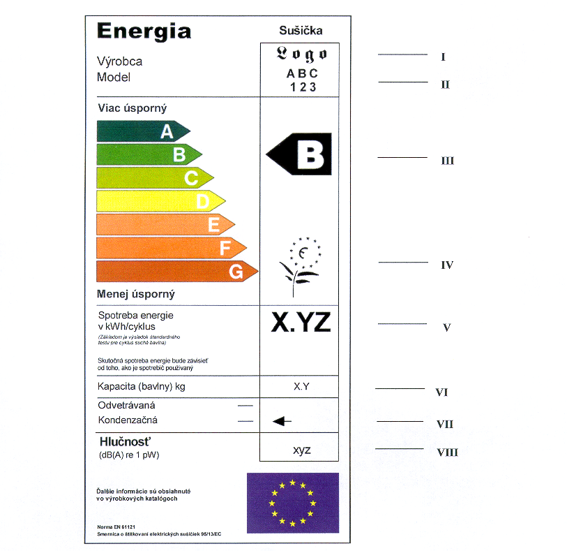
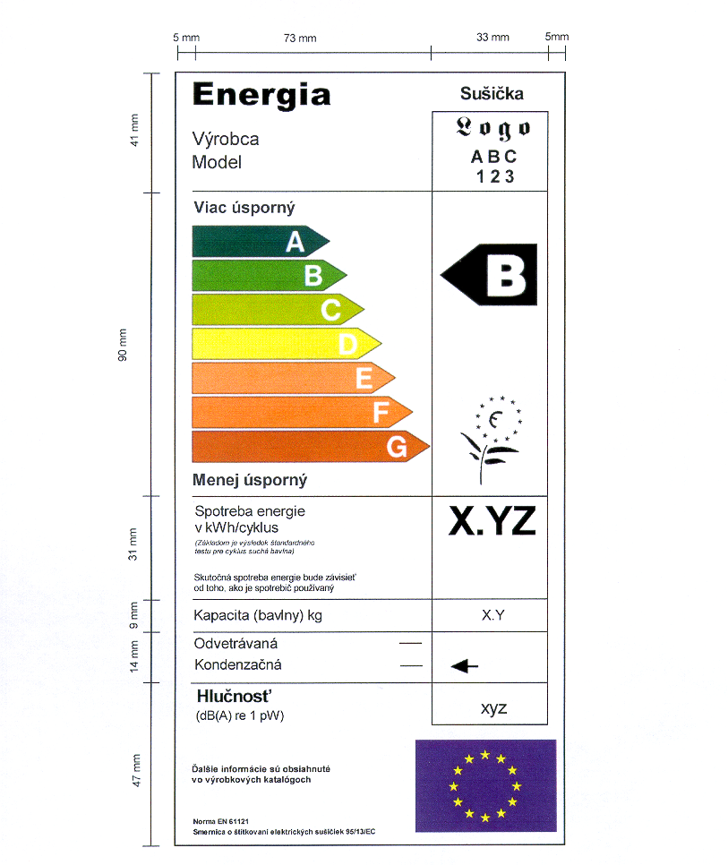

Príloha č. 1 k nariadeniu vlády č. 193/2002 Z. z.

- ENERGETICKÝ ŠTÍTOK

- Údaje na energetickom štítku

- I. Názov a obchodná značka výrobcu.

- II. Identifikačný kód elektrickej bubnovej sušičky.

- III. Trieda energetickej hospodárnosti podľa prílohy č. 4. Trieda je uvedená vo výške príslušnej šípky.

- IV. Ekologická značka EÚ (kvietok), ak bola elektrickej bubnovej sušičke udelená.

- V. Spotreba energie v kWh na jeden cyklus pre „cyklus suchej bavlny“ podľa skúšobného postupu určeného v harmonizovaných normách.

- VI. Menovité množstvo bavlny (kapacita) v kg podľa harmonizovaných noriem.

- VII. Typ elektrickej bubnovej sušičky, s odvetrávaním alebo s kondenzáciou, podľa skúšobného postupu určeného v harmonizovaných normách. Šípka sa umiestni v rovnakej rovine ako príslušný typ.

- VIII. Hlučnosť počas odstreďovacích cyklov sa meria pri štandardnom cykle pri teplote 60 oC podľa osobitného predpisu.2)

- Tlač

- Použité farby

- CMYB - tyrkysová, fialová, žltá, čierna.

- Príklad použitia farieb:

- 07X0: 0 % tyrkysová, 70 % fialová, 100 % žltá, 0 % čierna.

- Šípky:

- - A: X0X0,

- - B: 70X0,

- - C: 30X0,

- - D: 00X0,

- - E: 03X0,

- - F: 07X0,

- - G: 0XX0.

- Farba rámčeka X070.

- Celý text je čierny. Podklad je biely.
