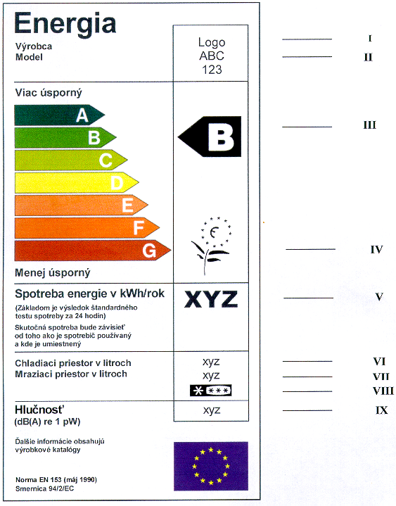
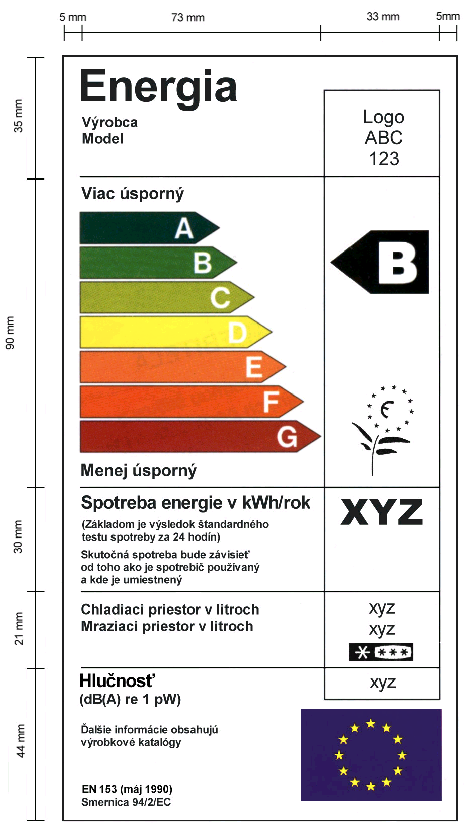

Príloha č. 1 k nariadeniu vlády č. 199/2002 Z. z.

- ENERGETICKÝ ŠTÍTOK 

- Údaje na energetickom štítku

- I. Názov a ochranná značka výrobcu.

- II. Identifikačný kód chladiaceho zariadenia.

- III. Trieda energetickej hospodárnosti podľa prílohy č. 5. Trieda je uvedená vo výške príslušnej šípky.

- IV. Ekologická značka EÚ (kvietok), ak bola chladiacemu zariadeniu udelená.

- V. Spotreba energie uvedená podľa metód merania uvedených v slovenskej technickej norme,3) ale vyjadrená v kWh za rok (t. j. 24 hodín x 365).

- VI. Súčet čistého skladovacieho objemu všetkých oddielov bez hviezdičky (t. j. ktoré fungujú pri teplote > -6 oC).

- VII. Súčet čistého skladovacieho objemu všetkých oddielov skladovania mrazených potravín klasifikovaných najmenej jednou hviezdičkou (t. j. ktoré fungujú pri teplote ≤ -6 oC).

- VIII. Počet hviezdičiek oddielu skladovania mrazených potravín. Ak je uvedený oddiel bez hviezdičky, táto rubrika zostane prázdna.

- IX. Hladina hluku sa meria podľa osobitného predpisu.2)

- Tlač

- 

- Použité farby

- CMYB - tyrkysová, fialová, žltá, čierna.

- Príklad použitia farieb:

- 07X0: 0 % tyrkysová, 70 % fialová, 100 % žltá, 0 % čierna.

- Šípky:

- - A: X0X0,

- - B: 70X0,

- - C: 30X0,

- - D: 00X0,

- - E: 03X0,

- - F: 07X0,

- - G: 0XX0.

- Farba rámčeka X070.

- Celý text je čierny. Podklad je biely.
