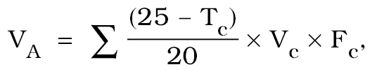

Príloha č. 5 k nariadeniu vlády č. 199/2002 Z. z.

- TRIEDY ENERGETICKEJ HOSPODÁRNOSTI ČASŤ 1: Definície tried energetickej hospodárnosti A+ a A++

- Trieda energetickej hospodárnosti chladiaceho zariadenia je klasifikovaná ako „A+“ alebo „A++“, ak index energetickej hospodárnosti alfa (ďalej len „Iα“) je v rozsahu vymedzenom tabuľkou č. 1.

- Tabuľka č. 1

- Index energetickej hospodárnosti Iα | Trieda energetickej hospodárnosti

- 30 > Iα | A++

- 42 > Iα ≥ 30 | A+

- Iα ≥ 42 | A až G (pozri nižšie)

- POZNÁMKA:

- Index energetickej hospodárnosti Iα vyjadrený v % sa vypočíta podľa vzorca:

- 

- kde

- AC je ročná spotreba energie chladiaceho zariadenia podľa prílohy č. 1 bodu V,

- SCα je štandardná ročná spotreba energie chladiaceho zariadenia α.

- Hodnota SCα sa vypočíta podľa vzorca:

- 

- kde

- Vc je úžitkový objem oddielu v litroch získaný meraním podľa osobitného predpisu,3)

- Tc je navrhovaná teplota oddielu v oC.

- 3) Nariadenie vlády Slovenskej republiky č. 453/2002 Z. z. o postupoch pri poskytovaní informácií v oblasti technických predpisov a technických noriem.

- Hodnoty Mα a Nα sú uvedené v tabuľke č. 2.

- Hodnoty FF, CC, BI a CH sú uvedené v tabuľke č. 3.

- Tabuľka č. 2

- Kategória chladiaceho zariadenia | Teplota najchladnej- šieho oddielu | Mα | Nα

- Chladnička bez oddielu s nízkou teplotou | >-6°C | 0,233 | 245

- Chladnička s oddielom na chladenie | >-6°C | 0,233 | 245

- Chladnička bez hviezdičky | >-6°C | 0,233 | 245

- Chladnička * | ≤ -6 °C * | 0,643 | 191

- Chladnička ** | ≤ -12 °C** | 0,450 | 245

- Chladnička *** | ≤ -18 °C ***/*(***) | 0,777 | 303

- Chladnička/mraznička *(***) | ≤ -18 °C ***/*(***) | 0,777 | 303

- Skriňová mraznička | ≤ -18 °C *(***) | 0,539 | 315

- Truhlicová mraznička | ≤ -18 °C *(***) | 0,472 | 286

- Viacdverové alebo iné | | 1) | 1)

- POZNÁMKA:

- 1) Pre tieto chladiace zariadenia sa určujú hodnoty Mαa Nαpodľa teploty a počtu hviezdičiek oddielov s najnižšou teplotou. Chladiace zariadenia s oddielmi –18oC *(***) sa posudzujú ako chladničky/mrazničky *(***).

- Tabuľka č. 3

- Korekčný súčiniteľ | Hodnota | Podmienka

- FF (bez námrazy) | 1,2 | pre oddiely mrazených potravín s núte- nou cirkuláciou bez námrazy

- | 1 | iné

- CC (klimatická trieda) | 1,2 | pre „tropické" chladiace zariadenia

- | 1,1 | pre „subtropické" chladiace zariadenia

- | 1 | iné

- BI (zabudovanie) | 1,2 | pre zabudované chladiace zariadenia1) s menšou šírkou ako 58 cm

- | 1 | iné

- CH (chladiaci oddiel) | 50 kWh/r | pre chladiace zariadenia s chladlaclm od- dielom s objemom najmenej 15 litrov

- | 0 | iné

- POZNÁMKA:

- 1) Chladiace zariadenie je definované ako zabudované iba vtedy, ak je určené výlučne na zabudovanie a bolo tak aj testované.

- Ak trieda energetickej hospodárnosti chladiaceho zariadenia nie je A+ alebo A++, musí byť určovaná podľa časti 2 tejto prílohy.

- ČASŤ 2: Definície tried energetickej hospodárnosti A až G

- Trieda energetickej hospodárnosti sa určí podľa tabuľky č. 1.

- Tabuľka č. 1

- Index energetickej hospodárnosti | Trieda energetickej hospodárnosti

- I < 55 | A

- 55 ≤ I < 75 | B

- 75 ≤ I < 90 | C

- 90 ≤ I < 100 | D

- 100 ≤ I < 110 | E

- 110 ≤ I < 125 | F

- 125 ≤ I | G

- Kde: - „index energetickej hospodárnosti“ vyjadrený v % = podiel ročnej spotreby energie podľa prílohy č. 1 bodu V a štandardnej ročnej spotreby energie,

- - „štandardná ročná spotreba energie“ = Mx upravený objem + N vyjadrené v kWh/rok,

- - „upravený objem“ = objem chladiaceho oddielu + Ωx objem mraziaceho oddielu, vyjadrený v litroch.

- Hodnoty M, N a Ω sú uvedené v tabuľke č. 2.

- Tabuľka č. 2

- Kategória chladiaceho zariadenia | Ω | M | N

- 1 . Chladnička bez oddielu s nízkou teplotou | - | 0,233 | 245

- 2. Chladnička s oddielom na chladenie | 0.751) | 0,233 | 245

- 3. Chladnička bez hviezdičky | 1,25 | 0,233 | 245

- 4. Chladnička* | 1,55 | 0,643 | 191

- 5. Chladnička** | 1,85 | 0,450 | 245

- 6. Chladnička*** | 2,15 | 0,657 | 235

- 7. Chladnička/mraznička * (***) | 3) | 0,777 | 303

- 8. Skriňová mraznička | 2.152) | 0,472 | 286

- 9. Truhlicová mraznička | 2.152) | 0,446 | 181

- 10. Viacdverové alebo iné | 3) | 4) | 4)

- POZNÁMKY:

- 1) Pre chladničky s oddielom na ochladenie „upravený objem“ = objem oddielu na čerstvé potraviny + Ωx objem oddielu na ochladenie (10 oC), vyjadrený v litroch.

- 2) Pre zariadenia s „ventilovaným chladom“; táto hodnota sa uvádza na 2,58 aplikovaním predbežného (dočasného) faktora 1,2. To dovoľuje uvažovať o prípadnej neprispôsobilosti metódy merania, ktorá naznačuje neprítomnosť tvorby ľadu v týchto zariadeniach. V praxi tvorba ľadu zvyšuje spotrebu „konvenčných“ zariadení.

- 3) Úžitkový upravený objem (VA) sa pre všetky oddiely vypočíta podľa vzorca:

- 

- kde Tc je menovitá teplota každého oddielu (oC),

- Vc je jeho úžitkový objem (l),

- Fc je faktor = 1,2 pre oddiely s „ventilovaným chladom“ a 1 pre iné oddiely.

- 4) Pre tieto zariadenia sú hodnoty M a N hodnoty stanovené teplotou a počtom hviezdičiek oddielu, ktorého teplota je najnižšia, ako to ukazuje tabuľka:

- Teplota najchladnejšieho oddielu | Príslušná kategória | M | A

- > -6 °C | 1/2/3 Chladnička bez oddielu s nízkou teplotou/chladnička bez hviezdičky/chladnička s oddielmi na ochladenie | 0,233 | 245

- ≤ -6 °C * | 4 Chladnička (*) | 0,643 | 191

- ≤ -12 °C ** | 5 Chladnička (**) | 0,450 | 245

- ≤ -18 °C *** | 6 Chladnička (***) | 0,657 | 235

- ≤ -18 °C *(***) s kapacitou mrazu | 7 Chladnička/mraznička *(***) | 0,777 | 303
