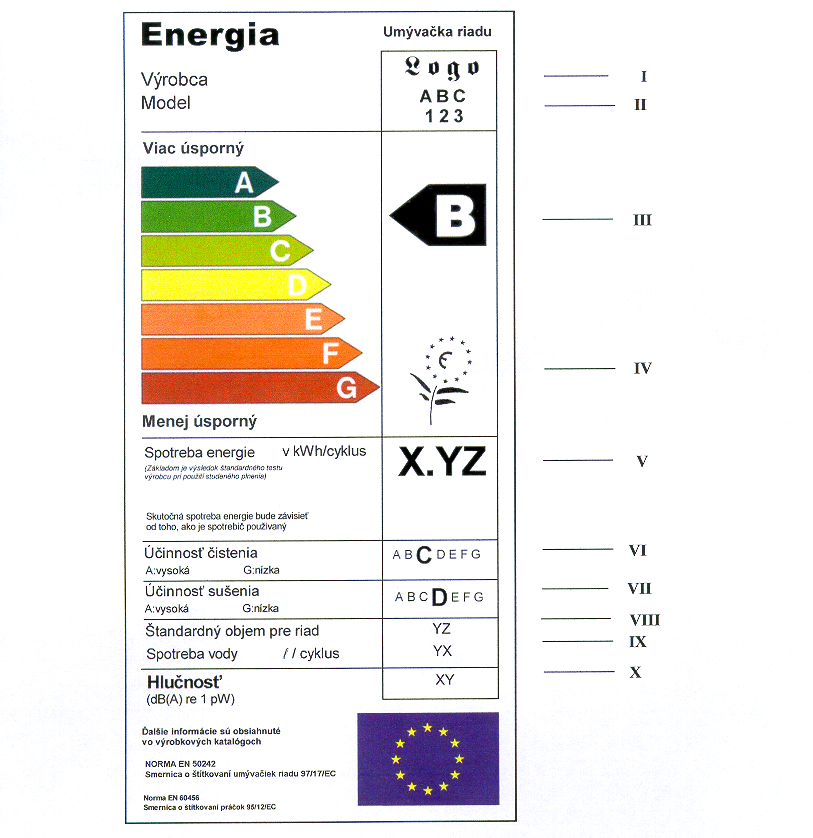
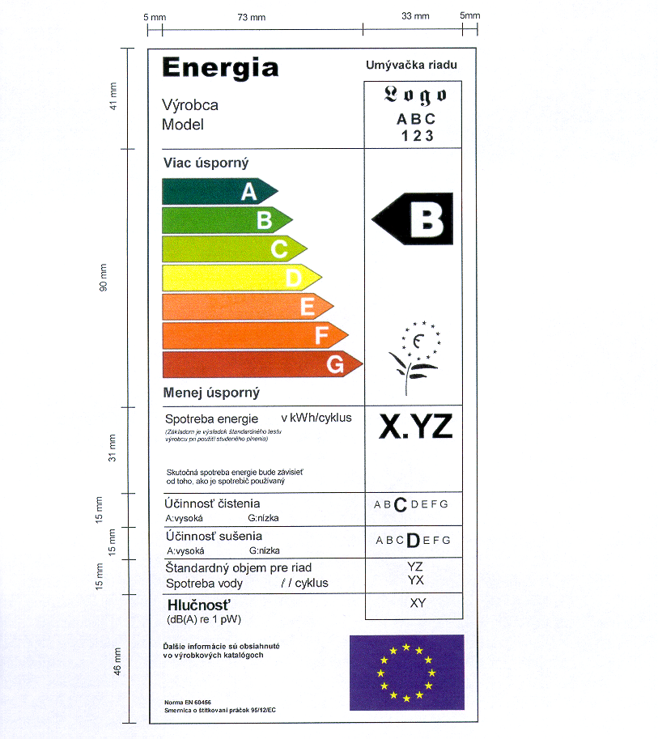

Príloha č. 1 k nariadeniu vlády č. 211/2002 Z. z.

- ENERGETICKÝ ŠTÍTOK

- Údaje na energetickom štítku

- I. Názov a ochranná značka výrobcu.

- II. Identifikačný kód umývačky riadu.

- III. Trieda energetickej hospodárnosti podľa prílohy č. 4; trieda je uvedená vo výške príslušnej šípky.

- IV. Ekologická značka EU (kvietok), ak bola umývačke riadu so sušičkou udelená.

- V. Spotreba energie v kWh na jeden cyklus pri použití štandardného cyklu určená podľa skúšobných postupov podľa harmonizovaných noriem.

- VI. Trieda účinnosti čistenia podľa prílohy č. 4.

- VII. Trieda účinnosti sušenia podľa prílohy č. 4.

- VIII. Kapacita zariadenia pri uložení na štandardných miestach určená podľa harmonizovaných noriem.

- IX. Spotreba vody v litroch na kompletný cyklus pri použití štandardného cyklu určená podľa skúšobných postupov podľa harmonizovaných noriem.

- X. Hlučnosť sa meria podľa osobitných predpisov.2)

- Tlač

- Použité farby

- CMYB - tyrkysová, fialová, žltá, čierna.

- Príklad použitia farieb:

- 07X0: 0 % tyrkysová, 70 % fialová, 100 % žltá, 0 % čierna.

- Šípky:

- - A: X0X0,

- - B: 70X0,

- - C: 30X0,

- - D: 00X0,

- - E: 03X0,

- - F: 07X0,

- - G: 0XX0.

- Farba rámčeka X070.

- Celý text je čierny. Podklad je biely.
