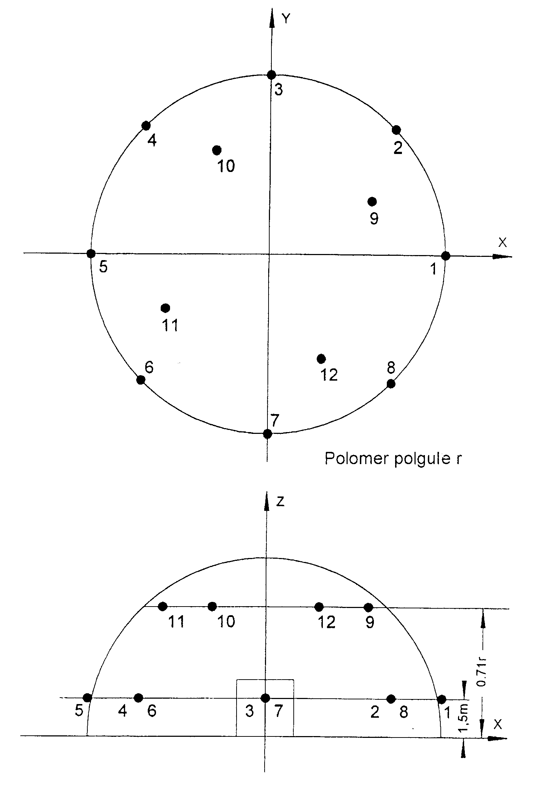
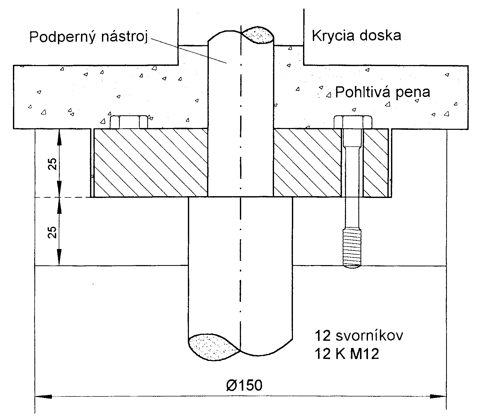
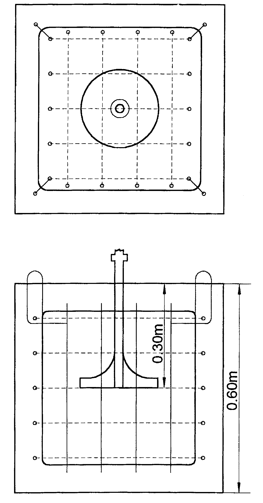
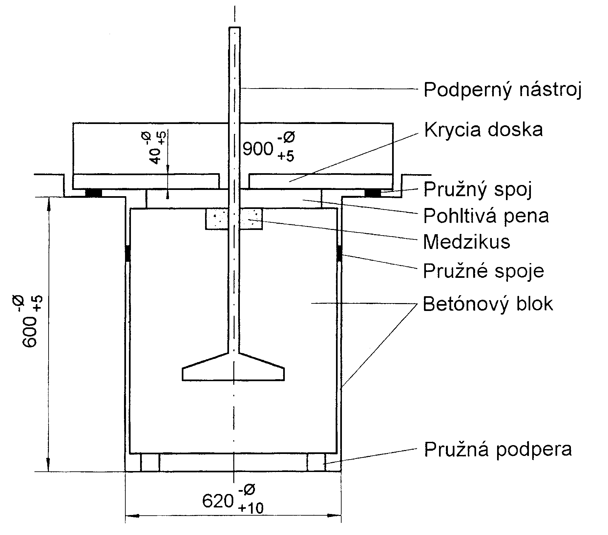
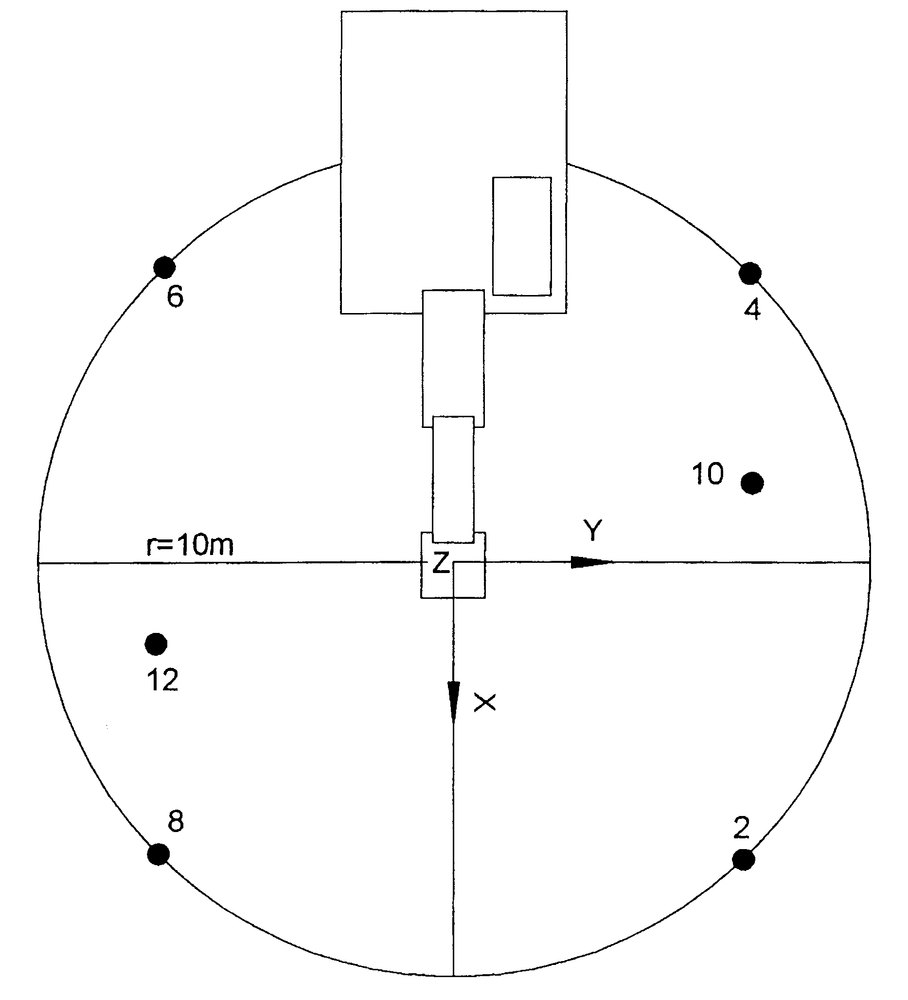
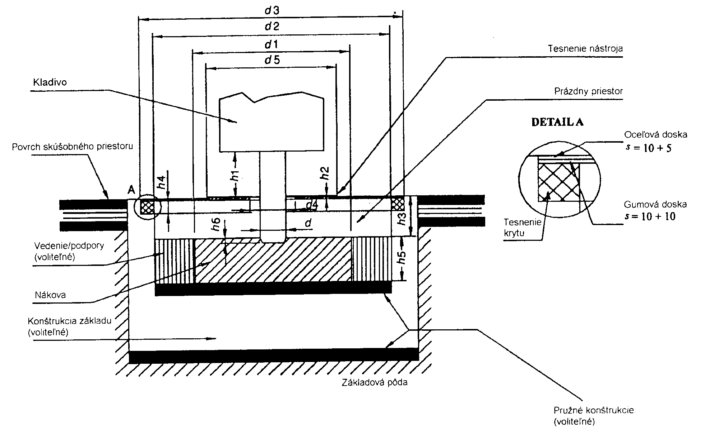
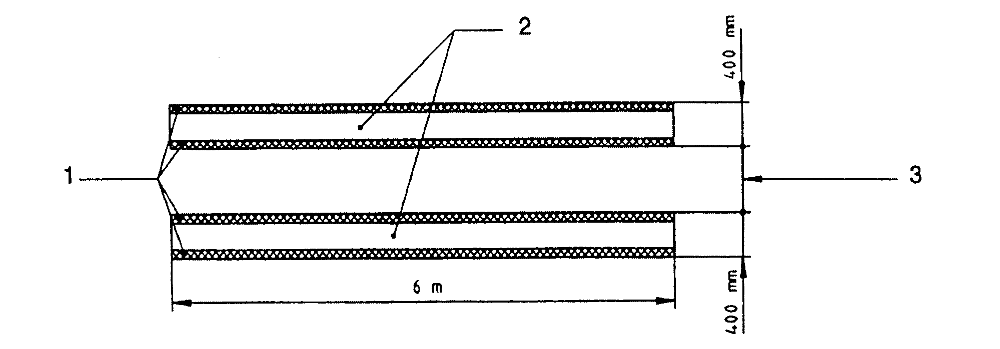
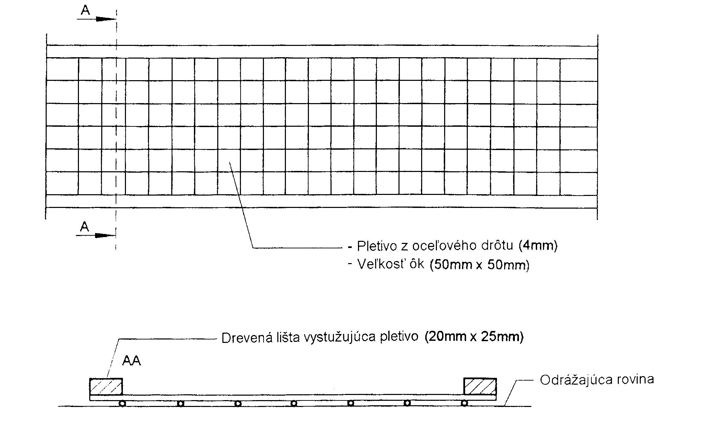
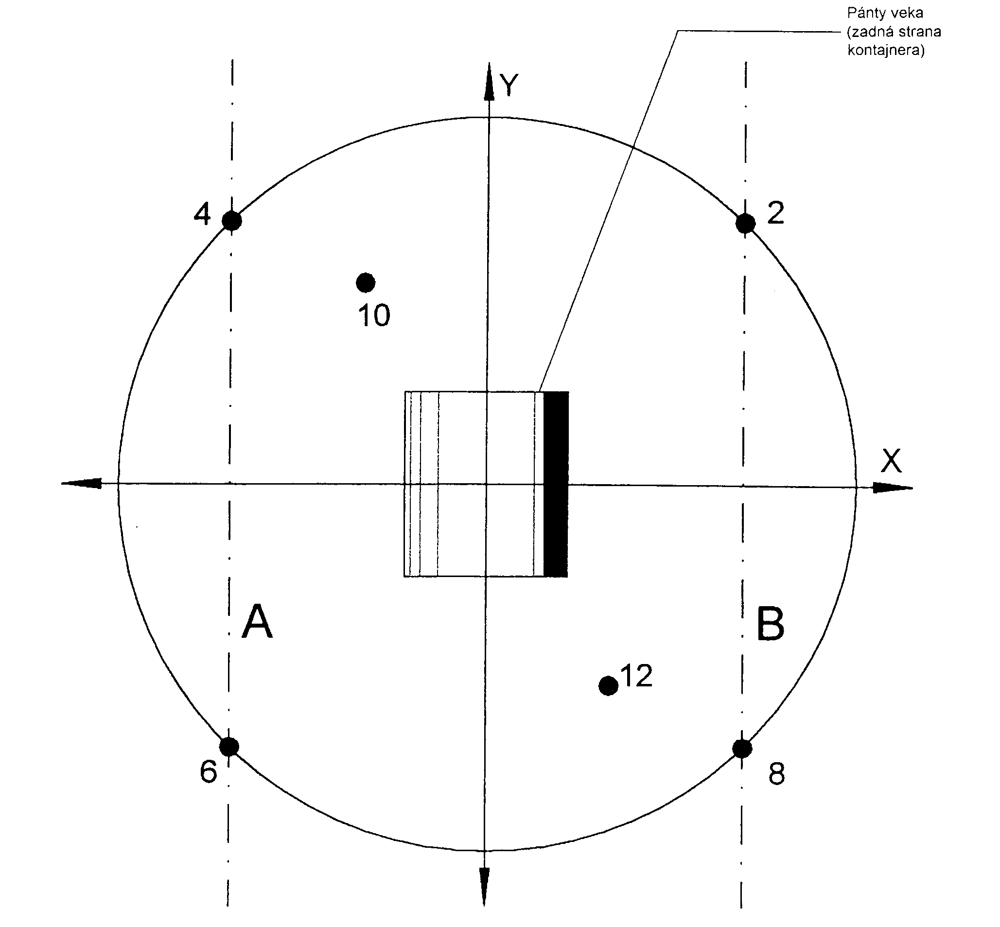
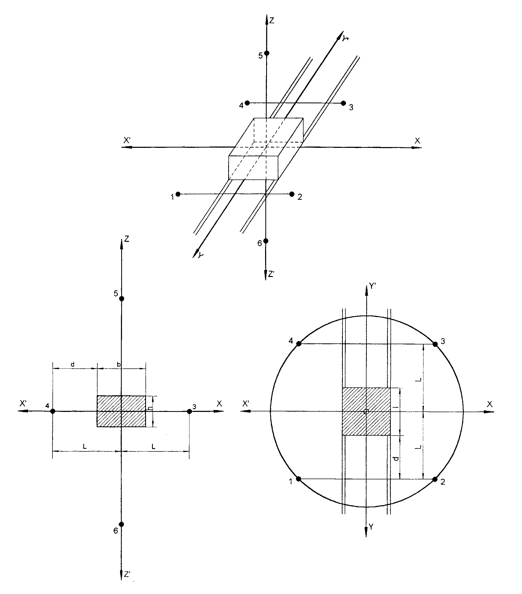

Príloha č. 3 k nariadeniu vlády č. 222/2002 Z. z.

- METÓDA MERANIA VZDUCHOM PRENÁŠANÉHO HLUKU EMITOVANÉHO ZARIADENIAMI POUŽÍVANÝMI VO VONKAJŠOM PRIESTORE

- Táto príloha uvádza metódy merania vzduchom prenášaného hluku, ktoré sa musia použiť na určenie hladín akustického výkonu zariadení, na ktoré sa vzťahuje toto nariadenie s ohľadom na postupy posudzovania zhody podľa tohto nariadenia.

- Časť A pre každý typ zariadenia podľa § 1 ods. 2 uvádza

  - a) základné normy o emisii hluku,

  - b) všeobecné dodatky k týmto základným normám o emisii hluku

    - na meranie hladiny akustického tlaku na meracej ploche obklopujúcej zdroj a na výpočet hladiny akustického výkonu vyžarovaného zdrojom.

    - Časť B pre každý typ zariadenia podľa § 1 ods. 2 uvádza

  - a) odporúčanú základnú normu o emisii hluku vrátane

- 1. odkazu na základnú normu o emisii hluku vybranú z časti A,

- 2. skúšobného priestoru,

- 3. hodnoty konštanty K2A,

- 4. tvaru meracej plochy,

- 5. počtu a polôh mikrofónov, ktoré sa majú použiť,

  - b) prevádzkové podmienky vrátane

- 1. odkazu na normu, ak existuje,

- 2. požiadaviek týkajúcich sa montáže zariadenia,

- 3. metódy na výpočet výsledných hladín akustického výkonu v prípade, že sa použijú viaceré skúšky s rôznymi prevádzkovými podmienkami,

  - c) ďalšie informácie.

    - Pri skúšaní špecifických typov zariadení si môže výrobca alebo jeho splnomocnenec všeobecne vybrať jednu zo základných noriem o emisii hluku z časti A a uplatniť prevádzkové podmienky z časti B na tento špecifický druh zariadenia. V prípade nejasnosti sa však odporúčaná základná norma o emisii hluku uvedená v časti B musí použiť spolu s prevádzkovými podmienkami časti B.

    - Časť A Základná norma o emisii hluku

      - Na určenie hladiny akustického výkonu zariadenia používaného vo vonkajšom priestore definovanej v § 1 ods. 3 písm. d) sa základné normy o emisii hluku STN EN ISO 3744 a STN EN ISO 3746 všeobecne môžu použiť vzhľadom na tieto všeobecné dodatky:

- 1. Neistota merania

  - Neistoty merania sa neberú do úvahy v rámci postupov posudzovania zhody vo fáze návrhu zariadenia.

- 2. Prevádzka zdroja počas skúšky

- 2.1. Otáčky ventilátora

  - Ak je motor zariadenia alebo jeho hydraulický systém vybavený ventilátorom, musí byť počas skúšky v chode. Otáčky ventilátora stanovené a určené výrobcom musia byť zvolené jedným z nasledujúcich postupov a musia byť uvedené v skúšobnom protokole; tieto otáčky sa potom používajú pri ďalších meraniach.

  - a) Ventilátor pripojený priamo k motoru

    - Ak je ventilátor poháňaný priamo motorom a/alebo hydraulickým zariadením (napríklad pomocou remeňového prevodu), musí byť počas skúšky v chode.

  - b) Ventilátor s viacerými rýchlostnými stupňami

    - Ak ventilátor môže pracovať pri rôznych otáčkach, skúška sa musí vykonať

- 1. pri jeho maximálnych otáčkach alebo

- 2. pri prvej skúške s ventilátorom v pokoji (pri nulových otáčkach) a pri druhej skúške s ventilátorom nastaveným na maximálne otáčky. Výsledná hladina akustického tlaku LpA potom musí byť vypočítaná z kombinácie výsledkov oboch skúšok použitím nasledujúceho vzťahu:

  - LpA = 10 lg {0,3 × 100,1 LpA. 0% + 0,7 × 100,1 LpA. 100 %},

  - kde

  - LpA.0 % je hladina akustického tlaku určená pri nulových otáčkach ventilátora,

  - LpA.100 % je hladina akustického tlaku určená pri maximálnych otáčkach ventilátora.

  - c) Ventilátor s plynulo premennými otáčkami

    - Ak ventilátor môže pracovať pri plynulo sa meniacich otáčkach, skúšky musia byť vykonané alebo podľa bodu 2.1 písm. b), alebo pri otáčkach nastavených výrobcom na najmenej 70 % hodnoty maximálnych otáčok.

- 2.2. Skúška zariadenia bez zaťaženia

  - Pri týchto meraniach sa musí motor a hydraulický systém zariadenia nahriať na prevádzkovú teplotu podľa prevádzkových pokynov a musia byť dodržané bezpečnostné požiadavky.

  - Skúška sa vykonáva so zariadením v stacionárnej polohe bez prevádzky pracovného zariadenia alebo pojazdného mechanizmu. Pri tejto skúške beží motor naprázdno pri menovitých alebo vyšších otáčkach, ktoré odpovedajú užitočnému výkonu.4)

  - Ak je stroj poháňaný generátorom alebo zo siete, musí byť frekvencia dodávaného prúdu špecifikovaná výrobcom pri stroji vybavenom indukčným motorom stabilná v rozmedzí ± 1 Hz a pri stroji vybavenom komutátorovým motorom musí byť dodávané napätie v rozmedzí ± 1 % menovitého napätia. Napájacie napätie sa meria na vidlici kábla alebo prívodu pevne spojeného so zariadením alebo na svorkovnici stroja, ak je kábel odpojiteľný. Tvar priebehu vlny prúdu dodávaného generátorom musí byť podobný tvaru vlny prúdu dodávaného zo siete.

  - Ak je stroj poháňaný batériou, musí byť batéria úplne nabitá.

  - Použité otáčky a príslušný užitočný výkon určuje výrobca zariadenia a musia byť uvedené v skúšobnej správe.

  - Ak je zariadenie vybavené viacerými motormi, musia byť počas skúšok v chode súčasne. Ak to nie je možné, musia sa preskúšať všetky možné kombinácie motorov.

- 2.3. Skúška zariadenia s vlastným pohonom pri zaťažení

  - Pre tieto merania motor (pohonný mechanizmus) a hydraulický systém zariadenia musia byť nahriate v súlade s prevádzkovými pokynmi a musia byť dodržané bezpečnostné požiadavky. Žiadne signálne zariadenia, ako napríklad výstražný klaksón alebo výstražný signál pri spätnom chode, nesmú byť počas skúšky v prevádzke.

  - Otáčky alebo rýchlosť zariadenia počas skúšky musia byť zaznamenané a uvedené v skúšobnom protokole.

  - Ak je zariadenie vybavené viacerými motormi a/alebo agregátmi, musia byť počas skúšok v chode súčasne. Ak to nie je možné, musia sa preskúšať všetky možné kombinácie motora a/alebo agregátov.

  - Pre každý typ zariadenia, ktoré sa má skúšať pri zaťažení, musia byť stanovené špecifické prevádzkové podmienky, ktoré majú čo najviac napodobňovať účinky a namáhanie vyskytujúce sa pri skutočných prevádzkových podmienkach.

- 2.4. Skúška ručného zariadenia

  - Pre každý typ ručného zariadenia musia byť stanovené typické prevádzkové podmienky, ktoré majú podobný účinok a spôsobujú podobné namáhanie, aké sa vyskytuje za skutočných prevádzkových podmienok.

- 3. Výpočet hladiny akustického tlaku na meracej ploche

  - Hladina akustického tlaku na meracej ploche musí byť stanovená najmenej trikrát. Ak sa najmenej dve z určených hodnôt nelíšia o viac ako 1 dB, ďalšie merania nebudú potrebné; v opačnom prípade treba v meraniach pokračovať, dokiaľ nebudú získané dve hodnoty, ktoré sa nelíšia o viac ako 1 dB. Hladina akustického tlaku A na meracej ploche, ktorá sa použije na výpočet hladiny akustického výkonu, je aritmetickým priemerom dvoch najvyšších hodnôt, ktoré sa navzájom nelíšia o viac ako 1 dB.

- 4. Informácie uvádzané v protokole o meraní

  - Hladina A akustického výkonu skúšaného zariadenia sa musí uvádzať ako údaj zaokrúhlený na najbližšie celé číslo (ak sa líši od najbližšieho menšieho čísla o menej ako 0,5 dB, uvedie sa toto najbližšie nižšie celé číslo; ak sa líši o 0,5 dB alebo viac, uvedie sa najbližšie vyššie celé číslo).

  - Protokol musí obsahovať technické údaje na identifikáciu skúšaného zariadenia, ako aj skúšobný predpis na meranie hluku a akustické údaje.

- 5. Polohy prídavných mikrofónov na polguľovej meracej ploche (STN EN ISO 3744)

  - Ako doplnok k STN EN ISO 3744 bodom 7.2.1 a 7.2.2 sa môže použiť sústava ďalších 12 mikrofónov na polguľovej meracej ploche. Umiestnenie 12 polôh mikrofónov rozmiestnených na povrchu polgule s polomerom r je uvedené vo forme kartézskych pravouhlých súradníc v nasledujúcej tabuľke. Polomer r polgule musí byť rovný alebo väčší ako dvojnásobok najväčšieho rozmeru referenčného kvádra. Referenčný kváder je definovaný ako najmenší možný obdĺžnikový kváder úplne obklopujúci zariadenie (bez príslušenstva) a končiaci na odrážajúcej ploche. Polomer polgule musí byť zaokrúhlený na najbližšiu vyššiu z týchto hodnôt: 4, 10, 16 m.

  - Počet mikrofónov (12) sa môže zmenšiť na 6, ale polohy mikrofónov 2, 4, 6, 8, 10 a 12 sa podľa požiadaviek STN EN ISO 3744 bodu 7.4.2 musia použiť v akomkoľvek prípade.

  - Všeobecne sa má použiť usporiadanie so 6 polohami mikrofónov na polguľovej meracej ploche. Ak sú v skúšobných postupoch na meranie hluku podľa tohto nariadenia pre špecifické zariadenia uvedené iné požiadavky, musia sa použiť.

  - Tabuľka - súradnice 12 polôh mikrofónov

- Poradové číslo mikrofónu | x/r | y/r | z

- 1 | 1 | 0 | 1,5 m

- 2 | 0,7 | 0,7 | 1,5 m

- 3 | 0 | 1 | 1,5 m

- 4 | -0,7 | 0,7 | 1,5 m

- 5 | -1 | 0 | 1,5 m

- 6 | -0,7 | -0,7 | 1,5 m

- 7 | 0 | -1 | 1,5 m

- 8 | 0,7 | -0,7 | 1,5 m

- 9 | 0,65 | 0,27 | 0,71 r

- 10 | -0,27 | 0,65 | 0,71 r

- 11 | -0,65 | -0,27 | 0,71 r

- 12 | 0,27 | -0,65 | 0,71 r

- 6. Korekcia na vplyv prostredia K2A

  - Zariadenie sa musí merať na odrážajúcej rovine z betónu alebo nepórovitého asfaltu, potom korekcia na vplyv prostredia K2A sa volí K2A = 0. Ak sú v skúšobnom postupe na meranie hluku podľa tohto nariadenia uvedené iné špecifikácie, musia sa použiť.

  - Obrázok

  - Usporiadanie prídavných mikrofónov na polguli (polohy 12 mikrofónov)

- 

  - Časť B

  - Skúšobné predpisy pre hluk pre jednotlivé zariadenia

- 0. ZARIADENIE, KTORÉ JE SKÚŠANÉ BEZ ZÁŤAŽE

  - Základná norma o emisii hluku

  - STN EN ISO 3744

  - Skúšobný priestor

  - Odrazový povrch z betónu alebo nepórovitého asfaltu

  - Korekcia na prostredie K2A

  - K2A = 0

  - Meracia plocha/počet polôh mikrofónov/meracia vzdialenosť

  - a) Ak najväčší rozmer referenčného kvádra neprevyšuje 8 m:

    - polguľa/šesť polôh mikrofónov podľa časti A bodu 5/časti A bodu 5

  - b) Ak najväčší rozmer referenčného kvádra prevyšuje 8 m:

    - kváder podľa STN ISO 3744 s meracou vzdialenosťou d = 1 m

    - Prevádzkové podmienky počas skúšky

    - Skúška bez zaťaženia

    - Skúšky hluku musia byť vykonané podľa časti A bodu 2.2.

    - Čas merania/určenie výslednej hladiny akustického výkonu, ak sa použije viac ako jeden prevádzkový režim

    - Čas merania musí byť aspoň 15 sekúnd.

- 1. ZDVIŽNÉ PRACOVNÉ PLOŠINY SO SPAĽOVACÍMI MOTORMI

  - Ako bod 0

- 2. KROVINOREZY

  - Základná norma o emisii hluku

  - STN EN ISO 3744

  - Skúšobný priestor

  - STN ISO 10884

  - Meracia plocha/počet polôh mikrofónov/meracia vzdialenosť

  - STN ISO 10884

  - Prevádzkové podmienky počas skúšky

  - Skúška pri zaťažení

  - STN ISO 10884 bod 5.3

  - Čas merania

  - STN ISO 10884

- 3. STAVEBNÉ VÝŤAHY NA PREPRAVU MATERIÁLU

  - Ako bod 0

  - Geometrický stred motora musí byť umiestnený nad stredom polgule; výťah sa musí pohybovať bez zaťaženia a opustiť polguľu - ak treba - v smere bodu 1.

- 4. PÁSOVÉ PÍLY PRE STAVENISKO

  - Základná norma o emisii hluku

  - STN EN ISO 3744

  - Meracia plocha/počet polôh mikrofónov/meracia vzdialenosť

  - STN ISO 7960, príloha J s d = 1 m

  - Prevádzkové podmienky počas skúšky

  - Skúška pri zaťažení

  - Podľa STN ISO 7960, príloha J [len bod J2 písm. b)]

  - Čas merania

  - Podľa STN ISO 7960, príloha J

- 5. KOTÚČOVÉ PÍLY PRE STAVENISKO

  - Základná norma o emisii hluku

  - STN EN ISO 3744

  - Meracia plocha/počet polôh mikrofónov/meracia vzdialenosť

  - STN ISO 7960, príloha A, meracia vzdialenosť d = 1 m

  - Prevádzkové podmienky počas skúšky

  - Skúška pri zaťažení

  - STN ISO 7960, príloha A [len bod A2 písm. b)]

  - Čas merania

  - STN ISO 7960, príloha A

- 6. REŤAZOVÉ PÍLY, PRENOSNÉ

  - Základná norma o emisii hluku

  - STN EN ISO 3744

  - Skúšobný priestor

  - STN ISO 9207

  - Meracia plocha/počet polôh mikrofónov/meracia vzdialenosť

  - STN ISO 9207

  - Prevádzkové podmienky počas skúšky

  - Skúška pri zaťažení/Skúška bez zaťaženia

  - Úplné zaťaženie pílením dreva/motor pri maximálnych otáčkach bez zaťaženia

  - a) Poháňané spaľovacím motorom: STN ISO 9207 body 6.3 a 6.4

  - b) Poháňané elektrickým motorom: skúška podľa STN ISO 9207 bodu 6.3 a skúška s motorom pri maximálnych otáčkach bez zaťaženia

    - Čas merania/určenie výslednej hladiny akustického výkonu, ak sa použije viac ako jeden prevádzkový režim

    - STN ISO 9207 body 6.3 a 6.4

    - Výsledná hladina akustického výkonu LWA sa vypočíta takto:

    - LWA = 10 lg 1/2 [100,1 LW1 + 100,1 LW2],

    - kde LW1 a LW2 sú priemerné hladiny akustického výkonu dvoch rozličných režimov prevádzky definovaných vyššie.

- 7. KOMBINOVANÉ VYSOKOTLAKOVÉ PREPLACHOVAČE A SACIE VOZIDLÁ

  - Ak je možné, aby boli obe časti zariadenia v chode súčasne, musí sa to urobiť podľa bodov 26 a 52. Ak nie, musia byť merané samostatne a uvádzajú sa vyššie z nameraných hodnôt.

- 8. ZHUTŇOVACIE STROJE

  - a) Valce bez vibrácií (statické)

    - Ako bod 0

  - b) Riadené vibračné valce s obsluhou

    - Základná norma o emisii hluku

    - STN EN ISO 3744

    - Prevádzkové podmienky počas skúšky

    - Montáž zariadenia

    - Vibračný valec musí byť umiestnený na jednom alebo viacerých vhodných elastických materiáloch, ako je vzduchový vankúš. Tieto vzduchové vankúše musia byť vyrobené z poddajného materiálu (elastoméru alebo podobného materiálu) a musia byť nahustené na tlak zabezpečujúci, že stroj je zdvihnutý aspoň o 5 cm; účinkom rezonancie sa musí zabrániť. Rozmer vankúša musí byť taký, aby sa zabezpečila stabilita stroja pri skúške.

    - Skúška pri zaťažení

    - Stroj sa musí skúšať v stacionárnej polohe s motorom pri menovitých otáčkach (stanovených výrobcom) a s odpojeným pojazdným mechanizmom. Ubíjací mechanizmus musí byť ovládaný použitím maximálnej ubíjacej sily zodpovedajúcej kombinácii najvyššej frekvencie a najvyššej možnej amplitúdy pre tú frekvenciu, ktorú deklaruje výrobca.

    - Čas merania

    - Čas merania musí byť aspoň 15 sekúnd.

  - c) Vibračné platne, vibračné ubíjačky, výbušné ubíjačky a vedené vibračné valce

    - Základná norma o emisii hluku

    - STN EN ISO 3744

    - Skúšobný priestor

    - STN EN 500-4 rev. 1, príloha C

    - Prevádzkové podmienky počas skúšky

    - Skúška pri zaťažení

    - STN EN 500-4 rev. 1, príloha C

    - Čas merania

    - STN EN 500-4 rev. 1, príloha C

- 9. KOMPRESORY

  - Základná norma o emisii hluku

  - STN EN ISO 3744

  - Meracia plocha/počet polôh mikrofónov/meracia vzdialenosť

  - Polguľa/šesť pozícií mikrofónov podľa časti A bodu 5/podľa časti A bodu 5

  - alebo

  - kváder podľa STN ISO 3744 s meracou vzdialenosťou d = 1 m

  - Prevádzkové podmienky počas skúšky

  - Montáž zariadenia

  - Kompresory musia byť inštalované na odrazovú plochu; kompresory namontované na lyžiny musia byť umiestnené na 0,40 m vysokej podstave, ak to výrobca v podmienkach inštalácie nevyžaduje inak.

  - Skúška pri zaťažení

  - Skúšaný kompresor sa musí temperovať a prevádzkovať za stabilných podmienok, ktoré zodpovedajú nepretržitej prevádzke. Musí sa riadne udržiavať a mazať, ako je špecifikované výrobcom.

  - Určenie hladiny akustického výkonu musí byť urobené pri úplnom zaťažení alebo pri prevádzkovom režime, ktorý je reprodukovateľný a charakterizuje najhlučnejšiu prevádzku typického použitia skúšaného stroja podľa toho, ktorý z dvoch uvedených stavov je hlučnejší.

  - Ak by mala byť zostava celého zariadenia taká, že určité zložky, napr. vnútorné chladiče, sú namontované mimo kompresora, treba sa snažiť oddeliť hluk tvorený takýmito časťami pri skúške hluku. Oddelenie rozličných zdrojov hluku môže vyžadovať špeciálne zariadenie na útlm hluku z týchto zdrojov počas merania. Hlukové vlastnosti a opis prevádzkových podmienok takýchto častí musia byť podané samostatne v protokole o skúške.

  - Počas skúšky sa musí plyn vypúšťaný z kompresora odvádzať potrubím zo skúšobného priestoru. Treba pritom zaistiť, aby hluk vytváraný vypúšťaným plynom bol aspoň o 10 dB nižší ako hluk nameraný vo všetkých meracích bodoch (napr. inštaláciou tlmiča).

  - Treba pritom venovať pozornosť tomu, aby vypúšťanie vzduchu nepredstavovalo nejaký mimoriadny hluk spôsobený vírením vo vypúšťacom ventile kompresora.

  - Čas merania

  - Čas merania musí byť aspoň 15 sekúnd.

- 10. RUČNÉ DRVIČE BETÓNU A RUČNÉ ZBÍJACIE KLADIVÁ

  - Základná norma o emisii hluku

  - STN EN ISO 3744

  - Meracia plocha/počet polôh mikrofónov/meracia vzdialenosť

  - Polguľa/šesť pozícií mikrofónov podľa časti A bodu 5 a nasledujúcej tabuľky/podľa hmotnosti zariadenia, ako je uvedené v nasledujúcej tabuľke:

- Hmotnosť zariadenia m v kg | Polomer polgule | „z“ pre pozície mikrofónov 2, 4, 6 a 8

- m < 10 | 2 m | 0,75 m

- m ≥ 10 | 4 m | 1,50 m

  - Prevádzkové podmienky počas skúšky

  - Montáž zariadenia

  - Všetky zariadenia sa musia skúšať vo vertikálnej polohe.

  - Ak skúšobné zariadenie má odvod vzduchu, jeho os musí mať rovnakú vzdialenosť od dvoch polôh mikrofónov. Hluk zdroja energie nesmie ovplyvňovať meranie emisie hluku zo skúšaného zariadenia.

  - Upevnenie zariadenia

  - Zariadenie musí byť počas priebehu skúšky pripojené k podpernému nástroju vloženému do betónového bloku v tvare kocky umiestneného do betónovej jamy, zapustenej do zeme. Medzi zariadenie a podperný nástroj môže byť počas skúšok vložený oceľový medzikus. Tento medzikus musí tvoriť stabilnú štruktúru medzi zariadením a podperným nástrojom. Uvedené usporiadanie je zobrazené na obrázku 10.1.

  - Vlastnosti betónového bloku

  - Blok musí byť v tvare kocky s dĺžkou hrán 0,60 m ± 2 mm a čo najpravidelnejší; musí byť vytvorený z vystuženého betónu a starostlivo zhutneného po vrstvách do 0,20 m, aby sa zabránilo prílišnej sedimentácii.

  - Kvalita betónu

  - Kvalita betónu musí zodpovedať C 50/60 ENV 206.

  - Kocka musí byť vystužená oceľovými tyčami o priemere 8 mm bez viazania, každá tyč bude nezávislá od ostatných; princíp konštrukcie je znázornený na obrázku 10.2.

  - Podperný nástroj

  - Nástroj musí byť ukotvený do bloku a musí pozostávať z ubíjačky s priemerom najmenej 178 mm alebo najviac 220 mm a zo stopky na upnutie nástroja zhodného s tým, ktorý sa bežne používa so skúšaným zariadením a ktorý je v zhode s STN ISO 1180, ale dostatočne dlhým na umožnenie praktickej skúšky, ktorá sa má vykonať.

  - Musí sa urobiť vhodná úprava na spojenie uvedených dvoch častí. Nástroj musí byť upevnený v bloku tak, aby spodná časť ubíjačky bola 0,30 m od vyššej strany bloku (obrázok 10.2).

  - Blok si musí zachovávať všetky mechanické vlastnosti, najmä v mieste, kde sa spája podperný nástroj a betón. Pred každou skúškou a po nej je potrebné sa presvedčiť, že nástroj ukotvený v betónovom bloku je s ním spojený.

  - Umiestnenie kocky

  - Kocka musí byť umiestnená do úplne vycementovanej jamy, prikrytá krycou doskou s plošnou hmotnosťou aspoň 100 kg/m2, ako je znázornené na obrázku 10.3 tak, aby horná plocha krycej dosky bola zahrnutá zemou. Aby sa zabránilo akémukoľvek parazitnému hluku, musí byť blok izolovaný na dne a po stranách jamy elastickými kusmi, ktorých medzný kmitočet nesmie byť vyšší ako polovica frekvencie úderov skúšaného zariadenia vyjadrenej počtom úderov za sekundu.

  - Otvor v krycej doske, cez ktorý prechádza stopka nástroja, musí byť čo najmenší a utesnený pružným zvukotesným spojom.

  - Skúška pri zaťažení

  - Skúšané zariadenie musí byť pripevnené na podperný nástroj.

  - Skúšané zariadenie musí byť v chode za stabilných podmienok, majúc rovnakú akustickú stabilitu ako pri bežnej funkcii.

  - Skúšané zariadenie musí byť v chode pri maximálnom výkone špecifikovanom v návode dodanom odberateľovi.

  - Čas merania

  - Čas merania musí byť aspoň 15 sekúnd.

  - Obrázok 10.1

  - Schematický nákres medzikusu

- 

  - Obrázok 10.2

  - Skúšobný blok

- 

  - Obrázok 10.3

  - Skúšobný prístroj

- 

  - Hodnota A by mala byť taká, aby krycia doska položená na pružnom spoji J bola zarovno zeme.

- 11. MIEŠAČE BETÓNOVEJ ZMESI ALEBO MALTY

  - Základná norma o emisii hluku

  - STN EN ISO 3744

  - Prevádzkové podmienky počas skúšky

  - Skúška pri zaťažení

  - Miešacie zariadenie (bubon) musí byť naplnené menovitým objemom piesku zrnitosti 0 až 3 mm, vlhkosť musí byť 4 % až 10 %.

  - Miešacie zariadenie musí byť v chode pri menovitých alebo väčších otáčkach.

  - Čas merania

  - Čas merania musí byť aspoň 15 sekúnd.

- 12. STAVEBNÉ VRÁTKY

  - Ako bod 0

  - Geometrický stred motora musí byť umiestnený nad stredom polgule; zdvihák musí byť zapnutý, ale nesmie sa aplikovať žiadne zaťaženie.

- 13. DOPRAVNÍKY A ČERPADLÁ BETÓNOVEJ ZMESI A MALTY

  - Základná norma o emisii hluku

  - STN EN ISO 3744

  - Prevádzkové podmienky počas skúšky

  - Ak je stroj vybavený výložníkom, je výložník umiestnený zvisle a potrubie musí viesť späť do plniaceho otvoru. V inom prípade musí byť stroj vybavený aspoň 30-metrovým vodorovným potrubím vedúcim späť k plniacemu otvoru.

  - Skúška pri zaťažení

  - a) Čo sa týka strojov prepravujúcich a čerpajúcich betónovú zmes:

    - Prepravný systém a potrubie musia byť naplnené materiálom podobným betónovej zmesi, cement sa nahradí prímesou, napr. najjemnejším popolom. Stroj musí pracovať pri maximálnom výkone, doba jedného pracovného cyklu nesmie byť viac ako 5 sekúnd (ak sa táto doba prekročí, musí sa do „betónu" pridať voda, aby sa dosiahla táto hodnota).

  - b) Čo sa týka strojov prepravujúcich a nahadzujúcich maltu:

    - Prepravný systém a potrubie musia byť naplnené materiálom podobným konečnej malte, cement sa nahradí prímesou, napr. metylcelulózou. Stroj musí pracovať pri maximálnom výkone, doba jedného pracovného cyklu nesmie byť viac ako 5 sekúnd (ak sa táto doba prekročí, musí sa do „malty" pridať voda, aby sa dosiahla táto hodnota).

    - Čas merania

    - Čas merania musí byť aspoň 15 sekúnd.

- 14. PÁSOVÝ DOPRAVNÍK

  - Ako bod 0

  - Geometrický stred motora musí byť umiestnený nad stredom polgule; pás sa musí pohybovať bez zaťaženia, a ak treba opustiť stred, tak potom v smere bodu 1.

- 15. CHLADIACE ZARIADENIA NA VOZIDLÁCH

  - Základná norma o emisii hluku

  - STN EN ISO 3744

  - Prevádzkové podmienky počas skúšky

  - Skúška pri zaťažení

  - Chladiace zariadenia musia byť inštalované v reálnom alebo simulovanom nákladnom priestore a musia sa skúšať v stacionárnej pozícii, kde výška umiestnenia chladiaceho zariadenia musí zodpovedať stanoveným podmienkam na montáž podľa návodu dodaného odberateľovi. Zdroj energie chladiaceho zariadenia musí pracovať v režime, pri ktorom majú chladiaci kompresor a ventilátor maximálne otáčky stanovené v návode. Ak je chladiace zariadenie konštruované na pohon motorom dopravného prostriedku, motor sa nesmie použiť počas skúšky a chladiace zariadenie musí byť pripojené na vhodný zdroj elektrickej energie. Odpojiteľné vlečné jednotky musia byť počas skúšky odpojené.

  - Chladiace zariadenia inštalované v chladiacich jednotkách nákladného priestoru, ktoré môžu byť poháňané rôznymi zdrojmi energie, musia sa skúšať samostatne pre každý zdroj energie. Výsledok skúšky uvedený v protokole musí zahŕňať režim prevádzky, pri ktorom dochádza k maximálnemu hluku.

  - Čas merania

  - Čas merania musí byť aspoň 15 sekúnd.

- 16. DOZÉRY (ZHŔŇAČE)

  - Základná norma o emisii hluku

  - STN EN ISO 3744

  - Skúšobný priestor

  - STN ISO 6395

  - Meracia plocha/počet polôh mikrofónov/meracia vzdialenosť

  - STN ISO 6395

  - Prevádzkové podmienky počas skúšky

  - Montáž zariadenia

  - Dozéry na pásovom podvozku sa musia skúšať na skúšobnom stanovišti zodpovedajúcom STN ISO 6395 bodu 6.3.3.

  - Skúška pri zaťažení

  - STN ISO 6395

  - Čas merania a uplatnenie rozličných prevádzkových podmienok, ak existujú

  - STN ISO 6395, príloha B

- 17. VRTNÉ SÚPRAVY

  - Základná norma o emisii hluku

  - STN EN ISO 3744

  - Prevádzkové podmienky počas skúšky

  - Skúška pri zaťažení

  - STN EN 791, príloha A

  - Čas merania

  - Čas merania musí byť aspoň 15 sekúnd.

- 18. DAMPERY (VYKLÁPAČE)

  - Základná norma o emisii hluku

  - STN EN ISO 3744

  - Skúšobný priestor

  - STN ISO 6395

  - Meracia plocha/počet polôh mikrofónov/meracia vzdialenosť

  - STN ISO 6395

  - Prevádzkové podmienky počas skúšky

  - Skúška pri zaťažení

  - Ekvivalentná STN ISO 6395, príloha C, s nasledujúcou zmenou:

  - V prílohe C bode 4.3 druhý odsek znie:

- „Motor musí byť v chode pri maximálnych riadených otáčkach (vysoký voľnobeh). Radenie prevodov musí byť nastavené na neutrál. Naberač sa uvedie 3-krát za sebou do prevrátenej polohy (vyklápanie) približne až na 75 % jeho maximálneho vyklopenia a vráti sa do pojazdnej polohy. Tento postup operácií sa považuje za jednoduchý cyklus pre stacionárny hydraulický režim.

- Ak sa na prevrátenie naberača nepoužíva žiaden pohon motora, motor musí byť v chode pri voľnobežných otáčkach s prevodom v neutrále. Meranie sa musí vykonať bez prevrátenia naberača, doba merania musí byť 15 sekúnd.“.

- Čas merania/určenie výslednej hladiny akustického výkonu, ak sa použije viac ako jeden prevádzkový režim

- STN ISO 6395, príloha C“.

- 19. ZARIADENIE NA PLNENIE ALEBO VYPRÁZDŇOVANIE VOZIDIEL SO ZÁSOBNÍKMI ALEBO S CISTERNAMI

  - Základná norma o emisii hluku

  - STN EN ISO 3744

  - Prevádzkové podmienky počas skúšky

  - Skúška pri zaťažení

  - Zariadenie sa musí skúšať s nákladným autom v stacionárnej polohe. Motor poháňajúci zariadenie musí byť v chode pri otáčkach, ktoré zodpovedajú maximálnemu výkonu zariadenia špecifikovanému v návode dodanom odberateľovi.

  - Čas merania

  - Čas merania musí byť aspoň 15 sekúnd.

- 20. RÝPADLÁ

  - Základná norma o emisii hluku

  - STN EN ISO 3744

  - Skúšobný priestor

  - STN ISO 6395

  - Meracia plocha/počet polôh mikrofónov/meracia vzdialenosť

  - STN ISO 6395

  - Prevádzkové podmienky počas skúšky

  - Skúška pri zaťažení

  - STN ISO 6395, príloha A

  - Čas merania/určenie výslednej hladiny akustického výkonu, ak sa použije viac ako jeden prevádzkový režim

  - STN ISO 6395, príloha A

- 21. RÝPADLÁ-NAKLADAČE

  - Základná norma o emisii hluku

  - STN EN ISO 3744

  - Skúšobný priestor

  - STN ISO 6395

  - Meracia plocha/počet polôh mikrofónov/meracia vzdialenosť

  - STN ISO 6395

  - Prevádzkové podmienky počas skúšky

  - Skúška pri zaťažení

  - STN ISO 6395, príloha D

  - Čas merania/určenie výslednej hladiny akustického výkonu, ak sa použije viac ako jeden prevádzkový režim

  - STN ISO 6395, príloha D

- 22. KONTAJNERY NA RECYKLÁCIU SKLA

  - Základná norma o emisii hluku

  - STN EN ISO 3744

  - Pri meraní hladiny akustického tlaku v polohách mikrofónov sa používa hladina akustického tlaku jednotlivej zvukovej udalosti LP,1s, ako je definovaná v STN EN ISO 3744 bode 3.2.2.

  - Korekcia na prostredie K2A

  - Meranie vo vonkajšom priestore

  - K2A = 0

  - Meranie vo vnútornom priestore

  - Hodnota konštanty K2A určená v zhode s STN EN ISO 3744 prílohou A musí byť ≤ 2,0 dB, v takom prípade sa K2A neberie do úvahy.

  - Prevádzkové podmienky počas skúšky

  - Meranie hluku sa musí vykonať počas celého cyklu začínajúceho sa vyprázdnením kontajnera a končiaceho sa, keď bude do kontajnera nahádzaných 120 fliaš.

  - Sklené fľaše sú definované takto:

  - a) objem: 75 cl,

  - b) hmotnosť: 370 g ± 30 g.

    - Skúšobný technik drží každú fľašu za jej hrdlo a dnom oproti plniacemu otvoru a potom ju opatrne vhodí dovnútra cez plniaci otvor v smere do stredu kontajnera tak, aby sa, pokiaľ možno, vylúčil náraz fľaše na stenu. Na vhadzovanie fliaš sa používa iba jeden otvor, a to ten, ktorý je najbližšie k pozícii mikrofónu 12.

    - Čas merania/určenie výslednej hladiny akustického výkonu, ak sa použije viac ako jeden prevádzkový režim

    - Hladina A akustického tlaku jednotlivej zvukovej udalosti sa, pokiaľ možno, súčasne meria v šiestich polohách mikrofónov pre každú fľašu vhodenú do kontajnera.

    - Vypočíta sa priemerná hladina A akustického tlaku jednotlivej zvukovej udalosti pre celú meraciu plochu podľa STN EN ISO 3744 bodu 8.1.

    - Priemerná hladina A akustického tlaku jednotlivých zvukových udalostí pre všetkých 120 vhodení fliaš sa vypočíta ako logaritmický priemer priemerných hladín A akustického tlaku jednotlivých zvukových udalostí na meracej ploche.

- 23. GRADERY (ZROVNÁVAČE)

  - Základná norma o emisii hluku

  - STN EN ISO 3744

  - Skúšobný priestor

  - STN ISO 6395

  - Meracia plocha/počet polôh mikrofónov/meracia vzdialenosť

  - STN ISO 6395

  - Prevádzkové podmienky počas skúšky

  - Skúška pri zaťažení

  - Podľa STN ISO 6395, príloha B

  - Čas merania/určenie výslednej hladiny akustického výkonu, ak sa použije viac ako jeden prevádzkový režim

  - STN ISO 6395, príloha B

- 24. VYŽÍŇAČE TRÁVNIKA/ZAČISŤOVAČE OKRAJOV TRÁVNIKA

  - Ako bod 2

  - Vyžíňač musí byť ustavený vhodným prípravkom tak, že jeho rezný nástroj je nad stredom polgule. Čo sa týka vyžíňačov trávnika, stred rezného nástroja musí byť ustavený vo vzdialenosti približne 50 mm nad povrchom. Aby sa dosiahol záber rezacích nožov, začisťovače okrajov trávnika by mali byť umiestnené čo najbližšie k skúšobnému povrchu.

- 25. NOŽNICE NA ŽIVÉ PLOTY

  - Základná norma o emisii hluku

  - STN EN ISO 3744

  - Skúšobný priestor

  - STN ISO 11094

  - V prípade rozporu sa musia merania vykonať vo vonkajšom priestore na umelom povrchu (STN ISO 11094 bod 4.1.2)

  - Korekcia na prostredie K2A

  - Meranie vo vonkajšom priestore

  - K2A = 0

  - Meranie vo vnútornom priestore

  - Hodnota konštanty K2A určená bez umelého povrchu a v zhode s STN EN ISO 3744 prílohou A musí byť ≤ 2,0 dB, v takom prípade sa K2A neberie do úvahy.

  - Meracia plocha/počet polôh mikrofónov/meracia vzdialenosť

  - STN ISO 11094

  - Prevádzkové podmienky počas skúšky

  - Montáž zariadenia

  - Nožnice na živé ploty musia byť pridržiavané obvyklým spôsobom na bežné použitie osobou alebo vhodným prípravkom takým spôsobom, že rezný nástroj je nad stredom polgule.

  - Skúška pri zaťažení

  - Nožnice na živé ploty sa musia prevádzkovať pri menovitých otáčkach s pracujúcim rezným nástrojom.

  - Čas merania

  - Čas merania musí byť aspoň 15 sekúnd.

- 26. VYSOKOTLAKOVÉ PREPLACHOVAČE

  - Základná norma o emisii hluku

  - STN EN ISO 3744

  - Prevádzkové podmienky počas skúšky

  - Skúška pri zaťažení

  - Vysokotlakový preplachovač sa musí skúšať v stacionárnej polohe. Motor a pomocné jednotky pracujú pri otáčkach udávaných výrobcom pre prevádzku pracovného zariadenia; vysokotlakové čerpadlo je prevádzkované pri maximálnych otáčkach a prevádzkovom tlaku podľa údajov výrobcu. Použitím upravenej dýzy musí byť redukčný tlakový ventil tesne pod prahom spustenia. Hluk prúdenia v dýze nesmie mať akýkoľvek vplyv na výsledky meraní.

  - Čas merania

  - Čas merania musí byť aspoň 30 sekúnd.

- 27. VYSOKOTLAKOVÉ VODNÉ ČISTIACE STROJE

  - Základná norma o emisii hluku

  - STN EN ISO 3744

  - Meracia plocha/počet polôh mikrofónov/meracia vzdialenosť

  - Kváder/podľa STN EN ISO 3744 s meracou vzdialenosťou d = 1 m

  - Prevádzkové podmienky počas skúšky

  - Montáž zariadenia

  - Vysokotlakový vodný čistiaci stroj na striekanie vody musí byť inštalovaný na odrážajúcej ploche; stroje namontované na lyžinách musia byť umiestnené na podstave 0,40 m vysokej, ak to inak výrobca nevyžaduje v návode na montáž.

  - Skúška pri zaťažení

  - Vysokotlakový vodný čistiaci stroj musí pracovať v ustálenom stave v rozsahu špecifikovanom výrobcom. Počas skúšania musí byť dýza pripojená na vysokotlakový vodný čistiaci stroj, ktorý pracuje pri najvyššom tlaku, ak sa používa podľa návodu výrobcu.

  - Čas merania

  - Čas merania musí byť aspoň 15 sekúnd.

- 28. HYDRAULICKÉ KLADIVÁ

  - Základná norma o emisii hluku

  - STN EN ISO 3744

  - Meracia plocha/počet polôh mikrofónov/meracia vzdialenosť

  - Polguľa/šesť pozícií mikrofónov podľa časti A bodu 5/r = 10 m

  - Prevádzkové podmienky počas skúšky

  - Montáž zariadenia

  - Čo sa týka skúšky, kladivo je pripevnené k nosiču a musí sa použiť špeciálna konštrukcia skúšobného bloku. Obrázok 28.1 udáva požiadavky na túto konštrukciu a obrázok 28.2 ukazuje polohu nosiča.

  - Nosič

  - Nosič pre skúšobné kladivo musí spĺňať požiadavky technických špecifikácií pre skúšobné kladivá, najmä v rozsahu hmotnosti, hydraulického výstupného výkonu, prívodu oleja a protitlaku v spätnom vedení.

  - Montáž

  - Mechanická montáž, ako aj pripojenia (hadice, potrubia atď.) musia zodpovedať špecifikáciám uvedeným v technických údajoch kladiva. Všetky významné hluky spôsobené potrubiami a rozličnými mechanickými dielcami potrebnými na inštaláciu sa musia eliminovať. Všetky pripojenia dielcov musia byť dobre utiahnuté.

  - Stabilita kladiva a statická prídržná sila

  - Kladivo musí byť pevne tlačené nosičom smerom nadol, aby sa dosiahla rovnaká stabilita, ako je tá, ktorá existuje za bežných prevádzkových podmienok. Kladivo musí byť prevádzkované vo zvislej polohe.

  - Nástroj

  - Pri meraní sa musí použiť tupý nástroj. Dĺžka nástroja musí spĺňať požiadavky uvedené na obrázku 28.1 (skúšobný blok).

  - Skúška pri zaťažení

  - Hydraulický príkon a prietok oleja

  - Prevádzkové podmienky hydraulického kladiva musia byť vhodne nastavené, merané a zaznamenané v protokole spolu so zodpovedajúcimi údajmi technickej špecifikácie. Skúšané kladivo sa musí použiť takým spôsobom, aby sa mohlo dosiahnuť 90 % alebo viac hydraulického príkonu a prietoku oleja.

  - Pozornosť treba venovať tomu, aby sa celková neistota reťazca meraní ps a Q zachovala v rámci ± 5 %. To je zabezpečené určením hydraulického príkonu s ± 10 % presnosťou. Predpokladajúc lineárnu závislosť medzi hydraulickým príkonom a emitovaným akustickým výkonom, by to mohlo znamenať odchýlku o menej ako ± 0,4 dB pri určení hladiny akustického výkonu.

  - Nastaviteľné dielce majúce účinok na výkon kladiva

  - Nastavenie všetkých akumulátorov, centrálnych tlakových ventilov a iných nastaviteľných dielcov musí byť uvedené v súlade s technickými údajmi. Ak je voliteľné viac ako jedno nastavenie, merania sa musia uskutočniť pri všetkých nastaveniach. Potom sú uvádzané minimálne a maximálne hodnoty.

  - Veličiny, ktoré sa majú merať:

  - ps je priemerná hodnota tlaku v hydraulickom obvode počas prevádzky kladiva zahŕňajúca aspoň 10 úderov,

  - Q je priemerná hodnota vstupného prietoku oleja kladiva meraná súčasne s ps,

  - T je teplota oleja, počas meraní musí byť medzi +40/+60 oC. Teplota telesa hydraulického kladiva musí byť stabilizovaná na bežnú prevádzkovú teplotu pred začatím meraní,

  - Pa sú tlaky plynu vo všetkých akumulátoroch, musia byť merané v statickej situácii (kladivo mimo prevádzky) pri stabilnej teplote okolia +15/+25 oC. Nameraná teplota prostredia sa musí zaznamenať spolu s nameraným tlakom plynu akumulátora.

  - Parametre, ktoré sa majú vyhodnotiť z nameraných prevádzkových údajov:

  - PIN je hydraulický príkon kladiva PIN = ps. Q.

  - Meranie tlaku v prívodnom potrubí, ps musí byť meraná

  - a) čo najbližšie na vstupe kladiva,

  - b) tlakomerom (minimálny priemer: 100 mm; trieda presnosti ± 1,0 %).

    - Prietok oleja privádzaného do kladiva, Q musí byť meraná

  - a) v prívodnom potrubí čo najbližšie na vstupe kladiva,

  - b) s elektrickým prietokomerom (trieda presnosti ± 2,5 % odčítania prietoku).

    - Meranie teploty oleja, T

  - a) T musí byť meraná v akumulátore oleja nosiča alebo v prívode oleja do kladiva; miesto merania musí byť uvedené v protokole,

  - b) presnosť odčítania T musí byť v rozpätí ± 2 oC aktuálnej hodnoty.

    - Čas merania/určenie výslednej hladiny akustického výkonu

    - Čas merania musí byť aspoň 30 sekúnd.

    - Merania sa opakujú trikrát alebo viackrát, ak treba. Konečný výsledok sa vypočíta ako aritmetický priemer dvoch najvyšších hodnôt, ktoré sa nelíšia viac ako o 1 dB.

    - Obrázok 28.1

  - 

    - Obrázok 28.2

  - 

    - Definície

    - d je priemer nástroja (mm),

    - d1 je priemer nákovy, 1 200 mm ± 100 mm,

    - d2 je vnútorný priemer podpornej konštrukcie nákovy, ≤ 1 800 mm,

    - d3 je priemer dosky skúšobného bloku, ≤ 2 200 mm,

    - d4 je priemer otvoru pre nástroj v krycej doske, ≤ 350 mm,

    - d5 je priemer tesnenia nástroja, ≤ 1 000 mm,

    - h1 je viditeľná dĺžka nástroja medzi najnižším bodom upínacieho puzdra a horným povrchom tesnenia nástroja (mm), h1 = d ± d/2,

    - h2 je hrúbka tesnenia nástroja nad krycou doskou, ≤ 20 mm (ak je tesnenie nástroja umiestnené pod krycou doskou, jeho hrúbka nie je obmedzená; môže byť vyrobené z penovej gumy),

    - h3 je vzdialenosť medzi horným povrchom dosky a horným povrchom nákovy, 250 mm ± 50 mm,

    - h4 je hrúbka izolačnej penovej gumy dosky nákovy,

    - h5 je hrúbka nákovy, 350 mm ± 50 mm,

    - h6 je preniknutie nástroja, ≤ 50 mm.

    - Ak sa použije štvorcový tvar konštrukcie skúšobného bloku, maximálny dĺžkový rozmer sa rovná 0,89 × príslušný priemer.

    - Prázdny priestor medzi krycou doskou a nákovou sa môže vyplniť pružnou penovou gumou alebo iným absorpčným materiálom s hustotou < 220 kg/m3.

- 29. HYDRAULICKÉ TLAKOVÉ ZDROJE

  - Základná norma o emisii hluku

  - STN EN ISO 3744

  - Prevádzkové podmienky počas skúšky

  - Montáž zariadenia

  - Hydraulický tlakový zdroj musí byť inštalovaný na odrážajúcu rovinu; hydraulické tlakové zdroje namontované na lyžinách musia byť umiestnené na podstave vysokej 0,40 m, ak to inak výrobca nevyžaduje v návode na inštaláciu.

  - Skúška pri zaťažení

  - Počas skúšania nesmú byť pripojené na hydraulický tlakový zdroj žiadne nástroje.

  - Hydraulický tlakový zdroj sa musí uviesť do jeho ustáleného stavu v rámci rozsahu špecifikovaného výrobcom. Musí pracovať pri jeho menovitých otáčkach a menovitom tlaku. Menovité otáčky a tlak sú tie hodnoty, ktoré sa nachádzajú v návode dodanom odberateľovi.

  - Čas merania

  - Čas merania musí byť aspoň 15 sekúnd.

- 30. FRÉZY NA ŠPÁRY

  - Základná norma o emisii hluku

  - STN EN ISO 3744

  - Prevádzkové podmienky počas skúšky

  - Skúška pri zaťažení

  - Fréza na špáry musí byť vybavená najväčším možným rezným nástrojom podľa údajov výrobcu v návode dodanom odberateľovi. Motor musí pracovať pri jeho maximálnych otáčkach s nezaťaženým rezným nástrojom.

  - Čas merania

  - Čas merania musí byť aspoň 15 sekúnd.

- 31. ZHUTŇOVAČE ODPADU

  - Ako bod 37

- 32. KOSAČKY NA TRÁVU

  - Základná norma o emisii hluku

  - STN EN ISO 3744

  - Skúšobný priestor

  - STN ISO 11094

  - V prípade rozporu sa merania musia vykonať v otvorenom priestore na umelom povrchu (STN ISO 11094 bod 4.1.2)

  - Korekcia na prostredie K2A

  - Meranie v otvorenom priestore

  - K2A = 0

  - Meranie vo vnútornom priestore

  - Hodnota konštanty K2A určená bez umelého povrchu a v zhode s STN EN ISO 3744 prílohou A musí byť ≤ 2,0 dB, v takom prípade sa K2A neberie do úvahy.

  - Meracia plocha/počet polôh mikrofónov/meracia vzdialenosť

  - STN ISO 11094

  - Prevádzkové podmienky počas skúšky

  - Montáž zariadenia

  - Ak by mali kolesá kosačky na trávu spôsobiť stlačenie umelého povrchu viac ako o 1 cm, musia sa kolesá umiestniť na podpery tak, aby boli v rovine s umelým povrchom pred stlačením. Ak rezný nástroj nemôže byť oddelený od hnacích kolies kosačky na trávu, kosačka musí byť preskúšaná na podperách s rezným nástrojom pracujúcim pri jeho maximálnych otáčkach stanovených výrobcom. Podpery musia byť zhotovené takým spôsobom, aby neovplyvňovali výsledky merania.

  - Skúška bez zaťaženia

  - STN ISO 11094

  - Čas merania

  - STN ISO 11094

- 33. OREZÁVAČKY TRÁVY/OREZÁVAČKY OKRAJOV TRÁVY

  - Pozri č. 32

  - Orezávačka musí byť umiestnená na vhodný prípravok takým spôsobom, aby jej rezný nástroj bol nad stredom polgule. Čo sa týka orezávačiek trávy, stred rezného nástroja musí byť ustavený vo vzdialenosti približne 50 mm nad povrchom. Aby sa dosiahol záber rezacích nožov, orezávačky okrajov trávy by mali byť umiestnené čo najbližšie k skúšobnému povrchu.

- 34. ODFUKOVAČE LÍSTIA

  - Základná norma o emisii hluku

  - STN EN ISO 3744

  - Skúšobný priestor

  - STN ISO 11094

  - V prípade rozporu sa merania musia vykonať v otvorenom priestore na umelom povrchu (STN ISO 11094 bod 4.1.2)

  - Korekcia na prostredie K2A

  - Meranie v otvorenom priestore

  - K2A = 0

  - Meranie vo vnútornom priestore

  - Hodnota konštanty K2A určená bez umelého povrchu a v zhode s STN EN ISO 3744 prílohou A musí byť ≤ 2,0 dB, v takom prípade sa K2A neberie do úvahy.

  - Meracia plocha/počet polôh mikrofónov/meracia vzdialenosť

  - STN ISO 11094

  - Prevádzkové podmienky počas skúšky

  - Montáž zariadenia

  - Odfukovač lístia musí byť umiestnený do polohy obvyklej pre bežné použitie tak, aby otvor jeho ventilačného zariadenia bol umiestnený (50 mm ± 25 mm) nad stredom polgule; ak je odfukovač lístia ručný, musí byť držaný osobou alebo vhodným prípravkom.

  - Skúška pri zaťažení

  - Odfukovač lístia musí pracovať pri menovitých otáčkach a menovitom prietoku vzduchu stanovenom výrobcom.

  - Čas merania

  - Čas merania musí byť aspoň 15 sekúnd.

  - Poznámka: Ak sa odfukovač lístia môže použiť aj ako zberač lístia, musí byť preskúšaný v oboch konfiguráciách,

  - pričom sa uvádza vyššia hladina.

- 35. ZBERAČE LÍSTIA

  - Základná norma o emisii hluku

  - STN EN ISO 3744

  - Skúšobný priestor

  - STN ISO 11094

  - V prípade rozporu sa merania musia vykonať v otvorenom priestore na umelom povrchu (STN ISO 11094 bod 4.1.2).

  - Korekcia na prostredie K2A

  - Meranie v otvorenom priestore

  - K2A = 0

  - Meranie vo vnútornom priestore

  - Hodnota konštanty K2A určená bez umelého povrchu a v zhode s STN EN ISO 3744 prílohou A musí byť ≤ 2,0 dB, v takom prípade sa K2A neberie do úvahy.

  - Meracia plocha/počet polôh mikrofónov/meracia vzdialenosť

  - STN ISO 11094

  - Prevádzkové podmienky počas skúšky

  - Montáž zariadenia

  - Zberač lístia musí byť umiestnený do polohy obvyklej pre bežné použitie tak, aby sa vstup zberného zariadenia nachádzal (50 mm ± 25 mm) nad stredom polgule; ak je zberač lístia ručný, musí byť držaný osobou alebo vhodným prípravkom.

  - Skúška pri zaťažení

  - Zberač lístia musí byť prevádzkovaný pri jeho menovitých otáčkach s menovitým prietokom vzduchu v zbernom zariadení stanoveným výrobcom.

  - Čas merania

  - Čas merania musí byť aspoň 15 sekúnd.

  - Poznámka: Ak sa zberač lístia môže používať aj ako odfukovač lístia, musí byť preskúšaný v oboch konfiguráciách,

  - pričom sa uvádza vyššia hladina.

- 36. ZDVIŽNÉ VOZÍKY

  - Základná norma o emisii hluku

  - STN EN ISO 3744

  - Prevádzkové podmienky počas skúšky

  - Požiadavky na bezpečnosť a informácie výrobcu musia byť dodržané.

  - Režim zdvíhania

  - Stojacim zdvižným vozíkom sa musí zdvihnúť záťaž (materiál, ktorý nepohlcuje zvuk, napr. oceľ alebo betón; najmenej 70 % užitočnej nosnosti stanovenej v návode výrobcu) zo spodnej polohy pri maximálnej rýchlosti na normalizovanú výšku zdvihu platnú pre tento typ priemyselného zdvižného vozíka v zhode s príslušnou európskou normou série „Bezpečnosť priemyselných zdvižných vozíkov". Ak je aktuálna maximálna výška zdvihu menšia, môže sa využiť pri individuálnych meraniach. Výška zdvihu musí byť uvedená v protokole o skúške.

  - Režim pohybu

  - Zdvižný vozík bez zaťaženia sa z pokoja rozbehne najväčším zrýchlením na vzdialenosť zodpovedajúcu trojnásobku jeho dĺžky k čiare A-A (spojnica polôh mikrofónov 4 a 6) a potom pokračuje najväčším zrýchlením až k čiare B-B (spojnica polôh mikrofónov 2 a 8). Keď zadná časť vozíka prejde čiaru B-B, zrýchľovanie sa skončí.

  - Ak má zdvižný vozík viacstupňovú prevodovku, vyberie sa prevodový stupeň, ktorý zabezpečuje najvyššiu možnú rýchlosť cez meraciu vzdialenosť.

  - Čas merania/určenie výslednej hladiny akustického výkonu, ak sa použije viac ako jeden prevádzkový režim

  - Časy merania sú:

  - a) pre režim zdvíhania: celý cyklus zdvihu,

  - b) pre režim pohybu: časový úsek začínajúci sa, keď stred zdvižného vozíka prekročí čiaru A-A, a končiaci sa, keď jeho stred dosiahne čiaru B-B.

    - Výsledná hladina akustického výkonu pre všetky typy zdvižných vozíkov sa vypočíta podľa vzťahu:

    - LWA = 10 log (0,7 × 100,1 LWAc + 0,3 × 100,1 LWAa),

    - kde index „a" vyjadruje „zdvihový režim" a index „c" vyjadruje „pohybový režim".

- 37. NAKLADAČE

  - Základná norma o emisii hluku

  - STN EN ISO 3744

  - Skúšobný priestor

  - STN ISO 6395

  - Meracia plocha/počet polôh mikrofónov/meracia vzdialenosť

  - STN ISO 6395

  - Prevádzkové podmienky počas skúšky

  - Montáž zariadenia

  - Nakladače na pásovom podvozku sa musia skúšať na skúšobnom mieste zodpovedajúcom STN ISO 6395 bodu 6.3.3.

  - Skúška pri zaťažení

  - STN ISO 6395, príloha C

  - Čas merania/určenie výslednej hladiny akustického výkonu, ak sa použije viac ako jeden prevádzkový režim

  - STN ISO 6395, príloha C

- 38. POJAZDNÉ ŽERIAVY

  - Základná norma o emisii hluku

  - STN EN ISO 3744

  - Prevádzkové podmienky počas skúšky

  - Montáž zariadenia

  - Ak je žeriav vybavený výložníkmi, musia byť úplne vysunuté a žeriav sa musí podoprieť na jeho podperách v strednej polohe možnej výšky podpery.

  - Skúška pri zaťažení

  - Pojazdný žeriav, ktorý sa má skúšať, musí byť zastúpený jeho štandardnou verziou podľa opisu výrobcu. Výkon motora uvažovaný pre určenie limitu hluku je menovitý výkon motora použitého pre pohyb žeriavu. Žeriav musí byť vybavený jeho maximálnym dovoleným protizávažím namontovaným na otočnú konštrukciu.

  - Pred vykonaním akéhokoľvek merania sa musí motor a hydraulický systém pojazdného žeriavu zahriať na ich menovitú pracovnú teplotu podľa návodu výrobcu a musia sa vykonať všetky príslušné postupy týkajúce sa bezpečnosti uvedené v návode na použitie.

  - Ak je pojazdný žeriav vybavený viacerými motormi, motor použitý na fungovanie žeriavu musí byť v chode. Motor na prepravu žeriavu musí byť vypnutý.

  - Ak je motor pojazdného žeriavu vybavený ventilátorom, musí byť počas skúšky v chode. Ak môže byť ventilátor prevádzkovaný pri rôznych otáčkach, skúška sa musí vykonať s ventilátorom v chode pri najvyšších otáčkach.

  - Pojazdný žeriav musí byť meraný pri nasledujúcich troch [(a) až (c)] alebo štyroch [(a) až (d)] režimoch:

  - Pre všetky pracovné režimy musí platiť:

  - a) otáčky motora zodpovedajú 3/4 maximálnych otáčok špecifikovaných pre režim prevádzky žeriava s toleranciou ± 2 %,

  - b) maximálne hodnoty zrýchlenia a spomalenia bez nebezpečných pohybov záťaže alebo kladky s hákom,

  - c) pohyby pri maximálnej možnej rýchlosti, ako je uvedené v návode podľa daných podmienok.

    - A. Zdvíhanie

      - Pojazdný žeriav musí byť zaťažený bremenom, ktoré tvorí 50 % maximálnej nosnosti lana. Skúška pozostáva zo zdvíhania záťaže a ihneď nasledujúceho spúšťania do počiatočnej polohy. Dĺžka výložníka musí byť vybraná tak, aby celá skúška trvala 15 až 20 sekúnd.

    - B. Otáčanie

      - S výložníkom nastaveným v uhle 40o až 50o k horizontále a bez bremena sa musí horná časť žeriavu otáčať o 90o doľava, po čom ihneď nasleduje návrat do počiatočnej polohy. Výložník musí byť nastavený na minimálnu dĺžku. Čas merania je čas potrebný na vykonanie pracovného cyklu.

    - C. Sklápanie výložníka

      - Skúška sa začína zdvíhaním výložníka nastaveného na minimálnu dĺžku z najnižšej pracovnej polohy, po čom ihneď nasleduje spustenie výložníka do jeho pôvodnej polohy. Pohyb musí byť vykonaný bez záťaže. Trvanie skúšky musí byť aspoň 20 sekúnd.

    - D. Teleskopické vysúvanie (ak prichádza do úvahy)

      - S výložníkom nastaveným v uhle 40o až 50o k horizontále, bez záťaže a s výložníkom úplne zasunutým sa musí vysunúť teleskopický valec iba pre prvú sekciu spolu s touto sekciou na svoju úplnú dĺžku a následne sa musí ihneď spolu s prvou sekciou zasunúť.

      - Čas merania/určenie výslednej hladiny akustického výkonu, ak sa použije viac ako jeden prevádzkový režim.

      - Výsledná hladina akustického výkonu sa počíta z uvedených vzťahov:

  - a) ak je použité teleskopické vysúvanie

    - LWA = 10 log (0,4 × 100,1 LWAa + 0,25 × 100,1 LWAb + 0,25 × 100,1 LWAc + 0,1 × 100,1 LWAd),

  - b) ak teleskopické vysúvanie nie je použité

    - LWA = 10 log (0,4 × 100,1 LWAa + 0,3 × 100,1 LWAb + 0,3 × 100,1 LWAc),

    - kde

    - LWAa je hladina akustického výkonu pre cyklus zdvíhania,

    - LWAb je hladina akustického výkonu pre cyklus otáčania,

    - LWAc je hladina akustického výkonu pre cyklus sklápania výložníka,

    - LWAd je hladina akustického výkonu pre cyklus teleskopického vysúvania (ak je použitý).

- 39. POJAZDNÉ KONTAJNERY NA ODPADKY

  - Základná norma o emisii hluku

  - STN EN ISO 3744

  - Skúšobný priestor

  - a) Odrážajúca plocha z betónu alebo nepórovitého asfaltu,

  - b) Laboratórna miestnosť, v ktorej je zaistené voľné pole nad odrážajúcou rovinou.

    - Korekcia na prostredie K2A

    - Meranie v otvorenom priestore

    - K2A = 0

    - Meranie vo vnútornom priestore

    - Hodnota konštanty K2Aurčená v zhode s STN EN ISO 3744 prílohou A musí byť ≤ 2,0 dB, v takom prípade sa K2A neberie do úvahy.

    - Meracia plocha/počet polôh mikrofónov/meracia vzdialenosť

    - Polguľa/šesť polôh mikrofónov podľa časti A bodu 5/r = 3 m

    - Prevádzkové podmienky počas skúšky

    - Všetky merania sa musia vykonať s prázdnym kontajnerom.

    - Skúška č. 1: Voľné zatvorenie veka pozdĺž telesa kontajnera

    - Aby sa minimalizoval vplyv obsluhy na merania, obsluha stojí na zadnej strane kontajnera (pánty veka). Veko sa spustí príslušným mechanizmom, aby sa predišlo jeho deformácii pri páde.

    - Meria sa v priebehu ďalej opísaného cyklu, ktorý sa dvadsaťkrát opakuje:

  - a) najprv sa veko zdvihne do zvislej polohy,

  - b) veko sa, pokiaľ možno, bez impulzu uvoľní smerom dopredu a obsluha pritom zostane na svojom mieste na zadnej strane kontajnera, kým sa veko nezatvorí,

  - c) veko sa po úplnom uzatvorení zodvihne do svojej počiatočnej polohy.

    - Poznámka: Obsluha môže v prípade potreby opustiť svoje stanovisko, aby mohla veko nadvihnúť.

    - Skúška č. 2: Úplné otvorenie veka

    - Aby sa minimalizoval vplyv obsluhy na merania, obsluha musí stáť na zadnej strane štvorkolesového kontajnera (pánty veka) pri štvorkolesových kontajneroch alebo na pravej strane vedľa kontajnera (medzi meracím miestom 10 a meracím miestom 12) pri dvojkolesových kontajneroch. Veko sa uvoľňuje zo strednej polohy alebo z polohy, ktorá je k nej čo najbližšie.

    - Aby sa zabránilo akémukoľvek pohybu kontajnera, kolesá musia byť počas skúšky zabrzdené. Pri dvojkolesových kontajneroch obsluha môže zabrániť akémukoľvek spätnému odrazu (nadskočeniu) kontajnera tým, že kontajner pridŕža rukou za hornú časť.

    - Meria sa v priebehu ďalej opísaného cyklu:

  - a) najprv sa veko zdvihne do vodorovnej polohy,

  - b) veko sa bez impulzu uvoľní,

  - c) veko sa po úplnom otvorení a ešte pred prípadným pribuchnutím zodvihne do svojej počiatočnej polohy.

    - Skúška č. 3: Pojazd kontajnera po nepravidelnej umelej skúšobnej dráhe

    - Pri tejto skúške sa používa umelá skúšobná dráha s nepravidelnými nerovnosťami povrchu. Dráha sa skladá z dvoch rovnobežných pásov pokrytých oceľovým drôteným pletivom (dĺžka 6 m, šírka 400 m), ktoré sa umiestňujú zhruba vo vzdialenosti 20 cm od seba na odrážajúcu rovinu. Vzdialenosť (rozteč) oboch pásov sa upravuje s prihliadnutím na typ kontajnerov tak, aby sa kolesá pohybovali po pásoch po celej dĺžke skúšobnej dráhy. Usporiadanie sa volí tak, aby vznikla rovinná skúšobná dráha. V prípade potreby sa skúšobná dráha pripevní na zem pomocou pružného materiálu, aby sa zabránilo vzniku parazitných hlukov.

    - Poznámka: Pripúšťa sa zostavenie skúšobnej dráhy z niekoľkých prvkov širokých 400 mm.

    - Príklad vhodnej skúšobnej dráhy je znázornený na obrázkoch 39.1 a 39.2.

    - Obsluha sa nachádza na zadnej strane kontajnera.

    - Meria sa, keď obsluha ťahá kontajner po skúšobnej dráhe konštantnou rýchlosťou asi 1 m/s medzi bodmi A a B (odstup 4,2 m - obrázok 39.3), a to od okamihu, keď náprava dvojkolesového kontajnera, prípadne predná náprava štvorkolesového kontajnera dosiahne bod A, dovtedy, kým tie isté nápravy dosiahnu bod B. Skúška sa opakuje v každom smere trikrát.

    - Pri dvojkolesových kontajneroch je uhol, ktorý kontajner zviera so skúšobnou dráhou, 45o. Pri štvorkolesových kontajneroch musí obsluha zabezpečiť primeraný kontakt kolies s povrchom dráhy.

    - Čas merania/určenie výslednej hladiny akustického výkonu, ak sa použije viac ako jeden prevádzkový režim.

    - Skúška č. 1 a 2: Voľné zatvorenie veka kontajnera a úplné otvorenie veka

    - Podľa možnosti sa merania vykonávajú súčasne v šiestich meracích bodoch. Ak to tak nie je, usporiadajú sa hladiny akustického tlaku namerané v každom meracom bode vzostupne a hladina akustického výkonu sa potom vypočíta združením hodnôt v každom meracom bode podľa ich poradia.

    - Hladina akustického tlaku A jednotlivej zvukovej udalosti sa meria pre každé z 20 zatvorení a 20 otvorení veka v každom meracom bode. Hladiny akustického výkonu LWA zatvorenia a LWA otvorenia sa vypočítajú zo strednej kvadratickej hodnoty piatich najväčších nameraných hodnôt.

    - Skúška č. 3: Pojazd kontajnera po nepravidelnej umelej skúšobnej dráhe

    - Čas merania T je totožný s časom potrebným na prejdenie vzdialenosti medzi bodmi dráhy A a B.

    - Hladina akustického výkonu LWA pojazdu sa rovná priemeru hodnôt, ktoré sa od seba neodlišujú o viac ako 2 dB. Ak sa toto kritérium v šiestich meraniach nepodarí splniť, merací cyklus sa opakuje, kým sa to nepodarí.

    - Výsledná hladina akustického výkonu sa vypočíta zo vzťahu:

    - LWA = 10 log 1/3 (100,1 LWA zatvorenia + 100,1 LWA otvorenia +100,1 LWA pojazdu)

    - Obrázok 39.1

    - Nákres pojazdovej dráhy

  - 

    - 1 Drevená lišta vystužujúca pletivo

    - 2 Časti pojazdu

    - 3 Mení sa v závislosti od typu kontajnera

    - Obrázok 39.2

    - Detail konštrukcie a ukotvenia pojazdovej dráhy

  - 

    - Obrázok 39.3

    - Meracia vzdialenosť

  - 

- 40. MOTOROVÉ KULTIVÁTORY

  - Ako bod 32

  - Nástroj musí byť počas merania odpojený.

- 41. FINIŠÉRY NA VOZOVKY

  - Základná norma o emisii hluku

  - STN EN ISO 3744

  - Prevádzkové podmienky počas skúšky

  - Skúška pri zaťažení

  - Motor stroja musí byť v chode pri menovitých otáčkach podľa údajov výrobcu. Všetky pracovné jednotky sa musia aktivovať a musia byť v chode pri týchto otáčkach:

  - systém dopravníkov minimálne 10 % maximálnej hodnoty

  - systém rozdeľovačov minimálne 40 % maximálnej hodnoty

  - ubíjač (otáčky, úder) minimálne 50 % maximálnej hodnoty

  - vibračné zariadenia (otáčky, moment nevývažku) minimálne 50 % maximálnej hodnoty

  - tlačné tyče (frekvencia, tlak) minimálne 50 % maximálnej hodnoty

  - Čas merania

  - Čas merania musí byť aspoň 15 sekúnd.

- 42. ZARIADENIA NA PILÓTOVACIE PRÁCE

  - Základná norma o emisii hluku

  - STN EN ISO 3744

  - Skúšobný priestor

  - STN ISO 6395

  - Prevádzkové podmienky počas skúšky

  - Skúška pri zaťažení

  - Zariadenie na pilótovacie práce sa namontuje na vrchnú časť pilóty, ktorá má dostatočnú pevnosť v zemi, aby umožnila zariadeniu pracovať pri rovnomernej rýchlosti. V prípade nárazových baranidiel sa musí hlavica dodať s novou drevenou výplňou. Hlavica pilóty je 0,50 m nad skúšobnou plochou.

  - Čas merania

  - Čas merania musí byť aspoň 15 sekúnd.

- 43. UKLADAČE POTRUBIA

  - Ako bod 0

- 44. PÁSOVÉ VOZIDLÁ NA ÚPRAVU SNEHU

  - Ako bod 0

- 45. VÝKONOVÉ GENERÁTORY

  - Základná norma o emisii hluku

  - STN EN ISO 3744

  - Korekcia na prostredie K2A

  - Meranie v otvorenom priestore

  - K2A = 0

  - Meranie vo vnútornom priestore

  - Hodnota konštanty K2A určená bez umelého povrchu a v zhode s STN EN ISO 3744 prílohou A musí byť ≤ 2,0 dB, v takom prípade sa K2A neberie do úvahy.

  - Meracia plocha/počet polôh mikrofónov/meracia vzdialenosť

  - Polguľa/6 polôh mikrofónov podľa časti A bodu 5/podľa časti A bodu 5. Ak 1 > 2 m: rovnobežnosten podľa STN EN ISO 3744 sa môže použiť s meracou vzdialenosťou d = 1 m.

  - Prevádzkové podmienky počas skúšky

  - Montáž zariadenia

  - Výkonové generátory sa musia inštalovať na odrážajúcej ploche; výkonové generátory namontované na lyžinách sa musia umiestniť na 0,40 m vysokej podstave, ak to inak výrobca nevyžaduje v návode na montáž.

  - Skúška pri zaťažení

  - STN ISO 8528-10, bod 9

  - Čas merania

  - Čas merania musí byť aspoň 15 sekúnd.

- 46. ZAMETACIE STROJE

  - Základná norma o emisii hluku

  - STN EN ISO 3744

  - Prevádzkové podmienky počas skúšky

  - Skúška pri zaťažení

  - Zametací stroj sa musí skúšať v stacionárnej polohe. Motor a prídavné jednotky pracujú pri otáčkach stanovených výrobcom pre prevádzku pracovného zariadenia; zametacie zariadenie pracuje pri najvyšších otáčkach, nie je v styku so zemou; odsávací systém musí pracovať pri jeho maximálnom odsávacom výkone s tým, že vzdialenosť medzi zemou a hubicou odsávacieho systému neprevyšuje 25 mm.

  - Čas merania

  - Čas merania musí byť aspoň 15 sekúnd.

- 47. VOZIDLÁ NA ZBER ODPADKOV

  - Základná norma o emisii hluku

  - STN EN ISO 3744

  - Prevádzkové podmienky počas skúšky

  - Skúška pri zaťažení

  - Vozidlo na zber odpadkov sa musí skúšať v stacionárnej polohe pri týchto prevádzkových podmienkach:

- 1. Motor je v chode pri maximálnych otáčkach stanovených výrobcom. Pracovné zariadenie nesmie byť v chode. Táto skúška sa nevykonáva pre vozidlá, ktoré sú poháňané iba elektricky.

- 2. Zhutňovacie zariadenie je v prevádzke.

  - Vozidlo na zber odpadkov a zásobník prijímajúci odpad sú prázdne.

  - Ak sa otáčky motora automaticky zrýchľujú, keď je zhutňovacie zariadenie v prevádzke, táto hodnota sa musí zmerať. Ak je nameraná hodnota nižšia ako otáčky stanovené výrobcom o viac ako 5 %, skúška sa uskutoční so zošliapnutým plynovým pedálom, aby sa zaistili otáčky motora stanovené výrobcom.

  - Ak otáčky motora pre zhutňovacie zariadenie nie sú stanovené výrobcom alebo ak vozidlo nie je vybavené automatickým akcelerátorom, potom sa otáčky motora musia nastaviť pomocou plynového pedálu v kabíne na 1200 ot/min.

- 3. Zdvíhací mechanizmus sa zdvíha a spúšťa bez zaťaženia a bez kontajnera. Otáčky motora sa dosahujú a ovládajú tak, ako pri chode zhutňovacieho zariadenia (bod 2).

- 4. Vysypávanie materiálu do vozidla na zber odpadkov

  - Odpad sa vysypáva ako celok zdvíhacím zariadením do zásobníka (zo začiatku prázdneho). Pre túto operáciu sa musí použiť dvojkolesový kontajner s objemom 240 l, ktorý je v zhode s STN EN 840-1. Ak zdvíhacie zariadenie nie je schopné vyzdvihnúť kontajner, musí sa použiť kontajner s objemom blízkym 240 l. Materiál musí pozostávať z 30 trubiek z PVC, každá s približnou hmotnosťou 0,4 kg a týmito rozmermi:

  - a) dĺžka: 150 mm ± 0,5 mm,

  - b) menovitý vonkajší priemer: 90 mm + 0,3/- 0 mm,

  - c) menovitá hrúbka: 6,7 mm + 0,9/- 0 mm.

    - Čas merania/určenie výslednej hladiny akustického výkonu, ak sa použije viac ako jeden prevádzkový režim.

    - Čas merania musí byť:

- 1. najmenej 15 sekúnd. Výsledná hladina akustického výkonu musí byť LWA1,

- 2. najmenej tri úplné cykly, ak zhutňovacie zariadenie beží automaticky. Ak zhutňovacie zariadenie nebeží automaticky, ale cyklus po cykle, merania sa vykonajú aspoň počas troch cyklov. Výsledná hladina akustického výkonu (LWA2) je strednou kvadratickou hodnotou z troch (alebo viacerých) meraní,

- 3. najmenej tri nepretržité úplné pracovné cykly včítane úplného zdvihu zdvíhacieho mechanizmu hore a zdvíhacieho mechanizmu dolu. Výsledná hladina akustického výkonu (LWA3) je strednou kvadratickou hodnotou z troch (alebo viacerých) meraní,

- 4. najmenej tri úplné pracovné cykly, každý včítane vysypania 30 trubiek do zásobníka. Žiaden cyklus nesmie prekročiť 5 sekúnd. Pre tieto merania sa LpAeq,T nahradí LpA,1s. Výsledná hladina akustického výkonu (LWA4) je strednou kvadratickou hodnotou z troch (alebo viacerých) meraní.

  - Výsledná hladina akustického výkonu sa vypočíta podľa vzťahu:

  - LWA = 10 log (0,06 × 100,1LWA1 + 0,53 × 100,1LWA2 + 0,4 × 100,1LWA3 + 0,01 × 100,1LWA4)

  - Poznámka: V prípade vozidla na zber odpadkov, ktoré je poháňané iba elektrickou energiou, je súčiniteľ priradený k LWA1 rovný 0.

- 48. STROJE NA FRÉZOVANIE VOZOVIEK

  - Základná norma o emisii hluku

  - STN EN ISO 3744

  - Prevádzkové podmienky počas skúšky

  - Montáž zariadenia

  - Pozdĺžna os frézovacieho stroja musí byť rovnobežná s osou y.

  - Skúška pri zaťažení

  - Stroj na frézovanie vozoviek sa musí uviesť do ustáleného chodu v rozsahu špecifikovanom v návode na obsluhu dodanom odberateľovi. Motor a všetky prídavné zariadenia musia byť v chode pri ich príslušných menovitých otáčkach v režime chodu naprázdno.

  - Čas merania

  - Čas merania musí byť aspoň 15 sekúnd.

- 49. ROZRÝVAČ

  - Základná norma o emisii hluku

  - STN EN ISO 3744

  - Skúšobný priestor

  - STN ISO 11094

  - V prípade rozporov sa musia merania vykonať v otvorenom priestore na umelom povrchu (STN ISO 11094 bod 4.1.2).

  - Korekcia na prostredie K2A

  - Meranie v otvorenom priestore

  - K2A = 0

  - Meranie vo vnútornom priestore

  - Hodnota konštanty K2A určená bez umelého povrchu a v zhode s STN EN ISO 3744 prílohou A musí byť ≤ 2,0 dB, v takom prípade sa K2A neberie do úvahy.

  - Meracia plocha/počet polôh mikrofónov/meracia vzdialenosť

  - STN ISO 11094

  - Prevádzkové podmienky počas skúšky

  - Skúška pri zaťažení

  - Kyprič musí byť v chode s motorom pri jeho menovitých otáčkach a pri voľnobehu jeho pracovného nástroja (bežiaceho, ale nerozrývajúceho).

  - Čas merania

  - Čas merania musí byť aspoň 15 sekúnd.

- 50. DRVIČE (ŠTIEPKOVACIE STROJE)

  - Základná norma o emisii hluku

  - STN EN ISO 3744

  - Skúšobný priestor

  - STN ISO 11094

  - Korekcia na prostredie K2A

  - Meranie v otvorenom priestore

  - K2A = 0

  - Meranie vo vnútornom priestore

  - Hodnota konštanty K2A určená bez umelého povrchu a v zhode s STN EN ISO 3744 prílohou A musí byť ≤ 2,0 dB, v takom prípade sa K2A neberie do úvahy.

  - Meracia plocha/počet polôh mikrofónov/meracia vzdialenosť

  - STN ISO 11094

  - Prevádzkové podmienky počas skúšky

  - Skúška pri zaťažení

  - Drvič (štiepkovací stroj) sa musí skúšať pri sekaní jedného kusa dreva alebo viacerých kusov dreva.

  - Pracovný cyklus pozostáva zo sekania okrúhleho kusa dreva (vysušená borovica alebo preglejka) aspoň 1,5 m dlhého, ktorý je na jednom konci zaostrený a má priemer približne rovný maximálnemu priemeru, pre ktorý je drvič (štiepkovací stroj) navrhnutý a ktorý je špecifikovaný v návode na použitie dodanom odberateľovi.

  - Čas merania/určenie výslednej hladiny akustického výkonu

  - Čas merania sa musí ukončiť, keď v mieste sekania už nie je materiál, ale nesmie prekročiť 20 sekúnd. Ak sú obe podmienky prevádzky možné, uvádza sa vyššia nameraná hladina akustického výkonu.

- 51. SNEHOVÉ FRÉZY

  - Základná norma o emisii hluku

  - STN EN ISO 3744

  - Prevádzkové podmienky počas skúšky

  - Skúška pri zaťažení

  - Snehová fréza sa musí skúšať v stacionárnej polohe. Snehová fréza musí byť v prevádzke pri maximálnych otáčkach pracovného nástroja odporúčaných výrobcom a otáčky motora musia tomu zodpovedať.

  - Čas merania

  - Čas merania musí byť aspoň 15 sekúnd.

- 52. SACIE VOZIDLÁ

  - Základná norma o emisii hluku

  - STN EN ISO 3744

  - Prevádzkové podmienky počas skúšky

  - Skúška pri zaťažení

  - Sacie vozidlo sa musí skúšať v stacionárnej polohe. Motor a prídavné jednotky sa musia prevádzkovať pri otáčkach stanovených výrobcom pre prevádzku pracovného zariadenia; vákuové čerpadlo je prevádzkované pri maximálnych otáčkach stanovených výrobcom. Sacie zariadenie je prevádzkované takým spôsobom, že vnútorný tlak sa rovná atmosférickému tlaku (0 % vákuum). Aerodynamický hluk prúdenia v sacom nástavci nesmie mať žiaden vplyv na výsledky meraní.

  - Čas merania

  - Čas merania musí byť aspoň 15 sekúnd.

- 53. VEŽOVÉ ŽERIAVY

  - Základná norma o emisii hluku

  - STN EN ISO 3744

  - Meracia plocha/počet polôh mikrofónov/meracia vzdialenosť

  - Merania na úrovni zeme

  - Polguľa/6 polôh mikrofónov podľa časti A bodu 5/podľa časti A bodu 5.

  - Merania vykonané vo výške ramena

  - Ak je zdvíhací mechanizmus umiestnený vo výške ramena, meracou plochou musí byť guľa s polomerom 4 m, ktorej stred sa musí zhodovať s geometrickým stredom bubna.

  - Ak sa meranie vykonáva so zdvíhacím mechanizmom na podpere ramena žeriava, je meracia plocha guľa; S sa rovná 200 m2.

  - Polohy mikrofónov musia byť tieto (obrázok 53.1):

  - Štyri polohy mikrofónov na horizontálnej ploche prechádzajúcej cez geometrický stred mechanizmu (H = h/2), kde

  - L = 2,80 m,

  - d = 2,80 - l/2,

  - L = polovičná vzdialenosť medzi dvoma následnými pozíciami mikrofónov,

  - l = dĺžka mechanizmu (pozdĺž osi ramena),

  - b = šírka mechanizmu,

  - h = výška mechanizmu,

  - d = vzdialenosť medzi držiakom mikrofónu a mechanizmom v smere ramena.

  - Zostávajúce polohy mikrofónov sa musia umiestniť v bodoch priesečníka gule a kolmice prechádzajúcej cez geometrický stred mechanizmu.

  - Prevádzkové podmienky počas skúšky

  - Montáž zariadenia

  - Meranie zdvíhacieho mechanizmu

  - Zdvíhací mechanizmus sa musí počas skúšky namontovať jedným z nasledujúcich spôsobov. Jeho umiestnenie sa musí opísať v protokole o skúške.

  - a) Zdvíhací mechanizmus na úrovni zeme

    - Namontovaný žeriav sa musí umiestniť na rovnom odrážajúcom povrchu z betónu alebo nepórovitého asfaltu.

  - b) Zdvíhací mechanizmus vo výške ramena

    - Zdvíhací mechanizmus musí byť aspoň 12 m nad zemou.

  - c) Zdvíhací mechanizmus pripevnený k zemi

    - Zdvíhací mechanizmus musí byť upevnený na rovný odrážajúci povrch z betónu alebo nepórovitého asfaltu.

    - Meranie zdrojového agregátu

    - Ak je zdrojový agregát pripojený k žeriavu, či už je alebo nie je spojený so zdvíhacím mechanizmom, žeriav sa musí namontovať na rovný odrážajúci povrch z betónu alebo nepórovitého asfaltu.

    - Ak sa zdvíhací mechanizmus nachádza na podpere ramena, meranie hluku sa môže urobiť s mechanizmom či už namontovaným na podperu ramena alebo pripevneným k zemi.

    - Ak je zdroj energie poháňajúci žeriav od neho nezávislý (generátor elektrickej energie alebo sieť, alebo hydraulický alebo pneumatický zdroj energie), musí sa merať iba hladina hluku mechanizmu navijaku.

    - Ak je zdrojový agregát pripojený k žeriavu, zdrojový agregát a zdvíhací mechanizmus sa musia merať oddelene, ak nie sú združené. Ak sú združené, meranie sa musí vzťahovať na celú zostavu.

    - Počas skúšky sa musí zdvíhať mechanizmus a zdrojový agregát inštalovať a používať v zhode s návodmi výrobcu.

    - Skúška bez zaťaženia

    - Zdrojový agregát včlenený do žeriavu musí pracovať pri plnom menovitom výkone udávanom výrobcom.

    - Zdvíhací mechanizmus musí pracovať bez zaťaženia s otáčajúcim sa bubnom pri otáčkach zodpovedajúcich maximálnej rýchlosti pohybu háku pri zdvíhaní a spúšťaní. Tieto otáčky musia byť špecifikované výrobcom. Ako výsledok skúšky sa uvádza vyššia z hladín akustického výkonu (zdvíhanie alebo spúšťanie).

    - Skúška pri zaťažení

    - Zdrojový agregát včlenený do konštrukcie žeriavu musí pracovať pri plnom menovitom výkone udávanom výrobcom. Zdvíhací mechanizmus musí pracovať s napnutím kotviaceho lana pri bubne zodpovedajúcim maximálnemu zaťaženiu (pre minimálne vyloženie) s pohybom háku pri maximálnej rýchlosti. Hodnoty zaťaženia a rýchlosti musia byť špecifikované výrobcom. Rýchlosť sa musí počas skúšky kontrolovať.

    - Čas merania/určenie výslednej hladiny akustického výkonu, ak sa použije viac ako jeden prevádzkový režim.

    - Pokiaľ ide o meranie hladiny akustického tlaku zdvíhacieho zariadenia, čas merania musí byť (tr + tf) sekúnd:

    - tr je čas v sekundách pred aktiváciou brzdy so zdvíhacím mechanizmom pracujúcim už špecifikovaným spôsobom. Na účel skúšky tr = 3 sekundy,

    - tf je čas v sekundách medzi momentom, keď je brzda aktivovaná, a tým, keď sa hák úplne zastaví.

    - Ak sa použije integračný zvukomer, čas integrovania sa musí rovnať (tr+ tf) sekúnd.

    - Efektívna hodnota v polohe i mikrofónu musí byť daná:

    - Lpi = 10 lg [(tr 100,1Lri +tf 100,1 Lfi)/(tr + tf)],

    - Lri je hladina akustického tlaku v polohe i mikrofónu počas doby tr,

    - Lfi je hladina akustického tlaku v polohe i mikrofónu počas doby brzdenia tf.

    - Obrázok 53.1

    - Usporiadanie polôh mikrofónov, ak je zdvíhací mechanizmus umiestnený na podpere ramena

  - 

- 54. RYHOVAČE

  - Ako bod 0

- 55. AUTOMIEŠAČE

  - Základná norma o emisii hluku

  - STN EN ISO 3744

  - Prevádzkové podmienky počas skúšky

  - Skúška pri zaťažení

  - Automiešač sa musí skúšať v stacionárnej polohe. Bubon je naplnený menovitým objemom betónovej zmesi strednej hustoty (miera roztekania 42 až 47 cm). Motor poháňajúci bubon musí pracovať pri otáčkach, ktorými sa dosiahnu maximálne otáčky bubna podľa údajov výrobcu dodaných odberateľovi.

  - Čas merania

  - Čas merania musí byť aspoň 15 sekúnd.

- 56. ČERPACIE AGREGÁTY

  - Základná norma o emisii hluku

  - STN EN ISO 3744

  - Meracia plocha/počet polôh mikrofónov/meracia vzdialenosť

  - Rovnobežnosten/podľa STN EN ISO 3744 s meracou vzdialenosťou d = 1 m

  - Prevádzkové podmienky počas skúšky

  - Montáž zariadenia

  - Čerpací agregát sa musí inštalovať na odrážajúcej ploche; čerpací agregát namontovaný na lyžinách sa musí umiestniť na 0,40 m vysokej podstave, ak to inak výrobca nevyžaduje v návode na montáž.

  - Skúška pri zaťažení

  - Motor musí pracovať v prevádzkovom bode najlepšej účinnosti čerpacieho agregátu udávanej v návode výrobcu

  - Čas merania

  - Čas merania musí byť aspoň 15 sekúnd.

- 57. ZVÁRACIE GENERÁTORY

  - Základná norma o emisii hluku

  - STN EN ISO 3744

  - Korekcia na prostredie K2A

  - Meranie v otvorenom priestore

  - K2A = 0

  - Meranie vo vnútornom priestore

  - Hodnota konštanty K2A určená bez umelého povrchu a v zhode s STN EN ISO 3744 prílohou A musí byť ≤ 2,0 dB, v takom prípade sa K2A neberie do úvahy.

  - Povrch merania/počet polôh mikrofónov/meracia vzdialenosť

  - Polguľa/6 polôh mikrofónov podľa časti A bodu 5/podľa časti A bodu 5

  - Ak l > 2 m: môže sa použiť rovnobežnosten podľa STN EN ISO 3744 s meracou vzdialenosťou d = 1 m.

  - Prevádzkové podmienky počas skúšky

  - Montáž zariadenia

  - Zváracie generátory sa musia inštalovať na odrážajúcej ploche; zváracie generátory namontované na lyžinách sa musia umiestniť na 0,40 m vysokej podstave, ak to inak výrobca nevyžaduje v návode na montáž.

  - Skúška pri zaťažení

  - STN ISO 8528-10, bod 9

  - Čas merania

  - Čas merania musí byť aspoň 15 sekúnd.
