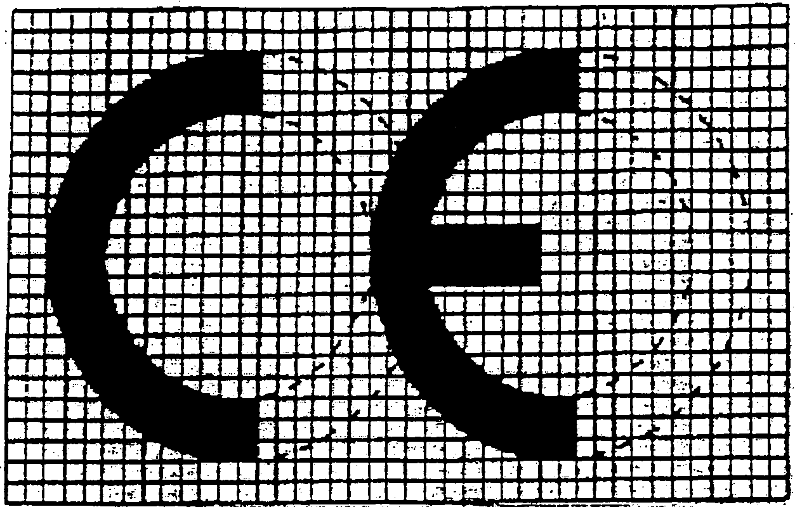
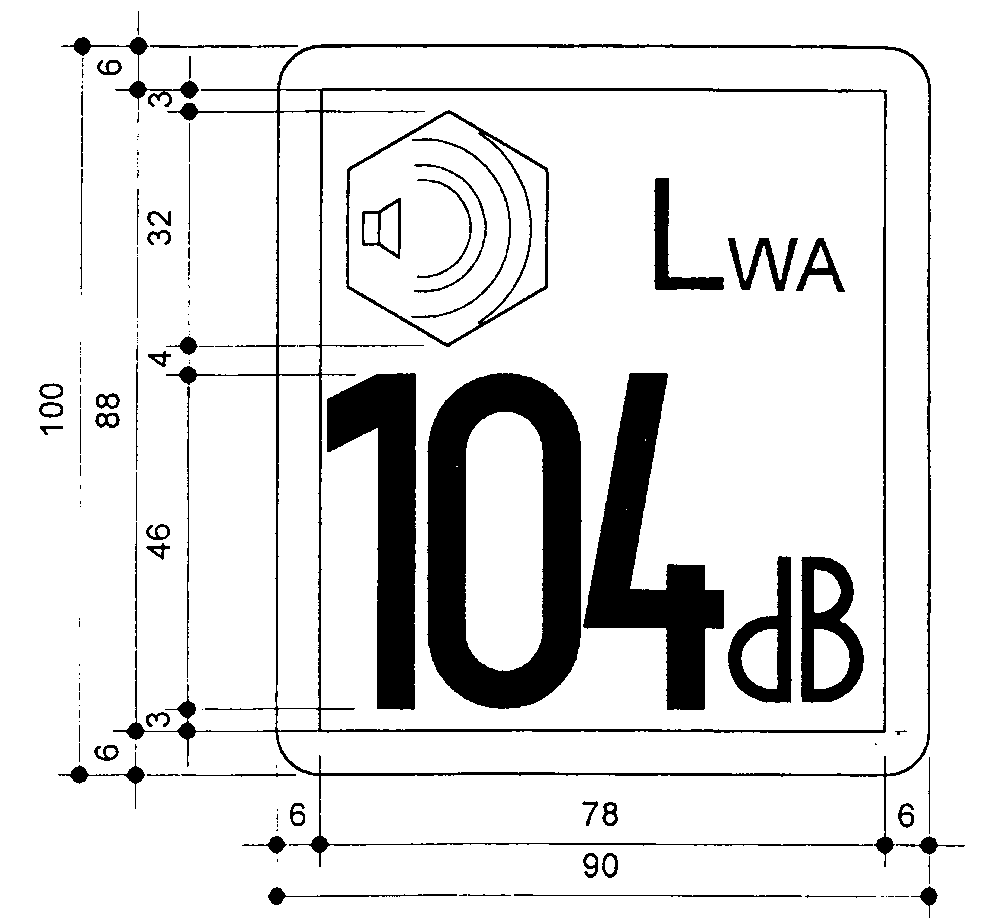

Príloha č. 4 k nariadeniu vlády č. 222/2002 Z. z.

- VZOR OZNAČENIA CE A VZOR VYZNAČENIA GARANTOVANEJ HLADINY AKUSTICKÉHO VÝKONU

- Označenie zhody CE pozostáva z iniciálok „CE“, ktoré majú túto formu:

- Ak sa označenie CE zmenší alebo zväčší podľa rozmerov zariadenia, vzájomný veľkostný pomer uvedený na uvedenom nákrese sa musí zachovať. Rôzne časti označenia CE musia mať v zásade rovnaký zvislý rozmer, ktorý nemôže byť menší ako 5 mm.

- Vyznačenie garantovanej hladiny akustického výkonu musí pozostávať z jednočíselného údaja garantovanej hladiny akustického výkonu v dB, značky LWA a piktogramu, ktorý má tento tvar:

- Ak sa označenie zmenší alebo zväčší podľa rozmerov zariadenia, vzájomný veľkostný pomer na uvedenom nákrese sa musí zachovať. Zvislý rozmer označenia by však, ak je to možné, nemal byť menší ako 40 mm.
