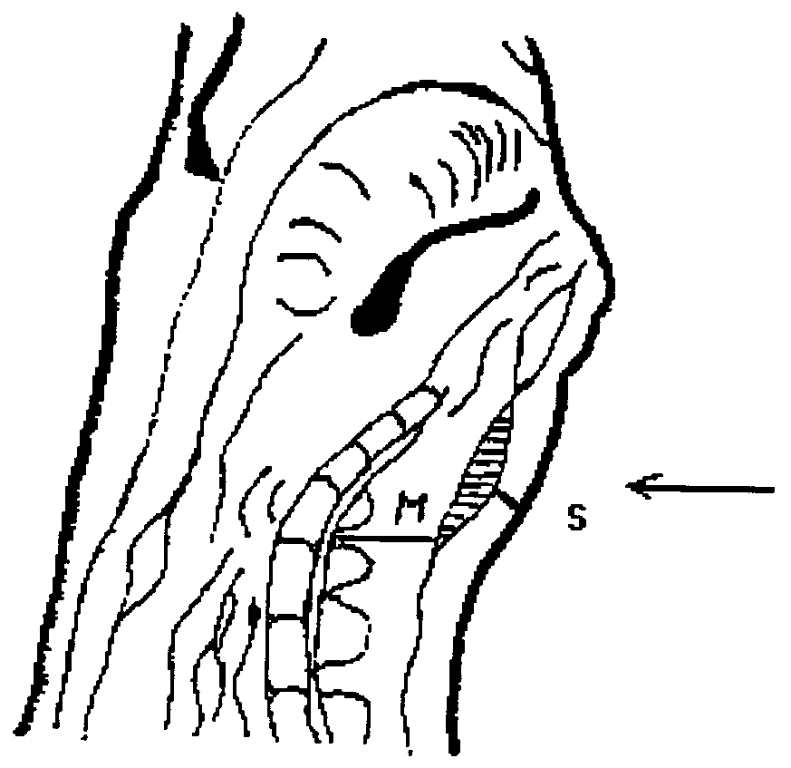
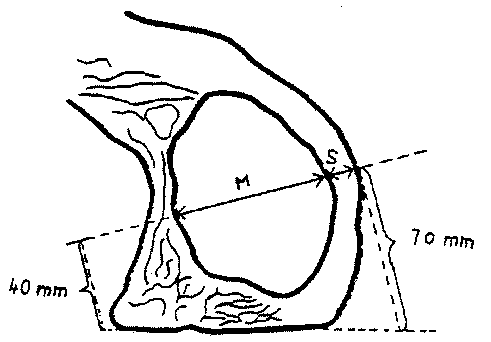

Príloha č. 2 k vyhláške č. 239/2002 Z. z.

- Stanovenie podielu svaloviny jatočne opracovaného tela jatočných ošípaných

- Klasifikácia tiel jatočných ošípaných prístrojovou technikou

- 1. Podiel svaloviny je podiel zistený meraním hrúbky svaloviny a hrúbky slaniny v percentách. Na meranie hrúbky svaloviny a hrúbky slaniny sa používajú dve metódy, a to jednoduchšia dvojbodová, ktorá je určená pre jatočné prevádzky s nižšou dennou kapacitou porážky, a dokonalejšia, pomocou prístrojovej techniky, t. j. vpichovacej sondy alebo ultrazvukového snímača, ktorá je určená predovšetkým pre jatočné prevádzky s vyššou dennou kapacitou porážky.

- 2. Dvojbodovou metódou sa zisťuje pomocou elektrického alebo optického meradla hrúbka svaloviny a slaniny na jednej z polovičiek toho istého tela v línii poliaceho rezu. Hrúbka svaloviny (M) v mm sa meria v bedernej časti, a to ako najkratšia spojnica od hornej (dorzálnej) hrany miechového kanálika k prednému (kraniálnemu) okraju stredného zadnicového svalu (Musculus gluteus medius). Hrúbka slaniny (S) vrátane kože v mm sa meria v bedernej krajine v mieste najnižšej vrstvy nad stredom stredného zadnicového svalu (Musculus gluteus medius), pozri obrázok A.

- Podiel svaloviny Y v % sa vypočíta podľa vzorca

- Y = 76,6722 - 1,0485 M + 0,00794 M2 - 0,002884 S2 + 9,0151 ln (M/S),

- kde S je hrúbka slaniny vrátane kože v mm,

- M je výška svaloviny v mm,

- ln je prirodzený logaritmus.

- 

- Obrázok A - Miesta merania hrúbky svaloviny (M) a slaniny (S) v línii poliaceho rezu

- 3. Metódou s využitím prístrojovej techniky sa zisťuje hrúbka svaloviny a slaniny na jednej z polovičiek toho istého tela paramediálne od línie poliaceho rezu, a to buď vpichovacou sondou na princípe reflexie svetelného lúča, alebo snímačom na princípe ultrazvuku. Hrúbka svaloviny (M) a hrúbka slaniny vrátane kože (S) v mm sa meria vo vzdialenosti 70 mm od línie poliaceho rezu na úrovni medzi druhým a tretím predposledným rebrom, a to zároveň pri jednom vpichu (pozri obrázok B).

- Podiel svaloviny Y v % sa vypočíta podľa vzorca

- Y = 81,8909 + 0,2006 M - 14,1911 ln S,

- kde M je hrúbka svaloviny v mm,

- S je výška slaniny vrátane kože v mm,

- ln je prirodzený logaritmus.

- V prípade získavania krupónu je potrebné pri tejto metóde vykonať v bedernej časti skrátený rez tak, aby bolo možné zmerať nad stredom stredného zadnicového svalu (Musculus gluteus medius) hrúbku slaniny vrátane kože.

- 

- Obrázok B - Miesta merania svaloviny (M) a slaniny (S) 70 mm bočne od línie poliaceho rezu
