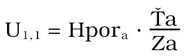

Príloha k nariadeniu vlády č. 24/2002 Z. z.

- SPÔSOB VÝPOČTU MAJETKOVEJ UJMY

- A. Spôsob výpočtu majetkovej ujmy vzniknutej na lesných pozemkoch

  - 1. Majetková ujma zo straty výnosu z dreva

    - U1,0 = Hporu . Df(u-a); diskontácia Df(u-a) sa vykoná iba v prípade úhrady ujmy pred dosiahnutím veku rubnej doby

    - bežného spôsobu obhospodarovania.

    - 

    - U1,2 = PPHa . Ťa,u(m3)

    - U1,3 = Ca . Ťa,u(m3)

  - 2. Majetková ujma zo zníženia výnosu z dreva

    - U2,1 = Hpora . (% Ťa,u – % Ťob)

    - U2,2 = PPHa . (Ťa,u – Ťob)

    - U2,3 = Ca . (Ťa,u – Ťob)

    - U2,4 = (PPpHa – PPzHa) . to

  - 3. Majetková ujma zo zvýšenia nákladov na obhospodarovanie

    - U3,1 = (Cnp – Cnb) . Ťa (m3) + (Cnp – Cnb) . P(ha)

    - U3,2 = Cnm . P(ha), Ťa(m3), resp. U3,3 = Cnm . Tj m

  - 4. Majetková ujma v prípade mimoriadnych okolností prírodných a antropogénnych kalamít

    - U4,1 = Hpora . Df(u-a) – OkHa

    - OkHa = Oka . Cka

    - U4,2 = Hpora . % Ťka – OkHa

    - U4,3 = PPHa . Ťka – OkHa

    - U4,4 = Ca . Ťka – OkHa

    - U4,5 = Hpora . (% Ťka – % Ťob) – OkHa

    - U4,6 = PPHa . (Ťka – Ťob) – OkHa

    - U4,7 = Ca . (Ťka – Ťob) – OkHa

    - Význam premenných (symbolov) vo vzorcoch

    - Un,m – vzorce výpočtu ujmy, kde n – druh ujmy, m – poradie vzorcov pre výpočet daného druhu ujmy

    - to – doba obmedzenia obhospodarovania v rokoch

    - u – rubná doba jednotlivých drevín

    - Hpora,u – cena porastu v skutočnom veku (a) alebo vo veku rubnej doby (u) podľa vyhlášky č. 465/1991 Zb.

    - Za – zásoba dreva na pni vo veku (a)

    - % Ťa,u – ťažbové percento predrubných a rubných ťažieb vo veku (a) alebo (u)

    - % Ťob – ťažbové percento obmedzených predrubných a rubných ťažieb

    - % Ťka – ťažbové percento predrubných a rubných kalamitných ťažieb

    - Ťa,u – predrubná a rubná ťažba v m3 vo veku (a) alebo (u)

    - Ťob – obmedzená predrubná a rubná ťažba

    - Ťka – predrubná a rubná kalamitná ťažba v m3

    - PPHa – priemerná cena dreva na pni v Sk . m-3 alebo Sk . ha-1 vo veku (a) stanovená z hodnoty porastu

    - Ca – priemerná trhová cena m3 dreva na pni danej sortimentovej štruktúry vo veku (a)

    - PPpHa – priemerný prírastok ceny dreva na pni v Sk . m-3 alebo Sk . ha-1 v rubnej dobe potenciálneho zastúpenia drevín

    - PPzHa – priemerný prírastok ceny dreva na pni v Sk . m-3 alebo Sk . ha-1 v rubnej dobe zmeneného cieľového zastúpenia drevín

    - Ncp – celkové náklady požadovaného spôsobu obhospodarovania, a to v Sk . m-3 ťažby dreva alebo v Sk . ha-1 lesa v pestovnej činnosti

    - Ncb – celkové náklady bežného spôsobu obhospodarovania, a to v Sk . m-3 ťažby dreva alebo v Sk . ha-1 lesa v pestovnej činnosti

    - Ncm – celkové náklady mimoriadneho charakteru, napríklad v prípade kalamít a podobne, v Sk . ha-1

    - P – plocha lesa v ha

    - OkHa – hodnota vyťaženej a realizovanej kalamitnej produkcie dreva v cenách dreva na pni

    - Ok – objem spracovaného a predaného kalamitného dreva v m3

    - Ck – priemerná trhová cena m3 kalamitného dreva na pni

    - Df(u-a) – diskontačný faktor, ktorým sa upravuje očakávaná hodnota vo veku (u) na skutočnú hodnotu vo veku (a) pri úrokovej miere p = 3 %

    - Tjm – množstvo technických jednotiek mimoriadnych nákladov (činností)

    - Pri výpočte výšky majetkovej ujmy zo zvýšenia nákladov na pestovnú činnosť sa zohľadňujú iba náklady skutočne realizovaných výkonov pestovnej činnosti. Výška zvýšených nákladov oproti nákladom pri bežnom obhospodarovaní sa vyjadruje v priemere koeficientom 1,6.

    - V ťažbovej činnosti sa ujma z obmedzenia hospodárenia týka výkonov ťažby a sústreďovania dreva. Výška nákladov požadovaného obhospodarovania sa odvodí z nákladov bežného obhospodarovania alebo použitím koeficientov uvedených v tabuľke.

    - Tabuľka

    - Ťažba dreva | | | | Sústreďovanie dreva | | |

    - Hospodársky spôsob | | | | | | |

    - Holorubný | | Podrastový | | Holorubný | | Podrastový |

    - Technológia | | | | | | |

    - T | L | T | L | T | L | T | L

    - 1 | 2 | 3 | 4 | 5 | 6 | 7 | 8

    - Koeficienty | | | | | | |

    - 1 | 1,2 | 1,4 | 1,6 | 1 | 1,3 | 1,5 | 1,6

    - stl.1 × koef.1 | stl.1 × koef.1,2 | stl.1 × koef.1,4 | stl.3 × koef.1,6 | stl.5 × koef.1 | stl.5 × koef.1,3 | stl.1 × koef.1,5 | stl.7 × koef.1,6

    - T – traktorový terén

    - L – lanovkový terén

    - Na výpočet jednotlivých druhov majetkovej ujmy možno použiť ktorýkoľvek z uvedených vzorcov v závislosti od dostupnosti vstupných dát a konkrétnych podmienok. Základný vzorec je uvedený ako prvý v poradí.

- B. Spôsob výpočtu majetkovej ujmy vzniknutej na iných pozemkoch

  - U = Urn + Urp

  - Význam premenných (symbolov) vo vzorcoch

  - U – majetková ujma z obmedzenia bežného hospodárenia na iných pozemkoch

  - Urn – majetková ujma zo zvýšenia nákladov na hospodárenie

  - Urp – majetková ujma zo straty alebo zníženia produkcie
