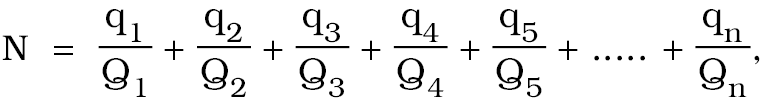

Príloha č. 1 k zákonu č. 261/2002 Z. z. PRAHOVÉ HODNOTY A KRITÉRIÁ NA ZARAĎOVANIE PODNIKOV DO KATEGÓRIE A A DO KATEGÓRIE B

Časť 1

ÚVOD

Pri používaní tabuľky I a tabuľky II v tejto časti na zaraďovanie podnikov do kategórií A a B platia nasledujúce princípy.

1. S vybranou nebezpečnou látkou, ktorá je prítomná v podniku v množstve rovnajúcom sa 2 % alebo v menšom ako 2 % z prahovej hodnoty uvedenej v tabuľke I alebo v tabuľke II, nebude sa pri výpočte jej celkového množstva rátať, ak jej umiestnenie v podniku je také, že nemôže kdekoľvek v podniku spôsobiť závažnú priemyselnú haváriu.

2. Ak vybraná nebezpečná látka uvedená v tabuľke I patrí tiež do niektorej z kategórií nebezpečných vlastností vybraných nebezpečných látok podľa tabuľky II, použije sa na zaradenie podniku do príslušnej kategórie prahová hodnota uvedená v tabuľke I.

3. Ak má vybraná nebezpečná látka viacero nebezpečných vlastností podľa kategórií uvedených v tabuľke II, použije sa na zaradenie podniku do príslušnej kategórie najnižšia prahová hodnota z príslušných kategórií nebezpečných vlastností podľa tabuľky II.

4. Posudzovanie chemických zmesí a chemických prípravkov sa vykonáva rovnakým spôsobom ako posudzovanie čistej vybranej nebezpečnej látky podľa osobitného predpisu.1)

5. Ak sa vybraná nebezpečná látka nachádza na viacerých miestach v podniku, vykoná sa súčet týchto čiastkových množstiev. Na zaradenie podniku do príslušnej kategórie sa potom berie do úvahy tento výsledný súčet.

Tabuľka I

KONKRÉTNE VYBRANÉ NEBEZPEČNÉ LÁTKY

| Stĺpec 1 | Stĺpec 2

Vybraná nebezpečná látka | Prahová hodnota pre kategóriu A v tonách | Prahová hodnota pre kategóriu B v tonách

Dusičnan amónny* | 350 | 2 500

Dusičnan amónny (hnojivá)** | 1 250 | 5 000

Oxid arzeničný, kyselina arzeničná alebo jej soli | 1 | 2

Oxid arzenitý, kyselina arzenitá alebo jej soli | | 0,1

Bróm | 20 | 100

Chlór | 10 | 25

Zlúčeniny niklu vo forme inhalovateľného prášku (oxid nikelnatý, oxid nikličitý, sulfid nikelnatý, sulfid niklitý, oxid niklitý) | | 1

Etylénimín | 10 | 20

Fluór | 10 | 20

Formaldehyd (koncentrácia ≥ 90 %) | 5 | 50

Vodík | 5 | 50

Chlorovodík (skvapalnený plyn) | 25 | 250

Alkyly olova | 5 | 50

Skvapalnené, mimoriadne plyny (vrátane kvapalného propánbutánu) a zemný plyn | 50 | 200

Acetylén | 5 | 50

Etylénoxid | 5 | 50

Propylénoxid | 5 | 50

Metanol | 500 | 5 000

4,4-metylén-bis (2-chloroanilín) alebo soli vo forme prášku | | 0,01

Metylizokyanát | | 0,15

Kyslík | 200 | 2 000

Diizokyanát toluénu | 10 | 100

Fosgén (karbonylchlorid) | 0,3 | 0,75

Arzenovodík (arzín) | 0,2 | 1

Fosforovodík (fosfín) | 0,2 | 1

Chlorid sírnatý | 1 | 1

Oxid sírový | 15 | 75

Polychlórované dibenzofurány a polychlórované dibenzodioxíny (vrátane TCDD), vypočítané v ekvivalente TCDD*** | | 0,001

Nasledujúce karcinogény: | |

4-aminobifenyl alebo jeho soli, benzidín alebo jeho soli, bis(chlorometyl)éter, chlorometylmetyléter, dimetylkarbamoylchlorid, dimetylnitrozoamín, hexametylfosfortriamid, 2-naftylamín alebo jeho soli a 1,3-propánsulfón 4-nitrodifenyl | 0,001 | 0,001

Motorový benzín a iné ropné deriváty | 5 000 | 50 000

Poznámky k tabuľke I

* Dusičnan amónny (350/2 500)

Vzťahuje sa na dusičnan amónny a jeho zlúčeniny, v ktorých je obsah dusíka z dusičnanu amónneho viac ako 28 hmot. % (zlúčeniny odlišné od uvedených v ** nižšie) a vodné roztoky dusičnanu amónneho s jeho koncentráciou viac ako 90 hmot. %.

** Dusičnan amónny (1 250/5 000)

Vzťahuje sa na jednoduché hnojivá na báze dusičnanu amónneho a na zložené hnojivá, v ktorých je obsah dusíka z dusičnanu amónneho viac ako 28 hmot. % (zložené hnojivá obsahujú dusičnan amónny, fosfáty alebo potaš).

*** Polychlórované dibenzofurány a polychlórované dibenzodioxíny

Pri výpočte množstiev polychlórovaných dibenzofuránov a polychlórovaných dibenzodioxínov sa použijú nasledujúce koeficienty.

Medzinárodné ekvivalentné koeficienty toxicity (ITEF) pre obdobné látky (NATO/CCMS) | | |

2,3,7,8-TCDD | 1 | 2,3,7,8-TCDF | 0,1

1,2,3,7,8-PeCDD | 0,5 | 2,3,4,7,8-PeCDF | 0,5

1,2,3,4,7,8-HxCDD | 0,1 | 1,2,3,7,8-PeCDF | 0,05

1,2,3,6,7,8-HxCDD | 0,1 | 1,2,3,4,7,8-HxCDF | 0,1

1,2,3,7,8,9-HxCDD | 0,1 | 1,2,3,7,8,9-HxCDF | 0,1

1,2,3,4,6,7,8-HpCDD | 0,01 | 1,2,3,6,7,8-HxCDF | 0,1

OCDD | 0,001 | 2,3,4,6,7,8-HxCDF | 0,1

| | 1,2,3,4,6,7,8-HpCDF | 0,01

| | 1,2,3,4,7,8,9-HpCDF | 0,01

| | OCDF | 0,001

(T = tetra, Pe = penta, Hx = hexa, Hp = hepta, O = octa)

Tabuľka II

KATEGÓRIE NEBEZPEČNÝCH VLASTNOSTÍ VYBRANÝCH NEBEZPEČNÝCH LÁTOK

| | Stĺpec 1 | Stĺpec 2

Klasifikácia vybranej nebezpečnej látky podľa osobitného predpisu1) | | Prahová hodnota pre kategóriu A v tonách | Prahová hodnota pre kategóriu B v tonách

1. | Veľmi jedovatá | 5 | 20

2. | Jedovatá | 50 | 200

3. | Oxidujúca | 50 | 200

4. | Výbušná s označením špecifického rizika R2 | 50 | 200

5. | Výbušná s označením špecifického rizika R3 | 10 | 50

6. | Horľavá (kvapalina)2) | 5 000 | 50 000

7a. | Veľmi horľavá3) | 50 | 200

7b. | Veľmi horľavá kvapalina4) | 5 000 | 50 000

8. | Mimoriadne horľavá5) | 10 | 50

9. | Nebezpečná pre životné prostredie v kombinácii s označením špecifického rizika (R- vetou): | |

| R50: „Veľmi jedovatá pre vodné organizmy“ | 200 | 500

| R51: „Jedovatá pre vodné organizmy“ | 500 | 2 000

| R53: „Môže spôsobiť dlhodobé škodlivé účinky vo vodnej zložke životného prostredia“ | 500 | 2 000

10. | Každá klasifikácia okrem uvedených v kombinácii s označením špecifického rizika (R- vetou): | |

| R14: „Prudko reaguje s vodou“ (vrátane R14/15) | 100 | 500

| R29: „Pri kontakte s vodou uvoľňuje jedovatý plyn“ | 50 | 200

Poznámky k tabuľke II

1) Klasifikácia vybraných nebezpečných látok (chemických látok a chemických prípravkov) sa uskutoční podľa zákona č. 163/2001 Z. z. o chemických látkach a chemických prípravkoch.

2) Chemická látka alebo chemický prípravok, ktorých teplota vzplanutia sa rovná alebo je väčšia ako 21 o C a menšia alebo sa rovná 55 oC (označenie špecifického rizika R10), podporujúca horenie.

3) Chemická látka alebo chemický prípravok, ktoré sa môžu zohriať a vznietiť v kontakte so vzduchom pri teplote okolia bez dodania energie (označenie špecifického rizika R17), ako aj chemické látky, ktoré majú teplotu vzplanutia menšiu ako 55 oC a pod tlakom zostávajú kvapalné, ak osobitné prevádzkové podmienky, ako sú vysoký tlak alebo vysoká teplota, môžu spôsobiť nebezpečenstvo závažnej priemyselnej havárie.

4) Chemické látky a chemické prípravky, ktorých teplota vzplanutia je menšia ako 21 oC a ktoré nie sú mimoriadne horľavé (označenie špecifického rizika R11 druhá pomlčka).

5) Mimoriadne horľavé látky podľa tohto bodu sú

a) kvapalné chemické látky a kvapalné chemické prípravky, ktorých teplota vzplanutia je menšia ako 0 oC a ktorých bod varu (alebo v prípade destilačného rozmedzia počiatočný bod varu) je pri normálnom tlaku menší alebo sa rovná 35 oC (označenie špecifického rizika R12 prvá pomlčka),

b) plynné chemické látky a plynné chemické prípravky, ktoré sú horľavé pri kontakte so vzduchom pri okolitej teplote a tlaku (označenie špecifického rizika R12 druhá pomlčka), či už sú udržiavané v kvapalnom, alebo v plynnom stave pod tlakom, alebo nie, okrem skvapalnených, mimoriadne horľavých plynov (vrátane skvapalnených uhľovodíkových plynov) a zemného plynu uvedených v tabuľke I tejto prílohy,

c) kvapalné chemické látky a kvapalné chemické prípravky udržiavané na teplote vyššej, ako je ich bod varu.

Časť 2

VZOREC NA VÝPOČET POMERNÉHO MNOŽSTVA VYBRANÝCH NEBEZPEČNÝCH LÁTOK

1. Súčet pomerných množstiev dvoch alebo viacerých vybraných nebezpečných látok prítomných v podniku (N) na účely zaradenia podniku do kategórie A alebo B podľa § 4 ods. 2 písm. b) a ods. 3 písm. b) tohto zákona sa vypočíta podľa nasledujúceho vzorca:

v ktorom

„qn“ je množstvo vybranej nebezpečnej látky „n“ (alebo kategórie nebezpečných vlastností vybraných nebezpečných látok „n“) patriacej do časti 1 tejto prílohy v tonách,

„Qn“ je prahové množstvo vybranej nebezpečnej látky „n“ podľa tabuľky I alebo prahové množstvo kategórie nebezpečných vlastností „n“ podľa tabuľky II z časti 1, pričom za Qn sa dosadí na zaradenie podniku

a) do kategórie A prahové množstvo podľa stĺpca 1 tabuľky I alebo tabuľky II,

b) do kategórie B prahové množstvo podľa stĺpca 2 tabuľky I alebo tabuľky II.

2. Ak výsledný súčet pomerných množstiev „N“ je väčší ako 1, prevádzkovateľ zaradí podnik

a) do kategórie A, ak sa za Qn dosadili prahové hodnoty podľa stĺpca 1 tabuľky I alebo II,

b) do kategórie B, ak sa za Qn dosadili prahové hodnoty podľa stĺpca 2 tabuľky I alebo II.

3. Tento vzorec sa použije v nasledujúcich prípadoch:

a) pre súčet množstiev vybraných nebezpečných látok uvedených v tabuľke I, ktoré sú prítomné v podniku v množstvách menších, ako sú ich prahové hodnoty podľa stĺpca 1 alebo stĺpca 2 tabuľky I, a ktoré majú rovnakú nebezpečnú vlastnosť uvedenú v tabuľke II,

b) pre súčet množstiev vybraných nebezpečných látok prítomných v podniku, ktoré majú rovnakú nebezpečnú vlastnosť podľa tabuľky II,

c) pre súčet množstiev vybraných nebezpečných látok prítomných v podniku, ktoré majú nebezpečné vlastnosti v kategóriách podľa riadkov 1, 2 a 9 tabuľky II,

d) pre súčet množstiev vybraných nebezpečných látok prítomných v podniku, ktoré majú nebezpečné vlastnosti v kategóriách podľa riadkov 3, 4, 5, 6, 7a, 7b a 8 tabuľky II.
