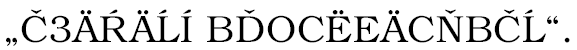
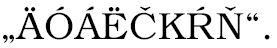
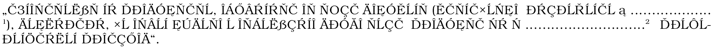

Príloha k článku 8 S cieľom uplatňovať ustanovenia Protokolu 7 Stredoeurópskej dohody o volnom obchode sa vykonajú tieto úpravy:

- 1. Článok 4

  - V odseku 1 tohto článku sa slovo „Bulharsko“ vypúšťa.

- 2. Článok 18

  - V odseku 4, ktorý sa týka dodatočného vydávania sprievodného osvedčenia EUR. 1, sa pripája táto bulharská verzia:

- 

- 3. Článok 19

  - V odseku 2 týkajúcom sa vydávania duplikátu sprievodného osvedčenia EUR. 1 sa pripája tento bulharský termín:

- 

- 4. PRÍLOHA 4 k Protokolu 7

  - Na faktúre sa pripája táto bulharská verzia vyhlásenia:

- 
