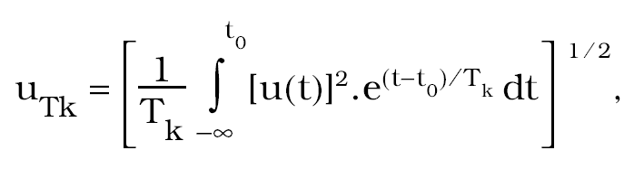
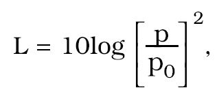
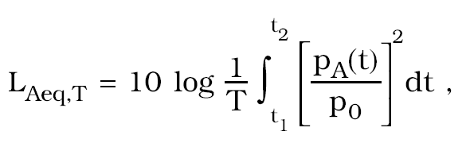
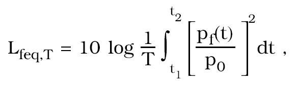
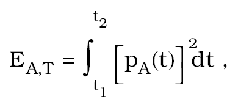
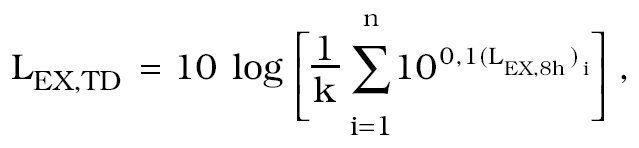
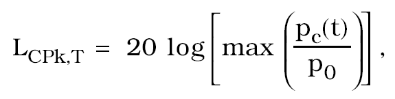
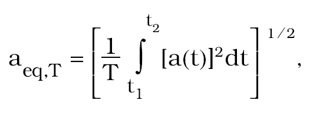
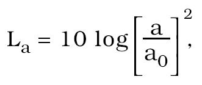

Príloha č. 2

- k nariadeniu vlády č. 40/2002 Z. z.

- Najvyššie prípustné hodnoty hluku a vibrácií v stavbách a vo vonkajších priestoroch

- I. oddiel Vysvetlenie pojmov

  - 1. Zvuk je mechanické kmitanie častíc pružného prostredia.

  - 2. Počuteľný zvuk je zvuk schopný vyvolať sluchový vnem; je to zvuk, ktorého frekvenčné spektrum leží v tretinooktávových frekvenčných pásmach so strednými frekvenciami 20 Hz až 20 kHz. Počuteľný zvuk s výraznými frekvenčnými zložkami v oblasti frekvencií pod 50 Hz je nízkofrekvenčný zvuk.

  - 3. Hluk je každý nežiaduci, rušivý, nepríjemný alebo škodlivý zvuk.

  - 4. Frekvenčné pásmo je oblasť frekvencií ohraničená dolnou hraničnou frekvenciou fda hornou hraničnou frekvenciou fh; charakterizuje sa strednou frekvenciou fs,1) pre ktorú platí

    - fs = (fd.fh)1/2 .

    - Ak fh = 2.fd, frekvenčné pásmo je oktávové,

    - fh = 21/3.fd, frekvenčné pásmo je tretinooktávové,

    - fh = 21/n.fd, frekvenčné pásmo má šírku jednej n-tiny oktávy.

  - 5. Vysokofrekvenčný zvuk je počuteľný zvuk, ktorého frekvenčné spektrum sa nachádza v niektorých alebo vo všetkých tretinooktávových pásmach so strednou frekvenciou 8 kHz až 20 kHz.

  - 6. Infrazvuk je zvuk, ktorého frekvenčné spektrum sa nachádza v tretinooktávových pásmach so strednou frekvenciou 1 Hz až 20 Hz.

  - 7. Ultrazvuk je zvuk s vyššou frekvenciou ako počuteľný zvuk. Na účely tohto nariadenia je to zvuk vo frekvenčných tretinooktávových pásmach so strednou frekvenciou 25 kHz až 40 kHz.

  - 8. Priebežná efektívna hodnota fyzikálnej veličiny je efektívna hodnota určená pri uplatnení zvolenej časovej váhovej funkcie podľa vzťahu

    - 

    - kde u(t) je časová funkcia fyzikálnej veličiny,

    - e(t-t0)/Tk je exponenciálna časová váhová funkcia,

    - Tk je časová konštanta a interval priemerovania,

    - t je priebežný čas,

    - t0 je čas pozorovania alebo odčítania.

    - Značka: uTk

    - Poznámka: Uplatnenie exponenciálnej časovej váhovej funkcie je násobenie druhej mocniny časovej funkcie fyzikálnej veličiny exponenciálnou funkciou s definovanou časovou konštantou. Zaužívaná časová váhová funkcia Fast má časovú konštantu 0,125 s. Časová váhová funkcia Slow má časovú konštantu 1,0 s. Použitie časových váhových funkcií sa vyjadruje v značke indexom F pre Fast a indexom S pre Slow.

  - 9. Okamžitý akustický tlak je rozdiel medzi celkovým tlakom a statickým tlakom v určitom okamihu ti v danom bode prostredia.

    - Značka: p(ti)

  - 10. Akustický tlak je priebežná efektívna hodnota určená z časovej funkcie akustického tlaku podľa bodu 8.

    - Značka: p, pS

    - Jednotka: Pa

    - Poznámka: Pretože v akustike sa najčastejšie používa časové váženie F a S, index Tk sa nahrádza indexom F alebo S.

    - Uvedenie veličiny bez indexu znamená použitie časového váženia F.

  - 11. Hladina akustického tlaku; priebežná hladina akustického tlaku je hladina určená vzťahom

    - 

    - kde p je akustický tlak v Pa, ktorého hladina sa určuje,

    - p0 je referenčný akustický tlak, p0 = 2.10-5Pa.

    - Značka: L, LS

    - Jednotka: dB

  - 12. Hladina akustického tlaku vo frekvenčnom pásme je priebežná hladina akustického tlaku určená podľa bodu 11 pri uplatnení akustického tlaku z príslušného frekvenčného pásma.

    - Značka: Lfpre časové váženie F

    - LfS pre časové váženie S

    - Jednotka: dB

    - Poznámka: Hladiny získané v oktávových a tretinooktávových frekvenčných pásmach sa označujú Lo, Lt.

  - 13. Hladina zvuku s frekvenčným vážením A, frekvenčným vážením C alebo frekvenčným vážením D; hladina A zvuku, hladina C zvuku alebo hladina D zvuku je priebežná hladina akustického tlaku podľa bodu 11, v ktorom sa použije akustický tlak korigovaný frekvenčnou váhovou funkciou A, frekvenčnou váhovou funkciou C alebo frekvenčnou váhovou funkciou D.2)

    - Značka: LA, LC, LD

    - LAS, LCS, LDS pri časovom vážení S

    - Jednotka: dB

    - Poznámka: Akustický tlak korigovaný frekvenčnou váhovou funkciou sa skrátene nazýva vážený akustický tlak.

    - Značka: pA, pC, pD

  - 14. Hladina infrazvuku s vážením G; hladina G infrazvuku je priebežná hladina akustického tlaku, ktorý je korigovaný frekvenčnou váhovou funkciou G.3)

    - Značka: LG

    - Jednotka: dB

  - 15. Hladina ultrazvuku je hladina akustického tlaku vo frekvenčnom pásme určenom podľa bodu 7, v oktávovom frekvenčnom pásme so strednou frekvenciou fs = 31,5 kHz alebo v jeho časti.

    - Značka: LoU, LfU

    - Jednotka: dB

  - 16. Ekvivalentná hladina A zvuku, C zvuku alebo G infrazvuku; časovo priemerovaná hladina A zvuku, C zvuku alebo G infrazvuku je veličina definovaná vzťahom

    - 

    - kde pA(t) je časová funkcia akustického tlaku váženého frekvenčnou váhovou funkciou A, C alebo G,

    - T je trvanie integrácie a priemerovania, T = t2 - t1

    - p0 je referenčný akustický tlak, p0 = 2.10-5Pa.

    - Značka : LAeq,T, LCeq,T, LGeq,T

    - Jednotka: dB

  - 17. Ekvivalentná hladina akustického tlaku vo frekvenčnom pásme je hladina určená vzťahom

    - 

    - kde pf(t) je časová funkcia akustického tlaku vo zvolenom frekvenčnom pásme.

    - Značka: Lfeq,T

    - Jednotka: dB

  - 18. Zvuková expozícia je veličina určená vzťahom

    - 

    - kde pA(t) je časová funkcia akustického tlaku váženého frekvenčnou váhovou funkciou A,

    - T je trvanie integrácie - časový interval, v priebehu ktorého sa určuje zvuková expozícia, T = t2 - t1.

    - Značka: EA,T

    - Jednotka: Pa2.s

    - Poznámka: Súvislosť zvukovej expozície s ekvivalentnou hladinou A zvuku vyjadruje vzťah

    - EA,T = p02.T.100,1LAeq,T .

  - 19. Hladina zvukovej expozície je hladina určená vzťahom

    - LEA,T = 10 log (EA,T/ E1),

    - kde EA,T je zvuková expozícia,

    - E1 je referenčná zvuková expozícia,

    - E1 = p02.T1 = 4.10-10 Pa2.s,

    - T1 je referenčný časový interval, T1 = 1 s,

    - T je časový interval, v ktorom sa určuje hladina LEA,T.

    - Značka: LEA,T

    - Jednotka: dB

    - Poznámky: Pre LEA,T možno použiť aj skratku SEL.

    - Ak sa vo vzťahu, v ktorom je vyjadrená hladina zvukovej expozície, použije namiesto hodnoty E1 ako referenčná zvuková expozícia hodnota ET = p02.T, kde T je trvanie zvukovej expozície EAT, získaná hladina sa nazýva hladina hlukovej expozície a má značku LEX,T.

  - 20. Normalizovaná hladina hlukovej expozície je hladina určená vzťahom

    - LEX,8h = 10 log (EA,T/E0),

    - kde EA,T je zvuková expozícia definovaná v bode 18, E0 je referenčná zvuková expozícia,

    - E0 = p02T0 = (2.10-5Pa)2.28800 s = 1,15.10-5 Pa2.s,

    - T0 je normalizované trvanie pracovnej zmeny,

    - T0= 8 h = 28800 s.

    - Značka : LEX,8h

    - Jednotka: dB

    - Poznámka: Medzi normalizovanou hladinou hlukovej expozície a ekvivalentnou hladinou A zvuku je tento vzťah:

    - LEX,8h = LAeq,T + 10 log (T/T0),

    - kde T je trvanie merania ekvivalentnej hladiny.

    - Na základe uvedeného vzťahu možno prepočítať ľubovoľnú ekvivalentnú hladinu, váženú, neváženú alebo vo frekvenčnom pásme, na normalizovanú hladinu. Najčastejšie sa používa normalizovaná hladina G infrazvuku, LGeq,8h a normalizovaná hladina akustického tlaku vo frekvenčnom pásme, Lfeq,8h .

  - 21. Týždenný priemer denných hodnôt normalizovanej hladiny hlukovej expozície sa vypočíta podľa vzťahu

    - 

    - kde k je počet dní v týždni; pre normalizovaný päťdňový pracovný týždeň k = 5,

    - n je počet skutočne odpracovných dní v týždni,

    - (LEX,8h)i je normalizovaná hladina hlukovej expozície v i-tom pracovnom dni.

    - Značka: LEX,TD

    - Jednotka: dB

  - 22. Percentná hladina je vypočítaná hladina A zvuku, ktorá je prekročená v N percentách z celkového času hodnotenia T.

    - Značka: LN,T, napr. L1,T, L5,T, L99,T

    - Jednotka: dB

  - 23. Maximálna hladina A zvuku je najvyššia hladina A zvuku určená vo zvolenom časovom intervale pri použití časovej váhovej funkcie F; použitie inej časovej váhovej funkcie musí byť zvýraznené v označení, napr.: LAmax,S.

    - Značka: LAmax

    - Jednotka: dB

  - 24. Vrcholová hladina C zvuku je hladina zvuku s frekvenčným vážením C definovaná vzťahom

    - 

    - kde pc(t) je časová funkcia akustického tlaku váženého frekvenčnou váhovou funkciou C,

    - T je časový interval, v ktorom sa určuje vrcholová hladina.

    - Hladina sa získa meraním hladiny C zvuku na zvukomeri pri použití funkcie Peak.

    - Použitie funkcie Peak sa vyjadruje v značke indexom Pk.

    - Značka: LCPk,T

    - Jednotka: dB

  - 25. Tónový hluk je zvuk, ktorému možno subjektívne prisúdiť výšku; počuteľný zvuk je tónový, ak tónová zložka je

    - a) jasne počuteľná a jej výskyt možno určiť na základe tretinooktávovej alebo úzkopásmovej frekvenčnej analýzy,

    - b) na hranici rozpoznateľnosti sluchom a objektívne ju možno zistiť úzkopásmovou analýzou, napr. pomocou filtra so šírkou pásma užšou ako 1/3 oktávy.

  - 26. Zvukový impulz je jednorazový akustický dej charakterizovaný skokovým nárastom tlaku s nasledujúcim rýchlym poklesom.

  - 27. Impulzový hluk je hluk, ktorý vzniká v dôsledku jedného zvukového impulzu alebo viacerých zvukových impulzov, z ktorých každý má trvanie kratšie ako 1s.4)

  - 28. Mechanické kmitanie je pohyb mechanickej sústavy alebo jej časti, pri ktorom veličina popisujúca jej pohyb alebo polohu je striedavo väčšia a menšia ako určitá rovnovážna alebo vzťažná hodnota tejto veličiny.

  - 29. Otras je rýchla jednorazová alebo opakovaná zmena určujúcej veličiny mechanického kmitania.

  - 30. Vibrácie prenášané na ruky sú vibrácie, ktoré sa prenášajú na jednu ruku alebo obidve ruky z rukovätí strojov a náradia alebo z povrchu predmetov držaných rukou.5)

  - 31. Vibrácie pôsobiace na celé telo; celkové vibrácie sú vibrácie, ktoré sa prenášajú na stojacu, sediacu alebo ležiacu osobu ako celok cez oporný povrch. Podľa smeru pôsobenia sa celkové vibrácie rozdeľujú na vibrácie v pozdĺžnom smere a vibrácie v priečnom smere.6)

    - Vibrácie, ktoré sa nemôžu označiť ako celkové vibrácie ani ako vibrácie prenášané na ruky a ktoré sa prenášajú na určitú časť tela, sú miestne vibrácie.

  - 32. Okamžité zrýchlenie vibrácií je určujúca veličina vibrácií a(ti) daná časovou deriváciou okamžitej rýchlosti vibrácií v čase ti.

    - Značka: a(ti)

    - Jednotka: m.s-2

  - 33. Zrýchlenie vibrácií; priebežné zrýchlenie vibrácií je priebežná efektívna hodnota zrýchlenia vibrácií určená z časovej funkcie zrýchlenia vibrácií podľa bodu 8.

    - Značka: a, aTk

    - Jednotka: m.s-2

    - Poznámka: Pri použití zavedených časových váhových funkcií sa namiesto značky časovej konštanty Tk uvedie skratka použitej časovej váhovej funkcie. Uvedenie veličiny bez indexu znamená použitie S, napr. a, aF.

  - 34. Vážené zrýchlenie vibrácií je zrýchlenie vibrácií korigované frekvenčnou váhovou funkciou5), 6), 7) podľa druhu prenosu vibrácií. Použitie váhovej funkcie sa v značke vyjadruje indexom w.

    - Značka: aw pre celkové vibrácie

    - ahw pre vibrácie na ruky

    - Jednotka: m.s-2

  - 35. Ekvivalentné zrýchlenie vibrácií je efektívna hodnota zrýchlenia určená vzťahom

    - 

    - kde a(t) je časová funkcia zrýchlenia vibrácií,

    - T je časový interval merania a priemerovania zrýchlenia vibrácií, T = t2 - t1.

    - Značka: aeq,T

    - Jednotka: m.s-2

  - 36. Ekvivalentné vážené zrýchlenie vibrácií je ekvivalentné zrýchlenie vibrácií určené pri uplatnení zvolenej frekvenčnej váhovej funkcie na časovú funkciu zrýchlenia vibrácií.

    - Značka : aweq,T

    - Jednotka: m.s-2

    - Poznámka: Ekvivalentné zrýchlenie, vážené i nevážené, určené v časovom intervale T možno prepočítať na iný časový interval Tn podľa vzťahu

    - aweq,Tn = (T/Tn)1/2.aweq,T ,

    - kde aweq,Tn je prepočítané ekvivalentné zrýchlenie na časový interval Tn.

  - 37. Normalizované zrýchlenie vibrácií je ekvivalentné vážené zrýchlenie vibrácií prepočítané podľa bodu 36 na trvanie normalizovanej pracovnej zmeny Tn = T0 = 8h.

    - Značka: aweq,8h

    - Jednotka: m.s-2

  - 38. Veľkosť vektora zrýchlenia vibrácií je výsledné zrýchlenie vibrácií vypočítané z ekvivalentných vážených hodnôt zrýchlení v definovaných smeroch súradnicového systému a z príslušných hodnotiacich súčiniteľov

    - av =[(kx.axweq )2 + (ky.ayweq )2 + (kz.azweq)2]0,5,

    - kde kx, ky, kz sú hodnotiace súčinitele v smere súradnicových osí,

    - axweq je vážené ekvivalentné zrýchlenie vibrácií v smere súradnicovej osi x,

    - ayweq, azweq je vážené ekvivalentné zrýchlenie vibrácií v smere súradnicových osí y a z.

    - Značka: av

    - Jednotka: ms-2

    - Poznámka: V prípade potreby sa doplnia ďalšie zaužívané indexy, napr.: av,4h, ahv,8h , pričom sa „eq“, „w“ v indexe neuvádza.

  - 39. Hladina zrýchlenia vibrácií je definovaná vzťahom

    - 

    - kde a je zrýchlenie vibrácií, ktorého hladinu treba určiť,

    - a0je referenčné zrýchlenie vibrácií, a0= 10-6m.s-2.

    - Značka: La

    - Jednotka: dB

    - Poznámka: Takýmto spôsobom možno získať i hladinové vyjadrenie zrýchlení definovaných v bodoch 30 až 38, pričom sa k značke La pripíšu indexy príslušného zrýchlenia, a to pre

    - a) hladinu váženého zrýchlenia vibrácií Law ,

    - b) hladinu ekvivalentného zrýchlenia vibrácií Laweq,T ,

    - c) hladinu normalizovaného zrýchlenia vibrácií Laweq,8h ,

    - d) hladinu normalizovaného zrýchlenia vibrácií vo frekvenčnom pásme Lafeq,8h ,

    - e) hladinu výsledného normalizovaného zrýchlenia vibrácií Lav,8h pre celkové vibrácie a Lahv,8h pre vibrácie na ruky a podobne.

      - Hladiny ekvivalentného zrýchlenia získané v časovom intervale T možno prepočítať na hladiny s iným časom hodnotenia Tnpodľa vzťahu

      - Laeq,Tn = Laeq,T + 10 log(T/Tn).

      - Poznámky: Ak Tn= T0 = 8h, prepočtom sa získajú hladiny normalizovaného zrýchlenia.

      - Hladinu výsledného zrýchlenia Lav možno určiť z hladín zrýchlenia v jednotlivých osiach Lax, Lay, Laz podľa vzťahu

      - Lav = 10log( 100,1(Lax + k1) + 100,1(Lay + k2) + 100,1(Laz + k3)),

      - kde k1, k2, k3 sú korekcie zodpovedajúce hodnotiacim súčiniteľom v bode 38.

  - 40. Maximálne zrýchlenie vibrácií je maximálna hodnota priebežného zrýchlenia vibrácií vo zvolenom časovom intervale T pri časovej váhovej funkcii S.

    - Značka: amax,T

    - Jednotka: ms-2

  - 41. Expozícia hluku a vibráciám pri práci je vystavenie zamestnanca hluku alebo vibráciám počas určitého časového intervalu.

  - 42. Určujúca veličina je fyzikálna veličina, ktorá slúži na vyjadrenie a hodnotenie pôsobiaceho hluku a vibrácií z hľadiska ochrany zdravia.

  - 43. Referenčný časový interval je časový interval, ktorý sa berie do úvahy pri hodnotení príslušnej fyzikálnej veličiny. Referenčný časový interval pre denný čas je od 6.00 h do 22.00 h, pre nočný čas od 22.00 h do 6.00 h, pre pracovný čas 8 hodín.

  - 44. Hodnotiaca hladina zvuku je ekvivalentná hladina A zvuku počas špecifikovaného časového intervalu korigovaná vzhľadom na zvláštny charakter hluku, napr. tónový, impulzový alebo iný vplyv. Stanovuje sa pre referenčné časové intervaly, napr. pre pracovný čas.

    - Hodnotiaca hladina sa použije namiesto ekvivalentnej hladiny pri hodnotení hluku s osobitným charakterom a porovnáva sa s najvyššími prípustnými hladinami.4), 8), 9) Hodnotiacou hladinou je aj dlhodobá 24 h ekvivalentná hladina Ldvn, ktorá sa používa pri dlhodobom sledovaní hluku.

    - V prípade hodnotenia pomocou LAmax sa hodnotiaca hladina neurčuje a korekcie vrátane znamienka + alebo - sa pripočítajú priamo k zistenej hodnote LAmax. Takto upravená hodnota LAmax sa porovnáva s najvyššou prípustnou hodnotou.

  - 45. Najvyššie prípustné hodnoty určujúcich veličín sú zdravotne zdôvodnené hodnoty z hľadiska ochrany zdravia pred nepriaznivými účinkami škodlivých faktorov.

  - 46. Hluk pozadia je hluk alebo iné vplyvy registrované meracím prístrojom i vtedy, ak zdroj hluku, ktorý sa má na základe merania posudzovať, nepôsobí.

    - Poznámka: Pri meraní hladiny hluku posudzovaného zdroja pôsobí okrem hluku posudzovaného zdroja Lzdroj aj hluk pozadia Lpoz, ktoré spolu vytvárajú súčtovú hladinu Ls.

    - Ak je rozdiel medzi súčtovou hladinou hluku a hladinou hluku pozadia väčší ako 10 dB, hluk pozadia zanedbateľne ovplyvňuje hladinu posudzovaného zdroja.

    - Ak rozdiel medzi súčtovou hladinou hluku a hladinou hluku pozadia Ls-Lpoz je v intervale od 3 dB do 10 dB, potom sa hladina hluku posudzovaného zdroja Lzdroj určí tak, že sa od súčtovej hladiny Ls odpočíta korekcia k určená podľa vzťahu

    - k = -10log(1-10-0,1(Ls-Lpoz)).

    - Ak rozdiel Ls - Lpoz je nižší ako 3 dB, nemožno určiť hladinu hluku posudzovaného zdroja.

    - Hluk pozadia sa meria pred meraním alebo po meraní posudzovaného zdroja pri zhodných podmienkach, napr. umiestnenie mikrofónu, čas merania, poveternostné podmienky. Hluk pozadia môžu spôsobovať nielen zdroje hluku, ale aj neakustické vplyvy, napr. elektrické a magnetické polia alebo prúdenie vzduchu.

  - 47. Akčná hodnota určujúcej veličiny je hodnota, ktorej prekročenie je dôvodom na vykonanie opatrení na zníženie hluku.

- II. oddiel Hluk v pracovnom prostredí

  - Najvyššie prípustné hodnoty určujúcich veličín hluku na pracoviskách

  - A. Počuteľný zvuk

    - 1. Najvyššie prípustné hodnoty určujúcich veličín hluku na pracoviskách sa vzťahujú na pracovné miesta a časti priestorov, v ktorých sa zamestnanci zdržiavajú počas pracovného času.

    - 2. Najvyššie prípustné hodnoty hluku sa vzťahujú na hluk pozadia a na hluk z pracovnej činnosti, ktorý je pre pracoviská typický a z dlhodobého hľadiska sa vyskytuje trvale alebo opakovane.

    - 3. Určujúcimi veličinami hluku na pracoviskách sú vrcholová hladina C zvuku a buď normalizovaná hladina hlukovej expozície, alebo hodnotiaca hladina A zvuku.

    - 4. Najvyššie prípustné hodnoty normalizovanej hladiny hlukovej expozície LEX,8h,p a hodnotiacej hladiny A zvuku LAr,p na pracovisku podľa jednotlivých druhov činnosti sú uvedené v tabuľke č. 1.

      - Ak počas pracovnej zmeny vykonáva zamestnanec práce patriace do rôznych skupín prác, potom ekvivalentné hladiny počas práce v jednotlivých skupinách nesmú číselne prekročiť najvyššie prípustné hladiny, ktoré prislúchajú jednotlivým skupinám prác.

    - 5. Ak je hluk tónový alebo impulzový, jeho hodnotiaca hladina LAr musí spĺňať najvyššie prípustné hodnoty podľa bodu 4. Pri tónovom charaktere hluku sa určuje hodnotiaca hladina korekciou

      - a) KT1 = +5 dB, ak je tónová zložka jasne počuteľná a výskyt možno určiť na základe tretinooktávovej analýzy,

      - b) KT2 = +3 dB, ak je tónová zložka na hranici rozpoznateľnosti sluchom a je zistiteľná úzkopásmovou frekvenčnou analýzou.

        - Ak má hluk impulzový charakter s výskytom nižším ako 20 imp./s, určuje sa hodnotiaca hladina LAr s korekciou, ktorá sa získa z rozdielu nameraných hladín LAIeq,T a LAeq,T :

        - KI = LAIeq,T - LAeq,T .

        - Ak je KI menšie ako 2 dB alebo ak výskyt impulzov je vyšší ako 20 imp./s, hluk nie je impulzový.

    - 6. Najvyššia prípustná vrcholová hladina C zvuku LC,Pk na pracoviskách je 140 dB. Táto hodnota sa kontroluje najmä pri výskyte impulzového hluku počas pracovnej činnosti.

    - 7. Ak je pracovný čas v priebehu pracovného týždňa rozdelený nerovnomerne alebo ak sa vystavenie hluku v priebehu týždňa značne mení, vypočíta sa týždenný priemer denných hodnôt normalizovanej hladiny hlukovej expozície LEX,TD a ten sa porovnáva s najvyššími prípustnými hodnotami. Ak normalizovaná hladina hlukovej expozície v niektorých dňoch týždňa prekračuje 90 dB, týždenný priemer sa nemôže použiť na hodnotenie.

      - Tabuľka č. 1 Najvyššie prípustné hodnoty normalizovanej hladiny hlukovej expozície podľa jednotlivých druhov činnosti na pracoviskách

      - Skupina prác | Druh práce - činnosti - pracovné priestory | | LEX,8h,p (dB)

      - I. | Koncepčná práca, zasadacie a konferenčné miestnosti, kancelárie riadiacich pracovníkov, mimoriadne tiché pracovné prostredie | | 40c), d)

      - II. | Kancelárie jednotlivých zamestnancov, práca spojená s veľkým sústredením, výskumné pracoviská | a) | 45c), d)

      - | | b) | 50c), d)

      - III. | Duševná práca rutinnej povahy vyžadujúca pozornosť sústredenie s možnosťou ľahkého dorozumenia rečou | a) | 55c), d)

      - | | b) | 60c), d)

      - IV. | Duševná práca rutinnej povahy s trvalým sledovaním a kontrolou okolia sluchom, práca vykonávaná na základe čiastkových sluchových informácií | a) | 65d)

      - | | b) | 70d)

      - V. | Práca vyžadujúca pri fyzickej námahe presnosť a sústredenie alebo vyžadujúca občasné sledovanie a kontrolu okolia sluchom | a) | 75d)

      - | | b) | 80d)

      - VI. | Práca bez nárokov na duševné sústredenie, sledovanie a kontrolu okolia sluchom alebo dorozumievanie sa rečou | | 85d)

      - a) Zvýšené nároky, napr. ak v dôsledku chýb pri práci môže dôjsť k významnej škode alebo poškodeniu zdravia.

      - b) Bežné nároky.

      - c) Najvyššie prípustné hodnoty sa nevzťahujú na rečovú komunikáciu.

      - d) Ak hluk preniká zvonku, zo susedných oddelených priestorov alebo je spôsobený nevýrobným zariadením, je najvyššia prípustná hodnota pre skupinu prác IV. 60 dB, pre skupinu prác V. 65 dB a pre skupinu prác VI. 70 dB. Pre ostatné skupiny prác sú najvyššie prípustné hodnoty určené v slovenských technických normách.10)

  - B. Infrazvuk

    - 1. Určujúcou veličinou infrazvuku je normalizovaná hladina G infrazvuku.

    - 2. Najvyššie prípustné normalizované hladiny G infrazvuku LGeq,8h,p sú uvedené v tabuľke č. 2.

    - 3. Maximálna hladina akustického tlaku infrazvuku v tretinooktávových pásmach od 1 Hz do 16 Hz nesmie prekročiť ani pri krátkodobom vystavení infrazvuku 137 dB.

  - C. Nízkofrekvenčný zvuk

    - Najvyššie prípustné hladiny Lteq,8h,p nízkofrekvenčného zvuku v oblasti tretinooktávových pásiem od 20 Hz do 40 Hz sú uvedené v tabuľke č. 2. V týchto pásmach nesmie maximálna hladina akustického tlaku prekračovať ani krátkodobo Ltmax = 132 dB.

  - D. Ultrazvuk

    - 1. Určujúcou veličinou ultrazvuku je normalizovaná hladina akustického tlaku v oktávovom pásme Loeq,8h,p so strednou frekvenciou 31,5 kHz.

    - 2. Najvyššie prípustné normalizované hladiny akustického tlaku v oktávovom pásme Loeq,8h,p so strednou frekvenciou 31,5 kHz sú uvedené v tabuľke č. 2.

      - Poznámka: Pri meraní v tretinooktávových pásmach sa určí hladina v oktávovom pásme sčítaním hladín.

  - E. Vysokofrekvenčný zvuk

    - 1. Určujúcimi veličinami vysokofrekvenčného zvuku sú normalizované hladiny akustického tlaku v tretinooktávových pásmach.

    - 2. Najvyššie prípustné hodnoty normalizovaných hladín akustického tlaku v tretinooktávových pásmach Lteq,8h,p so strednou frekvenciou od 8 kHz do 20 kHz sú uvedené v tabuľke č. 2.

    - 3. Ak sú hladiny vysokofrekvenčného zvuku v tretinooktávových pásmach so strednou frekvenciou 16 kHz alebo 20 kHz podľa tabuľky č. 2 pre skupinu prác VI. prekročené, treba urobiť frekvenčnú analýzu v pásmach so šírkou 1/12 oktávy. Najvyššie prípustné hodnoty pre úzkopásmovú analýzu sú uvedené v tabuľke č. 3.

      - Tabuľka č. 2 Najvyššie prípustné hodnoty určujúcich veličín infrazvuku, ultrazvuku, vysokofrekvenčného zvuku a nízkofrekvenčného zvuku

      - Skupina prác | Infrazvuk LG,p | NF zvuk Lt,p | Ultrazvuk Lo,p | Vysokofrekvenčný zvuk Lt,p (dB) | |

      - | | | | 8 kHz, 10 kHz, 12,5 kHz | 16 kHz | 20 kHz

      - I. | 90 | 80 | 75 | 35 | 40 | 52

      - II. | 95 | 85 | 80 | 40 | 45 | 57

      - III. | 100 | 90 | 85 | 50 | 55 | 67

      - IV. | 105 | 95 | 90 | 60 | 65 | 77

      - V. | 112 | 102 | 100 | 65 | 70 | 82

      - VI. | 116 | 106 | 105 | 70 | 75 | 87

      - Tabuľka č. 3 Najvyššie prípustné hodnoty akusického tlaku vysokofrekvenčného zvuku v pásmach 1/12 oktávy

      - fs (kHz) | 16 | 17 | 18 | 19 | 20 | 21

      - Lu,p (dB) | 70 | 75 | 84 | 92 | 101 | 105

  - F. Meranie a hodnotenie hluku, infrazvuku, ultrazvuku, vysokofrekvenčného zvuku a nízkofrekvenčného zvuku v pracovnom prostredí

    - 1. Pri meraní a hodnotení hluku, infrazvuku, ultrazvuku, vysokofrekvenčného zvuku a nízkofrekvenčného zvuku v pracovnom prostredí sa postupuje podľa slovenskej technickej normy.8)

    - 2. Normalizovaná hladina hlukovej expozície a určujúce veličiny infrazvuku, ultrazvuku, vysokofrekvenčného zvuku a nízkofrekvenčného zvuku v pracovnom prostredí nezohľadňujú účinok používaného osobného chrániča sluchu.

  - G. Najvyššie prípustné hodnoty určujúcich veličín hluku na pracoviskách pre vykonanie technických, organizačných a iných opatrení

    - Najvyššie prípustné hodnoty určujúcich veličín hluku na pracoviskách pre vykonanie technických, organizačných a iných opatrení11) sú normalizovaná hladina hlukovej expozície 85 dB alebo vrcholová hladina C zvuku 140 dB a pre infrazvuk, ultrazvuk, vysokofrekvenčný zvuk a nízkofrekvenčný zvuk najvyššie prípustné hodnoty uvedené v tabuľkách č. 2 a 3, skupina prác VI.

- III. oddiel Hluk vo vonkajších priestoroch a v stavbách

  - A. Najvyššie prípustné hodnoty určujúcich veličín hluku vo vonkajších priestoroch

    - 1. Najvyššie prípustné hodnoty vo vonkajšom priestore sa vzťahujú na priestor mimo budov, na miesta, ktoré ľudia používajú dlhodobo alebo opakovane, napr. na liečenie, oddych, šport, rekreáciu, ďalej na priestor pred fasádami obytných miestností s oknom, učební a budov vyžadujúcich tiché prostredie okrem priestoru komunikácií a vonkajších pracovísk.

    - 2. Určujúcimi veličinami hluku vo vonkajšom priestore sú ekvivalentná hladina A zvuku pre denný čas a pre nočný čas alebo príslušná hodnotiaca hladina A zvuku.

    - 3. Najvyššie prípustné hodnoty určujúcich veličín vo vonkajšom priestore sú uvedené v tabuľke č. 4. Vzťahujú sa na priestor vo výške 1,5 m alebo vo výške 4 m nad terénom pre územné plánovanie. Ak ide o chránený priestor budov, vzťahujú sa na priestor vo výške okien miestností vo vzdialenosti 2 m od fasády. Ak špecifické požiadavky merania nevyžadujú iné podmienky, posudzujú sa hodnoty namerané s krytom proti vetru na mikrofóne pri pôsobení vetra do 5 m/s s uplatnením príslušných korekcií, pri suchej vozovke a nezasneženom teréne.

    - 4. Pri pôsobení impulzového hluku cez deň sa určí jeho hodnotiaca hladina pre 16-hodinový interval a pri posudzovaní v noci sa určí hodnotiaca hladina pre najnepriaznivejšiu nočnú hodinu. Takto určené hodnotiace hladiny nesmú prekročiť najvyššie prípustné hodnoty uvedené v tabuľke č. 4 pre nočný čas. Pri hodnotení sa používajú korekcie uvedené v slovenskej technickej norme.4)

    - 5. Najvyššie prípustné hodnoty podľa bodu 3 sa nevzťahujú na hluk zariadení, ktoré sú v prevádzke iba výnimočne, napr. výstražné zvukové signály. Hladina A zvuku týchto zariadení nesmie prekročiť 130 dB.

    - 6. V blízkosti letísk a dopravných zón možno na základe kladného posudku orgánu na ochranu zdravia výnimočne povoliť stavby na bývanie v rámci novej zástavby aj v priestore s vyššími hladinami, ako sú uvedené v tabuľke č. 4, ak

      - a) sa vykonajú opatrenia na ochranu ich vnútorného prostredia tak, aby boli splnené požiadavky podľa oddielu III časti B,

      - b) ekvivalentná hladina A hluku primeranej časti priľahlého vonkajšieho priestoru obytného územia neprekročí 65 dB.

    - 7. Na základe kladného posudku orgánu na ochranu zdravia sa môže vydať povolenie na výstavbu a používanie budov aj v oblastiach s vyššími ekvivalentnými hladinami A hluku vo vonkajšom priestore ako 65 dB, ak neslúžia na trvalé bývanie, pričom musia byť splnené požiadavky podľa oddielu III časti B.

      - Tabuľka č. 4 Najvyššie prípustné ekvivalentné hladiny A hluku vo vonkajších priestoroch

      - Kategória územia | Objekty a územia | Najvyššie prípustné hodnoty (dB) | | | |

      - | | | hluk z dopravya) | | hluk z iných zdrojov |

      - | | | denný čas | nočný časb) | denný čas | nočný časb)

      - I. | Územie s osobitnou ochranou pred hlukom, napr. veľké kúpeľné a liečebné areály. | LAeq.p | 45 | 35 | 40 | 35

      - II. | Vonkajší priestor v obytnom území. Priestor pred oknami chránených miestností školských budov a viacpodlažných budov. Rekreačné územia, územia nemocníc a územia iných budov vyžadujúcich tiché prostredie. | LAeq.p | 50 | 40 | 50 | 40

      - III. | Vonkajší priestor v obytnom území v okolí diaľnic, letísk, ciest I. a II. triedy, zberných mestských komunikácií a hlavných železničných ťahov. | LAeq.p | 60c) | 50c) | 50 | 40

      - IV. | Výrobné zóny, areály závodov, územie v okolí diaľnic, letísk, ciest I. a II. triedy a hlavných železničných ťahov, všetko bez obytnej funkcie. | LAeq.p | 70 | | 70 |

      - a) Zahrnuté sú všetky druhy dopravy spolu.

      - b) Hodnoty pre nočný čas sa uplatňujú iba pre priestory používané v noci.

      - c) Ak je preukázané, že v súčasnosti je nemožné v existujúcej mestskej zástavbe, v okolí dopravných zón obstavaných obytnými budovami prijateľné riešenie, ktoré by umožnilo dodržanie ustanovených najvyšších prípustných hodnôt, možno pripustiť aj vyššie hodnoty pri maximálnom využití možných opatrení na zníženie hluku. Výstavba škôl, nemocníc a stavieb podobného charakteru v takejto mestskej zástavbe sa nepovoľuje a pri výstavbe iných nových obytných objektov treba dodržať požiadavky uvedené v bode 6.

    - 8. Vonkajší hluk pred administratívnymi budovami sa riadi požiadavkami kategórie územia, v ktorej sa nachádzajú. Ich vnútorný priestor musí spĺňať požiadavky na pracovné prostredie.

    - 9. Pri stavebnej činnosti v pracovných dňoch od 7.00 do 21.00 h a v sobotu od 8.00 do 13.00 h sa hluk v blízkom okolí posudzuje hodnotiacou hladinou pri použití korekcie -10 dB.

    - 10. Ak počuteľný zvuk má silný rušivý charakter, napr. reč, hudba, výrazné rytmické zložky, tónový hluk, hluk často prerušovaný s odstupom 10 dB a viac od hladiny tichého intervalu, určuje sa hodnotiaca hladina pre denný čas alebo pre nočný čas s korekciou +5 dB. Korekcia sa uplatňuje počas pôsobenia takéhoto hluku.

  - B. Najvyššie prípustné hodnoty určujúcich veličín hluku v stavbách

    - 1. Najvyššie prípustné hodnoty určujúcich veličín hluku v stavbách sa vzťahujú na chránené priestory budov, ktorými sú obytné miestnosti, miestnosti slúžiace na dlhodobý pobyt osôb, napr. izby pacientov, učebne a priestory, v ktorých sa vykonávajú aktivity vyžadujúce tiché prostredie, napr. študovne. Na priestory, ktoré majú charakter trvalých pracovísk, sa vzťahujú aj požiadavky uvedené v II. oddiele.

    - 2. Určujúcimi veličinami hluku v chránených priestoroch budov sú ekvivalentná hladina A zvuku alebo hodnotiaca hladina pre hluk z vonkajších zdrojov a maximálna hladina A zvuku pre hluky z vnútorných zdrojov. Vzťahujú sa na miesta pobytu osôb v chránených priestoroch budov a na hluk, ktorý sa vyskytuje trvale alebo opakovane z dlhodobého hľadiska. Určujú sa za podmienok, ktoré možno predpokladať pri obvyklom používaní miestností, napr. zabezpečenie vetrania.

    - 3. Najvyššie prípustné hodnoty určujúcich veličín hluku v chránených priestoroch budov sú uvedené v tabuľke č. 5. Ak sa pre dané využitie miestnosti ustanovuje viac určujúcich veličín hluku so zodpovedajúcimi najvyššími prípustnými hodnotami, všetky musia byť splnené súčasne.

    - 4. Hluk v chránených priestoroch budov sa posudzuje, ak

      - a) vzniká z vnútorných technických zariadení v budove alebo v miestnosti, napr. vetranie, výťahy, kúrenie, osvetlenie,

      - b) preniká do miestnosti zo susedných miestností alebo z objektov a zdrojov, do miestnosti sa nešíri cez vonkajšie prostredie, ale sa šíri prevažne konštrukciou budovy, podložím a podobne,

      - c) vonkajší hluk pred fasádou budov prekračuje najvyššie prípustné hodnoty podľa oddielu III časti A a ak sa na budove vykonali opatrenia na ochranu vnútorných priestorov pred hlukom.

    - 5. Najvyššie prípustné hodnoty uvedené v tabuľke č. 5 sa nevzťahujú na hluk zariadení, ktoré sú v prevádzke iba výnimočne, napr. výstražné zvukové signály. Hladina A zvuku týchto zariadení nesmie v mieste pobytu osôb prekročiť 90 dB a vrcholová hladina LCPk nesmie prekročiť 120 dB.

      - Tabuľka č. 5 Najvyššie prípustné hodnoty ekvivalentných hladín a maximálnych hladín A hluku v chránených priestoroch budova)

      - Druh chráneného priestoru | Veličina | Najvyššia prípustná hodnota (dB) |

      - | | denný čas | nočný čas

      - Nemocničné izby | LAeq,T,p | 35 | 25

      - | LAmax.p | 35 | 25b)

      - Operačné sály, špecializované lekárske vyšetrovne, koncertné siene, hľadiská divadiel a kín | LAeq,T,p | 35 | počas používania

      - | LAmax.p | 35b) |

      - Obytné miestnosti, hotelové izby, ubytovne | LAeq,T,p | 40 | 30

      - | LAmax.p | 40b) | 30b)

      - Prednáškové sály, zasadačky, učebne, posluchárne, čitárne, študovne, súdne siene, ordinácie | LAeq,T,p | počas používania 40 |

      - Miestnosti pre styk s verejnosťou, kultúrne strediská, konferenčné miestnosti | LAeq,T,p | počas používania 45 |

      - Reštaurácie, školské dielne | LAeq,T,p | 50 |

      - Čakárne, vestibuly, predajne, herne | LAeq,T,p | počas používania 55 |

      - Nenáročné prostredie na rozhovor, telocvične, športové haly | LAeq,T,p | počas používania 60 |

      - a) Pri relizácii povolenej prestavby vnútri budov s chránenými miestnosťami sa určuje hodnotiaca hladina s korekciou -10 dB v čase od 8.00 do 19.00 h. Hodnotené maximálne hladiny sa upravujú korekciou -15 dB.

      - b) Pre občasne sa vyskytujúce krátkotrvajúce zvuky v trvaní maximálne 5 s, napr. hluk z výťahov, zatváračov dverí a z prevádzky v budove, s maximálnym počtom 12 výskytov/h cez deň a 6 výskytov/h v noci sa hodnotené maximálne hladiny pred porovnaním s prípustnými hodnotami upravujú korekciou -5 dB. Korekcia -10 dB sa použije pre ojedinele sa vyskytujúce krátkotrvajúce zvuky s maximálnym počtom 2 výskyty/h cez deň a 1 výskyt/h v noci.

    - 6. Ak je počuteľný zvuk tónový, určuje sa hodnotiaca hladina s korekciou

      - a) KT = +5 dB, ak je tónová zložka jasne počuteľná alebo jej výskyt možno určiť na základe tretinooktávovej analýzy,

      - b) KT = +3 dB, ak je tónová zložka na hranici rozpoznateľnosti sluchom a je zistiteľná úzkopásmovou frekvenčnou analýzou.

        - Korekcie sa uplatňujú v časovom intervale pôsobenia hluku s tónovým charakterom.

        - V prípade vnútorných zdrojov sa pri tónovom hluku upravuje maximálna hladina A zvuku LAmax korekciou + 5 dB.

    - 7. Ak počuteľný zvuk má silný rušivý charakter, napr. reč, hudba, zvukové impulzy alebo je často prerušovaný, určuje sa hodnotiaca hladina pre denný čas alebo pre nočný čas s korekciou +5 dB. Korekcia sa uplatňuje počas pôsobenia rušivého hluku, len ak sa nepoužila korekcia podľa bodu 6.

    - 8. Najvyššia prípustná ekvivalentná hladina zvuku LAeq,T,p v spoločenských priestoroch, v miestach zdržiavania sa osôb, napr. hľadisko, reštauračné priestory, tanečný parket a podobne pre zvuk elektronicky zosilňovanej hudby v prípade bežnej hudobnej produkcie je 90 dB a v prípade koncertnej produkcie je 100 dB počas štyroch hodín. Pre vekovú kategóriu detí do 15 rokov sú najvyššie prípustné hladiny o 5 dB nižšie.

    - 9. Najvyššia prípustná ekvivalentná hladina G infrazvuku počas jednej hodiny LGeq,1h,p vnútri budov je 90 dB.

  - C. Akčné hodnoty hlukových indikátorov vo vonkajšom prostredí Ldvn a Lnoc

    - 1. Akčné hodnoty hlukových indikátorov vo vonkajšom prostredí Ldvn a Lnoc, ktoré sa vzťahujú na priestory vo vonkajšom prostredí podľa § 2 zákona č. 2/2005 Z. z. o posudzovaní a kontrole hluku vo vonkajšom prostredí a o zmene zákona Národnej rady Slovenskej republiky č. 272/1994 Z. z. o ochrane zdravia ľudí v znení neskorších predpisov, sú uvedené v tabuľke č. 5a.

    - 2. Hlukové indikátory Ldvn a Lnoc sa stanovujú podľa prílohy č. 1 bodu 1 nariadenia vlády Slovenskej republiky č. 43/2005 Z. z., ktorým sa ustanovujú podrobnosti o strategických hlukových mapách a akčných plánoch ochrany pred hlukom.

      - Tabuľka č. 5a Akčné hodnoty hlukových indikátorov vo vonkajšom prostredí Ldvn a Lnoc

      - | Akčné hodnoty hlukových indikátorov (dB) | | |

      - Zdroje hluku | Vonkajšie prostredie1) | | Vonkajšie prostredie s osobitnou ochranou pred hlukom2) |

      - | Ldvn | Lnoc | Ldvn | Lnoc

      - Priemysel | 55 | 40 | 50 | 35

      - Letiská | 60 | 50 | 60 | 50

      - Pozemné komunikácie | 60 | 50 | 55 | 45

      - Železničné dráhy | 60 | 50 | 55 | 45

- IV. oddiel Vibrácie v budovách

  - Najvyššie prípustné hodnoty určujúcich veličín vibrácií v chránených priestoroch budov

  - 1. Určujúcimi veličinami vibrácií v chránených priestoroch budov sú ekvivalentné vážené zrýchlenie vibrácií v dennom a nočnom čase a maximálne vážené zrýchlenie vibrácií alebo týmto veličinám zodpovedajúce hladiny zrýchlenia.

  - 2. Najvyššie prípustné ekvivalentné vážené zrýchlenie vibrácií v chránených priestoroch budov aweq,p sa určí súčinom základnej hodnoty zrýchlenia aw,z zodpovedajúcej smeru prenosu a korekčného činiteľa určeného pre daný druh priestoru, denný čas a časový priebeh vibrácií. Pri hladinovom vyjadrení sa použijú príslušné korekcie.

  - 3. Základné hodnoty váženého zrýchlenia pre vibrácie v pozdĺžnom smere az a v priečnom smere sú uvedené v tabuľke č. 7, pričom priečnym smerom sa rozumie bočný prenos axa dopredný prenos ay. Korekčné činitele a korekcie sú uvedené v tabuľke č. 8.

  - 4. Najvyššie prípustné maximálne vážené zrýchlenie vibrácií sa určí súčinom základnej hodnoty zrýchlenia aw,z zodpovedajúceho smeru prenosu a korekčného činiteľa zrýchlenia podľa druhu priestoru a denného času pre ostatné vibrácie a otrasy.

  - 5. Ak sa v budovách vyskytujú horizontálne vibrácie vo frekvenčnej oblasti 1 až 8 Hz, ktoré sú spojené s rušivými javmi, napr. štrngot pohárov, chvenie predmetov a podobne, najvyššia prípustná hodnota zrýchlenia pre priečny smer sa znižuje 3,2-krát a príslušná hladina o 10 dB.

  - 6. Na vibrácie pôsobiace pri určitých výrobných postupoch na zamestnancov obsluhujúcich zariadenia, ktoré sú zdrojom vibrácií na pracovných miestach, ako sú buchary, drtiče a podobne, sa vzťahujú hodnoty vibrácií v pracovnom prostredí.

    - Tabuľka č. 7 Základné hodnoty váženého zrýchlenia vibrácií v obytných budovách a v budovách občianskeho vybavenia

    - Prenos v smere | | |

    - pozdĺžnom | | priečnom |

    - Lzw,z | azw,z | Lxw,z | axw,z

    - (dB) | (ms-2) | Lyw,z | ayw,z

    - | | (dB) | (ms-2)

    - 74 | 5.10-3 | 71 | 3,6.10-3

    - Tabuľka č. 8 Korekčné činitele a korekcie7),12)

    - Druh chráneného priestoru | Čas | Neprerušované alebo prerušované vibrácie | | Ostatné vibrácie vrátane otrasov vyskytujúcich sa niekoľkokrát za deň |

    - priestory so zvýšenou ochranou, napr. operačné sály | počas používania | činiteľ | korekcia v dB | činiteľ | korekcia v dB

    - koncertné siene, divadlá, náročné laboratória | počas používania | 1 | 0 | 1a), b) | 0

    - obytné miestnosti, školy, čitárne | denný čas | 2 | 6 | 30c), d) | 30

    - | nočný čas | 1,4 | 3 | 1,4 | 3

    - kancelárie, budovy občianskeho vybavenia | denný čas | 4d) | 12 | 100e) | 40

    - | nočný čas | | | |

    - a) Zahrnuté sú aj kvazistacionárne vibrácie vyvolané opakovanými rázmi.

    - b) Korekcie na prechodné vibrácie v operačných sálach nemocníc a na iných pracovných miestach so zvýšenou ochranou sa vzťahujú na čas, v ktorom sa vykonávajú operácie alebo iné náročné práce. Mimo tohto času platia hodnoty ustanovené pre obytné miestnosti.

    - c) V prípade viac ako troch rušivých udalostí za deň sa použije ďalší korekčný činiteľ Fn = 1,7.N-0,5, kde N je počet udalostí za deň. Tento vzťah sa nepoužije vtedy, ak podľa neho určené hodnoty sú nižšie, ako sú hodnoty získané použitím činiteľa pre neprerušované vibrácie. Ak je dynamický rozsah maximálnych hodnôt zistených pre jednotlivé udalosti menší ako polovica najväčšej amplitúdy, môže sa použiť aritmetický priemer. V ostatných prípadoch sa musia používať iba maximálne hodnoty.

    - d) Pre každú jednotlivú udalosť trvajúcu dlhšie ako 1 s sa použije ďalší korekčný činiteľ Fd pre čas trvania

    - Fd = T -1,22 pre pevné podlahy a T medzi 1 a 20 s,

    - Fd = T -0,32 pre drevené podlahy a T medzi 1 a 60 s,

    - kde T je čas trvania udalostí v sekundách.

    - e) Veľkosť prechodových javov v kanceláriách a dielňach sa nesmie zvyšovať nad hodnoty uvedené v tabuľke bez kontroly, či nedochádza k rušeniu pracovnej činnosti.

- V. oddiel Vibrácie s frekvenciou 0,1 Hz až 0,63 Hz

  - Najvyššie prípustné hodnoty určujúcich veličín vertikálnych vibrácií

  - 1. Najvyššie prípustné ekvivalentné hodnoty určujúcich veličín vertikálnych vibrácií pôsobiacich v smere gravitácie prenášaných z povrchu konštrukcií na človeka vo frekvenčnom rozsahu 0,1 až 0,63 Hz sa vzťahujú na miesta pobytu osôb, na miesta obsluhy samohybných strojov a na miesta cestujúcich v dopravných prostriedkoch.

  - 2. Najvyššie prípustné ekvivalentné vážené zrýchlenie aweq,T,p a hladiny zrýchlenia Laweq,T,p v závislosti od času pôsobenia sú uvedené v tabuľke č. 9.

    - Tabuľka č. 9 Prípustné ekvivalentné vážené zrýchlenia a hladiny váženého zrýchlenia vertikálnych vibrácií

    - Čas pôsobenia (h) | aweq,T,p (m.s-2) | Laweq,T,p (dB)

    - do 0,5 | 1,0 | 120

    - 0,5 až 2 | 0,5 | 114

    - 2 až 4 | 0,25 | 108

    - 4 až 8 | 0,125 | 102
