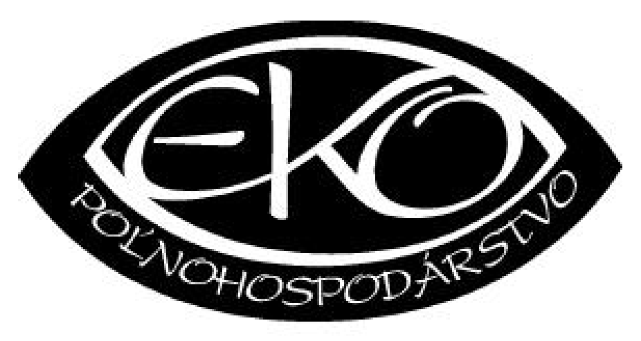
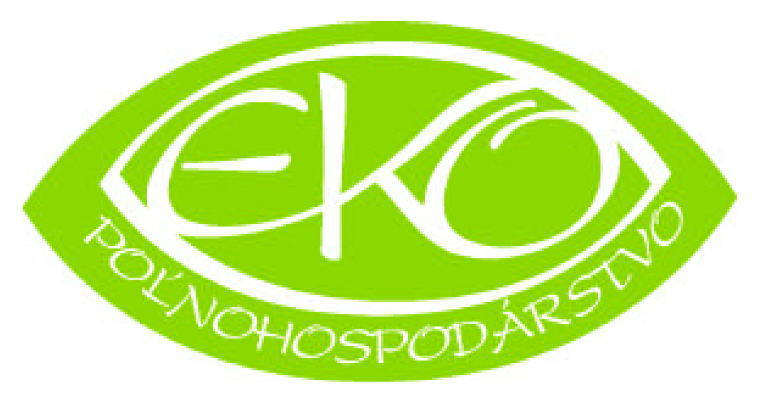

Príloha k zákonu č. 415/2002 Z. z.

- GRAFICKÝ ZNAK EKOLOGICKÉHO POĽNOHOSPODÁRSTVA

  - Značka - popis farieb a písma

  - Čiernobiela verzia

- 

  - Farebná verzia

- 

  - POUŽITE PÍSMO

  - President

  - ŠPECIFIKÁCIA POUŽITÝCH FARIEB

  - PRE OFSET:

  - zelená farba: PANTONE č. 375 CV, (CMYK: C-30, M-0, Y-100, K-0)

  - PRE APLIKÁCIU FÓLIÍ:

  - zelená farba
