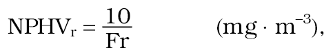

- 1) Zákon č. 163/2001 Z. z. o chemických látkach a chemických prípravkoch.

- 2) § 13s ods. 12 zákona Národnej rady Slovenskej republiky č. 272/1994 Z. z. o ochrane zdravia ľudí v znení zákona č. 514/2001 Z. z.

- 3) § 13s ods. 13 zákona Národnej rady Slovenskej republiky č. 272/1994 Z. z. v znení zákona č. 514/2001 Z. z.

- 4) § 13s ods. 1 písm. c) zákona Národnej rady Slovenskej republiky č. 272/1994 Z. z. v znení zákona č. 514/2001 Z. z.

- 5) § 8a ods. 1 písm. c) zákona Národnej rady Slovenskej republiky č. 330/1996 Z. z. o bezpečnosti a ochrane zdravia pri práci v znení zákona č. 158/2001 Z. z.

- 6) Nariadenie vlády Slovenskej republiky č. 159/2001 Z. z. o minimálnych bezpečnostných a zdravotných požiadavkách pri používaní pracovných prostriedkov.

- 7) Nariadenie vlády Slovenskej republiky č. 201/2001 Z. z. o minimálnych bezpečnostných a zdravotných požiadavkách na pracovisko.

- 8) § 20 zákona Národnej rady Slovenskej republiky č. 98/1995 Z. z. o Liečebnom poriadku v znení zákona č. 251/1997 Z. z.§ 8a ods. 1 písm. o) zákona Národnej rady Slovenskej republiky č. 330/1996 Z. z. v znení zákona č. 158/2001 Z. z.

- 9) Nariadenie vlády Slovenskej republiky č. 117/2001 Z. z., ktorým sa ustanovujú podrobnosti o technických požiadavkách a postupoch posudzovania zhody zariadení a ochranných systémov určených na použitie v prostredí s nebezpečenstvom výbuchu.

- 10) Nariadenie vlády Slovenskej republiky č. 444/2001 Z. z. o požiadavkách na používanie označenia, symbolov a signálov na zaistenie bezpečnosti a ochrany zdravia pri práci.

- 11) § 3 ods. 1 písm. g) zákona č. 163/2001 Z. z.

- 12) § 3 ods. 1 písm. f) zákona č. 163/2001 Z. z.

- 13) § 2 ods. 6 až 8 zákona č. 140/1998 Z. z. o liekoch a zdravotníckych pomôckach, o zmene zákona č. 455/1991 Zb. o živnostenskom podnikaní (živnostenský zákon) v znení neskorších predpisov a o zmene a doplnení zákona Národnej rady Slovenskej republiky č. 220/1996 Z. z. o reklame.

- 14) § 2 ods. 1 až 3 zákona č. 139/1998 Z. z. o omamných látkach, psychotropných látkach a prípravkoch v znení zákona č. 260/1999 Z. z.

- 15) § 2 ods. 1 zákona Národnej rady Slovenskej republiky č. 152/1995 Z. z. o potravinách v znení neskorších predpisov.

- 16) § 2 písm. a) zákona Národnej rady Slovenskej republiky č. 184/1993 Z. z. o krmivách.

- 17) § 3 ods. 1 písm. a) zákona č. 163/2001 Z. z.§ 21 zákona Slovenskej národnej rady č. 51/1988 Zb. o banskej činnosti, výbušninách a o štátnej banskej správe v znení neskorších predpisov.

- 18) Zákon Slovenskej národnej rady č. 126/1985 Zb. o požiarnej ochrane v znení neskorších predpisov.

- 19) § 27 ods. 2 písm. d) zákona Národnej rady Slovenskej republiky č. 272/1994 Z. z. v znení zákona č. 514/2001 Z. z.

- 20) § 21 písm. f) zákona Národnej rady Slovenskej republiky č. 272/1994 Z. z. v znení neskorších predpisov.

- 1) Za fibrogénny sa považuje pevný aerosól, ktorý obsahuje viac ako 1 % fibrogénnej zložky a v pokuse na zvierati vykazuje zreteľnú fibrogénnu reakciu pľúcneho tkaniva.

- 2) NPHV pre pevné aerosóly sa stanovuje ako celozmenová priemerná hodnota vystavenia celkovej koncentrácii pevného aerosólu (NPHVc) alebo jeho respirabilnej frakcii (NPHVr). Meranie sa vykonáva v dýchacej zóne vo vzdialenosti 30 cm od úst prístrojmi a metodikami schválenými príslušným orgánom na ochranu zdravia. Ako vyhovujúce možno hodnotiť pracovisko len v prípade, ak sú dodržané obidve hodnoty NPHV pre daný pevný aerosól.

- 3) Respirabilná frakcia je váhový podiel častíc pevného aerosólu ≤ 5 μm odobraného vo vzorke ovzdušia v dýchacej zóne zamestnanca stanoveným spôsobom, ktoré vzhľadom na ich priemer môžu prenikať až do pľúcnych alveolov.

- 4) Fr je obsah fibrogénnej zložky v % v respirabilnej frakcii.

- 5) Pri faktoroch v položke 1 až 4 je 100 % fibrogénnej zložky.

- 6) Do tejto skupiny sa zaraďuje pevný aerosól bez fibrogénneho a dráždivého účinku.

- 7) V prípade obsahu fibrogénnej zložky > 1 % v respirabilnej frakcii prachu sa vypočíta NPHVr pre respirabilnú frakciu prachu podľa vzorca:  pričom celková hodnota vystavenia prachu nesmie prekročiť 10,0 mg.m-3.

- 8) Ak sa vyskytujú v pracovnom ovzduší viaceré faktory, ktorých účinky sa vzájomne zosilňujú, NPHV sa stanoví výpočtom z NPHV jednotlivých faktorov.

- 9) NPHV pre pevné aerosóly neprihliada na možné alergické účinky a na obsah mikroorganizmov v prachu.

- 10) Obidve hodnoty sú rovnocenné.

- 11) Za respirabilné vlákno sa považuje častica, ktorá vyhovuje súčasne všetkým nasledujúcim podmienkam: hrúbka vlákna < 3 μm, dĺžka vlákna ≥ 5 μm, pomer (dĺžka : hrúbka) 3 : 1.

- 12) Pre azbest sa ustanovujú technické smerné hodnoty (TSH), ktoré upravuje nariadenie vlády Slovenskej republiky č. 39/2002 Z. z. o ochrane zdravia pri práci s azbestom.

- 13) Pre pevné aerosóly, ktoré sú zároveň klasifikované ako karcinogény alebo mutagény kategórie 1 a kategórie 2, sa stanovujú TSH. Definíciu TSH upravuje nariadenie vlády Slovenskej republiky č. 46/2002 Z. z. o ochrane zdravia pri práci s karcinogénnymi a mutagénnymi faktormi.

- 1) Zákon Národnej rady Slovenskej republiky č. 98/1995 Z. z. o Liečebnom poriadku.
