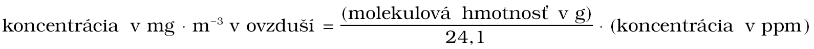
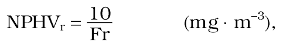

Príloha č. 1 k nariadeniu vlády č. 45/2002 Z. z.

- NAJVYŠŠIE PRÍPUSTNÉ HODNOTY VYSTAVENIA ZAMESTNANCOV CHEMICKÝM FAKTOROM PRI PRÁCI

- 1. Najvyššie prípustné hodnoty vystavenia plynom, parám, aerosólom s prevažne toxickým účinkom v pracovnom ovzduší (NPHV)

- Por. číslo | Chemická látka | EINECS | CAS | NPHV | | | | Upozornenie

- | | | | priemerná | | hraničná | |

- | | | | ml.m-3 (ppm) | mg.m-3 | kategória | mg.m-3 |

- 1. | acetaldehyd (etanal) | 200-836-8 | 75-07-0 | 50 | 91 | VI. | - |

- 2. | acetanhydrid (anhydrid kyseliny octovej) | 203-564-8 | 108-24-7 | 5 | 21 | I. | - |

- 3. | acetón (propanón) | 200-662-2 | 67-64-1 | 500 | 1210 | I. | - |

- 4. | acetonitril (etánnitril) | 200-835-2 | 75-05-8 | 40 | 68 | II., 1 | - |

- 5. | akroleín (propenál) | 203-453-4 | 107-02-8 | 0,1 | 0,23 | I. | - |

- 6. | aldtin | 206-215-8 | 309-00-2 | - | 0,25 | VI. | - | K

- 7. | alylalkohol (prop-2-én-1-ol) | 203-470-7 | 107-18-6 | 2 | 4,8 | - | 12,1 | K

- 8. | 2-aminopyridín | 207-988-4 | 504-29-0 | 0,5 | 2 | - | - |

- 9. | amoniak | 231-635-3 | 7664-41-7 | 20 | 14 | I. | 36 |

- 10. | amylalkohol (pentanoly okrem terc-pentanolu) | 250-378-8 | 30899-19-5 | 100 | 370 | II., 1 | - |

- 11. | anilín | 200-539-3 | 62-53-3 | 2 | 7,7 | VI. | - | K

- 12. | antimón a jeho zlúčeniny (ako celkový prach) | 231-146-5 | 7440-36-0 | - | 0,5 | III. | - |

- 13. | ANTU (naftalén-1-yltiomočovlna) | 201-706-3 | 86-88-4 | - | 0,3 | VI. | - |

- 14. | báryum - zlúčeniny rozpustné | 231-149-1 | 7440-39-3 | - | 0,5 | II., 1 | - |

- 15. | benzén-1,4-diol (hydrochinón) | 204-617-8 | 123-31-9 | - | 2 | VI. | - |

- 16. | 1,4-benzochinón (chinón, p-benzochinón) | 203-405-2 | 106-51-4 | 0,1 | 0,4 | I. | - | S

- 17. | bifenyl | 202-163-5 | 92-52-4 | 0,16 | 1 | - | - |

- 18. | bróm | 231-778-1 | 7726-95-6 | 0,1 | 0,7 | I. | - |

- 19. | 2-bróm-2-chlór-1,1,1-trifluóretán (halotan) | 205-796-5 | 151-67-7 | 5 | 41 | II., 1 | - |

- 20. | brómetán (etylbromid) | 200-825-8 | 74-96-4 | - | 890 | VI. | - | K

- 21. | brómchlórmetán | 200-826-3 | 74-97-5 | 200 | 1100 | II., 1 | - |

- 22. | bromovodík | 233-113-0 | 10035-10-6 | - | - | I. | 6,7 |

- 23. | butanón (etylmetylketón) | 201-159-0 | 78-93-3 | 200 | 600 | I. | 900 |

- 24. | butántiol | 203-705-3 | 109-79-5 | 0,5 | 1,9 | V. | - |

- 25. | 2-butoxyetanol (butylglykol) | 203-905-0 | 111-76-2 | 20 | 98 | - | 246 | K

- 26. | 2-butoxyetylacetát (butylglykolacetát) | 203-933-3 | 112-07-2 | 20 | 133 | - | 333 | K

- 27. | butylacetáty | | | 100 | 500 | I. | - |

- | 1-butylacetát | 204-658-1 | 123-86-4 | 100 | 480 | I. | - |

- | 2-butylacetát | 203-300-1 | 105-46-4 | | | | |

- | izo-butylacetát | 203-745-1 | 110-19-0 | 100 | 480 | I. | - |

- | terc-butylacetát | 208-760-7 | 540-88-5 | 20 | 96 | - | - |

- 28. | butylakrylát | 205-480-7 | 141-32-3 | 2 | 11 | - | 53 | S

- 29. | butylalkoholy (butanoly) | | | 100 | 310 | II., 1 | - |

- | 1-butanol | 200-751-6 | 71-36-3 | 100 | 310 | - | - |

- | 2-butanol | 201-158-5 | 78-92-2 | | | | |

- | izo-butanol | 201-148-0 | 78-83-1 | 100 | 310 | - | - |

- | terc-butanol | 200-889-7 | 75-65-0 | 20 | 62 | - | - |

- 30. | butyldiglykol 2-(2-butoxyetoxy)etanol | 203-961-6 | 112-34-5 | - | 100 | I. | - |

- 31. | 4-terc-butyltoluén (p-terc-butyltoluén) | 202-675-9 | 98-51-1 | 10 | 60 | I. | - |

- 32. | cín - zlúčeniny anorganické | 231-141-8 | 7440-31-5 | - | 2 | II., 1 | - |

- 33. | cín - zlúčeniny organické | | 7440-31-5 | - | 0,1 | II., 1 | - | K

- 34. | cyklohexán | 203-806-2 | 110-82-7 | 200 | 700 | II., 1 | - |

- 35. | cyklohexanol | 203-630-6 | 108-93-0 | 50 | 210 | II., 1 | - | K

- 36. | cyklohexanón | 203-631-1 | 108-94-1 | 10 | 40,8 | - | 81,6 | K

- 37. | cyklohexén | 203-807-8 | 110-83-8 | 300 | 1000 | II., 1 | - |

- 38. | cyklohexylamín (cyklohexánamín) | 203-629-0 | 108-91-8 | 10 | 41 | V. | - |

- 39. | DDT (1,1,1-trichlór-2,2-bis (4-chlorfenyl) etán), (dikofán, klofenotán) | 200-024-3 | 50-29-3 | - | 1 | IV. | - | K

- 40. | diamid kyseliny diazéndikarboxylovej | 204-650-8 | 123-77-3 | - | 1 | - | - |

- 41. | dibenzoyldioxidán (dibenzoylperoxid) | 202-327-6 | 94-36-0 | - | 5 | I. | - |

- 42. | diborán | | 19287-45-7 | 0,1 | 0,1 | I. | - |

- 43. | dibrómdifluórmetán | 200-885-5 | 75-61-6 | 100 | 870 | II., 1 | - |

- 44. | dibutylftalát | 201-557-4 | 84-74-2 | - | 3 | - | - |

- 45. | dieldrin (1a alfa, 2 beta, 2a alfa, 3 beta, 6 beta, 6a alfa, 7 beta, 7a alfa)-3, 4, 5, 6, 9, 9-hexachlór-2, 7: 3, 6-dimetano-la, 2, 2a, 3, 6, 6a, 7, 7a-oktahydro-nafto [2,3-b] oxirén | 200-484-5 | 60-57-1 | - | 0,25 | VI. | - | K

- 46. | dietylamín | 203-716-3 | 109-89-7 | 10 | 30 | V. | - |

- 47. | 2-dietylaminoetanol | 202-845-2 | 100-37-8 | 5 | 24 | I. | - | K

- 48. | dietylénglykol (2,2'-oxydietanol) | 203-872-2 | 111-46-6 | 10 | 44 | II., 2 | - |

- 49. | dietylénglykol-dimetyléter bis (2-metoxyetyl)éter | 203-924-4 | 111-96-6 | 5 | 28 | II., 1 | - | K

- 50. | dietyléter | 200-467-2 | 60-29-7 | 100 | 308 | - | 616 |

- 51. | di-(2-etylhexyl)ftalát | 204-211-0 | 117-81-7 | - | 10 | III. | - |

- 52. | difenyléter | 202-981-2 | 101-84-8 | 1 | 7,1 | - | - |

- 53. | dihydrogén selenid | 231-978-9 | 7783-07-5 | 0,02 | 0,07 | - | 0,17 |

- 54. | 1,2-dichlórbenzén (o-dichlórbenzén) | 202-425-9 | 95-50-1 | 20 | 122 | - | 306 | K

- 55. | 1,4-dichlórbenzén (p-dichlórbenzén) | 203-400-5 | 106-46-7 | 20 | 122 | - | 306 |

- 56. | dichlórdifluórmetán | 200-893-9 | 75-71-8 | 1000 | 5000 | IV. | - | K

- 57. | 1,1-dichlóretán | 200-863-5 | 75-34-3 | 100 | 412 | II., 1 | - | K

- 58. | 1,1-dichlóretén (dichlóretylén) | 200-864-0 | 75-35-4 | 2 | 8 | II., 1 | - |

- 59. | 1,2-dichlóretylén (1,2-dichlóretén) | 208-750-2 | 540-59-0 | 200 | 800 | II., 1 | - |

- 60. | dichlófluórmetán | 200-869-8 | 75-43-4 | 10 | 43 | II., 1 | - |

- 61. | dichlórmetán (metylénchlorid) | 200-838-9 | 75-09-2 | 100 | 350 | VI. | - |

- 62. | 1,2-dichlór-1,1,-tetrafluóretán | 200-937-7 | 76-14-2 | 1000 | 7100 | IV. | - |

- 63. | dichlórvos (2,2-dichlórvinyl dimetylfosfát) | 200-547-7 | 62-73-7 | 0,11 | 1 | III. | - | K

- 64. | N, N-dimetylacetamid | 204-826-4 | 127-19-5 | 10 | 36 | - | 72 | K

- 65. | dimetylamín | 204-697-4 | 124-40-3 | 2 | 3,8 | - | 9,4 |

- 66. | N, N-dimetylanilín | 204-493-5 | 121-69-7 | 5 | 25 | VI. | - | K

- 67. | 1,3-dimetylbutylacetát | 203-621-7 | 108-84-9 | 50 | 300 | I. | - |

- 68. | dimetyléter | 204-065-8 | 115-10-6 | 1000 | 1920 | IV. | - |

- 69. | N, N-dimetylformamid | 200-679-5 | 68-12-2 | 10 | 30 | II., 1 | - | K

- 70. | dinitrobenzén (všetky izoméry) | 246-673-6 | 25154-54-5 | 0,15 | 1 | - | - | K

- 71. | 1,4-dioxán | 204-661-8 | 123-91-1 | 20 | 73 | VI. | - | K

- 72. | endrin (1a alfa, 2 beta, 2a beta, 3 alfa, 6 alfa, 6a beta, 7 beta, 7a alfa)-3,4,5,6,9,9-hexachlór-2,7: 3,6-dimetano-la, 2, 2a, 3, 6, 6a, 7, 7a-oktahydro-nafto [2,3-b] oxirén | 200-775-7 | 72-20-8 | - | 0,1 | III. | - | K

- 73. | etántiol (etylmerkaptán) | 200-837-3 | 75-08-1 | 0,5 | 1,3 | V. | - |

- 74. | bis(2-chlóretyl)éter | 203-870-1 | 111-44-4 | 10 | 59 | II., 2 | - | K

- 75. | 2-etoxyetanol (etylglykol) | 203-804-1 | 110-80-5 | 5 | 19 | II., 1 | - | K

- 76. | 2-etoxyetylacetát (etylglykolacetát) | 203-839-2 | 111-15-9 | 5 | 27 | II., 1 | K |

- 77. | etylacetát (octan etylový) | 205-500-4 | 141-78-6 | 400 | 1500 | I. | - |

- 78. | etylakrylát | 205-438-8 | 140-88-5 | 5 | 21 | I. | - | K

- 79. | etylalkohol (etanol) | 200-578-6 | 64-17-5 | 500 | 960 | II., 1 | - |

- 80. | etylamín (etánamín) | 200-834-7 | 75-04-7 | 5 | 9,4 | V. | - |

- 81. | etylbenzén | 202-849-4 | 100-41-4 | 100 | 442 | - | 884 | K

- 82. | etyléndiamín (etán-1,2-diamín) | 203-468-6 | 107-15-3 | 10 | 25 | II., 1 | - |

- 83. | etylénglykol (etán-1,2-diol) | 203-473-3 | 107-21-1 | 20 | 52 | - | 104 | K

- 84. | etylén dinitrát (nitroglykol, dinitrát etylénglykolu) | 211-063-0 | 628-96-6 | 0,05 | 0,32 | II., 1 | - | K

- 85. | etylénchlórhydrín (2-chlóretanol) | 203-459-7 | 107-07-3 | 1 | 3,3 | II., 2 | - | K

- 86. | etylformiát (mravčan etylový) | 203-721-0 | 109-94-4 | 100 | 310 | I. | - | K

- 87. | fenol | 203-632-7 | 108-95-2 | 2 | 7,8 | I. | - | K

- 88. | o-fenyléndiamín (benzén-1,2-diamín) | 202-430-6 | 95-54-5 | - | 0,1 | VI. | - | K, S

- 89. | 2-fenylpropén | 202-705-0 | 98-83-9 | 50 | 246 | - | 492 |

- 90. | fluór | 231-954-8 | 7782-41-4 | 1,0 | 1,58 | - | 3,16 |

- 91. | fluorid sírový | 219-854-2 | 2551-62-4 | 1000 | 6100 | IV. | - |

- 92. | fluoridy | | | - | 2,5 | II., 2 | - |

- 93. | fluoridy a fluorovodík pri súčasnom pôsobení | | | - | 2,5 | I. | - |

- 94. | fluorovodík (kyselina fluorovodíková) | 231-634-8 | 7664-39-3 | 1,8 | 1,5 | - | 2,5 |

- 95. | formaldehyd (metanál) | 200-001-8 | 50-00-0 | 0,3 | 0,37 | VI. | - | K, S

- 96. | fosfor - prach (biely, žltý) | 231-768-7 | 7723-14-0 | - | 0,1 | I. | - |

- 97. | fosforovodík (fosfin) | 232-260-8 | 7803-51-2 | 0,1 | 0,14 | I. | - |

- 98. | fosgén (chlorid karbonylu, dichlorid-oxid uhličitý) | 200-870-3 | 75-44-5 | 0,02 | 0,08 | - | 0,4 |

- 99. | ftalanhydrid (anhydrid kyseliny ftalovej) | 201-607-5 | 85-44-9 | - | 1 | I. | - | S

- 100. | furfural (furán-2-karbaldehyd) | 202-627-7 | 98-01-1 | 2 | 7,9 | VI. | - | K

- 101. | furfurylalkohol (furán-2-ylmetanol) | 202-626-1 | 98-00-0 | 10 | 41 | - | - | K

- 102. | gáfor (bornán-2-ón) | 200-945-0 | 76-22-2 | 2 | 13 | - | - |

- 103. | glutarál (pentándiál) | 203-856-5 | 111-30-8 | 0,1 | 0,42 | I. | - | S

- 104. | nitroglycerín (propán-1,2,3-triyl trinitrát, trinitrát glycerolu) | 200-240-8 | 55-63-0 | 0,05 | 0,47 | II., 1 | - | K

- 105. | grafit | 231-955-3 | 7782-42-5 | - | 1,5 | - | - |

- | | 231-153-3 | 7440-44-0 | | | | |

- 106. | heptán | 205-563-8 | 142-82-5 | 500 | 2085 | I. | - |

- 107. | heptachlór (1,4,5,6,7,8,8-hepta-chlór-4,7-metano-3a, 4,7,7a-tetrahydro-1H-indén) | 200-962-3 | 76-44-8 | - | 0,5 | VI. | - | K

- 108. | heptán-2-ón (metylpentylketón) | 203-767-1 | 110-43-0 | 50 | 238 | - | 475 | K

- 109. | heptán-3-ón (etylbutylketón) | 203-388-1 | 106-35-4 | 20 | 95 | - | - |

- 110. | hexachlór-1,3-butadién | 201-765-5 | 87-68-3 | 0,02 | 0,21 | - | - | K

- 111. | hexachlóretán | 200-666-4 | 67-72-1 | 1 | 9,8 | - | - |

- 112. | 1,2,3,4,5,6-hexachlórcyklohexán (rozličné izoméry) | 206-270-8 | 319-84-6 | - | 0,5 | - | - | K

- | | 206-271-3 | 319-85-7 | | | | |

- 113. | hexametylén-1,6-diizokyanát (1,6-diizokyanato-hexán) | 212-485-8 | 822-06-0 | 0,005 | 0,035 | I. | - | S

- 114. | hexán (n-hexán) | 203-777-6 | 110-54-3 | 50 | 180 | II., 1 | - | K

- 115. | hliník - kovový (hliník práškový) | 231-072-3 | 7429-90-5 | - | 1,5 | II., 2 | - |

- | - oxid hlinitý dym | 215-691-6 | 1344-28-1 | | | | |

- | - oxid hlinitý | 215-691-6 | 1344-28-1 | | | | |

- | - hydroxid hlinitý | 244-492-7 | 21645-51-2 | | | | |

- 116. | hydrid lítny | 231-484-3 | 7580-67-8 | - | 0,025 | - | - |

- 117. | hydroxid sodný | 215-185-5 | 1310-73-2 | - | 2 | I. | - |

- 118. | hydroxid vápenatý | 215-137-3 | 1305-62-0 | - | 5 | - | - |

- 119. | chlór | 231-959-5 | 7782-50-5 | 0,5 | 1,5 | I. | - |

- 120. | chlóracetaldehyd | 203-472-8 | 107-20-0 | 1 | 3,0 | VI. | - |

- 121. | chlórbenzén | 203-628-5 | 108-90-7 | 10 | 47 | - | 94 |

- 122. | 2-chlórbuta-1,3-dién (chloroprén) | 204-818-0 | 126-99-8 | 5,0 | 18 | II., 1 | - | K

- 123. | chlorid fosforečný | 233-060-3 | 10026-13-8 | | 1 | I. | - |

- 124. | chloroform (trichlórmetán) | 200-663-8 | 67-66-3 | 2 | 10 | VI. | - |

- 125. | 3-chlórpropén (alylchlorid) | 203-457-6 | 107-05-1 | 1 | 3,0 | I. | - |

- 126. | chlorovodík | 231-595-7 | 7647-01-0 | 5 | 8,0 | - | 15 |

- 127. | 2-chlór-1,1,2-triflúoretyl diflúormetyléter | 237-553-4 | 13838-16-9 | 20 | 150 | II., 1 | - |

- 128. | chróm (III) chromát | | | - | 0,1 | - | - | S

- 129. | izokyanáty | | | - | 0,02 | - | - |

- 130. | izopropylbenzén (kumén) | 202-704-5 | 98-82-9 | 20 | 100 | - | 250 | K

- 131. | jód | 231-442-4 | 7553-56-2 | 0,1 | 1,1 | I. | - |

- 132. | jódmetán (metyljodid) | 200-819-5 | 74-88-4 | 0,3 | 2 | VI. | - |

- 133. | kaprolaktám (prach, pary) (azepán-2-ón, epsilon-kaprolaktám, hexáno-6-laktám) | 203-313-2 | 105-60-2 | - | 10 | - | 40 |

- 134. | karbid kremíka (voľné vlákna) | 206-991-8 | 409-21-2 | - | 1,5 | - | - |

- 135. | výroba kaučuku, gumy | | | | | | |

- | - výpary | | | - | 0,6 | - | - |

- | - prach z výroby | | | - | 6 | - | - |

- 136. | ketén | 207-336-9 | 463-51-4 | 0,5 | 0,9 | I. | - |

- 137. | kobalt kov, oxid a sulfid | 231-158-0 | 7440-48-4 | | | | |

- | - výroba katalyzátorov, magnetu | | | - | 0,5 | VI. | - |

- | - ostatné | | | - | 0,1 | VI. | - |

- 138. | krezoly (metylfenol) | 215-293-2 | 1319-77-3 | 5 | 22 | I. | - | K

- | o-krezol | | 95-48-7 | | | | |

- | m-krezol | | 108-39-4 | | | | |

- | p-krezol | | 106-44-5 | | | | |

- 139. | kyánamid (karbamonitril) | 206-992-3 | 420-04-2 | - | 2 | - | - |

- 140. | kyanidy | | | - | 5 | II., 1 | - | K

- 141. | kyanovodík (kyselina kyanovodíková) | 200-821-6 | 74-90-8 | 10 | 11 | II., 1 | - | K

- 142. | kyselina mravčia (kyselina metánová) | 200-579-1 | 64-18-6 | 5 | 9,0 | I. | - |

- 143. | kyselina octová (kyselina etánová) | 200-580-7 | 64-19-7 | 10 | 25 | I. | - |

- 144. | kyselina trihydrogénfosforečná | 231-633-2 | 7664-38-2 | - | 1 | - | 2 |

- 145. | kyselina pikrová (2,4,6-trinitrofenol) | 201-865-9 | 88-89-1 | - | 0,1 | I. | - | K, S

- 146. | kyselina propánová (kyselina propiónová) | 201-176-3 | 79-09-4 | 10 | 31 | - | 62 |

- 147. | kyselina sírová | 231-639-5 | 7664-93-9 | - | 0,1 | I. | - |

- 148. | kyselina šťaveľová (kyselina etándiová) | 205-634-3 | 144-62-7 | - | 1 | - | - |

- 149. | lindán (1 alfa, 2 alfa, 3 beta, 4 alfa, 5 alfa, 6 beta)-1,2,3,4,5,6-hexachlórcyklohexán) | 200-401-2 | 58-89-9 | - | 0,1 | III. | - | K

- 150. | maleínanhydrid (anhydrid kyseliny maleínovej) | 203-571-6 | 108-31-6 | 0,1 | 0,4 | I. | - | S

- 151. | mangán a jeho anorganické zlúčeniny | 231-105-1 | 7439-96-5 | - | 0,5 | III. | - |

- 152. | meď, prach | 231-159-6 | 7440-50-8 | - | 1 | II., 1 | - |

- 153. | meď, dymy | 231-159-6 | 7440-50-8 | - | 0,1 | II., 1 | - |

- 154. | 2-metoxyetanol (metylglykol) | 203-713-7 | 109-86-4 | 5 | 16 | II., 1 | - | K

- 155. | 2-metoxyetylacetát (metylglykolacetát) | 203-772-9 | 110-49-6 | 5 | 25 | II., 1 | - | K

- 156. | 2-metoxymetyl-etoxy propanol | 252-104-2 | 34590-94-8 | 50 | 308 | - | - | K

- 157. | 1-metoxypropán-2-ol (propylénglykolmonometyléter) | 203-539-1 | 107-98-2 | 100 | 375 | - | 568 | K

- 158. | 2-metoxypropán-1-ol | 216-455-5 | 1589-47-5 | 20 | 75 | II., 1 | - | K

- 159. | 2-metoxypropán-2-ylacetát | 203-603-9 | 108-65-6 | 50 | 275 | - | 550 | K

- 160. | 2-metoxypropylacetát | 274-724-2 | 70657-70-4 | 20 | 110 | II., 1 | - | K

- 161. | metylacetát (octan metylový) | 201-185-2 | 79-20-9 | 200 | 610 | I. | - |

- 162. | metylalkohol (metanol) | 200-659-6 | 67-56-1 | 200 | 260 | II., 1 | - | K

- 163. | metylacetylén (metyletín) | 200-828-4 | 74-99-7 | 1000 | 1650 | IV. | - |

- 164. | metylakrylát | 202-500-6 | 96-33-3 | 5 | 18 | I. | - | S

- 165. | metylamín (metánamín, metylazán) | 200-820-0 | 74-89-5 | 10 | 13 | V. | - |

- 166. | N-metylanilín | 202-870-9 | 100-61-8 | 0,5 | 2,2 | II., 1 | - | K

- 167. | 1-metylbutylacetát (pentán-2-ylacetát) | 210-946-8 | 626-38-0 | 50 | 270 | - | 540 |

- 168. | 3-metylbutylacetát (izopentylacetát) | 204-662-3 | 123-92-2 | 50 | 270 | - | 540 |

- 169. | metylcyklohexán | 203-624-3 | 108-87-2 | 200 | 810 | II., 1 | - |

- 170. | metylcyklohexanol (izoméry) | 247-152-6 | 25639-42-3 | 50 | 235 | II., 1 | - |

- 171. | 2-metyl-4,6-dinitrofenol (DNOC) | 208-601-1 | 534-52-1 | - | 0,2 | II., 1 | - | K

- 172. | 5-metylhexán-2-on (metylizoamylketón) | 203-737-8 | 110-12-3 | 20 | 95 | - | - |

- 173. | 1,1'-metylénbis(4-izokyanatobenzén)4,4'-metyléndifenylizokyanát | 202-966-0 | 101-68-8 | 0,005 | 0,05 | I. | - | K

- 174. | metylchlorid (chlórmetán) | 200-817-4 | 74-87-3 | 50 | 100 | VI. | - | K

- 175. | 5-metyl-3-heptanón | 208-793-7 | 541-85-5 | 10 | 53 | - | 107 |

- 176. | metyllzokyanát (izokyanatometán) | 210-866-3 | 624-83-9 | 0,01 | 0,024 | I. | - | S

- 177. | metylmetakrylát (metyl 2-etylpropenoát) | 201-297-1 | 80-62-6 | 50 | 210 | I. | - | S

- 178. | 4-metylpentán-2-ón (izobutylmetylketón) | 203-550-1 | 108-10-1 | 20 | 83 | - | 208 | K

- 179. | metylstyrén (vinyltoluén) | 246-562-2 | 25013-15-4 | 100 | 490 | V. | - |

- 180. | mevinfos (metyl 3-(dimetoxyfosfonyloxy-but-2-enoát) | 232-095-1 | 7786-34-7 | 0,01 | 0,093 | - | - | K

- 181. | molybdén - zlúčeniny rozpustné | 231-107-2 | 7439-98-7 | - | 5 | III. | - |

- 182. | molybdén - zlúčeniny nerozpustné | 231-107-2 | 7439-98-7 | - | 15 | III. | - |

- 183. | monochlórdifluórmetán (chlórdifluórmetán) | 200-871-9 | 75-45-6 | 1000 | 3600 | IV. | - |

- 184. | morfolín | 203-815-1 | 110-91-8 | 10 | 36 | I. | - |

- 185. | naftalén | 202-049-5 | 91-20-3 | 10 | 50 | - | - |

- 186. | nikel a jeho zlúčeniny vo vode nerozpustné | 231-111-4 | 7440-02-0 | - | 0,5 | VI. | - | S

- 187. | nikotín (N)-3-(1-metylpyrolidín-2-yl) pyridín | 200-193-3 | 54-11-5 | - | 0,5 | II., 1 | - | K

- 188. | nitril kyseliny etánovej (etánnitril, acetonitril) | 200-835-2 | 75-05-8 | 40 | 70 | - | - |

- 189. | nitrobenzén | 202-716-0 | 98-95-3 | 1 | 5 | VI. | - | K

- 190. | nitrotoluén (všetky izoméry) | 202-728-6 | 99-08-1 | 5 | 28 | II., 1 | - | K

- 191. | nitrotoluén (4-nitrotoluén) | 202-808-0 | 99-99-0 | 5 | 28 | II., 1 | - | K

- 192. | oleje minerálne | | | | | | |

- | - nerafinované | | | 5 | 1 | VI | - |

- | - rafinované | | | - | 5 | - | - |

- 193. | olovo | 231-100-4 | 7439-92-1 | - | 0,15 | VI. | - |

- 194. | ortuť | 231-106-7 | 7439-97-6 | - | 0,1 | III. | - | S

- 195. | ortuť - zlúčeniny organické | | | - | 0,01 | III. | - | K, S

- 196. | oxid antimonitý | 215-175-0 | 1309-64-4 | - | 0,5 | VI. | - |

- 197. | oxid dusičitý | 233-272-6 | 10102-44-0 | 5 | 9,5 | I. | - |

- 198. | oxid dusnatý | 233-271-0 | 10102-43-9 | 25 | 30 | - | - |

- 199. | oxid dusný | 233-032-0 | 10024-97-2 | 100 | 180 | II., 1 | - |

- 200. | oxid fosforečný | 215-236-1 | 1314-56-3 | - | 1 | I. | - |

- 201. | oxid chloričitý (chlórdioxid) | 233-162-8 | 10049-04-4 | 0,1 | 0,28 | I. | - |

- 202. | oxid osmičelý | 244-058-7 | 20816-12-0 | 0,0002 | 0,0021 | I. | - |

- 203. | oxid sírový | 231-197-3 | 7446-11-9 | - | 1 | - | - |

- 204. | oxid siričitý | 231-195-2 | 7446-09-5 | 0,5 | 1,3 | I. | - |

- 205. | oxid uhličitý | 204-696-9 | 124-38-9 | 5000 | 9000 | IV. | - |

- 206. | oxid uhoľnatý | 211-128-3 | 630-08-0 | 30 | 35 | II., 1 | - |

- 207. | oxid vanadičný | 215-239-8 | 1314-62-1 | - | 0,05 | VI. | - |

- 208. | oxid zinočnatý (dymy) | 215-222-5 | 1314-13-2 | - | 1 | III. | - |

- 209. | ozón | 233-069-2 | 10028-15-6 | 0,1 | 0,2 | I. | - |

- 210. | paraquatdichlorid | 217-615-7 | 1910-42-5 | - | 0,1 | I. | - | K

- 211. | paratión (O,O-dietyl-O-4-nitrofenyl tiofosfát) | 200-271-7 | 56-38-2 | - | 0,1 | - | - | K

- 212. | pentaboran | 243-194-4 | 19624-22-7 | 0,005 | 0,013 | II., 1 | - |

- 213. | pentakarbonyl železa | 236-670-8 | 13463-40-6 | 0,1 | 0,81 | II., 1 | - |

- 214. | pentylacetát | 211-047-3 | 628-63-7 | 50 | 270 | - | 540 |

- 215. | pentylacetát terciálny | | 625-16-1 | 50 | 270 | - | 540 |

- | 3-pentylacetát | | 620-11-1 | 50 | 270 | - | 540 |

- 216. | peroxid vodíka | 231-765-0 | 7722-84-1 | 1 | 1,4 | I. | - |

- 217. | piperazín | 203-808-3 | 110-85-0 | - | 0,1 | - | 0,3 |

- 218. | platina - kovová | 231-116-1 | 7440-06-4 | - | 1 | - | - |

- 219. | platina - zlúčeniny | | | - | 0,002 | - | - |

- 220. | polyetylénglykol (macrogol- (INN)) | | 25322-68-3 | - | 1000 | IV. | - |

- 221. | propán-2-amín (izopropylamín) | 200-860-9 | 75-31-0 | 5 | 12 | II., 1 | - |

- 222. | propán-2-ol (izopropylalkohol) | 200-661-7 | 67-63-0 | 200 | 500 | II., 1 | - |

- 223. | propylacetát (octan propylový) | 203-686-1 | 109-60-4 | 100 | 420 | I. | - |

- 224. | pyretrum | 232-319-8 | 8003-34-7 | - | 5 | III. | - | S

- 225. | pyridín | 203-809-9 | 110-86-1 | 5 | 15 | II., 1 | - |

- 226. | rezorcinol (benzén-1,3-diol) | 203-585-2 | 108-46-3 | 10 | 45 | - | - |

- 227. | selén | 231-957-4 | 7782-49-2 | - | 0,05 | II., 1 | - |

- 228. | síran vápenatý | 231-900-3 | 7778-18-9 | - | 6 | - | - |

- 229. | sulfid kademnatý | 215-147-8 | 1306-23-6 | - | 32 | - | - |

- 230. | sírouhlík (sulfid uhličitý) | 200-843-6 | 75-15-0 | 5 | 16 | II., 1 | - | K

- 231. | sírovodík (sufán) | 231-977-3 | 7783-06-4 | 10 | 14 | V. | - |

- 232. | sódium azid (azid sodný) | 247-852-1 | 26628-22-8 | - | 0,1 | - | 0,3 | K

- 233. | striebro | 231-131-3 | 7440-22-4 | - | 0,1 | III. | - |

- 234. | styrén | 202-851-5 | 100-42-5 | 20 | 86 | II., 1 | - |

- 235. | sulfid fosforečný | 215-242-4 | 1314-80-3 | - | 1 | - | - |

- 236. | sulfotep (O,O,O,O-tetraetyl difosforotioát) | 222-995-2 | 3689-24-5 | - | 0,1 | III. | - | K

- 237. | tálium - rozpustné zlúčeniny | 231-138-1 | 7440-28-0 | - | 0,1 | III. | - |

- 238. | telúr a jeho zlúčeniny | | 13494-80-9 | - | 0,1 | II., 1 | - |

- 239. | terpentín (terpentínový olej) | 232-350-7 | 8006-64-2 | 100 | 560 | I. | - | S

- 240. | tetraetylolovo | | 78-00-2 | - | 0,05 | II., 1 | - | K

- 241. | tetrahydrofurán | 203-726-8 | 109-99-9 | 50 | 150 | - | 300 | K

- 242. | 1,1,1,2-tetrachlór-2,2-difluóretán | 200-934-0 | 76-11-9 | 1000 | 8500 | IV. | - |

- 243. | 1,1,2,2-tetrachlór-1,2-difluóretán | 200-935-6 | 76-12-0 | 200 | 1700 | II., 2 | - |

- 244. | 1,1,2,2-tetrachlóretán | 201-197-8 | 79-34-5 | 1 | 7 | - | - | K

- 245. | tetrachlóretén (perchlóretylén, tetrachlóretylén) | 204-825-9 | 127-18-4 | 50 | 345 | VI. | - |

- 246. | tetrachlórmetán (chlorid uhličitý) | 200-262-8 | 56-23-5 | 0,5 | 3,2 | VI. | - | K

- 247. | tetrakarbonyl niklu | 236-669-2 | 13463-39-3 | 0,05 | 0,12 | VI. | - | K

- 248. | tetrametylolovo | 200-897-0 | 75-74-1 | - | 0,05 | II., 1 | - | K

- 249. | tetranitrometán | 208-094-7 | 509-14-8 | - | 10 | - | - |

- 250. | toluén | 203-625-9 | 108-88-3 | 50 | 190 | II., 2 | - |

- 251. | toluén-2,4-diizokyanát (4-metyl-m-fenyléndiizokyanát, 2,4-diizokyanato-1-metylbenzén) | 209-544-5 | 584-84-9 | 0,01 | 0,07 | VI. | - | S

- 252. | toluén-2,6-diizokyanát (1,3-diizokyanato-2-metylbenzén, 2-metyl-m-fenyléndiizokyanát) | 202-039-0 | 91-08-7 | 0,01 | 0,07 | VI. | - | s

- 253. | trietylamín | 204-469-4 | 121-44-8 | 2 | 8,4 | - | 12,6 | K

- 254. | 1,2,4-trichlórbenzén | 204-428-0 | 120-82-1 | 2 | 15,1 | - | 37,8 | K

- 255. | trifluórbróm-metán (halon-1301) | 200-887-6 | 75-63-8 | 1000 | 6100 | IV. | - |

- 256. | 1,1,1-trichlóretán (metylchloroform) | 200-756-3 | 71-55-6 | 100 | 550 | - | 1100 |

- 257. | 1,1,2-trichlóretán | 201-166-9 | 79-00-5 | 10 | 55 | II., 2 | - | K

- 258. | trichlóretylén (trichlóretén) | 201-167-4 | 79-01-6 | 100 | 550 | VI. | - |

- 259. | trichlórfluormetán | 200-892-3 | 75-69-4 | 1000 | 5700 | IV. | - |

- 260. | trichlorid-oxid fosforečný (chlorid fosforylu) | 233-046-7 | 10025-87-3 | 0,2 | 1,3 | II., 1 | - |

- 261. | triglycidyl-izokyanuarát | | | - | 0,1 | - | - |

- 262. | trimellitan hydrid (1,2-anhydrid kyseliny 1,2,4-benzén-trikarboxylovej, anhydrid kyseliny trimelitovej) | 209-008-0 | 552-30-7 | - | 0,04 | I. | - |

- 263. | 1,2,3-trimetylbenzén | 208-394-8 | 526-73-8 | 20 | 100 | II., 1 | - |

- 264. | 1,2,4-trimetylbenzén | 202-436-9 | 95-63-6 | 20 | 100 | II., 1 | - |

- 265. | 1,3,5-trimetylbenzén (mezitylén) | 203-604-4 | 108-67-8 | 20 | 100 | II., 1 | - |

- 266. | 2,4,6-trinitrotoluén TNT (izoméry v technických zmesiach) | 204-289-6 | 118-96-7 | 0,011 | 0,1 | II., 1 | - | K

- 267. | vinylacetát (octan vinylový) | 203-545-4 | 108-05-4 | 10 | 36 | VI. | - |

- 268. | vinylidénchlorid (1,1-dichlóretén, dichlóretylén) | 200-864-0 | 75-35-4 | 2 | 8 | II., 1 | - |

- 269. | xylén | 215-535-7 | 1330-20-7 | 50 | 221 | - | 442 | K

- | o-xylén | 202-422-2 | 95-47-6 | 50 | 221 | - | 442 | K

- | m-xylén | 203-576-3 | 108-38-3 | 50 | 221 | - | 442 | K

- | p-xylén | 203-396-5 | 106-42-3 | 50 | 221 | - | 442 | K

- Poznámky a vysvetlivky:

- 1. Najvyššie prípustné hodnoty sú stanovené priemernou hodnotou a hraničnou hodnotou.

- Najvyššia prípustná hodnota priemerná sa nesmie prekročiť v celozmenovom priemere. Celozmenovým priemerom sa rozumie časovo-vážený priemer hodnôt koncentrácií nameraných počas referenčného časového intervalu v dýchacej zóne zamestnanca. Najvyššie prípustné hodnoty priemerné sa vzťahujú na osemhodinovú pracovnú zmenu a 40-hodinový pracovný týždeň.

- Najvyššia prípustná hodnota hraničná sa nesmie prekročiť vôbec. Hodnoty vystavenia sa určujú pri niektorých látkach uvedením kategórie I - VI alebo koncentráciou látky v pracovnom ovzduší.

- 2. Najvyššie prípustné hodnoty vystavenia plynom, parám a pevným aerosólom sú stanovené nezávisle od teploty a tlaku vzduchu v ml na m3 (ppm - pars per million) a závisle od týchto premenných v mg na m3 pri teplote 20 oC a tlaku 101,3 kPa. Najvyššie prípustné hodnoty vystavenia pevným aerosólom sú uvedené v mg na m3.

- 

- 24,1 = molekulový objem vyjadrený v litroch pri teplote 20 oC a 101,3 kPa.

- 3. EINECS číslo: číslo priradené chemickej látke, ktorá sa nachádza v Európskom zozname existujúcich komerčných chemických látok.

- 4. CAS číslo: medzinárodne stanovené číslo priradené danému chemickému faktoru na účely presnej identifikácie chemickej látky za predpokladu, že údaje boli publikované v odbornej literatúre.

- 5. NPHV hraničné:

Kategórie hraničných NPHV | Krátkodobé vystavenie | | Frekvencia za zmenu

| hodnota | trvanie |

I. Miestne dráždivé faktory alebo faktory senzibilizujúce dýchacie cesty | 2 x NPHV | 15 min okamžitá hodnota | 4 v odstupe 1 hodiny

II. Faktory so systémovými účinkami Začiatok účinku ≤ 2 hod. II., 1: polčas vylúčenia z organizmu < 2 hod. | 2 x NPHV | 30 min. priemerná hodnota | 4

II., 2: polčas vylúčenia z organizmu = 2 - 8 hod. do konca pracovnej zmeny | 5 x NPHV | 30 min. priemerná hodnota | 2

III. Faktory so systémovými účinkami Začiatok účinku > 2 hod. Polčas > dĺžka zmeny | 10 x NPHV | 30 min. | 1

Výrazná kumulácia faktora v organizme | | priemerná hodnota |

IV. Faktory, ktoré majú veľmi slabé účinky NPHV > 500 ml.m-3 | 2 x NPHV | 60 min. okamžitá hodnota | 3

V. Faktory spôsobujúce intenzívny zápach | 2 x NPHV | 10 min. okamžitá hodnota | 4

VI. Faktory zaradené do kategórie 3 - možný karcinogén | 5 x NPHV | 15 min. priemerná hodnota | 5

- 6. K - znamená, že faktor môže byť ľahko absorbovaný kožou.

- Niektoré faktory, ktoré ľahko prenikajú kožou, môžu spôsobovať až smrteľné otravy, často bez varovných príznakov (napr. anilín, nitrobenzén, nitroglykol, fenoly a pod.). Pri látkach s významným prienikom cez kožu, či už v podobe kvapalín alebo pár, je osobitne dôležité zabrániť kožnému kontaktu.

- 7. S - znamená, že faktor môže spôsobiť senzibilizáciu.

- Senzibilizujúce účinky majú faktory, ktoré spôsobujú vyšší výskyt precitlivelosti alergického typu. Pri práci s nimi je potrebná osobitná opatrnosť. Dodržiavanie najvyšších prípustných hodnôt vystavenia nezabezpečí, že nevzniknú u vnímavých osôb alergické reakcie.

- 2. Najvyššie prípustné hodnoty vystavenia pevným aerosólom bez toxického účinku

- Tabuľka č. 1

- Pevné aerosóly s prevažne fibrogénnym účinkom1)

- Faktor | NPHVr - pre respirabilnú frakciu3) (mg.m-3) | | NPHVc - pre celkovú koncentráciu2) (mg.m-3)

- | Fr = 100 %4) | |

- 1. kremeň5) | 0,1 (THS)13) | | -

- 2. kristobalit5) | 0,1 | | -

- 3. tridymit5) | 0,1 | | -

- 4. gama-oxid hlinitý5) | 0,1Fr ≤ 5 % | Fr > 5 %4) | -

- 5. dinas | 2,0 | 10 : Fr | 10,0

- 6. grafit | 2,0 | 10 : Fr | 10,0

- 7. čierne uhlie | 2,0 | 10 : Fr | 10,0

- 8. koks | 2,0 | 10 : Fr | 10,0

- 9. sľuda | 2,0 | 10 : Fr | 10,0

- 10. mastenec | 2,0 | 10 : Fr | 10,0

- 11. talok | 2,0 | 10 : Fr | 10,0

- 12. ostatné kremičitany (s výnimkou azbestu) | 2,0 | 10 : Fr | 10,0

- 13. šamot | 2,0 | 10 : Fr | 10,0

- 14. zlievarenské pevné aerosóly | 2,0 | 10 : Fr | 10,0

  - Tabuľka č. 2

- Pevné aerosóly s možným fibrogénnym účinkom

- Faktor | NPHVc (mg.m-3)

- 1. amorfný SiO2 | 2,0

- 2. sadze (karcinogén - kategórie 1) | 2,0 (TSH)13)

- 3. zváračské pevné aerosóly6) | 5,0

- 4. ferrosilicium | 8,0

- 5. bentonit | 6,0

- Tabuľka č. 3

- Pevné aerosóly s prevažne nešpecifickým účinkom

- Faktor | NPHVc (mg.m-3)

- 1. hnedé uhlie a lignit7) | 10,0

- 2. vápenec, mramor7) | 10,0

- 3. baryt7) | 10,0

- 4. siderit7) | 10,0

- 5. pevné aerosóly z umelého brusiva7) (karborundum, elektrit) | 10,0

- 6. hliník a jeho oxidy (s výnimkou gama Al2O3) | 6,0

- 7. ferrozliatiny8) (okrem ferrosilicia) | 10,0

- 8. oxidy železa | 10,0

- 9. čadič tavený | 10,0

- 10. pôdne pevné aerosóly | 10,0

- 11. vysokopecná troska8) | 10,0

- 12. oceliarska troska8) | 10,0

- 13. popolček8) | 10,0

- 14. škvara8) | 10,0

- 15. magnezit | 10,0

- 16. dolomit | 10,0

- 17. kovové dentálne zliatiny | 10,0

- 18. ostatný pevný aerosól | 10,0

- Tabuľka č. 4

- Pevné aerosóly s prevažne dráždivým účinkom

- Faktor | | NPHVc (mg.m-3)9)

- 1. | Minerálny pevný aerosól |

- | oxid vápenatý | 2,0

- | oxid horečnatý | 4,0

- | uhličitany alkálií | 8,0

- | hydroxidy alkálií | 0,5

- | cement | 10,0

- 2. | Textilný pevný aerosól |

- | bavlna | 2,0

- | ľan | 2,0

- | konope | 2,0

- | hodváb | 2,0

- | syntetické vlákna textilné | 4,0

- | sisal | 6,0

- | juta | 6,0

- | kapok | 6,0

- 3. | Živočíšny pevný aerosól |

- | perie | 4,0

- | vlna | 6,0

- | srsť | 6,0

- | ostatný živočíšny pevný aerosól | 6,0

- 4. | Rastlinný pevný aerosól |

- | múka | 4,0

- | cukor | 6,0

- | tabak | 4,0

- | čaj | 4,0

- | káva zelená | 2,0

- | korenie | 2,0

- | pevný aerosól obilný | 6,0

- | pevný aerosól z dreva |

- | a) exotické dreviny | 1,0

- | b) ostatné dreviny | 5,0

- | c) buk, dub (karcinogén kategórie 1) | 1,0 (TSH)13)

- | ostatný rastlinný pevný aerosól | 6,0

- 5. | Iný pevný aerosól s dráždivým účinkom |

- | brúsny pevný aerosól |

- | a) fenolformaldehydových živíc | 6,0

- | b) PVC | 5,0

- | c) pneumatík | 3,0

- | d) sklolaminátov | 8,0

- | e) polymetakrylátových živíc | 8,0

- Tabuľka č. 5

- Minerálne vláknité pevné aerosóly

- Faktor | NPHV10) |

- | Knpočetná koncentrácia počet respirabilných vlákien11) . cm-3 | Kc hmotnostná koncentrácia mg . m-3

- azbest12) | |

- umelé minerálne vlákna (napr. čadičové, sklenené, troskové) | 2 | 4,0

- Vysvetlivky a poznámky:

- 1) Za fibrogénny sa považuje pevný aerosól, ktorý obsahuje viac ako 1 % fibrogénnej zložky a v pokuse na zvierati vykazuje zreteľnú fibrogénnu reakciu pľúcneho tkaniva.

- 2) NPHV pre pevné aerosóly sa stanovuje ako celozmenová priemerná hodnota vystavenia celkovej koncentrácii pevného aerosólu (NPHVc) alebo jeho respirabilnej frakcii (NPHVr). Meranie sa vykonáva v dýchacej zóne vo vzdialenosti 30 cm od úst prístrojmi a metodikami schválenými príslušným orgánom na ochranu zdravia. Ako vyhovujúce možno hodnotiť pracovisko len v prípade, ak sú dodržané obidve hodnoty NPHV pre daný pevný aerosól.

- 3) Respirabilná frakcia je váhový podiel častíc pevného aerosólu ≤ 5 μm odobraného vo vzorke ovzdušia v dýchacej zóne zamestnanca stanoveným spôsobom, ktoré vzhľadom na ich priemer môžu prenikať až do pľúcnych alveolov.

- 4) Fr je obsah fibrogénnej zložky v % v respirabilnej frakcii.

- 5) Pri faktoroch v položke 1 až 4 je 100 % fibrogénnej zložky.

- 6) Do tejto skupiny sa zaraďuje pevný aerosól bez fibrogénneho a dráždivého účinku.

- 7) V prípade obsahu fibrogénnej zložky > 1 % v respirabilnej frakcii prachu sa vypočíta NPHVr pre respirabilnú frakciu prachu podľa vzorca:

- 

- pričom celková hodnota vystavenia prachu nesmie prekročiť 10,0 mg.m-3.

- 8) Ak sa vyskytujú v pracovnom ovzduší viaceré faktory, ktorých účinky sa vzájomne zosilňujú, NPHV sa stanoví výpočtom z NPHV jednotlivých faktorov.

- 9) NPHV pre pevné aerosóly neprihliada na možné alergické účinky a na obsah mikroorganizmov v prachu.

- 10) Obidve hodnoty sú rovnocenné.

- 11) Za respirabilné vlákno sa považuje častica, ktorá vyhovuje súčasne všetkým nasledujúcim podmienkam:

- hrúbka vlákna < 3 μm,

- dĺžka vlákna ≥ 5 μm,

- pomer (dĺžka : hrúbka) 3 : 1.

- 12) Pre azbest sa ustanovujú technické smerné hodnoty (TSH), ktoré upravuje nariadenie vlády Slovenskej republiky č. 39/2002 Z. z. o ochrane zdravia pri práci s azbestom.

- 13) Pre pevné aerosóly, ktoré sú zároveň klasifikované ako karcinogény alebo mutagény kategórie 1 a kategórie 2, sa stanovujú TSH. Definíciu TSH upravuje nariadenie vlády Slovenskej republiky č. 46/2002 Z. z. o ochrane zdravia pri práci s karcinogénnymi a mutagénnymi faktormi.
