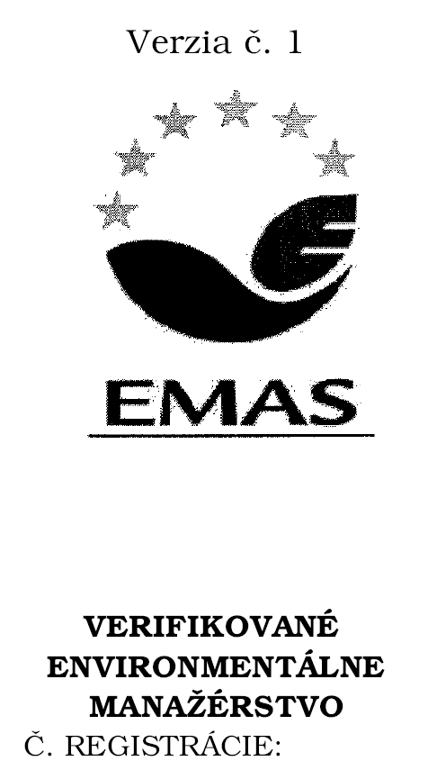
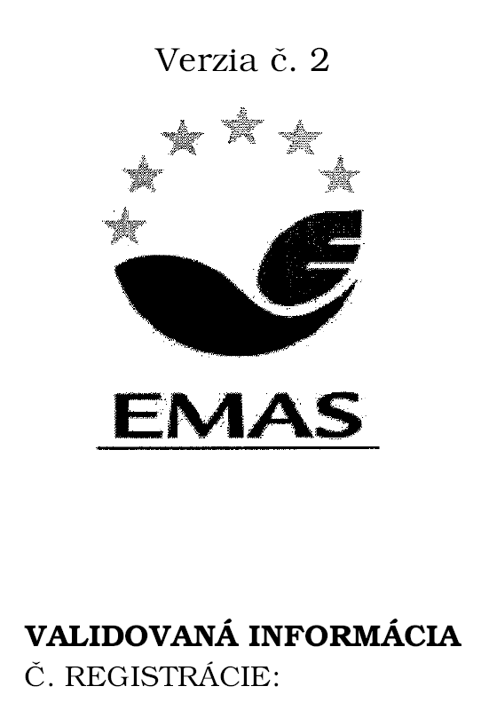

Príloha č. 3 k zákonu č. 468/2002 Z. z.

- VZOR LOGA A ODKAZU NA REGISTRÁCIU A. Vzor loga podľa § 20 ods. 1 tohto zákona

- 

- 

- Na oboch verziách musí byt vždy uvedené registračné číslo organizácie.

- Logo sa musí používať buď

- - v trojfarebnom prevedení (Pantone č. 255 zelená; Pantone č. 109 žltá; Pantone č. 286 modrá),

- - čierne na bielom pozadí, alebo

- - biele na čiernom pozadí.

- B. Vzor loga podľa § 20 ods. 5 tohto zákona

- 

- C. Vzor odkazu na registráciu podľa § 21 ods. 1 tohto zákona

- Verzia č. 1 | Verzia č. 2

- „Organizácia registrovaná v EMAS“ č. registrácie: | „Validovaná informácia (EMAS)“ č. registrácie:

- V oboch verziách sa uvedie číslo registrácie organizácie.
