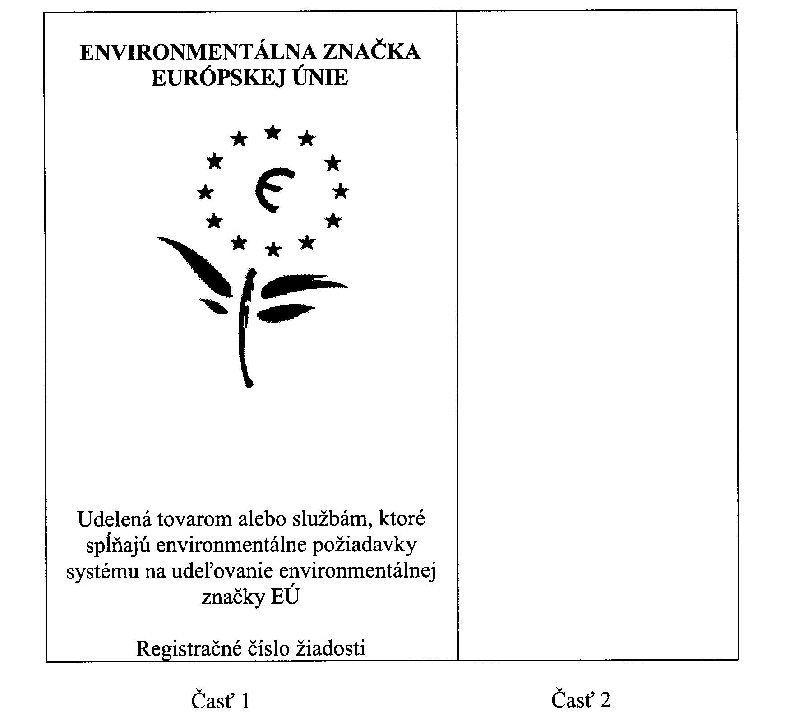

Príloha č. 3 k zákonu č. 469/2002 Z. z.

ENVIRONMENTÁLNA ZNAČKA EURÓPSKEHO SPOLOČENSTVA TVAR ENVIRONMENTÁLNEJ ZNAČKY

Environmentálna značka Európskeho spoločenstva sa udelí výrobkom, ktoré spĺňajú kritériá pre všetky vybrané kľúčové environmentálne aspekty. Musí obsahovať informácie pre spotrebiteľov v súlade s § 13 tohto zákona a podľa nasledujúceho vzoru:

Environmentálna značka Európskeho spoločenstva sa skladá z týchto dvoch častí:

- Časť 2 obsahuje informácie o dôvodoch na udelenie environmentálnej značky Európskeho spoločenstva. Informácie sa musia vzťahovať aspoň na jeden environmentálny vplyv, a nie na viac ako tri environmentálne vplyvy. Informácie majú mať formu stručného slovného opisu.

- Príklad:

* | nízke znečistenie ovzdušia

* | energeticky efektívny

* | znížená toxicita

- Časť 1 a časť 2 sa spravidla použijú spoločne. V prípade nedostatku miesta, najmä pri drobných výrobkoch, sa môže časť 2 pri niektorom z použití tejto environmentálnej značky vynechať pod podmienkou, že úplná environmentálna značka sa použije pri niektorom z ďalších označení tohto výrobku.

- Príklad: Časť 1 sa môže samostatne použiť na vlastnom výrobku, ak sa úplná environmentálna značka použije na obale výrobku, informačnom letáku týkajúcom sa tohto výrobku a podobne.
