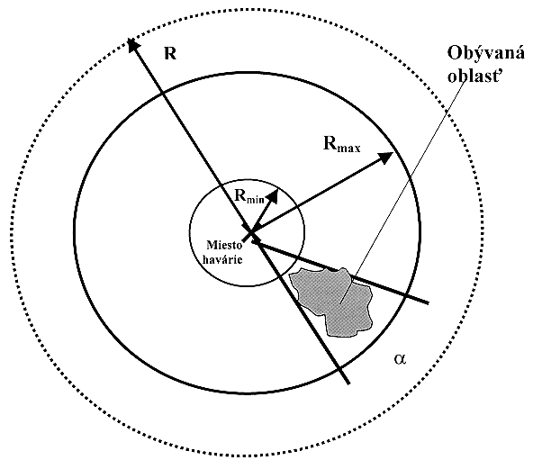
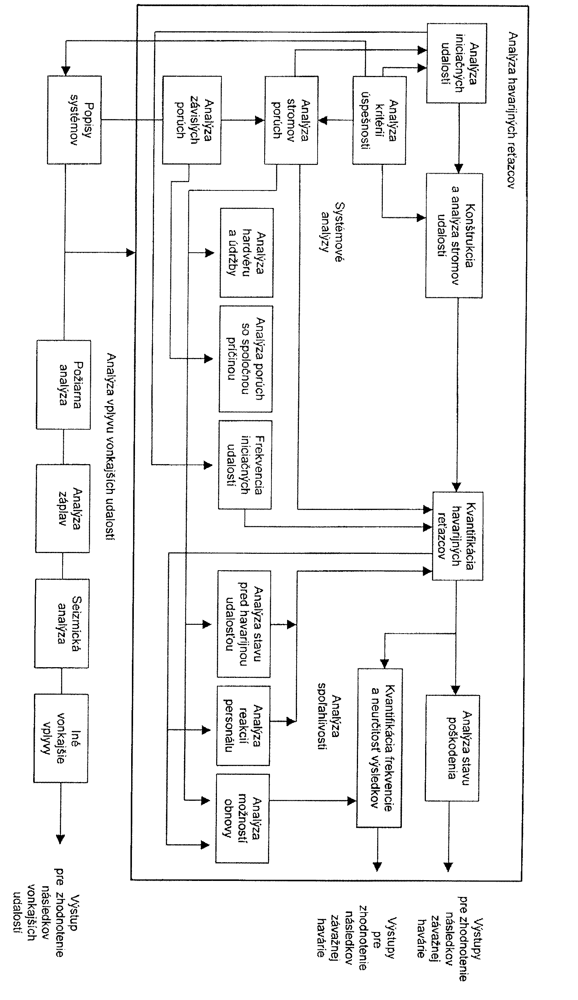

Príloha č. 1 k vyhláške č. 489/2002 Z. z.

PREDBEŽNÝ ODHAD RIZIKA

1. Podľa tabuľky I sa priradí číselný kód vybranej nebezpečnej látke na základe jej všeobecnej charakteristiky (skupenstvo, tlak pár, horľavosť, výbušnosť a jedovatosť) a jej prítomnosti v zariadení (výrobno-skladovacie zariadenia, prepravné zariadenia vrátane vnútropodnikových potrubí a podobne).

TABUĽKA I: PRIRADENIE ČÍSELNÝCH KÓDOV VYBRANÝM NEBEZPEČNÝM LÁTKAM

Typ látky | Popis látky | Zariadenie/preprava | Číselný kód

Horľavá kvapalina1) | Tlak pár < 0,03 MPa pri 20 °C | Sklad - podzemné zásobníky | 1

| | Potrubie | 2

| | Ostatné (technológia) | 3

| Tlak pár ≥ 0,03 MPa pri 20 °C | Sklad - podzemné zásobníky | 4

| | Potrubie | 5

| | Ostatné (technológia) | 6

Horľavý plyn2) | Skvapalnený tlakom | Nadzemný sklad | 7

| | Potrubie | 8

| | Ostatné (technológia) | 9

| Skvapalnený chladom | Sklad - podzemné zásobníky | 10

| | Ostatné (technológia) | 11

| Pod tlakom | Potrubie | 12

| | Sklad tlakových fliaš do 100 kg | 13

Výbušniny3) | V celku (zapríčiňujú jednotlivé explózie) | Sklady a technológie | 14

| V baleniach (napr. munícia) | | 15

Toxická kvapalina4) | Zdraviu škodlivá | Sklad - podzemné zásobníky | 16

| | Ostatné (technológia) | 17

| Jedovatá | Sklad - podzemné zásobníky | 18

| | Ostatné (technológia) | 21

| Veľmi jedovatá | Sklad - podzemné zásobníky | 22

| | Ostatné (technológia) | 23

Pokračovanie tabuľky I

Jedovatý plyn5) | Skvapalnený tlakom: | |

| zdraviu škodlivý | | 26

| jedovatý | | 27

| veľmi jedovatý | | 28

| Skvapalnený chladením: | |

| zdraviu škodlivý | | 29

| jedovatý | | 30

| veľmi jedovatý | | 31

| V potrubí: veľmi jedovatý | | 32

| Veľmi jedovatý | |

| pod tlakom > 2,5 MPa | | 33

| Spaliny horenia (jedovaté splodiny) | | 34

Vysvetlivky k tabuľke I:

1) V zmysle zákona č. 163/2001 Z. z. o chemických látkach a chemických prípravkoch sú tieto horľavé kvapaliny klasifikované s označením špecifického rizika R10, R11 druhá zarážka, R12 prvá zarážka a R17 ako horľavé, veľmi horľavé a mimoriadne horľavé.

2) V zmysle zákona č. 163/2001 Z. z. sú tieto horľavé plyny klasifikované s označením špecifického rizika R12 druhá zarážka okrem mimoriadne horľavých plynov vrátane skvapalnených uhľovodíkových plynov.

3) V zmysle zákona č. 163/2001 Z. z. sú výbušniny klasifikované s označením špecifického rizika R2 a R3.

4) V zmysle zákona č. 163/2001 Z. z. sú tieto toxické (jedovaté) kvapaliny klasifikované ako jedovaté alebo s označením špecifického rizika R50, R51 a R53 ako veľmi jedovaté pre vodné organizmy, jedovaté pre vodné organizmy a jedovaté kvapaliny, ktoré môžu spôsobiť dlhodobé škodlivé účinky vo vodnej zložke životného prostredia.

5) V zmysle zákona č. 163/2001 Z. z. sú tieto toxické plyny klasifikované ako jedovaté alebo veľmi jedovaté alebo sú podobne ako toxické kvapaliny klasifikované s označením špecifického rizika R50, R51, R53.

2. Podľa tabuľky IIa a tabuľky IIb sa uskutoční priradenie kódových označení následkov závažnej priemyselnej havárie zariadeniu s vybranou nebezpečnou látkou v závislosti od jej číselného kódu a projektovaného množstva v zariadení. Tabuľka IIa platí pre výrobné, skladovacie a prepravné zariadenia okrem potrubí, tabuľka IIb platí špeciálne na prepravu vybraných nebezpečných látok vo vnútropodnikových potrubiach.

TABUĽKA IIa: KÓDOVÉ OZNAČENIE NÁSLEDKOV ZÁVAŽNEJ PRIEMYSELNEJ HAVÁRIE PODĽA PROJEKTOVANÉHO MNOŽSTVA VYBRANEJ NEBEZPEČNEJ LÁTKY (OKREM POTRUBÍ)

Číselný kód | Množstvo vybranej nebezpečnej látky (t) | | | | | | | |

| 0,2 - 1 | 1 - 5 | 5 - 10 | 10 - 50 | 50 - 200 | 200 - 1 000 | 1 000 - 5 000 | 5 000 - 10 000 | nad 10 000

1 | - | - | - | - | - | A I | B I | B I | C I

3 | - | - | - | A I | B I | C I | D II | X | X

4 | - | - | - | - | - | B I | C II | C II | D II

6 | - | - | - | B II | C II | D II | E II | X | X

7 | - | A I | B I | C I | D I | E I | X | X | X

9 | - | B II | C III | C III | D III | E III | X | X | X

10 | - | - | - | - | - | B I | C II | C II | D II

11 | - | - | - | B II | C II | D II | E II | X | X

13 | - | - | C III | C II | C I | C I | X | X | X

14 | A I | B I | B I | C I | C I | D I | X | X | X

15 | B III | B III | C III | C I | C I | D I | X | X | X

16 | - | - | - | - | - | A II | A II | B II | C III

17 | - | - | - | A III | A II | B II | C II | C II | C II

18 | - | - | A II | B III | C III | E III | F III | G III | G III

21 | B II | C II | D III | E III | F III | G III | G III | X | x

22 | A II | B II | C III | E III | F III | G III | G III | H III | H III

23 | C II | D III | E III | F III | x | X | X | X | x

26 | - | - | A II | A I | B II | B I | C III | C II | x

27 | C II | D III | E III | E III | F III | F III | G III | X | x

28 | E III | F III | G III | H III | H III | X | X | X | x

29 | - | - | - | A II | A II | B II | B II | B II | C II

30 | B II | C II | D III | E III | E III | E III | F III | G III | x

31 | E III | F III | G III | H III | H III | X | X | X | x

34 | - | - | - | B II | D III | E III | E III | X | x

Vysvetlivky k tabuľke IIa:

- Symbol (X) znamená v praxi nereálnu kombináciu látka/množstvo.

- Symbol (-) znamená zanedbateľný účinok.

TABUĽKA IIb: KÓDOVÉ OZNAČENIE NÁSLEDKOV ZÁVAŽNEJ PRIEMYSELNEJ HAVÁRIE PODĽA PROJEKTOVANÉHO MNOŽSTVA VYBRANEJ NEBEZPEČNEJ LÁTKY (PRE POTRUBIA)

Kódové číslo | Typ látky | Popis vybranej nebezpečnej látky | Priemer potrubia1) (m) | Kódové označenie

2 | Horľavá kvapalina | Tlak pary pri 20 °C < 0,03 MPa | > 0,2 | A I

5 | | Tlak pary pri 20 °C ≥ 0,03 MPa | 0,2 - 0,4 | A I

| | | > 0,4 | B II

8 | Horľavý plyn | Skvapalnený tlakom | < 0,1 | C I

| | | 0,1 - 0,2 | D I

| | | > 0,2 | E I

12 | Horľavý plyn | Pod tlakom | 0,2 - 1 | A I

| | | > 1 | B I

32 | Toxický plyn | Veľmi jedovatý | < 0,1 | F III

| | | 0,1 - 0,2 | G III

33 | | Veľmi jedovatý pod tlakom > 2,5 MPa | < 0,02 | D III

| | | 0,02 - 0,04 | E III

| | | 0,04 - 0,1 | F III

Vysvetlivka k tabuľke IIb:

1) Priemer najväčšieho potrubia.

3. Podľa tabuľky III sa k príslušnému kódovému označeniu následkov závažnej priemyselnej havárie priradí polomer zóny ohrozenia označený R, ktorý ohraničuje maximálnu predpokladanú vzdialenosť jej nežiaducich účinkov (kódové označenie účinkov závažnej priemyselnej havárie A až H je prepojené s polomermi pôsobenia nežiaducich účinkov), a taktiež sa priradí predpokladaná zasiahnutá plocha S (v hektároch) podľa priradenej kategórie závažnej udalosti: I - požiar, II - výbuch, III - toxický rozptyl.

TABUĽKA III: DEFINOVANIE NEŽIADUCICH NÁSLEDKOV ZÁVAŽNEJ PRIEMYSELNEJ HAVÁRIE PRIRADENÍM POLOMEROV ZÓNY OHROZENIA A CELKOVEJ ZASIAHNUTEJ PLOCHY

Vzdialenosť účinkov havárie | | Zasiahnutá plocha S [ha]1) | |

R [m] | | I (požiar) | II (výbuch) | III (toxický rozptyl)

A | 0 - 25 | 0,2 | 0,1 | 0,02

B | 0 - 50 | 0,8 | 0,4 | 0,1

C | 0 - 100 | 3 | 1,5 | 0,3

D | 0 - 200 | 12 | 6 | 1

E | 0 - 500 | 80 | 40 | 8

F | 0 - 1 000 | - | - | 30

G | 0 - 3 000 | - | - | 300

H | 0 - 10 000 | - | - | 1 000

Vysvetlivka k tabuľke III:

1) 1 ha = 104 m2.

4. Súhrnné vyjadrenie závažnosti následkov závažnej priemyselnej havárie sa vypočíta podľa vzorca:

N = S . h . fs, v ktorom

„N“ je počet ohrozených osôb,

„S“ je celková zasiahnutá plocha (zasiahnuté územie) [ha] - pozri tabuľku III,

„h“ je hustota zaľudnenia v zasiahnutom území [počet osôb/ha] - ak nie sú k dispozícii presnejšie údaje o skutočnej hustote zaľudnenia v obciach a mestách, použije sa odhad podľa tabuľky IV,

„fs“ je korekčný faktor - používa sa v prípade, ak obývaná plocha tvorí zlomok zasiahnutej plochy;

určí sa podľa vzorca:

fs = fr . fα, v ktorom

„fr“ je faktor prstencovej časti plochy predstavujúcej obývanú plochu v tvare kruhu k celkovej ploche kruhu vymedzeného polomerom zóny ohrozenia R (pozri tabuľku III a obrázok č. 1 ) - vypočíta sa

podľa vzorca:

fr = (R2max - R2min)/R2, v ktorom

„Rmax“ je vonkajší polomer, t. j. maximálna vzdialenosť obývanej plochy od zdroja rizika,

„Rmin“ je vnútorný polomer, t. j. minimálna vzdialenosť obývanej plochy od zdroja rizika,

„R“ je maximálny polomer zóny ohrozenia (maximálna vzdialenosť účinkov závažnej priemyselnej havárie),

„fα“ je faktor predstavujúci uhol obývanej plochy zasiahnutý zdrojom rizika, redukovaný uhlom nežiaducich účinkov udalosti Θ - určí sa podľa vzorca:

fα = α/Θ, v ktorom

„Θ“ je uhol nežiaducich účinkov závažnej priemyselnej havárie

Θ = 360o pre plochu (I) - požiar, 180o pre plochu (II) - výbuch mraku pár a 36o pre plochu (III) - toxický rozptyl.

„α“ je uhol vymedzený plochou s uvažovanou hustotou zaľudnenia (pozri obrázok č. 1).

Pri určovaní faktora fα je potrebné sa zamerať na oblasť s najväčšou hustotou obyvateľstva.

TABUĽKA IV: HUSTOTA ZAĽUDNENIA V OBCIACH A MESTÁCH

Popis zaľudnenej plochy (oblasti) | Hustota zaľudnenia [počet osôb/ha]1)

Vidiecke osídlenie (obec do 2 000 obyvateľov) | 10

Strediskové obce a mestá na vidieku (obec, mesto od 2 000 do 5 000 obyvateľov) | 20

Vonkajšia obytná časť mesta (obec, mesto od 5 000 do 20 000 obyvateľov) | 30

Mestá (od 20 000 do 50 000 obyvateľov) | 60

Centrálna obytná časť mesta (mestá nad 50 000 obyvateľov) | 80

Vonkajšia obytná časť mesta (miestne časti nad 50 000 do 100 000 obyvateľov) | 90

Centrálna obytná časť mesta (viac ako 100 000 obyvateľov) | 160

Vysvetlivka k tabuľke IV:

1) Priemerná hustota zaľudnenia v Slovenskej republike je 1 osoba/ha.

5. Podľa tabuľky Va a tabuľky Vb sa priradí pre každú vybranú nebezpečnú látku priemerný index pravdepodobnosti vzniku závažnej priemyselnej havárie P podľa číselného kódu látky a charakteru zariadenia.

Tabuľka Va je určená pre stacionárne zariadenia a tabuľka Vb pre vnútropodnikové potrubné rozvody.

TABUĽKA Va: PRIEMERNÝ INDEX PRAVDEPODOBNOSTI VZNIKU ZÁVAŽNEJ PRIEMYSELNEJ HAVÁRIE (P) PRE STACIONÁRNE ZARIADENIA

Vybraná nebezpečná látka (číselný kód) | | Priemerný index pravdepodobnosti vzniku závažnej priemyselnej havárie (P) |

| | Skladovanie | Výrobné zariadenie

Horľavá kvapalina | (1 - 3) | 8 | 7

Horľavá kvapalina | (4 - 6) | 7 | 6

Horľavý plyn | (7) | 6 | 5

Horľavý plyn | (9) | 7 | 6

Horľavý plyn | (10, 11) | 6 | -

Horľavý plyn | (13) | 4 | -

Výbušnina | (14, 15) | 7 | 6

Toxická kvapalina | (16 - 23) | 5 | 4

Toxický plyn | (26 - 28) | 6 | 5

Toxicky plyn | (29 - 31) | 6 | -

Toxicky plyn | (33) | 5 | 4

Produkty spaľovania | (34) | 3 | -

TABUĽKA Vb: PRIEMERNÝ INDEX PRAVDEPODOBNOSTI VZNIKU ZÁVAŽNEJ PRIEMYSELNEJ HAVÁRIE (P) PRE VNÚTROPODNIKOVÉ POTRUBNÉ SYSTÉMY

Vybraná nebezpečná látka (číselný kód) | | Priemerný index pravdepodobnosti vzniku závažnej priemyselnej havárie (P)

Horľavá kvapalina | (2) | 6

Horľavá kvapalina | (5) | 5

Horľavý plyn | (8) | 6

Horľavý plyn | (12) | 6

Toxický plyn | (30) | 6

Toxický plyn | (32, 33) | 5

6. Na prevod priemerného indexu pravdepodobnosti vzniku závažnej priemyselnej havárie P na pravdepodobnosť, prípadne početnosť výskytu závažnej priemyselnej havárie Fp(počet udalostí/rok) platí:

P = |log Fp|.

Prevod sa určí podľa tabuľky VI.

TABUĽKA VI: PREVOD PRIEMERNÉHO INDEXU PRAVDEPODOBNOSTI VZNIKU ZÁVAŽNEJ PRIEMYSELNEJ HAVÁRIE (P) NA PRAVDEPODOBNOSŤ (POČETNOSŤ) VÝSKYTU ZÁVAŽNEJ PRIEMYSELNEJ HAVÁRIE (Fp)

Index pravdepodobnosti vzniku závažnej priemyselnej havárie1) (P) | Pravdepodobnosť výskytu závažnej priemyselnej havárie [udalosť/rok] (Fp)

3 | 1.10-3

4 | 1.10-4

5 | 1.10-5

6 | 1.10-6

7 | 1.10-7

8 | 1.10-8

Vysvetlivka k tabuľke VI:

1) P je absolútna hodnota logaritmu Fp (P = |(log Fp)|).

7. Výsledná (sumárna) hodnota pravdepodobnosti (početnosti) výskytu závažnej priemyselnej havárie sa stanoví ako súčet hodnôt pravdepodobnosti (početnosti) výskytu závažnej priemyselnej havárie od jednotlivých vybraných nebezpečných látok.

Obrázok č. 1

Schematické znázornenie odhadu následkov závažnej priemyselnej havárie

Legenda k obrázku:

α - uhol sektora obývanej plochy,

R - maximálny polomer nežiaducich účinkov závažnej priemyselnej havárie,

Rmax, Rmin - maximálna a minimálna vzdialenosť hraníc obývanej plochy od miesta závažnej priemyselnej havárie.

Obrázok č. 2

Zjednodušený postupový diagram pre analýzu rizika závažnej priemyselnej havárie

