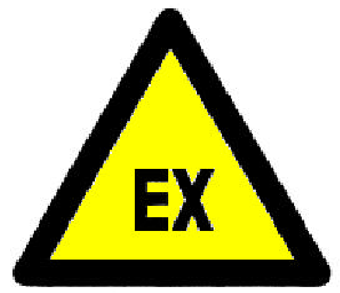

Príloha č. 4 k nariadeniu vlády č. 493/2002 Z. z.

- VÝSTRAŽNÁ ZNAČKA NA OZNAČENIE PRIESTOROV S NEBEZPEČENSTVOM VÝBUCHU

- 

- Hlavné znaky:

- - trojuholníkový tvar,

- - čierne písmená na žltom pozadí s čiernym okrajom, pričom žltá farba musí zaberať najmenej 50 % plochy značky.
