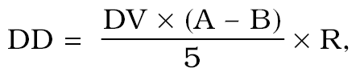

# Čl. I

Zákon Národnej rady Slovenskej republiky č. 289/1995 Z. z. o dani z pridanej hodnoty v znení zákona Národnej rady Slovenskej republiky č. 200/1996 Z. z., zákona Národnej rady Slovenskej republiky č. 386/1996 Z. z., zákona č. 371/1997 Z. z., zákona č. 60/1999 Z. z., zákona č. 153/1999 Z. z., zákona č. 342/1999 Z. z., zákona č. 246/2000 Z. z., zákona č. 524/2001 Z. z. a zákona č. 555/2001 Z. z. sa mení a dopĺňa takto:

- 1. § 1 vrátane nadpisu znie:

- 㤠1

- Predmet úpravy

- Tento zákon upravuje daň z pridanej hodnoty (ďalej len „daň"), ktorej predmetom je

- a)

- zdaniteľné plnenie s miestom plnenia v tuzemsku (§ 6),

- b)

- dovoz tovaru,

- c)

- medzinárodná autobusová doprava uskutočnená zahraničným dopravcom s výnimkou pravidelnej dopravy (ďalej len „príležitostná preprava osôb").“.

- 2. V § 2 sa za odsek 2 vkladá nový odsek 3, ktorý znie:

- „(3)

- Za zdaniteľné plnenie sa považuje aj použitie alebo využitie tovaru, stavby, nehnuteľnosti a služby na osobnú spotrebu platiteľa.“.

- Doterajšie odseky 3 až 5 sa označujú ako odseky 4 až 6.

- 3. V § 2 ods. 4 sa vypúšťa písmeno a). Doterajšie písmená b) až e) sa označujú ako písmená a) až d).

- 4. V § 2 ods. 6 písmená f) až i) znejú:

- „f)

- daňou na vstupe daň u platiteľa, ktorú voči nemu v súlade s týmto zákonom uplatnil pri ním prijatom zdaniteľnom plnení iný platiteľ; v prípade dovozu tovaru daň vyrubená colným orgánom,

- g)

- daňou na výstupe daň, ktorú je platiteľ povinný uplatniť pri vzniku daňovej povinnosti,

- h)

- odpočítaním dane odpočítanie dane na vstupe od súčtu súm dane na výstupe za príslušné zdaňovacie obdobie,

- ch)

- vlastnou daňovou povinnosťou prevýšenie súčtu súm dane na výstupe nad súčtom súm odpočítanej dane za príslušné zdaňovacie obdobie, upravené podľa § 4, 20, 21, 21a, 38b a 43,

- i)

- nadmerným odpočtom prevýšenie súčtu súm odpočítanej dane nad súčtom súm dane na výstupe za príslušné zdaňovacie obdobie, upravené podľa § 4, 20, 21, 21a, 38b a 43,“.

- 5. V § 2 ods. 6 sa vypúšťa písmeno m). Doterajšie písmená n) a o) sa označujú ako písmená m) a n).

- 6. V § 4 odseky 5 a 6 znejú:

- „(5)

- Platiteľ registrovaný podľa odsekov 1 až 4 môže odpočítať daň viažucu sa na kúpnu cenu tovaru a nehnuteľnosti, ktoré kúpil najneskôr 12 mesiacov pred dňom, keď sa stal platiteľom, a daň viažucu sa na cenu za oprávnenie na výkon práva priemyselného vlastníctva8b) a na cenu za oprávnenie použiť dielo9) vrátane programového vybavenia, ktoré nadobudol najneskôr 12 mesiacov pred dňom, keď sa stal platiteľom. Daň pri uvedenom majetku, ktorý je odpisovaný podľa osobitného predpisu,10) platiteľ zníži o sumu dane zodpovedajúcu odpisu podľa ročnej percentuálnej odpisovej sadzby. Platiteľ nemôže odpočítať daň, ak majetok nepoužije na uskutočňovanie zdaniteľných plnení ako platiteľ.

- (6)

- Platiteľ registrovaný podľa odsekov 1 až 4 môže odpočítať daň podľa odseku 5 v rozsahu a za podmienok podľa § 20, 20a, 21 a 48, pričom za daňový doklad sa považuje doklad o nadobudnutí uvedeného majetku od platiteľa za cenu s daňou; pri dovezenom tovare sa za daňový doklad považuje písomné colné vyhlásenie. Odpočet dane platiteľ uplatní v daňovom priznaní za zdaňovacie obdobie, v ktorom sa splnila posledná z podmienok na odpočítanie dane.“.

- Poznámky pod čiarou k odkazom 8b, 9 a 10 znejú:

- „8b)

- Napríklad zákon č. 527/1990 Zb. o vynálezoch, priemyselných vzoroch a zlepšovacích návrhoch v znení neskorších predpisov, zákon č. 174/1988 Zb. o ochranných známkach v znení neskorších predpisov, zákon č. 159/1973 Zb. o ochrane označení pôvodu výrobkov v znení neskorších predpisov.

- 9)

- Zákon č. 383/1997 Z. z. Autorský zákon a zákon, ktorým sa mení a dopĺňa Colný zákon v znení neskorších predpisov v znení zákona č. 234/2000 Z. z.

- 10)

- Zákon č. 366/1999 Z. z. o daniach z príjmov v znení neskorších predpisov.“.

- 7. § 4 sa dopĺňa odsekom 7, ktorý znie:

- „(7)

- Platiteľ registrovaný podľa odsekov 1 až 4 môže odpočítať daň pri majetku podľa odseku 5, ktorý nadobudol ako nepeňažný vklad do obchodnej spoločnosti alebo družstva3) najneskôr 12 mesiacov pred dňom, keď sa stal platiteľom. Na odpočítanie dane sa primerane vzťahujú odseky 5 a 6.“.

- 8. § 5 sa vypúšťa.

- 9. V § 6 ods. 4 sa za slová „prevode alebo postúpení" vkladajú slová „autorských a im príbuzných práv,".

- 10. V § 7 ods. 11 sa nad slovom „náklady" odkaz 10 nahrádza odkazom 15b.

- 11. V § 10 ods. 5 sa slová „uplatniť nárok na odpočet dane" nahrádzajú slovami „odpočítať daň".

- 12. V § 12 ods. 3 sa slová „nemá nárok na odpočet dane" nahrádzajú slovami „nemôže odpočítať daň pri prijatých zdaniteľných plneniach".

- 13. V § 12 ods. 5 sa slová „o nároku na odpočet dane" nahrádzajú slovami „o odpočítaní dane".

- 14. V § 13 ods. 1 písmeno a) znie:

- „a)

- pri dodaní tovaru dňom odovzdania tovaru v určitom mieste alebo dňom odovzdania tovaru prvému dopravcovi na prepravu, ak je dodanie tovaru spojené s odoslaním tovaru, a to aj vtedy, ak k zmene vlastníckeho práva k tovaru podľa kúpnej zmluvy dôjde až zaplatením ceny tovaru;26) v ostatných prípadoch dňom, keď je príjemcovi umožnené nakladať s tovarom, a to aj vtedy, ak k zmene vlastníckeho práva k tovaru podľa kúpnej zmluvy dôjde až zaplatením ceny tovaru,26)“.

- 15. V § 13 ods. 1 písm. f) sa slová „prevzatia tovaru" nahrádzajú slovami „odovzdania tovaru, stavby, nehnuteľnosti".

- 16. V § 13 ods. 1 písmeno i) znie:

- „i)

- pri poskytnutí úveru alebo pôžičky dňom, keď má byť zaplatený úrok.“.

- 17. V § 13 sa vypúšťa odsek 7. Doterajší odsek 8 sa označuje ako odsek 7.

- 18. V § 14 sa za odsek 1 vkladá nový odsek 2, ktorý znie:

- „(2)

- Daňová povinnosť nevzniká pri

- a)

- bezodplatne poskytnutých propagačných a reklamných predmetoch, ak hodnota nepresiahne 300 Sk za jeden kus a sú označené obchodným menom platiteľa alebo jeho obvyklým obchodným označením,

- b)

- vzorkách poskytnutých na kontrolné účely podľa osobitného predpisu,11)

- c)

- predaji podniku alebo jeho časti,31) ak sa podnik alebo jeho časť predáva platiteľovi.“.

- Doterajšie odseky 2 a 3 sa označujú ako odseky 3 a 4.

- 19. V § 15 odsek 3 znie:

- „(3)

- Ak platiteľ uskutoční zdaniteľné plnenie, ku ktorého cene sa poskytuje dotácia alebo príspevok, výška ceny bez dane podľa odseku 2 písm. g) neobsahuje dotáciu alebo príspevok k cene zdaniteľného plnenia a výška dane podľa odseku 2 písm. ch) zodpovedá cene bez dane, ktorá neobsahuje dotáciu alebo príspevok. Za správnosť údajov v daňovom doklade zodpovedá platiteľ uskutočňujúci zdaniteľné plnenie.“.

- 20. § 20 vrátane nadpisu nad § 20 znie:

- „Odpočítanie dane

- § 20

- (1)

- Platiteľ môže odpočítať daň, ak zdaniteľné plnenie prijme na uskutočnenie svojich zdaniteľných plnení,

- a)

- pri ktorých vzniká daňová povinnosť podľa § 14,

- b)

- ktoré sú oslobodené od dane podľa § 37, 38 a 39,

- c)

- pri ktorých nevzniká daňová povinnosť podľa § 14 ods. 2 písm. a).

- (2)

- Platiteľ nemôže odpočítať daň, ak zdaniteľné plnenie prijme na

- a)

- uskutočnenie svojich zdaniteľných plnení, ktoré sú oslobodené od dane podľa § 26,

- b)

- výkon svojich činností, ktoré nie sú zdaniteľnými plneniami.

- (3)

- Ak platiteľ prijme zdaniteľné plnenie na uskutočnenie svojich zdaniteľných plnení, pri ktorých môže odpočítať daň podľa odseku 1, a súčasne aj na uskutočnenie svojich zdaniteľných plnení oslobodených od dane podľa § 26, je povinný postupovať pri určení dane, ktorú môže odpočítať, podľa § 21. Platiteľ je povinný postupovať podľa § 21 aj v prípade, ak pri prijatí zdaniteľného plnenia nevie určiť, či prijaté zdaniteľné plnenie použije na uskutočnenie zdaniteľných plnení, pri ktorých môže odpočítať daň podľa odseku 1, alebo na uskutočnenie zdaniteľných plnení oslobodených od dane podľa § 26.

- (4)

- Ak platiteľ prijme zdaniteľné plnenie, ktoré je určené čiastočne na uskutočnenie svojich zdaniteľných plnení a čiastočne na výkon činností, ktoré nie sú zdaniteľnými plneniami, za daň na vstupe sa považuje daň uplatnená na prijaté zdaniteľné plnenie, znížená pomerne podľa rozsahu použitia prijatého zdaniteľného plnenia; pomer platiteľ určí najmä podľa pracovných hodín, obratu, zisku a počtu zamestnancov vzťahujúcich sa na uskutočnenie zdaniteľných plnení a na výkon činností, ktoré nie sú zdaniteľnými plneniami. Ak platiteľ nevie určiť rozsah použitia prijatého zdaniteľného plnenia na výkon činností, ktoré nie sú zdaniteľnými plneniami, nemôže odpočítať daň.

- (5)

- Platiteľ nemôže odpočítať daň pri

- a)

- kúpe alebo prenájme osobného automobilu s výnimkou prenájmu osobného automobilu na základe zmluvy o kúpe prenajatej veci, keď platiteľ môže odpočítať daň len z prirážky, ktorá je súčasťou dohodnutej splátky,

- b)

- kúpe tovaru tvoriaceho príslušenstvo osobného automobilu vrátane montáže,

- c)

- kúpe tovaru a služieb na účely pohostenia,

- d)

- kúpe vratných fliaš s výnimkou kúpy vratných fliaš, ktoré platiteľ vyváža do zahraničia (§ 37),

- e)

- prijatých zdaniteľných plneniach, ktoré sú prechodnými položkami (§ 7 ods. 2).

- (6)

- Platiteľ, ktorý kupuje osobné automobily na účely ďalšieho predaja, a to aj formou zmluvy o kúpe prenajatej veci, a nákup a predaj osobných automobilov je predmetom podnikania platiteľa, môže odpočítať daň pri ich kúpe a pri kúpe tovaru tvoriaceho ich príslušenstvo vrátane montáže.

- (7)

- Ustanovenie odseku 6 sa vzťahuje aj na ojazdené osobné automobily kúpené na účely ďalšieho predaja, a to aj formou zmluvy o kúpe prenajatej veci; v týchto prípadoch platiteľ môže odpočítať daň vo výške, ktorá sa vypočíta ako podiel, v ktorého čitateli je cena, za ktorú bol ojazdený osobný automobil kúpený, vynásobená príslušnou výškou sadzby dane a v menovateli je súčet čísla 100 a príslušnej výšky sadzby dane. Na tento prípad sa nevzťahuje § 20a ods. 1.

- (8)

- Ak platiteľ kúpený osobný automobil podľa odsekov 6 a 7 použije na iný účel, ako je ustanovené v odsekoch 6 a 7, je povinný priznať a odviesť daň vo výške odpočítanej dane, a to v zdaňovacom období, v ktorom osobný automobil použil na iný účel.

- (9)

- Ak platiteľ predá alebo daruje osobný automobil, pri ktorého kúpe neodpočítal daň, daň na výstupe neuplatní.

- (10)

- Ak platiteľ predá vratné fľaše, pri ktorých kúpe neodpočítal daň, daň na výstupe neuplatní.

- (11)

- Platiteľ môže odpočítať daň aj v prípade, ak zdaniteľné plnenie prijme na uskutočnenie zdaniteľných plnení s miestom zdaniteľného plnenia v zahraničí. Platiteľ môže odpočítať daň za podmienok a v rozsahu, v akom by mohol odpočítať daň, keby zdaniteľné plnenia boli uskutočnené v tuzemsku.

- (12)

- Platiteľ, ktorému bol odcudzený tovar, pri ktorom odpočítal daň, je povinný odviesť daň vo výške odpočítanej dane; pri tovare odpisovanom podľa osobitného predpisu10) zníži platiteľ odvod dane o sumu dane zodpovedajúcu odpisom podľa ročných percentuálnych odpisových sadzieb. Platiteľ daň odvedie v tom zdaňovacom období, v ktorom zistil odcudzenie tovaru.

- (13)

- Pri prevádzkovaní podniku po vyhlásení konkurzu môže platiteľ odpočítať daň len zo zdaniteľného plnenia prijatého na účely prevádzkovania podniku; platiteľ nemôže odpočítať daň pri prijatom zdaniteľnom plnení súvisiacom s udržiavaním a správou konkurznej podstaty a pri prijatom zdaniteľnom plnení, ktoré je hotovým výdavkom správcu konkurznej podstaty a je pohľadávkou proti konkurznej podstate.

- (14)

- Platiteľ, ktorý odpočítaval daň z prirážky pri prenájme osobného automobilu na základe zmluvy o kúpe prenajatej veci [odsek 5 písm. a)], je povinný odviesť daň vo výške odpočítanej dane, ak sa zmluvný vzťah neskončil kúpou osobného automobilu týmto platiteľom. Platiteľ odvedie daň v zdaňovacom období, v ktorom skončil zmluvný vzťah.“.

- 21. Za § 20 sa vkladá § 20a, ktorý znie:

- 㤠20a

- (1)

- Odpočítať daň podľa § 20 môže platiteľ pri prijatom zdaniteľnom plnení, ak

- a)

- platiteľovi, ktorý uskutočnil toto zdaniteľné plnenie, vznikla daňová povinnosť (§ 14),

- b)

- daň na vstupe zaúčtoval vo svojom účtovníctve; ak ide o platiteľa, ktorý nie je účtovnou jednotkou, daň na vstupe zaevidoval v záznamoch podľa § 24,

- c)

- má daňový doklad alebo zjednodušený daňový doklad, ktoré vyhotovil platiteľ.

- (2)

- Platiteľ môže odpočítať daň v zdaňovacom období, v ktorom sa splnila posledná z podmienok podľa odseku 1.“.

- 22. § 21 znie:

- 㤠21

- (1)

- Pri prijatom zdaniteľnom plnení podľa § 20 ods. 3 platiteľ odpočíta daň, ktorá zodpovedá dani na vstupe uplatnenej na prijaté zdaniteľné plnenie, vynásobenej koeficientom vypočítaným podľa odseku 2 a zaokrúhleným na štyri desatinné miesta (ďalej len „predbežné odpočítanie dane").

- (2)

- Koeficient sa vypočíta ako podiel, v ktorého čitateli je súčet cien bez dane za uskutočnené zdaniteľné plnenia, pri ktorých platiteľ môže odpočítať daň (§ 20 ods. 1), a v ktorého menovateli je súčet cien bez dane za všetky uskutočnené zdaniteľné plnenia. Pri výpočte koeficientu platiteľ do čitateľa ani do menovateľa koeficientu neuvádza tieto zdaniteľné plnenia:

- a)

- úrok z peňažných prostriedkov na účte v banke, ak platiteľ nie je bankou,

- b)

- predaj podniku alebo jeho časti,31)

- c)

- prevod obchodného podielu,

- d)

- zdaniteľné plnenia, pri ktorých neuplatňuje daň na výstupe podľa § 20 ods. 9 a 10.

- (3)

- V zdaňovacích obdobiach kalendárneho roka platiteľ predbežne použije koeficient podľa odseku 2, do ktorého výpočtu uvedie

- a)

- údaje o zdaniteľných plneniach uskutočnených v predchádzajúcom kalendárnom roku alebo

- b)

- údaje o zdaniteľných plneniach uskutočnených v zdaňovacích obdobiach od začiatku kalendárneho roka kumulovane.

- (4)

- Platiteľ je povinný v každom zdaňovacom období kalendárneho roka postupovať len podľa jedného z postupov podľa odseku 3 a nemôže ho v priebehu kalendárneho roka meniť. Ak sa osoba podliehajúca dani stane platiteľom v priebehu kalendárneho roka alebo ak platiteľovi nevznikla v predchádzajúcom kalendárnom roku povinnosť použiť koeficient podľa odseku 1, postupuje v každom zdaňovacom období kalendárneho roka podľa odseku 3 písm. b).

- (5)

- Po skončení kalendárneho roka vypočíta platiteľ spôsobom podľa odseku 2 koeficient z údajov o zdaniteľných plneniach uskutočnených v kalendárnom roku. Týmto koeficientom zaokrúhleným na štyri desatinné miesta vynásobí daň na vstupe pri prijatých zdaniteľných plneniach, pri ktorých bol povinný použiť koeficient podľa odseku 1. Rozdiel medzi predbežným odpočítaním dane a odpočítaním dane vypočítaným koeficientom za kalendárny rok vysporiada platiteľ v poslednom zdaňovacom období kalendárneho roka na ťarchu alebo v prospech štátneho rozpočtu. Rovnakým spôsobom postupuje aj platiteľ, ktorý v priebehu kalendárneho roka prestane byť platiteľom, a to za obdobie od 1. januára do skončenia jeho posledného zdaňovacieho obdobia.“.

- 23. Za § 21 sa vkladá § 21a, ktorý vrátane nadpisu znie:

- 㤠21a

- Úprava dane odpočítanej pri investičnom majetku

- (1)

- Platiteľ je povinný vykonať úpravu dane odpočítanej pri investičnom majetku, ak v priebehu kalendárneho roka, v ktorom daň odpočítal, alebo v priebehu štyroch kalendárnych rokov nasledujúcich po kalendárnom roku, v ktorom daň odpočítal, zmenil účel použitia investičného majetku, pri ktorom odpočítal daň. Zmenou účelu použitia investičného majetku sa rozumie, ak platiteľ

- a)

- investičný majetok, pri ktorom odpočítal daň podľa § 20 ods. 1, použije na uskutočňovanie zdaniteľných plnení bez možnosti odpočítania dane podľa § 20 ods. 2 písm. a) alebo na uskutočňovanie zdaniteľných plnení, pri ktorých je povinný použiť koeficient podľa § 21,

- b)

- investičný majetok, pri ktorom nemohol odpočítať daň podľa § 20 ods. 2 písm. a), použije na uskutočňovanie zdaniteľných plnení s možnosťou odpočítania dane podľa § 20 ods. 1 alebo na uskutočňovanie zdaniteľných plnení, pri ktorých je povinný použiť koeficient podľa § 21,

- c)

- investičný majetok, pri ktorom odpočítal daň podľa § 20 ods. 3, použije na uskutočňovanie zdaniteľných plnení s možnosťou odpočítania dane podľa § 20 ods. 1 alebo na uskutočňovanie zdaniteľných plnení bez možnosti odpočítania dane podľa § 20 ods. 2 písm. a).

- (2)

- Ak sa zmenil účel použitia investičného majetku v priebehu kalendárneho roka, v ktorom platiteľ odpočítal daň pri investičnom majetku, úpravu odpočítanej dane platiteľ vysporiada v poslednom zdaňovacom období kalendárneho roka. Platiteľ postupuje pri úprave odpočítanej dane podľa prílohy č. 3.

- (3)

- Ak sa zmenil účel použitia investičného majetku v priebehu štyroch kalendárnych rokov nasledujúcich po kalendárnom roku, v ktorom platiteľ odpočítal daň, úpravu odpočítanej dane platiteľ vykoná v poslednom zdaňovacom období kalendárneho roka, v ktorom sa zmenil účel použitia investičného majetku podľa odseku 1. Platiteľ postupuje pri úprave odpočítanej dane podľa prílohy č. 3.

- (4)

- Investičným majetkom na účely tohto zákona sú hnuteľné veci, ktorých cena obstarania bez dane je vyššia ako 30 000 Sk a ktorých doba použiteľnosti je dlhšia ako jeden rok, a stavby a nehnuteľnosti.

- (5)

- Ak platiteľ nadobudne stavbu formou prijatých stavebných prác, úprava odpočítania dane podľa odsekov 1 až 3 sa týka všetkých prijatých zdaniteľných plnení, ktoré sú súčasťou obstarávacej ceny15b) stavby. Lehota na vykonanie úpravy odpočítania dane podľa odseku 1 začína plynúť v roku uvedenia stavby do užívania.

- (6)

- Úprava odpočítania dane podľa odsekov 1 až 3 sa vzťahuje aj na prijaté stavebné práce, ktoré sú technickým zhodnotením10) stavby alebo nehnuteľnosti. Lehota na vykonanie úpravy odpočítania dane podľa odseku 1 začína plynúť v roku uvedenia technického zhodnotenia do užívania.

- (7)

- Neodpočítanie dane podľa § 20 ods. 2 písm. a) sa na účely úpravy dane odpočítanej pri investičnom majetku považuje za odpočítanie dane vo výške 0.“.

- 24. § 22 a 23 vrátane nadpisov znejú:

- 㤠22

- Oprava odpočítanej dane

- (1)

- Ak platiteľ, ktorý uskutočnil zdaniteľné plnenie, opraví základ dane podľa § 18 alebo opraví sadzbu dane, opraví aj platiteľ, v ktorého prospech sa zdaniteľné plnenie uskutočnilo, odpočítanú daň. Opravu odpočítanej dane vykoná platiteľ v tom zdaňovacom období, v ktorom daňový dobropis alebo daňový ťarchopis zaúčtoval alebo zaevidoval v záznamoch podľa § 24, ak ide o platiteľa, ktorý nie je účtovnou jednotkou.

- (2)

- Na opravu odpočítanej dane podľa odseku 1 sa vzťahujú § 20 a 21.

- § 23

- Nadmerný odpočet

- (1)

- Ak v zdaňovacom období vznikne platiteľovi nadmerný odpočet, odpočíta platiteľ nadmerný odpočet od vlastnej daňovej povinnosti v nasledujúcich zdaňovacích obdobiach. Platiteľ odpočítava nadmerné odpočty v poradí, v akom boli uplatnené. Platiteľ nemôže odpočítať nadmerný odpočet od vlastnej daňovej povinnosti, ak uplynulo päť rokov od konca zdaňovacieho obdobia, v ktorom nadmerný odpočet vznikol.

- (2)

- Nadmerný odpočet uplatnený v príslušnom zdaňovacom období daňový úrad vráti do 30 dní od podania daňového priznania za toto zdaňovacie obdobie, ak

- a)

- platiteľ v príslušnom zdaňovacom období uskutočnil vývoz tovaru (§ 37), vývoz služieb (§ 38) a medzinárodnú prepravu (§ 39), ktoré predstavujú najmenej 30 % zo všetkých uskutočnených zdaniteľných plnení v cenách bez dane v príslušnom zdaňovacom období,

- b)

- u platiteľa v príslušnom zdaňovacom období súčet súm dane na výstupe za zdaniteľné plnenia podliehajúce sadzbe dane 10 % presiahne 50 % celkového súčtu súm dane na výstupe a súčasne v každom z predchádzajúcich po sebe idúcich piatich zdaňovacích obdobiach súčet súm dane na výstupe za zdaniteľné plnenia podliehajúce sadzbe dane 10 % presiahol 50 % celkového súčtu súm dane na výstupe,

- c)

- platiteľ v príslušnom zdaňovacom období odpočítava daň, ktorá je súčasťou kúpnej ceny hmotného investičného majetku10) a ktorá je vyššia ako 100 000 Sk a súčasne táto daň predstavuje viac ako 50 % celkovej dane na výstupe za príslušné zdaňovacie obdobie.

- (3)

- Ak daňový úrad v lehote na vrátenie nadmerného odpočtu podľa odseku 2 začne kontrolu na zistenie oprávnenosti uplatneného nadmerného odpočtu alebo ak platiteľ neumožní vykonanie kontroly v lehote na vrátenie nadmerného odpočtu podľa odseku 2, vráti daňový úrad nadmerný odpočet zistený kontrolou v lehote desiatich dní od skončenia kontroly.“.

- 25. V § 24 ods. 1 sa na konci pripája táto veta: „O prijatých zdaniteľných plneniach a o dovoze tovaru vedie platiteľ záznamy v členení na plnenia s možnosťou odpočítania dane, bez možnosti odpočítania dane a na plnenia, pri ktorých je povinný použiť koeficient podľa § 21.".

- 26. V § 26 sa vypúšťa písmeno i).

- 27. V § 27 odsek 1 znie:

- „(1)

- Univerzálne poštové služby32) poskytované poštovým podnikom, v ktorom majetková účasť štátu presiahne 50 %, sú oslobodené od dane.“.

- Poznámka pod čiarou k odkazu 32 znie:

- „32)

- § 3 zákona č. 507/2001 Z. z. o poštových službách.“.

- 28. Poznámky pod čiarou k odkazom 33 a 34 sa vypúšťajú.

- 29. V § 29 ods. 1 písm. c) sa slovo „bankou" nahrádza slovami „podľa osobitného predpisu35a)".

- Poznámka pod čiarou k odkazu 35a znie:

- „35a)

- Zákon č. 510/2002 Z. z. o platobnom styku a o zmene a doplnení niektorých zákonov.“.

- 30. § 36 sa vypúšťa.

- 31. V § 37 ods. 2 sa na konci pripája táto veta: „Pri vývoze tovaru, ktorý sa uskutočňuje prostredníctvom nepriameho zástupcu,48) je daňovým dokladom písomné colné vyhlásenie, v ktorom je zastúpená osoba uvedená ako predávajúca popri odosielateľovi, a daňový doklad musí byť doložený písomnou zmluvou o zastúpení.".

- Poznámka pod čiarou k odkazu 48 znie:

- „48)

- § 9 ods. 1 písm. b) zákona č. 238/2001 Z. z. Colný zákon.“.

- 32. V § 37 odseky 4 až 6 znejú:

- „(4)

- Dodanie tovaru organizačnej zložke platiteľa umiestnenej v zahraničí, ako aj dodanie tovaru organizačnou zložkou, ktorá je platiteľom, svojmu podniku, ktorý má sídlo v zahraničí, sa považuje za vývoz tovaru oslobodený od dane, ak sú splnené podmienky podľa odsekov 1 a 2.

- (5)

- Dodanie tovaru, ktorý je určený na predaj alebo poskytovanie služieb na palubách lietadiel a lodí zahraničných leteckých spoločností alebo zahraničných plavebných spoločností, je oslobodené od dane.

- (6)

- Osoby iných štátov, ktoré požívajú výhody podľa medzinárodných zmlúv,49) ktorými je Slovenská republika viazaná, majú nárok na vrátenie dane viažucej sa na cenu prijatého zdaniteľného plnenia; tieto osoby majú na účely vrátenia dane postavenie daňového subjektu. Rozsah a spôsob vrátenia dane ustanoví ministerstvo všeobecne záväzným právnym predpisom.“.

- 33. V § 37 sa vypúšťajú odseky 7 až 11.

- 34. V § 38 sa vypúšťa odsek 3. Doterajší odsek 4 sa označuje ako odsek 3.

- 35. V § 39 sa vypúšťa odsek 6. Doterajšie odseky 7 a 8 sa označujú ako odseky 6 a 7.

- 36. V § 39 ods. 7 sa slová „platiteľ, ktorý uskutočňuje takéto zdaniteľné plnenie, má nárok na odpočet dane" nahrádzajú slovami „oslobodené od dane je aj dodanie náhradných dielcov pre prevádzkovú spôsobilosť takéhoto lietadla".

- 37. V § 40 ods. 2 posledná veta znie: „Platitelia, ktorí vykonávajú zdaniteľné plnenia spoločne na základe zmluvy o združení, započítavajú do celkového obratu obraty jednotlivých osôb a ich spoločný obrat.".

- 38. V § 40 sa vypúšťa odsek 3. Doterajšie odseky 4 a 5 sa označujú ako odseky 3 a 4.

- 39. V § 42 ods. 1 sa slová „daňová povinnosť alebo nárok na odpočet dane" nahrádzajú slovami „vlastná daňová povinnosť alebo nadmerný odpočet".

- 40. V § 42 odsek 3 znie:

- „(3)

- V dodatočnom daňovom priznaní môže platiteľ odpočítať daň najneskôr v lehote 12 mesiacov od konca zdaňovacieho obdobia, keď vznikol nárok na odpočítanie dane, inak mu nárok na odpočítanie dane zaniká.“.

- 41. V § 43 odsek 5 znie:

- „(5)

- V daňovom priznaní za posledné zdaňovacie obdobie je platiteľ povinný priznať daň z majetku, pri ktorého obstaraní alebo vytvorení odpočítal daň, a z majetku, ktorý nadobudol bez dane [§ 4 ods. 3, § 14 ods. 2 písm. c)]. Platiteľ, ktorý je účtovnou jednotkou, odvedie daň vo výške, ktorá sa vypočíta zo zostatkovej ceny hmotného a nehmotného majetku zistenej podľa osobitného predpisu10) ku dňu skončenia posledného zdaňovacieho obdobia a z obstarávacej ceny zásob zistenej podľa osobitného predpisu15b) ku dňu skončenia posledného zdaňovacieho obdobia. Platiteľ, ktorý nie je účtovnou jednotkou, použije pri výpočte odvodu dane postup ako platiteľ, ktorý je účtovnou jednotkou.“.

- 42. § 44 sa dopĺňa odsekom 8, ktorý znie:

- „(8)

- Na účely odsekov 3 až 6 sa za vrátený nadmerný odpočet považuje aj nadmerný odpočet odpočítaný od vlastnej daňovej povinnosti podľa § 23 ods. 1.“.

- 43. V § 46a sa vypúšťa odsek 4. Doterajší odsek 5 sa označuje ako odsek 4.

- 44. V § 46a ods. 4 v poslednej vete sa vypúšťajú slová „a zaplatenie dane daňovému úradu sa považuje za splnenie podmienky na účely odpočtu dane podľa § 20 ods. 2 písm. c)".

- 45. V § 46b odsek 5 znie:

- „(5)

- Odpočítať daň pri prijatom zdaniteľnom plnení (§ 20) pre združenie môže len poverená osoba podľa odseku 1, a to len ak daňový doklad znie na jej meno.“.

- 46. V § 46b sa vypúšťa odsek 6. Doterajší odsek 7 sa označuje ako odsek 6.

- 47. V § 46c ods. 1 písm. a) sa slová „nemá nárok na odpočet dane" nahrádzajú slovami „nemôže odpočítať daň".

- 48. V § 46c ods. 6 sa slová „vypočítať pomernú časť odpočtu dane" nahrádzajú slovami „použiť koeficient".

- 49. § 46c sa dopĺňa odsekom 9, ktorý znie:

- „(9)

- Platiteľ, ktorý prevádzkuje cestovnú kanceláriu, použije postup podľa odsekov 1 až 6 len pri predaji služieb cestovného ruchu, ktoré tvoria zájazd,56c) a pri predaji kombinácie služieb cestovného ruchu zostavenej na základe individuálnej požiadavky,56d) ak nie sú objednané podnikateľom na jeho podnikateľské účely.“.

- Poznámky pod čiarou k odkazom 56c a 56d znejú:

- „56c)

- § 2 ods. 1 a 2 zákona č. 281/2001 Z. z. o zájazdoch, podmienkach podnikania cestovných kancelárií a cestovných agentúr a o zmene a doplnení Občianskeho zákonníka v znení neskorších predpisov.

- 56d)

- § 2 ods. 3 písm. a) zákona č. 281/2001 Z. z.“.

- 50. V § 48 odseky 7 a 8 znejú:

- „(7)

- Na odpočítanie dane pri dovoze tovaru sa primerane vzťahujú ustanovenia druhej časti zákona, pričom platiteľ môže odpočítať daň z dovezeného tovaru, ak daň vyrubená pri dovoze bola zaplatená colnému orgánu a platiteľ má daňový doklad podľa odseku 4. Platiteľ môže odpočítať daň pri dovezenom tovare v zdaňovacom období, v ktorom sa splnila posledná z podmienok na odpočítanie dane.

- (8)

- Pri dovoze tovaru, ktorý platiteľ uskutočňuje prostredníctvom nepriameho zástupcu,48) je povinný tento zástupca vyrubenú daň preúčtovať zastúpenej osobe bez možnosti odpočítania dane. Daňovým dokladom je písomné colné vyhlásenie, ktoré potvrdzuje dovoz tovaru podľa odseku 2 a v ktorom musí byť uvedená zastúpená osoba popri príjemcovi. Daňový doklad musí byť doložený príslušnou zmluvou o zastúpení.“.

- 51. V § 48 ods. 9 písm. b) sa slová „nie je nárok na odpočet dane" nahrádzajú slovami „platiteľ nemôže odpočítať daň".

- 52. V § 48 ods. 9 písm. c) sa slová „uplatnil nárok na odpočet dane, vráti tento odpočet" nahrádzajú slovami „odpočítal daň, vráti odpočítanú daň".

- 53. V § 48 ods. 10 sa slová „je oslobodený od dane" nahrádzajú slovami „a dovoz náhradných dielcov pre prevádzkovú spôsobilosť takéhoto lietadla sú oslobodené od dane".

- 54. V § 49a ods. 4 sa na konci pripája táto veta: „Daň sa zaokrúhľuje na celé koruny nahor.".

- 55. Za § 55c sa vkladá § 55d, ktorý vrátane nadpisu znie:

- 㤠55d

- Prechodné ustanovenia k úpravám účinným od 1. januára 2003

- (1)

- Na odpočty dane zo zdaniteľných plnení uskutočnených k 31. decembru 2001, ktoré neboli uplatnené do konca roku 2002, sa použijú ustanovenia § 20 až 22 zákona účinného k 31. decembru 2002.

- (2)

- Na odpočty dane zo zdaniteľných plnení uskutočnených od 1. januára 2002, ktoré neboli uplatnené do konca roku 2002, sa vzťahujú podmienky a postup odpočítania dane podľa § 4, 20 až 22 zákona účinného od 1. januára 2003.

- (3)

- Platiteľ, ktorý sa rozhodne predbežne používať v zdaňovacích obdobiach roku 2003 koeficient podľa § 21 ods. 3 písm. a), použije koeficient vypočítaný z údajov roku 2002 podľa § 21 v znení platnom k 31. decembru 2002.

- (4)

- Úprava dane podľa § 21a sa vzťahuje na investičný majetok, pri ktorom platiteľ odpočítal daň po 31. decembri 2002.

- (5)

- Na nadmerný odpočet uplatnený za zdaňovacie obdobia do 31. decembra 2002 sa vzťahuje § 23 zákona účinného k 31. decembru 2002.

- (6)

- Daňový úrad môže zrušiť do 30. júna 2003 registráciu platiteľa, ktorého priemerný mesačný obrat za zdaniteľné plnenia bez plnení oslobodených od dane podľa § 26 za rok 2002 nedosiahol 100 000 Sk a súčasne súčet súm nadmerných odpočtov za zdaňovacie obdobia roku 2002 je vyšší ako súčet súm vlastnej daňovej povinnosti za zdaňovacie obdobia roku 2002. U platiteľov, ktorí vykonávajú zdaniteľné plnenia spoločne na základe zmluvy o združení, sa do celkového obratu započítavajú obraty jednotlivých osôb a ich spoločný obrat. Na zrušenie registrácie sa vzťahujú práva a povinnosti podľa § 43 ods. 4 až 6 a ods. 8.“.

- 56. V prílohe č. 1 sa vypúšťajú položky

  - „84191900 - Slnečné absorpčné kolektory na ohrievanie vody

  - 84212190 - Domáce prístroje na úpravu vody a malé čističky odpadových vôd pre rodinné domy

  - 87100000 - Tanky a iné obrnené bojové vozidlá, tiež vybavené zbraňami, ich časti a súčasti

  - 90268091 - Elektronické merače množstva spotrebovaného tepla v domácnostiach

  - 90268099 - Ostatné merače množstva spotrebovaného tepla v domácnostiach

  - 90282000 - Vodomery na teplú a studenú vodu pre spotrebu vody v domácnostiach

  - 93010000 - Vojenské zbrane, iné revolvery, pištole a zbrane čísla 9307 - len samohybná húfnica ZUZANA

  - 93063010 - Do revolverov a pištolí čísla 9302 a do samopalov čísla 9301 - len na použitie v ozbrojených silách

  - 93063030 - Do vojenských zbraní

  - 93069010 - Na vojenské účely

- 29.60.92 - Opravy a údržba zbraní a zbrojných systémov".

- 57. V prílohe č. 1 sa položky „05119950 - Embryá hovädzieho dobytka, 05119980 - Ostatné - len kančie spermie" nahrádzajú položkou „05119990 - Ostatné - len embryá hovädzieho dobytka a kančie spermie".

- 58. V prílohe č. 1 sa položka „151490 - Ostatné" nahrádza položkou „151499 - Ostatné".

- 59. V prílohe č. 1 sa v položke „21069098 - Ostatné - len nealkoholické nápoje a šľahačka" slovo „a" nahrádza čiarkou a na konci sa dopĺňajú slová „a syry".

- 60. V prílohe č. 1 sa položka „27100074 - S obsahom síry nepresahujúcim 1 % hmotnosti" nahrádza položkou „27101961 - S obsahom síry nepresahujúcim 1 % hmotnosti".

- 61. V prílohe č. 1 sa položka „27100076 - S obsahom síry prevyšujúcim 1 % hmotnosti, ale nepresahujúcim 2 % hmotnosti" nahrádza položkou „27101963 - S obsahom síry presahujúcim 1 % hmotnosti, ale nepresahujúcim 2 % hmotnosti".

- 62. V prílohe č. 1 sa položky „28444011 - Ferourán - len pre zdravotníctvo, 28444019 - Ostatné - len pre zdravotníctvo, 28444020 - Umelé rádioaktívne izotopy (Euratom) - len pre zdravotníctvo, 28444030 - Zlúčeniny umelých rádioaktívnych izotopov (Euratom) - len pre zdravotníctvo, 28444040 - Anorganické výrobky používané ako „luminofóry" aktivované rádioaktívnymi zlúčeninami - len pre zdravotníctvo, 28444090 - Ostatné - len pre zdravotníctvo" nahrádzajú položkou "ex 284440 - Rádioaktívne prvky a izotopy a zlúčeniny iné ako podpoložiek 2844 10, 2844 20 alebo 2844 30; zliatiny, disperzie (vrátane cermetov), keramické výrobky a zmesi obsahujúce tieto prvky, izotopy alebo zlúčeniny; rádioaktívne zvyšky - len pre zdravotníctvo".

- 63. V prílohe č. 1 sa položka „38249095 - Ostatné - iba bioplyn" nahrádza položkou „ex 38249099 - Ostatné - iba bioplyn".

- 64. V prílohe č. 1 sa položky „480252 - S plošnou hmotnosťou do 40 g.m-2 alebo vyššou, nie však vyššou ako 150 g.m-2 - len Braille papier, 480253 - S plošnou hmotnosťou vyššou ako 150 g.m-2 - len Braille papier, 48026091 - V kotúčoch - len Braille papier, 48026099 - V listoch (hárkoch) - len Braille papier, 48056090 - Ostatné - len Braille papier, 48057090 - Ostatné - len Braille papier, 48058090 - Ostatné - len Braille papier" nahrádzajú položkami „ex 4802 - len Braille papier, ex 4805 - len Braille papier".

- 65. V prílohe č. 1 sa položka „48235990 - Ostatné - len Braille papier" nahrádza položkou „ex 4823 - len Braille papier".

- 66. V prílohe č. 1 sa položka „84254290 - Ostatné - len vaňový zdvihák na použitie pre ťažko zdravotne postihnutých občanov" nahrádza položkou „ex 84289098 - Ostatné - len vaňový zdvihák na použitie pre občanov s ťažkým zdravotným postihnutím".

- 67. V prílohe č. 1 sa položky „84701010 - Elektronické kalkulačky pracujúce bez vonkajšieho zdroja energie s hlasovým výstupom pre nevidiacich, 84701090 - Vreckové prístroje na záznam, vyvolanie a zobrazenie údajov s výpočtovými funkciami s hlasovým výstupom pre nevidiacich" nahrádzajú položkou „ex 84701000 - Elektronické kalkulačky pracujúce bez vonkajšieho zdroja energie a vreckové prístroje na záznam, vyvolanie a zobrazenie údajov výpočtovými funkciami s hlasovým výstupom pre osoby so zrakovým postihnutím".

- 68. V prílohe č. 1 sa položka „85318090 - Ostatné len špeciálne signalizačné prístroje pre nepočujúcich a nevidomých" nahrádza položkami „ex 85318030 - Prístroje s plochým panelovým displejom - len pre osoby so sluchovým a zrakovým postihnutím, ex 85318080 Ostatné - len pre osoby so sluchovým a zrakovým postihnutím".

- 69. V prílohe č. 1 sa položka „8713 - Vozíky pre invalidov, tiež s motorom alebo s iným mechanickým pohonným zariadením" nahrádza položkou „871300 - Vozíky pre telesne postihnuté osoby, tiež s motorom alebo s iným mechanickým pohonným zariadením".

- 70. V prílohe č. 1 sa položka „87142000 - Vozíky pre invalidov" nahrádza položkou „87142000 - Časti, súčasti a príslušenstvá vozíkov pre telesne postihnuté osoby".

- 71. Za prílohu č. 2 sa dopĺňa príloha č. 3, ktorá znie:

- „Príloha č. 3 k zákonu Národnej rady Slovenskej republiky č. 289/1995 Z. z. v znení neskorších predpisov

- Postup pri úprave odpočítanej dane pri investičnom majetku

- Pri úprave dane podľa § 21a postupuje platiteľ podľa vzorca

- 

- kde

- DD je výsledok úpravy odpočítanej dane, ktorý v prípade záporného znamienka predstavuje dodatočne odpočítateľnú daň a v prípade kladného znamienka predstavuje dodatočne neodpočítateľnú daň,

- DV je

- a) daň na vstupe vzťahujúca sa na cenu obstarania investičného majetku (§ 21a ods. 4) alebo

- b) súčet súm dane na vstupe vzťahujúcej sa na všetky prijaté zdaniteľné plnenia, ktoré sú súčasťou obstarávacej ceny stavby (§ 21a ods. 5), alebo

- c) súčet súm dane na vstupe vzťahujúcej sa na prijaté stavebné práce, ktoré sú technickým zhodnotením stavby alebo nehnuteľnosti (§ 21a ods. 6),

- A je číslo, ktoré predstavuje koeficient, ktorý bol platiteľ povinný použiť pri investičnom majetku po skončení kalendárneho roka, v ktorom odpočítal daň (§ 21 ods. 5); ak platiteľ odpočítal daň v plnej výške, uvedie číslo 1 (§ 20 ods. 1); ak platiteľ neodpočítal daň, uvedie číslo 0 (§ 20 ods. 2),

- B je číslo, ktoré predstavuje koeficient vypočítaný po skončení kalendárneho roka, v ktorom platiteľ zmenil účel použitia investičného majetku, alebo číslo 0 alebo číslo 1, a to podľa zmeny účelu použitia podľa § 21a ods. 1,

- R je počet kalendárnych rokov, ktoré zostávajú do skončenia obdobia piatich rokov od odpočítania dane vrátane roka, v ktorom došlo k zmene účelu použitia investičného majetku.“.
