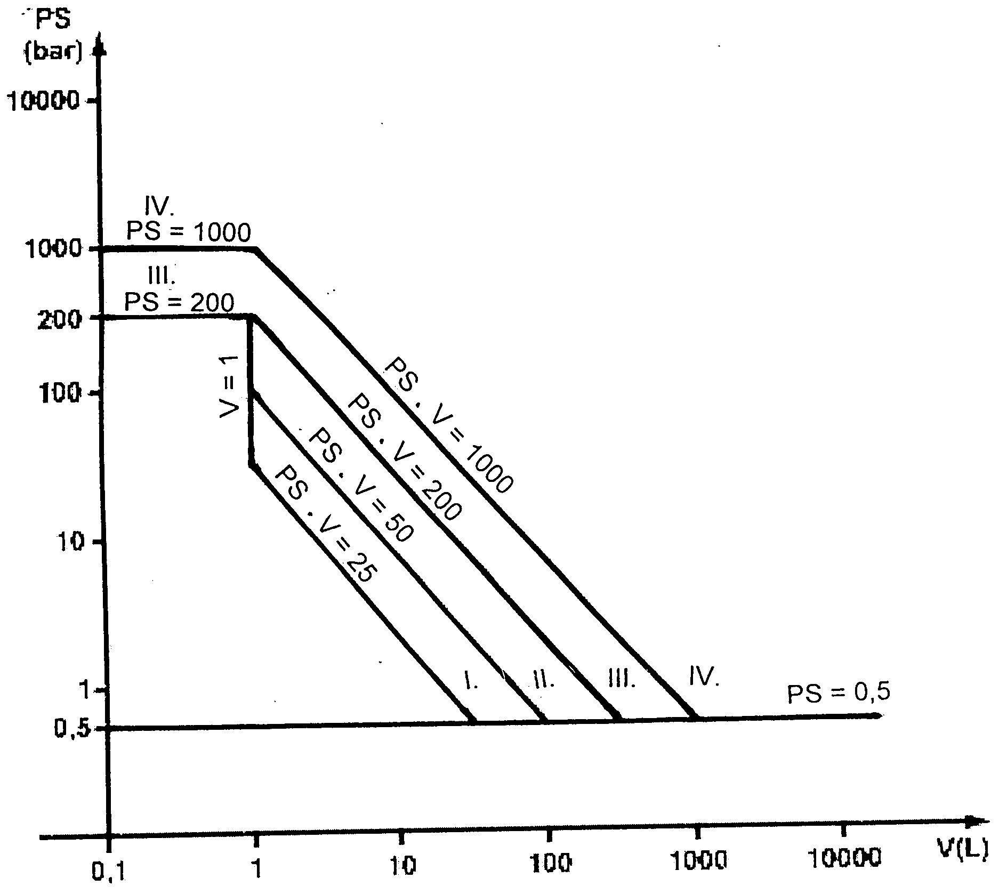
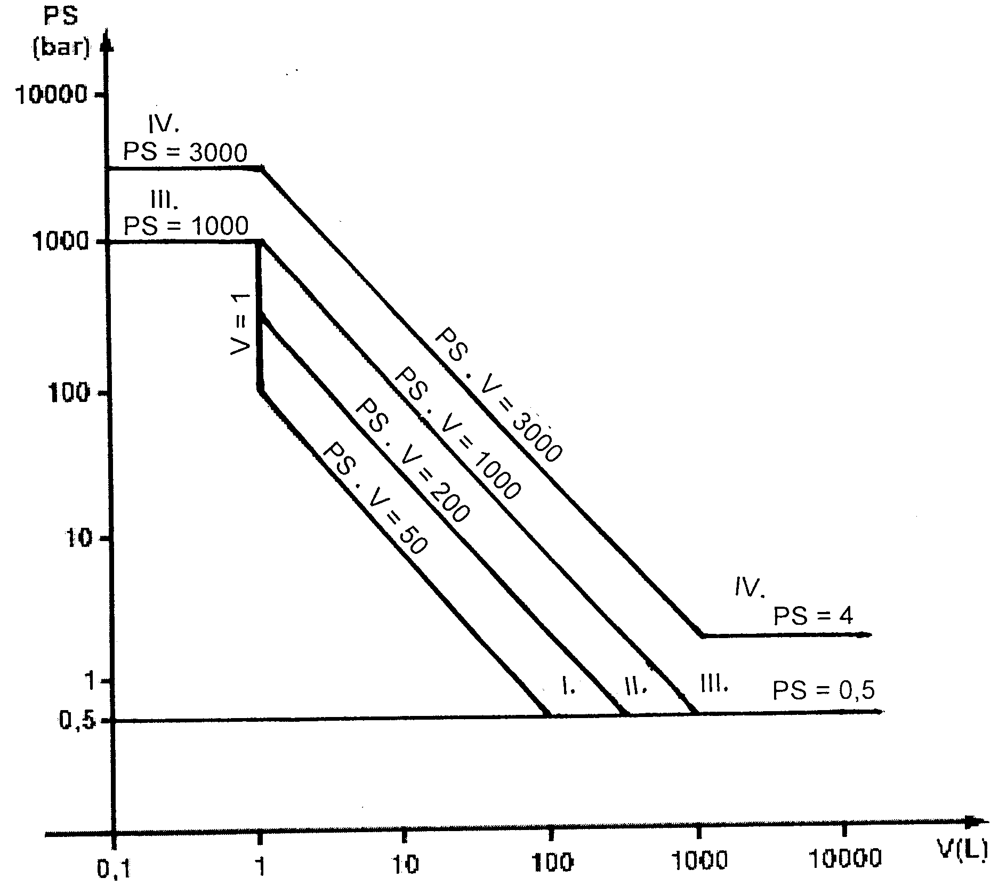
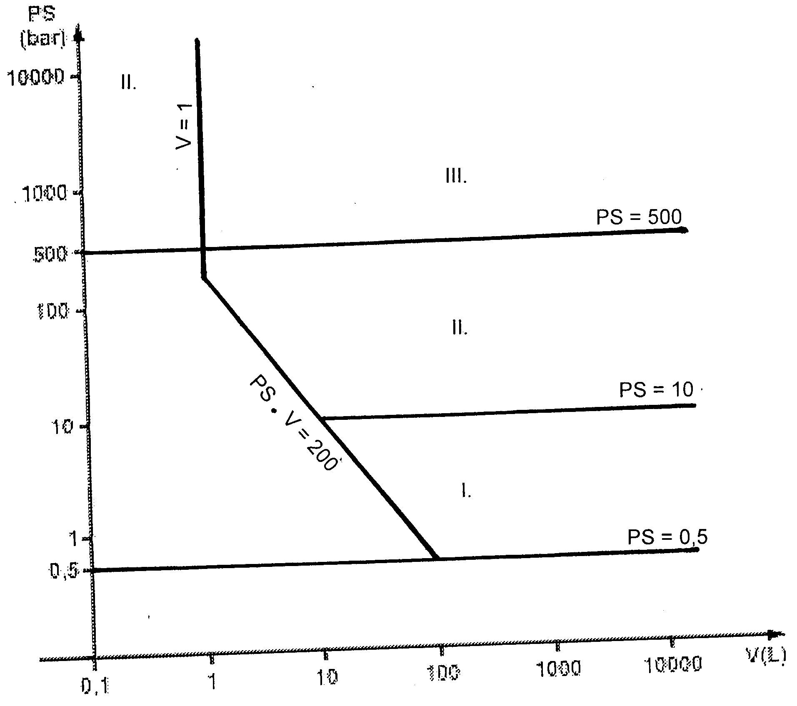
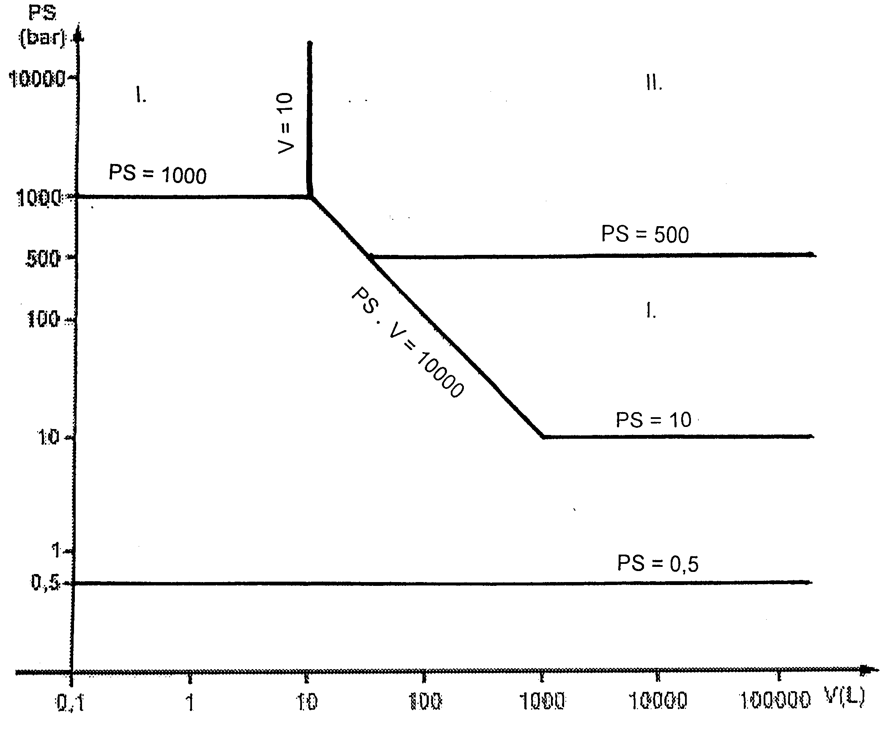
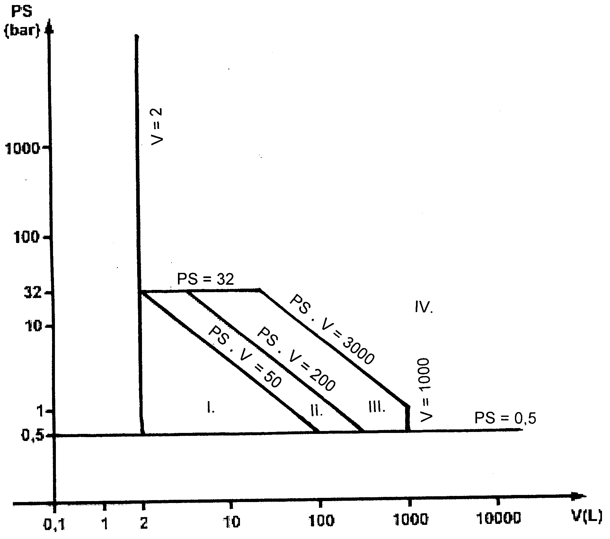
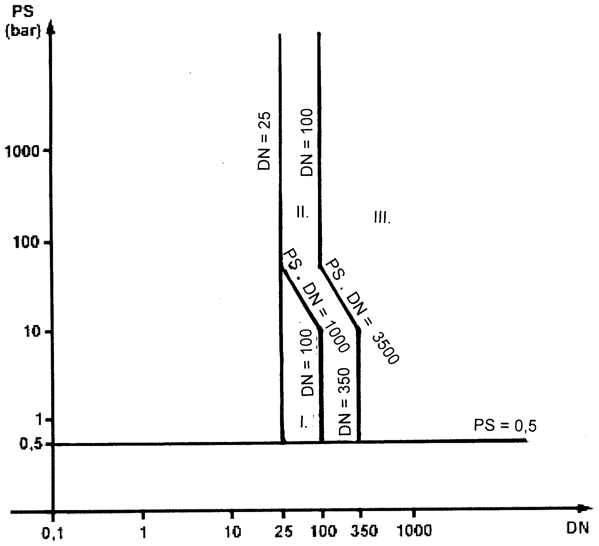
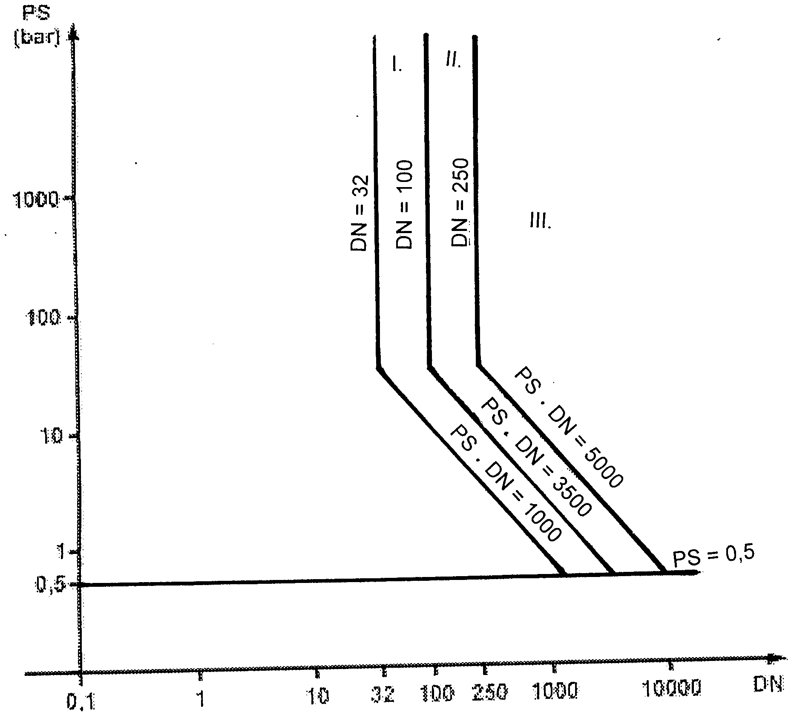
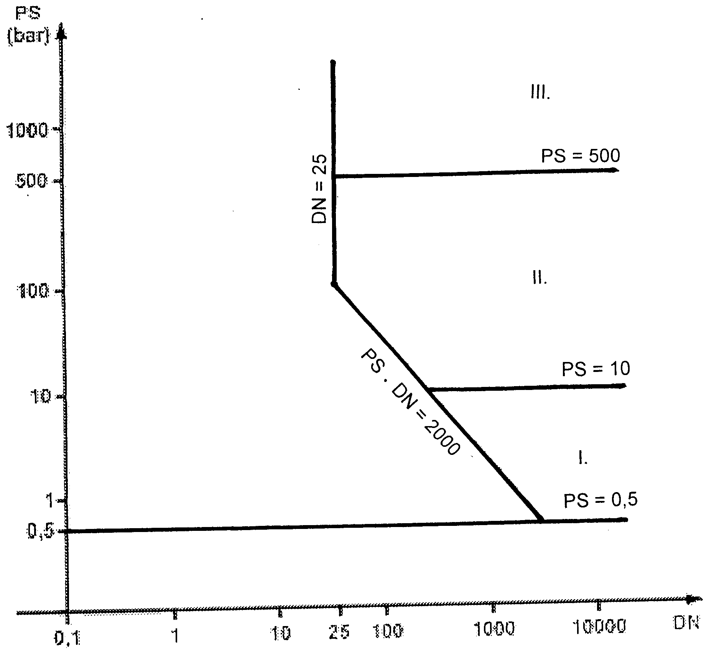
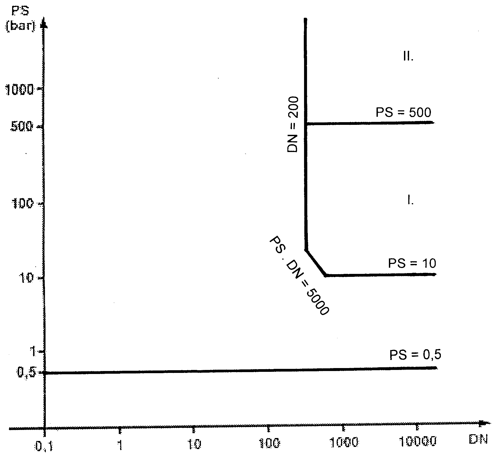

Príloha č. 2 k nariadeniu vlády č. 576/2002 Z. z.

- GRAFY NA POSUDZOVANIE ZHODY

  - 1. Postup posudzovania zhody sa určí podľa § 9 ods. 3, podľa údajov uvedených v príslušných grafoch a pri

    - a) I. kategórii sa použije postup podľa § 12 ods. 3 písm. a) zákona na základe vnútornej kontroly výroby (modul A),

    - b) II. kategórii sa použije postup

  - 1. podľa § 12 ods. 3 písm. a) zákona na základe vnútornej kontroly výroby s kontrolou záverečného posudzovania spresnený v prílohe č. 3 (modul A1),

  - 2. podľa § 12 ods. 3 písm. d) zákona na základe zabezpečovania kvality výroby spresnený v prílohe č. 3 (modul D1), alebo

  - 3. podľa § 12 ods. 3 písm. e) zákona na základe zabezpečovania kvality výrobkov spresnený v prílohe č. 3 (modul E1),

    - c) III. kategórii sa použije postup

  - 1. podľa § 12 ods. 3 písm. b) zákona na základe posúdenia návrhu spresnený v prílohe č. 3 (modul B1) + postup podľa § 12 ods. 3 písm. d) zákona na základe zabezpečovania kvality výroby (modul D),

  - 2. podľa § 12 ods. 3 písm. b) zákona na základe posúdenia návrhu spresnený v prílohe č. 3 (modul B1) + podľa § 12 ods. 3 písm. f) zákona na základe overovania výrobkov (modul F),

  - 3. podľa § 12 ods. 3 písm. b) zákona na základe posúdenia typu (modul B) + podľa § 12 ods. 3 písm. e) zákona na základe zabezpečovania kvality výrobkov (modul E),

  - 4. podľa § 12 ods. 3 písm. b) zákona na základe posúdenia typu (modul B) + podľa § 12 ods. 3 písm. c) zákona na základe zhody s typom spresnený v prílohe č. 3 (modul C1), alebo

  - 5. podľa § 12 ods. 3 písm. h) zákona na základe komplexného zabezpečenia kvality (modul H),

    - d) IV. kategórii sa použije postup

  - 1. podľa § 12 ods. 3 písm. b) zákona na základe posúdenia typu (modul B) + podľa § 12 ods. 3 písm. d) zákona na základe zabezpečovania kvality výroby (modul D),

  - 2. podľa § 12 ods. 3 písm. b) zákona na základe posúdenia typu (modul B) + podľa § 12 ods. 3 písm. f) zákona na základe overovania výrobkov (modul F),

  - 3. podľa § 12 ods. 3 písm. g) zákona na základe overovania jednotlivých výrobkov (modul G), alebo

  - 4. podľa § 12 ods. 3 písm. h) zákona na základe komplexného zabezpečenia kvality s posúdením návrhu a kontrolou pri záverečnom posudzovaní spresnený v prílohe č. 3 (modul H1).

  - 2. Bezpečnostné príslušenstvo podľa § 1 ods. 4 písm. d) a podľa § 4 ods. 1 písm. d) je zaradené do IV. kategórie. Bezpečnostné príslušenstvo vyrobené pre určité tlakové zariadenie môže byť zaradené do rovnakej kategórie ako tlakové zariadenie, ktoré chráni.

  - 3. Tlakové príslušenstvo podľa § 1 ods. 4 písm. e) a podľa § 4 ods. 1 písm. d) je zaradené do kategórie posudzovania zhody podľa príslušného grafu pre nádoby alebo potrubia na základe

    - a) najvyššieho pracovného pretlaku tlakového príslušenstva,

    - b) objemu alebo menovitej svetlosti tlakového príslušenstva,

    - c) skupiny tekutín, pre ktoré je tlakové príslušenstvo určené.

      - Ak podľa písmena b) možno zohľadniť aj objem, aj menovitú svetlosť, musí byť tlakové príslušenstvo zaradené do vyššej kategórie.

  - 4. Hraničné čiary v jednotlivých grafoch vyznačujú hornú hranicu pre nižšiu kategóriu.

  - 

    - Graf č. 1

    - Nádoba uvedená v § 4 ods. 1 písm. a) bode 1.a

    - Výnimkou je nádoba I. alebo II. kategórie obsahujúca nestabilné plyny. Táto nádoba musí byť zaradená podľa grafu č. 1 do III. kategórie.

    - (PS – najvyšší pracovný tlak,

    - V – objem)

  - 

    - Graf č. 2

    - Nádoba uvedená v § 4 ods. 1 písm. a) bode 1.b

    - Výnimkou je tlaková nádoba hasiaceho prístroja a fľaša pre dýchací prístroj, ktoré musia byť zaradené najmenej do III. kategórie.

    - (PS – najvyšší pracovný tlak,

    - V – objem)

  - 

    - Graf č. 3

    - Nádoba uvedená v § 4 ods. 1 písm. a) bode 2.a

    - (PS – najvyšší pracovný tlak,

    - V – objem)

  - 

    - Graf č. 4

    - Nádoba uvedená v § 4 ods. 1 písm. a) bode 2.b

    - Výnimkou je zostava určená na výrobu teplej vody podľa § 4 ods. 2 písm. c), ktorá sa musí podrobiť posúdeniu zhody podľa § 12 ods. 3 písm. b) zákona na základe posúdenia návrhu spresneného v prílohe č. 3 (modul B1) s ohľadom na požiadavky uvedené v prílohe č. 1 v bodoch 2.10, 2.11, 3.4, 5.2 písm. a) a 5.2 písm. d) alebo podľa § 12 ods. 3 písm. h) zákona na základe komplexného zabezpečenia kvality (modul H).

    - (PS – najvyšší pracovný tlak,

    - V – objem)

  - 

    - Graf č. 5

    - Tlakové zariadenie uvedené v § 4 ods. 1 písm. b)

    - Výnimkou je návrh tlakového hrnca, ktorý sa musí podrobiť jednému z postupov posudzovania zhody určených pre III. kategóriu.

    - (PS – najvyšší pracovný tlak,

    - V – objem)

  - 

    - Graf č. 6

    - Potrubie uvedené v § 4 ods. 1 písm. c) bode 1.a

    - Výnimkou je potrubie I. alebo II. kategórie obsahujúce nestabilné plyny. Toto potrubie musí byť zaradené podľa grafu č. 6 do III. kategórie.

    - (PS – najvyšší pracovný tlak,

    - DN – menovitá svetlosť)

  - 

    - Graf č. 7

    - Potrubie uvedené v § 4 ods. 1 písm. c) bode 1.b

    - Výnimkou je potrubie II. kategórie obsahujúce tekutiny pri teplotách vyšších ako 350 oC.

    - Toto potrubie musí byť zaradené do III. kategórie.

    - (PS – najvyšší pracovný tlak,

    - DN – menovitá svetlosť)

  - 

    - Graf č. 8

    - Potrubie uvedené v § 4 ods. 1 písm. c) bode 2.a

    - (PS – najvyšší pracovný tlak,

    - DN – menovitá svetlosť)

  - 

    - Graf č. 9

    - Potrubie uvedené v § 4 ods. 1 písm. c) bode 2.b

    - (PS – najvyšší pracovný tlak,

    - DN – menovitá svetlosť)

  - [Príloha 03](../assets/875958461b31f732f4e3583a83878d0ad2bae7d17f667b59dc9d57bb4e02f881.pdf)
