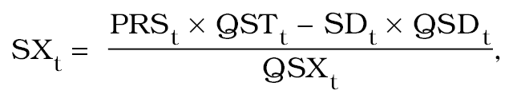

# Článok 10 Cena za odvedenie a čistenie odpadovej vody pre odberateľov okrem domácností a tarify pre jednotlivé skupiny odberateľov

(1) Cena za odvedenie a čistenie odpadovej vody pre odberateľov okrem domácností sa vypočíta podľa vzorca

kde

SXt je cena za odvedenie a čistenie odpadovej vody pre odberateľov okrem domácností v Sk na objemovú jednotku v roku t,

SDtje cena za odvedenie a čistenie odpadovej vody pre domácnosti v Sk na objemovú jednotku v roku t,

QSDtje predpokladané množstvo odvedenej a čistenej odpadovej vody v objemových jednotkách pre domácnosti v roku t,

QSXt je predpokladané množstvo odvedenej a čistenej odpadovej vody v objemových jednotkách pre odberateľov okrem domácností v roku t.

(2) Tarify pre jednotlivé skupiny odberateľov okrem domácností navrhuje regulovaný subjekt tak, aby pokrývali minimálne ekonomicky oprávnené náklady a primeraný zisk na jednotlivé skupiny odberateľov a aby sa priemer taríf vážený plánovaným množstvom odvedenej a čistenej odpadovej vody v roku t pre jednotlivé skupiny odberateľov rovnal cene za odvedenie a čistenie odpadovej vody pre odberateľov okrem domácností vypočítanej podľa odseku 1.

(3) Spôsob výpočtu ceny za odvedenie a čistenie odpadovej vody pre odberateľov okrem domácností a určenia taríf uvedený v odsekoch 1 a 2 sa uplatňuje dovtedy, kým maximálna cena za odvedenie a čistenie odpadovej vody pre domácnosti určená podľa článku 9 ods. 1 nedosiahne priemernú regulovanú cenu za odvedenie a čistenie odpadovej vody vypočítanú podľa článku 8 ods. 1.

(4) Tarify pre jednotlivé skupiny odberateľov navrhuje regulovaný subjekt tak, aby pokrývali ekonomicky oprávnené náklady a primeraný zisk na jednotlivé skupiny odberateľov a aby sa priemer taríf vážený plánovaným množstvom odvedenej a čistenej odpadovej vody v roku t pre jednotlivé skupiny odberateľov rovnal priemernej regulovanej cene za odvedenie a čistenie odpadovej vody vypočítanej podľa článku 8 ods. 1.

(5) Spôsob určenia taríf uvedený v odseku 4 sa uplatňuje v prípade, keď maximálna cena za odvedenie a čistenie odpadovej vody pre domácnosti určená podľa článku 9 ods. 1 dosiahne priemernú regulovanú cenu za odvedenie a čistenie odpadovej vody vypočítanú podľa článku 8 ods. 1.
