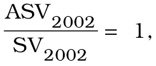
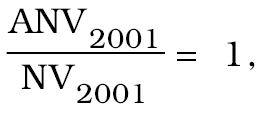
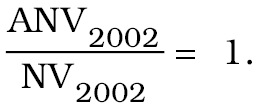
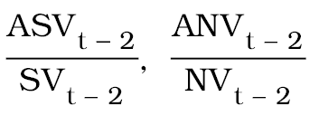

# Článok 11 Hodnoty koeficientov

(1) Hodnoty koeficientov sú stanovené takto:

- a) K2001 = 0,

- b) K2002 = 0,

- c) 

- d) 

- e) 

- f) 

(2) Regulovanému subjektu, ktorý prvýkrát podáva návrh cien, môže určiť hodnotu koeficientov Kt - 2,

úrad.
