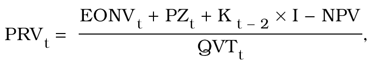
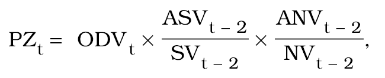
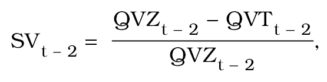

# Článok 5 Spôsob výpočtu priemernej regulovanej ceny za výrobu a dodávku pitnej vody

(1) Priemerná regulovaná cena za výrobu a dodávku pitnej vody v Sk na jednotku objemu na rok t sa vypočíta podľa vzorca

kde

PRVtje priemerná regulovaná cena za výrobu a dodávku pitnej vody na rok t,

EONVtsú plánované ekonomicky oprávnené náklady na výrobu a dodávku pitnej vody v roku t podľa článku 4,

PZt je primeraný zisk určený podľa odseku 2,

Kt - 2 je korekčný faktor určený podľa odseku 4,

I je úroková sadzba určená podľa odseku 5,

NPV je neoprávnený prebytok výnosov z vodného určený podľa odseku 6,

QVTtje predpokladané množstvo dodanej pitnej vody v objemových jednotkách pre všetkých odberateľov v roku t.

(2) Primeraný zisk PZt sa vypočíta podľa vzorca

kde

ODVt je plánovaná výška ročných odpisov4) z majetku, ktorý regulovaný subjekt používa na výrobu a dodávku pitnej vody, vrátane odpisov z majetku, ktorý má regulovaný subjekt v prenájme; do ODVtsa nezahŕňajú odpisy z majetku, ktorý sa nepoužíva na výrobu a dodávku pitnej vody, a z osobných áut; odpisy z majetku, ktorý sa používa na výrobu a dodávku pitnej vody iba čiastočne, sa zahrnú do ODVtv pomere, v akom sa používa na výrobu a dodávku pitnej vody,

SVt - 2 je koeficient celkových strát vody určený podľa odseku 3,

ASVt - 2 je aritmetický priemer koeficientov celkových strát vody za roky t - 2 až t - 4,

NVt - 2 sú skutočné jednotkové náklady v Sk na objemovú jednotku dodanej a fakturovanej pitnej vody, ktoré sa vypočítajú ako podiel skutočných ekonomicky oprávnených nákladov určených podľa článku 4 v roku t - 2 a celkového množstva dodanej a fakturovanej pitnej vody v roku t - 2,

ANVt - 2 je aritmetický priemer NVt - 2, NVt - 3 a NVt - 4.

(3) Koeficient celkových strát vody SVt - 2 sa vypočíta podľa vzorca

kde

QVZt - 2 je celkové množstvo vody odobratej z vodných zdrojov v roku t - 2,

QVTt - 2 je celkové množstvo dodanej a fakturovanej vody v roku t - 2.

(4) Korekčný faktor Kt - 2 slúži na spätnú korekciu nedostatku alebo prebytku príjmov a vypočíta sa ako rozdiel schválenej priemernej regulovanej ceny za výrobu a dodávku pitnej vody v roku t - 2 vynásobenej plánovaným množstvom dodanej pitnej vody v roku t - 2 a skutočnej priemernej fakturovanej ceny za výrobu a dodávku pitnej vody v roku t - 2 vynásobenej skutočným množstvom dodanej pitnej vody v roku t - 2.

(5) Hodnota úrokovej sadzby I je dvojnásobok úrokovej sadzby 12M BRIBOR (predaj), ktorú publikuje Národná banka Slovenska, ku dňu podania návrhu cien zníženej o štyri percentá, ak je korekčný faktor Kt - 2 väčší ako nula. Ak je korekčný faktor Kt - 2 menší ako nula, hodnota úrokovej sadzby I je dvojnásobok úrokovej sadzby 12M BRIBOR (predaj), ktorú publikuje Národná banka Slovenska, ku dňu podania návrhu cien zvýšenej o štyri percentá.

(6) Neoprávnený prebytok výnosov z vodného môže určiť úrad, ak regulovaný subjekt fakturuje alebo fakturoval v predchádzajúcich regulačných rokoch nesprávnu cenu alebo tarifu za výrobu a dodávku pitnej vody, ak tým došlo k zvýšeniu výnosov regulovaného subjektu.
