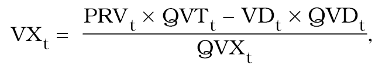

# Článok 7 Cena za výrobu a dodávku pitnej vody pre odberateľov okrem domácností a tarify pre jednotlivé skupiny odberateľov

(1) Cena za výrobu a dodávku pitnej vody pre odberateľov okrem domácností sa vypočíta podľa vzorca

kde

VXt je cena za výrobu a dodávku pitnej vody pre odberateľov okrem domácností v Sk na objemovú jednotku v roku t,

VDt je cena za výrobu a dodávku pitnej vody pre domácnosti v Sk na objemovú jednotku v roku t,

QVDtje predpokladané množstvo dodanej pitnej vody v objemových jednotkách pre domácnosti v roku t,

QVXt je predpokladané množstvo dodanej pitnej vody v objemových jednotkách pre odberateľov okrem domácností v roku t.

(2) Tarify pre jednotlivé skupiny odberateľov okrem domácností navrhuje regulovaný subjekt tak, aby pokrývali minimálne ekonomicky oprávnené náklady a primeraný zisk na jednotlivé skupiny odberateľov a aby sa priemer taríf vážený plánovaným množstvom vyrobenej a dodanej pitnej vody v roku t pre jednotlivé skupiny odberateľov rovnal cene za výrobu a dodávku pitnej vody pre odberateľov okrem domácností vypočítanej podľa odseku 1.

(3) Spôsob výpočtu ceny za výrobu a dodávku pitnej vody pre odberateľov okrem domácností a určenia taríf uvedený v odsekoch 1 a 2 sa uplatňuje dovtedy, kým maximálna cena za výrobu a dodávku pitnej vody pre domácnosti určená podľa článku 6 ods. 1 nedosiahne priemernú regulovanú cenu za výrobu a dodávku pitnej vody vypočítanú podľa článku 5 ods. 1.

(4) Tarify pre jednotlivé skupiny odberateľov navrhuje regulovaný subjekt tak, aby pokrývali ekonomicky oprávnené náklady a primeraný zisk na jednotlivé skupiny odberateľov a aby sa priemer taríf vážený plánovaným množstvom vyrobenej a dodanej pitnej vody v roku t pre jednotlivé skupiny odberateľov rovnal priemernej regulovanej cene za výrobu a dodávku pitnej vody vypočítanej podľa článku 5 ods. 1.

(5) Spôsob určenia taríf uvedený v odseku 4 sa uplatňuje v prípade, keď maximálna cena za výrobu a dodávku pitnej vody pre domácnosti určená podľa článku 6 ods. 1 dosiahne priemernú regulovanú cenu za výrobu a dodávku pitnej vody vypočítanú podľa článku 5 ods. 1.
