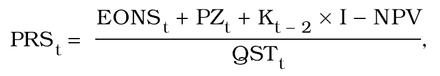

# Článok 8 Spôsob výpočtu priemernej regulovanej ceny za odvedenie a čistenie odpadovej vody

(1) Priemerná regulovaná cena za odvedenie a čistenie odpadovej vody v Sk na objemovú jednotku na rok t sa vypočíta podľa vzorca

kde

PRSt je priemerná regulovaná cena za odvedenie a čistenie odpadovej vody na rok t,

EONSt sú plánované ekonomicky oprávnené náklady na odvedenie a čistenie odpadovej vody v roku t určené podľa článku 4,

PZt je primeraný zisk určený podľa odseku 2,

Kt - 2 je korekčný faktor určený podľa odseku 3,

I je úroková sadzba určená podľa odseku 4,

NPV je neoprávnený prebytok výnosov zo stočného určený podľa odseku 5,

QSTt je predpokladané množstvo odvedenej a čistenej odpadovej vody v objemových jednotkách pre všetkých odberateľov v roku t.

(2) Primeraný zisk PZt sa vypočíta podľa vzorca

kde

ODSt je plánovaná výška ročných odpisov z majetku,4) ktorý regulovaný subjekt používa na odvedenie a čistenie odpadovej vody, vrátane odpisov z majetku, ktorý má regulovaný subjekt v prenájme. Do ODStsa nezahŕňajú odpisy z majetku, ktorý sa nepoužíva na odvedenie a čistenie odpadovej vody, a z osobných áut. Odpisy z majetku, ktorý sa používa na odvedenie a čistenie odpadovej vody iba čiastočne, sa zahrnú do ODSt v pomere, v akom sa používa na odvedenie a čistenie odpadovej vody.

(3) Korekčný faktor Kt - 2 slúži na spätnú korekciu nedostatku alebo prebytku príjmov a vypočíta sa ako rozdiel schválenej priemernej regulovanej ceny za odvedenie a čistenie odpadovej vody v roku t - 2 vynásobenej plánovaným množstvom odvedenej a čistenej vody v roku t - 2 a skutočnej priemernej fakturovanej ceny za odvedenie a čistenie odpadovej vody v roku t - 2 vynásobenej skutočným množstvom odvedenej a čistenej odpadovej vody v roku t - 2.

(4) Hodnota úrokovej sadzby I je dvojnásobok úrokovej sadzby 12M BRIBOR (predaj), ktorú publikuje Národná banka Slovenska, ku dňu podania návrhu cien zníženej o štyri percentá, ak je korekčný faktor Kt - 2 väčší ako nula. Ak je korekčný faktor Kt - 2 menší ako nula, hodnota úrokovej sadzby I je dvojnásobok úrokovej sadzby 12M BRIBOR (predaj), ktorú publikuje Národná banka Slovenska, ku dňu podania návrhu cien zvýšenej o štyri percentá.

(5) Neoprávnený prebytok výnosov zo stočného môže určiť úrad, ak regulovaný subjekt fakturuje alebo fakturoval v predchádzajúcich regulačných rokoch nesprávnu cenu alebo tarifu za odvedenie a čistenie odpadovej vody, ak tým došlo k zvýšeniu výnosov regulovaného subjektu.
