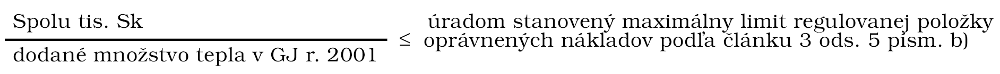

Príloha č. 2 A

- VÝPOČET POLOŽKY 3.3 OSTATNÉ OPRÁVNENÉ NÁKLADY FIXNEJ ZLOŽKY CENY TEPLA

Regulačný subjekt: | | | | |

Adresa: | | | | |

Číslo licencie: | | Kontaktná osoba: | | Telefón: |

- Do výpočtu položky 3.3 ostatné oprávnené náklady ceny tepla na rok t sú zahrnuté tieto náklady:

1. Osobné náklady | |

521 | mzdové náklady | tis. Sk

522 | príjmy spoločníkov | tis. Sk

524 | zákonné sociálne poistenie | tis. Sk

527 | zákonné sociálne náklady | tis. Sk

2. Spotrebované nákupy | |

501, 502 | Spotreba materiálu | tis. Sk

3. Služby | |

512 | Cestovné | tis. Sk

518 | Ostatné služby | tis. Sk

4. Dane a poplatky | |

531 | Cestná daň | tis. Sk

532, 538 | Ostatné dane a poplatky | tis. Sk

5. Iné prevádzkové náklady | |

548 | Ostatné prevádzkové náklady | tis. Sk

6. Odpisy | |

551 | Odpisy NIM a HIM | tis. Sk

(tých NIM a HIM, ktoré nepriamo súvisia s výrobou a rozvodom tepla) | |

7. Finančné náklady | |

568 | Ostatné finančné náklady | tis. Sk

| Spolu | tis. Sk

- Kontrola výšky oprávnených nákladov:

- 

- Vysvetlenie:

- V prípade, že podmienka výšky oprávnených nákladov je splnená, výsledná suma oprávnených nákladov položky 3.3 sa započíta do kalkulácie na rok t (t. j. do niektorej z príloh č. 1 A až 1 G), takže v kalkulácii sú tieto náklady prepočítané na zmluvnú dodávku tepla roku t.
