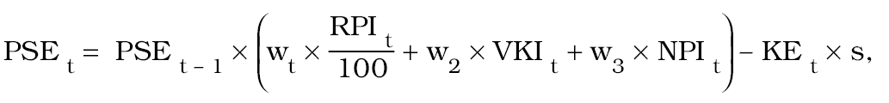
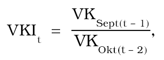
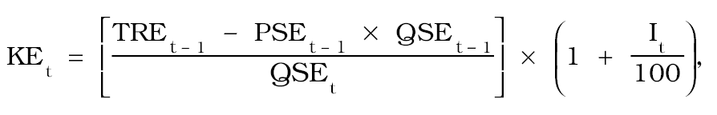

# Článok 3

(1) Tento článok upravuje spôsob regulácie cien za predaj elektriny podľa článku 2 ods. 1 písm. a), b) a c).

(2) Regulovaný subjekt navrhne ceny na rok t tak, aby skutočne dosiahnutý priemerný výnos z predaja elektriny podľa článku 2 ods. 1 písm. a), b) a c) v roku t na jednotku elektriny neprekročil maximálnu cenu na rok t vypočítanú podľa odseku 3.

(3) Maximálna cena za predaj elektriny podľa článku 2 ods. 1 písm. a), b) a c) PSEt v Sk na jednotku elektriny v roku t sa vypočíta podľa vzorca

pričom

PSEt - 1 = maximálna cena za predaj elektriny podľa článku 2 ods. 1 písm. a), b) a c) v Sk na jednotku elektriny v roku t - 1,

wi = podiely vyjadrujúce váhy indexov v ma- ximálnej cene, pričom w1 + w2 + w3 = 1,

RPIt = aritmetický priemer indexov spotrebiteľských cien, ktorým je položka „indexy spotrebiteľských cien oproti rovnakému obdobiu minulého roku, spotrebiteľské ceny úhrnom", publikovaný Štatistickým úradom Slovenskej republiky v období od októbra v roku t - 2 až do septembra v roku t - 1,

VKIt = index vyjadrujúci zmenu výmenného kurzu slovenskej koruny voči EUR vypočítaný ako

pričom

VKSept(t - 1) = výmenný kurz v SKK za 1 EUR, priemer za mesiac september roku t - 1, publikovaný Národnou bankou Slovenska,

VKOkt(t - 2) = výmenný kurz v SKK za 1 EUR, priemer za mesiac október roku t - 2, publikovaný Národnou bankou Slovenska,

NPIt = aritmetický priemer indexov vyjadrujúcich zmenu cien paliva, ktorým je položka „indexy cien vo výrobnej sfére oproti rovnakému obdobiu minulého roka, produkty banskej a povrchovej ťažby", publikovaný Štatistickým úradom Slovenskej republiky v období od októbra v roku t - 2 až do septembra v roku t - 1,

KEt = korekčný faktor v Sk na jednotku elektriny v roku t, ktorý sa vypočíta podľa vzorca

pričom

TREt - 1 = celkové výnosy v Sk v roku t - 1 z predaja elektriny podľa článku 2 ods. 1 písm. a), b) a c),

PSEt - 1 = maximálna cena za predaj elektriny podľa článku 2 ods. 1 písm. a), b) a c) v Sk na jednotku elektriny v roku t - 1,

QSEt - 1 = celkový objem elektriny predanej podľa článku 2 ods. 1 písm. a), b) a c) v jednotkách elektriny v roku t - 1,

QSEt = celkový plánovaný objem elektriny predanej podľa článku 2 ods. 1 písm. a), b) a c) v jednotkách elektriny v roku t,

It = úroková sadzba: 12M BRIBOR (predaj), ktorú publikuje Národná banka Slovenska za obdobie január až september v roku t - 1 a ktorá sa vypočíta ako priemer mesačných priemerov,

s = koeficient delenia rozdielu medzi skutočnými a povolenými príjmami regulovaného subjektu z predaja elektriny podľa článku 2 ods. 1 písm. a), b) a c) medzi regulovaný subjekt a jeho odberateľov.

(4) Regulovaný subjekt zároveň účtuje držiteľovi licencie na rozvod elektriny prevádzkujúcemu prenosovú sústavu poplatky za náklady systému, pričom maximálny povolený výnos VNSt z týchto poplatkov v Sk v roku t sa vypočíta podľa vzorca

VNSt = NSPLt - KSt,

pričom

NSPLt = plánované náklady systému v Sk v roku t povolené úradom,

KSt = korekčný faktor v Sk v roku t, ktorý sa vypočíta podľa vzorca

pričom

TNSt - 1 = celkový skutočný výnos z poplatkov za náklady systému uhradený regulovanému subjektu držiteľom licencie na rozvod elektriny prevádzkujúcim prenosovú sústavu v Sk v roku t - 1,

NSSKt - 1 = celkové skutočné náklady systému regu- lovaného subjektu v Sk v roku t - 1,

hodnota It v prípade, ak

- 1. [TNS t - 1 - NSSKt - 1] > 0, je rovné úrokovej sadzbe: 12M BRIBOR (predaj), ktorú publikuje Národná banka Slovenska za obdobie január až september v roku t - 1 + 5 % a ktorá sa vypočíta ako priemer mesačných priemerov,

- 2. [TNS t - 1 - NSSKt - 1] < 0, je rovné úrokovej sadzbe: 12M BRIBOR (predaj), ktorú publikuje Národná banka Slovenska za obdobie január až september v roku t - 1 a ktorá sa vypočíta ako priemer mesačných priemerov.
