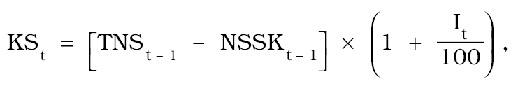

# Článok 3

(4) Regulovaný subjekt zároveň účtuje držiteľovi licencie na rozvod elektriny prevádzkujúcemu prenosovú sústavu poplatky za náklady systému, pričom maximálny povolený výnos VNSt z týchto poplatkov v Sk v roku t sa vypočíta podľa vzorca

VNSt = NSPLt - KSt,

pričom

NSPLt = plánované náklady systému v Sk v roku t povolené úradom,

KSt = korekčný faktor v Sk v roku t, ktorý sa vypočíta podľa vzorca

pričom

TNSt - 1 = celkový skutočný výnos z poplatkov za náklady systému uhradený regulovanému subjektu držiteľom licencie na rozvod elektriny prevádzkujúcim prenosovú sústavu v Sk v roku t - 1,

NSSKt - 1 = celkové skutočné náklady systému regu- lovaného subjektu v Sk v roku t - 1,

hodnota It v prípade, ak

- 1. [TNS t - 1 - NSSKt - 1] > 0, je rovné úrokovej sadzbe: 12M BRIBOR (predaj), ktorú publikuje Národná banka Slovenska za obdobie január až september v roku t - 1 + 5 % a ktorá sa vypočíta ako priemer mesačných priemerov,

- 2. [TNS t - 1 - NSSKt - 1] < 0, je rovné úrokovej sadzbe: 12M BRIBOR (predaj), ktorú publikuje Národná banka Slovenska za obdobie január až september v roku t - 1 a ktorá sa vypočíta ako priemer mesačných priemerov.
