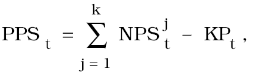
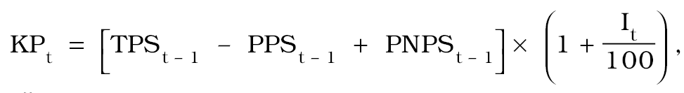

# Článok 4

(1) Tento článok upravuje spôsob regulácie cien za predaj podporných služieb držiteľom licencie na výrobu elektriny pre držiteľa licencie na rozvod elektriny prevádzkujúceho prenosovú sústavu na základe zmluvy o poskytovaní podporných služieb.

(2) Regulovaný subjekt účtuje držiteľovi licencie na rozvod elektriny prevádzkujúcemu prenosovú sústavu cenu za predaj podporných služieb, pričom maximálny povolený výnos PPSt, ktorý regulovaný subjekt dosiahne za predaj podporných služieb, v Sk v roku t sa vypočíta podľa vzorca

pričom

NSPJt= povolené náklady regulovaného subjek- tu spojené s poskytovaním j-teho typu podporných služieb povolené úradom v Sk v roku t,

k = počet typov podporných služieb, na ktorých predaj má regulovaný subjekt uzatvorenú v roku t zmluvu na poskytovanie podporných služieb s držiteľom licencie na rozvod prevádzkujúcim prenosovú sústavu,

KPt = korekčný faktor v Sk v roku t, ktorý sa vypočíta podľa vzorca

pričom

TPSt - 1 = celkový skutočný výnos v Sk v roku t - 1 z predaja podporných služieb,

PPSt - 1 = maximálny povolený výnos z predaja podporných služieb v Sk v roku t - 1,

PNPSt - 1 = penále, pokuty a iné poplatky, ktoré regulovaný subjekt uhradil za neposkytnutie podporných služieb v rozsahu dohodnutom v zmluvách o poskytovaní podporných služieb alebo určenom v Kódexe prenosovej sústavy v Sk v roku t - 1,

It = úroková sadzba: 12M BRIBOR (predaj), ktorú publikuje Národná banka Slovenska za obdobie január až september v roku t - 1 a ktorá sa vypočíta ako priemer mesačných priemerov.
