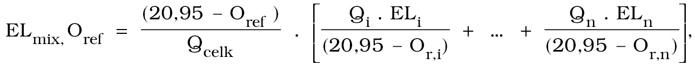
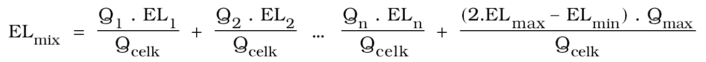
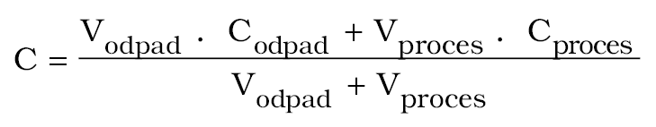

Príloha č. 4 k vyhláške č. 704/2002 Z. z.

- ŠPECIFICKÉ EMISNÉ LIMITY A VŠEOBECNÉ PODMIENKY PREVÁDZKOVANIA ZDROJOV ZNEČISŤOVANIA

  - I. PALIVOVO-ENERGETICKÝ PRIEMYSEL

    - 1. TECHNOLOGICKÉ CELKY OBSAHUJÚCE STACIONÁRNE ZARIADENIA NA SPAĽOVANIE PALÍV (TEPLÁRNE, ELEKTRÁRNE, VÝHREVNE A ZARIADENIA NA PROCESNÉ SPAĽOVANIE) SO SÚHRNNÝM TEPELNÝM PRÍKONOM 0,3 MW A VYŠŠÍM

    - 1.1 Zariadenia na spaľovanie palív

      - Zariadenie na spaľovanie palív je každý kotol alebo technický aparát, ktorý slúži na oxidáciu palív na účely využitia vzniknutého tepla.

    - Emisné limity a podmienky prevádzkovania uvedené v tomto bode platia pre zariadenia určené na výrobu energie okrem tých zariadení, ktoré využívajú produkty spaľovania priamo vo výrobe, najmä:

      - a) zariadenia, v ktorých sa produkty spaľovania používajú na priame vykurovanie, sušenie alebo iné tepelné spracovanie materiálov a predmetov,

      - b) dopaľovacie zariadenia, t. j. zariadenia, ktoré sú určené na čistenie odpadových plynov spaľovaním, ak nie sú prevádzkované ako samostatné zariadenia na spaľovanie palív,

      - c) zariadenia na regeneráciu katalyzátorov na katalytické krakovanie,

      - d) zariadenia na premenu sírovodíka na síru,

      - e) reaktory používané v chemickom priemysle okrem procesného spaľovania,

      - f) koksárenské pece,

      - g) ohrievače vetra,

      - h) technické zariadenia používané na pohon vozidiel, lodí a lietadiel,

      - i) plynové turbíny,

      - j) stacionárne piestové motory.

    - 1.2 Členenie zariadení na spaľovanie palív vo vzťahu k platnosti emisných limitov

    - 1.2.1 Zariadenia zdrojov, pre ktoré bolo vydané stavebné povolenie, alebo ak také nie sú, povolenie na užívanie do 30. júna 1987.

    - 1.2.2 Zariadenia zdrojov, pre ktoré bolo vydané stavebné povolenie, alebo ak také nie sú, povolenie na užívanie od 1. júla 1987 do 31. marca 1998, alebo bolo vydané stavebné povolenie do 31. marca 1998 a povolenie na užívanie do 31. marca 2001.

    - 1.2.3 Zariadenia zdrojov, pre ktoré bolo vydané stavebné povolenie od 31. marca 1998 a ktoré sú uvedené do prevádzky do 27. novembra 2003.

    - 1.2.4 Zariadenia zdrojov, pre ktoré sa začne konanie o vydanie súhlasu na povolenie od 27. novembra 2002, alebo zariadenia zdrojov, ktoré budú uvedené do prevádzky od 27. novembra 2003.

    - 1.3 Vymedzenie zariadení na spaľovanie palív pre priradenie emisných limitov

    - 1.3.1 Zariadenie pre jestvujúce zdroje

      - Za zariadenie sa považuje kotol alebo skupina kotlov (aparátov), ktoré podľa posúdenia obvodného úradu životného prostredia vypúšťajú alebo môžu vypúšťať odpadové plyny cez spoločný odvod spalín a ktorých jednotlivé tepelné príkony sú v rozmedzí od 300 kW do 62 MW, alebo jednotlivé kotly a zariadenia na procesné spaľovanie s menovitým tepelným príkonom 62 MW a vyšším. Na priradenie emisného limitu podľa príkonu sa spočítavajú príkony kotlov spaľujúcich palivo rovnakého typu (tuhé, kvapalné, plynné). Pri dvojpalivovom systéme, ak podiel privedeného tepla druhým palivom neprekročí 30 %, sa z hľadiska priradenia emisného limitu berie kotol, ako keby spaľoval len palivo privádzajúce prevažujúci tepelný príkon. Ak kotol spaľuje prídavné palivo vo väčšom podiele ako 30 % privedeného tepla, príkon tohto kotla sa k príkonom kotlov spaľujúcich len jedno palivo (alebo považovaných za také) nepripočítava a na priradenie emisného limitu sa počíta príkon každého takého kotla samostatne. Osobitne sa spočítavajú príkony kotlov s cirkulujúcou fluidnou vrstvou a pretlakovou fluidnou vrstvou a osobitne sa spočítavajú príkony kotlov s výtavným ohniskom.

      - Pre zariadenia uvedené v bode 1.2.1 platí toto ustanovenie do 31. decembra 2007 a pre zariadenia uvedené v bode 1.2.2 do dňa nadobudnutia platnosti Zmluvy o pristúpení Slovenskej republiky k Európskej únii a Európskym spoločenstvám.

    - 1.3.2 Zariadenie pre nové zdroje

      - Za zariadenie sa považuje kotol alebo skupina kotlov (prípadne procesných ohrevov), ktorých tepelné príkony sú rovné 300 kW alebo vyššie a ktoré podľa posúdenia obvodného úradu životného prostredia vypúšťajú alebo môžu vypúšťať odpadové plyny cez spoločný odvod spalín. Na priradenie emisného limitu podľa príkonu sa spočítavajú príkony kotlov spaľujúcich palivo rovnakého typu (tuhé, kvapalné, plynné). Pri viacpalivovom systéme sa pripočítava príkon kotla k ostatným kotlom podľa prevládajúceho paliva. V prípade, že do jedného komína sú zaústené len kotly s viacpalivovým systémom, spočítajú sa ich príkony bez ohľadu na prevládajúce palivo. Osobitne sa spočítavajú príkony kotlov s cirkulujúcou fluidnou alebo pretlakovou vrstvou a osobitne kotlov s výtavným ohniskom.

      - Pre zariadenia uvedené v bode 1.2.1 platí toto ustanovenie od 1. januára 2008. Pre zariadenia uvedené v bode 1.2.2 platí ustanovenie o spočítavaní kotlov okrem spočítavania kotlov s viacpalivovým systémom odo dňa nadobudnutia platnosti Zmluvy o pristúpení Slovenskej republiky k Európskej únii a Európskym spoločenstvám. Pre zariadenia uvedené v bodoch 1.2.2 a 1.2.3 platí spočítavanie príkonu kotlov s viacpalivovým systémom od 1. januára 2008. Príkony kotlov, na ktoré sa vzťahuje výnimka z emisného limitu, sa s ostatnými kotlami nespočítavajú.

    - 1.3.3 Príkony kotlov alebo technických aparátov na spaľovanie palív s menovitým tepelným príkonom do 300 kW sa navzájom ani s ostatnými kotlami nespočítavajú. Emisné limity podľa I. časti bodu 1 sa na ne neuplatňujú.

    - 1.4 Zariadenia na procesné spaľovanie

      - Zariadenia na procesné spaľovanie sú iné zariadenia na spaľovanie palív, ako sú elektrárne, teplárne a výhrevne, pri ktorých je množstvo a zloženie emisií závislé len od množstva a zloženia paliva, pričom spalinový prúd je od ďalšej technológie oddelený pevnou teplovýmennou plochou.

    - 1.5 Palivá

      - Palivo je každá tuhá, kvapalná alebo plynná látka používaná na spaľovanie v zariadeniach na spaľovanie palív okrem odpadov, na ktoré sa vzťahujú ustanovenia časti V. tejto prílohy; sú to fosílne palivá a palivá z nich vyrobené (hnedé a čierne palivové uhlie, lignit, rašelina, koks, brikety, nafta, vykurovacie oleje a ťažké ropné frakcie štandardizovanej kvality spaľované v rafinériách ako vlastná produkcia), biomasa, zemný plyn naftový, skvapalnené uhľovodíkové plyny, bioplyn, prípadne priemyselné plyny osobitne uvedené v bodoch 1.8.2 a 1.8.3.

      - Za palivo sa do 27. decembra 2005 považujú aj odpadové oleje, ak neobsahujú chlór v množstve väčšom ako 0,5 % hmot. a PCB a PCT v množstve väčšom ako 10 mg.kg-1.

      - Biomasa sú produkty pozostávajúce z rastlinnej hmoty alebo z časti rastlinnej hmoty, pochádzajúce z poľnohospodárstva alebo lesného hospodárstva, ktoré možno využiť na výrobu energie. Drevný odpad a rastlinný odpad sú tiež biomasou, ak sú uvedené v bode 1.2 písm. b) v bodoch 1 až 5 V. časti tejto prílohy.

      - Zemný plyn je prírodný metán, ktorý neobsahuje viac ako 20 % obj. inertných plynov alebo iných zložiek.

    - 1.5.1 Spaľovanie biomasy v zariadeniach na spaľovanie palív

      - Biomasu podľa bodu 1.5 možno spaľovať len v kotloch s menovitým tepelným príkonom 300 kW a vyšším, ak spĺňajú určené emisné limity. V kotloch s menovitým tepelným príkonom do 300 kW sa môže spaľovať len čisté nekontaminované prírodné drevo mechanicky upravené podľa požiadaviek výrobcu kotla (napríklad kusové drevo, brikety, štiepky, pelety), prípadne iná prírodná biomasa upravená na palivo podľa výrobcu kotla, napríklad slama, rákosie.

    - 1.6 Emisné limity na spaľovanie tuhých palív

    - 1.6.1 Podmienky platnosti emisných limitov

      - Všetky emisné limity uvedené v bode 1.6 platia pre koncentrácie prepočítané na suchý plyn pri štandardných podmienkach 101,325 kPa a 0o C a pre obsah kyslíka v odpadových plynoch 6 % obj. Pre zariadenia s menovitým tepelným príkonom nižším ako 50 MW platia pri spaľovaní biomasy emisné limity pri obsahu kyslíka 11 %; pre zariadenia s menovitým tepelným príkonom 50 MW a vyšším uvedené v bodoch 1.2.1, 1.2.2 a 1.2.3 platia pri spaľovaní biomasy emisné limity pri referenčnom obsahu kyslíka v spalinách 11 % obj. do 31. decembra 2007.

    - 1.6.2 Emisné limity pre tuhé znečisťujúce látky.

    - 1.6.2.1 Emisný limit pre zariadenia uvedené v bode 1.2.1 s platnosťou do 31. decembra 2007 a pre zariadenia uvedené v bode 1.2.2 s platnosťou do dňa nadobudnutia platnosti Zmluvy o pristúpení Slovenskej republiky k Európskej únii a Európskym spoločenstvám s výnimkou zariadení s tepelným príkonom 0,3 MW a vyšším do 2,5 MW vrátane, pre ktoré platia emisné limity do 31. decembra 2007.

    - Menovitý tepelný príkon | Emisný limit [mg.m-3]

    - 62 MW a vyšší | 100

    - Vyšší ako 2,5 MW až do 62 MW | 150

    - Zariadenia na fluidné spaľovanie s cirkulujúcou alebo pretlakovou fluidnou vrstvou s príkonom vyšším ako 2,5 MW | 100

    - 0,3 MW a vyšší až do 2,5 MW vrátane | Emisný limit sa neurčuje a neplatia ani všeobecné emisné limity

    - 1.6.2.2 Emisný limit pre zariadenia uvedené v bode 1.2.3, pre zariadenia uvedené v bode 1.2.1 s platnosťou od 1. januára 2008 a pre zariadenia uvedené v bode 1.2.2 s platnosťou odo dňa nadobudnutia platnosti Zmluvy o pristúpení Slovenskej republiky k Európskej únii a Európskym spoločenstvám s výnimkou zariadení s tepelným príkonom 0,3 MW a vyšším do 2,5 MW vrátane, pre ktoré platia emisné limity od 1. januára 2008.

    - Menovitý tepelný príkon | Emisný limit [mg.m-3]

    - 50 MW a vyšší | 501)

    - Vyšší ako 2,5 MW až do 50 MW | 150

    - Fluidný kotol s cirkulujúcou alebo pretlakovou fluidnou vrstvou s príkonom vyšším ako 2,5 MW do 500 MW | 100

    - 0,3 MW a vyšší až do 2,5 MW vrátane | 250

    - 1) Pri zariadeniach na spaľovanie tuhých palív s menovitým tepelným príkonom 50 MW a vyšším až do 500 MW, pre ktoré sa začalo konanie o vydanie súhlasu na povolenie stavby do 31. decembra 2001, platí emisný limit 100 mg.m-3. Tento emisný limit platí do 31. decembra 2007 pre všetky zariadenia v bodoch 1.2.1, 1.2.2 a 1.2.3 uvedených príkonov. Pre zariadenia uvedené v bode 1.2.1, ktoré spaľujú tuhé palivá s nižšou výhrevnosťou ako 5 800 kJ.kg-1, s obsahom vody vyšším ako 45 % hmot., s kombinovaným obsahom vody a popola vyšším ako 60 % hmot. a s obsahom oxidu vápenatého vyšším ako 10 % hmot., platí emisný limit 100 mg.m-3.

    - 1.6.2.3 Emisný limit pre zariadenia uvedené v bode 1.2.4.

    - Menovitý tepelný príkon | Emisný limit [mg.m-3]

    - Vyšší ako 100 MW | 30

    - 50 MW a vyšší do 100 MW vrátane | 50

    - Vyšší ako 2,5 MW až do 50 MW | 150

    - Zariadenia na fluidné spaľovanie s cirkulujúcou alebo pretlakovou fluidnou vrstvou s príkonom vyšším ako 2,5 MW do 50 MW | 100

    - 0,3 MW a vyšší až do 2,5 MW vrátane | 250

    - 1.6.3 Emisný limit pre oxid siričitý.

    - 1.6.3.1 Emisný limit pre zariadenia uvedené v bode 1.2.1 s platnosťou do 31. decembra 2007 a pre zariadenia uvedené v bode 1.2.2 s platnosťou do dňa nadobudnutia platnosti Zmluvy o pristúpení Slovenskej republiky k Európskej únii a Európskym spoločenstvám s výnimkou zariadení s tepelným príkonom 0,3 MW a vyšším do 7 MW vrátane, pre ktoré platia emisné limity do 31. decembra 2007.

    - Menovitý tepelný príkon | Emisný limit [mg.m-3]

    - Vyšší ako 400 MW | 5001)

    - 62 MW a vyšší až do 400 MW vrátane | 1 7002)

    - Vyšší ako 7 MW až do 62 MW | 2 500

    - Zariadenia na fluidné spaľovanie s cirkulujúcou alebo pretlakovou fluidnou vrstvou s príkonom vyšším ako 2,5 MW | 4003)

    - 0,3 MW a vyšší až do 7 MW vrátane | 2 500 pri hmotnostnom toku vyššom ako 20 kg.h-1

    - 1) Ak pre vysoký obsah síry v domácom palive nemožno dosiahnuť túto hodnotu, nesmie byť stupeň odsírenia nižší ako 85 %.

    - 2) Ak pre vysoký obsah síry v domácom palive nemožno dosiahnuť túto hodnotu bez odsírenia, nesmie byť stupeň odsírenia nižší ako 40 %. V takom prípade koncentrácia oxidu siričitého v spalinách nesmie zároveň prekročiť hodnotu 2 500 mg.m-3.

    - 3) Ak pre vysoký obsah síry v domácom palive nemožno túto hodnotu dosiahnuť, nesmie byť stupeň odsírenia nižší ako 85 %.

      - Pri spaľovaní biomasy sa emisný limit pre oxid siričitý neurčuje a neuplatňuje sa ani všeobecný emisný limit pre oxidy síry.

    - 1.6.3.2 Emisný limit pre zariadenia uvedené v bode 1.2.3, pre zariadenia uvedené v bode 1.2.1 s platnosťou od 1. januára 2008 a pre zariadenia uvedené v bode 1.2.2 s platnosťou odo dňa nadobudnutia platnosti Zmluvy o pristúpení Slovenskej republiky k Európskej únii a Európskym spoločenstvám s výnimkou zariadení s tepelným príkonom 0,3 MW a vyšším do 50 MW, pre ktoré platia emisné limity od 1. januára 2008.

    - Menovitý tepelný príkon | Emisný limit [mg.m-3]

    - 500 MW a vyšší | 400

    - 175 MW a vyšší až do 500 MW | od 1 700 do 4001)

    - 50 MW a vyšší až do 175 MW | 1 700

    - Fluidné spaľovacie zariadenia s cirkulujúcou alebo pretlakovou fluidnou vrstvou s príkonom vyšším ako 2,5 MW | 400

    - 0,3 MW a vyšší až do 50 MW | 2 500 pri hmotnostnom toku vyššom ako 10 kg.h-1

    - 1) Emisný limit sa vypočíta podľa vzťahu EL = 2 400 - 4 × MTP, kde EL je emisný limit a MTP je menovitý tepelný príkon. Pre všetky zariadenia pri spaľovaní biomasy s príkonom 50 MW a viac platí emisný limit 200 mg.m-3 od 1. januára 2008. Pre zariadenia na spaľovanie biomasy s príkonom do 50 MW sa emisný limit pre oxid siričitý neuplatňuje.

      - Ak pre vysoký obsah síry v domácom palive nemožno dosiahnuť určené koncentračné emisné limity pre zariadenia s tepelným príkonom 50 MW a vyšším, a pri fluidných zariadeniach s cirkulujúcou alebo pretlakovou fluidnou vrstvou s príkonom vyšším ako 2,5 MW, nesmie byť s platnosťou do 31.12. 2007 stupeň odsírenia nižší, ako je uvedené v tabuľke:

    - Menovitý tepelný príkon | Stupeň odsírenia [%]

    - 500 MW a vyšší | 90

    - 167 MW a vyšší až do 500 MW | Vypočíta sa podlá vzťahu

    - | SO = 15 + 0,15 x MTP, kde

    - | SO je stupeň odsírenia

    - | MTP je menovitý tepelný príkon

    - 50 MW a vyšší až do 167 MW | 40

    - Fluidné spaľovacie zariadenia s cirkulujúcou alebo pretlakovou fluidnou vrstvou s príkonom vyšším ako 2,5 MW | 85

      - Ak sa uplatní stupeň odsírenia, koncentrácia oxidu siričitého v spalinách nesmie zároveň prekročiť hodnotu 2 500 mg.m-3.

      - S platnosťou od 1. januára 2008, ak vzhľadom na vlastnosti paliva nemožno dosiahnuť určený emisný limit, nesmie byť stupeň odsírenia nižší, ako je uvedené v tejto tabuľke:

    - Menovitý tepelný príkon | Stupeň odsírenia [%]

    - 50 MW a vyšší až do 100 MW vrátane | 60

    - Vyšší ako 100 MW do 300 MW vrátane | 75

    - Vyšší ako 300 MW do 500 MW vrátane | 90

    - Vyšší ako 500 MW | 94

      - Pre fluidné spaľovacie zariadenia s cirkulujúcou alebo pretlakovou fluidnou vrstvou s príkonom vyšším ako 2,5 MW do 300 MW vrátane platí stupeň odsírenia najmenej 85 %.

    - 1.6.3.3 Emisné limity pre zariadenia uvedené v bode 1.2.4.

      - Emisný limit pre tuhé palivá okrem biomasy

    - Menovitý tepelný príkon | Emisný limit [mg.m-3]

    - 100 MW a vyšší | 200

    - 50 MW a vyšší až do 100 MW | 850

    - 0,3 MW a vyšší až do 50 MW | 2 500 pri hmotnostnom toku vyššom ako 10 kg.h-1

      - Emisný limit osobitne pre biomasu: pre zariadenia s tepelným príkonom 50 MW a vyšším platí emisný limit 200 mg.m-3.Pri spaľovaní biomasy v zariadeniach s príkonom do 50 MW sa emisný limit pre oxid siričitý neurčuje a neuplatňuje sa ani všeobecný emisný limit pre oxidy síry.

      - Ak vzhľadom na vlastnosti paliva nemožno dosiahnuť určený emisný limit pre zariadenia s tepelným príkonom od 100 MW do 300 MW vrátane, nesmie koncentrácia oxidov síry v spalinách prekročiť hodnotu 300 mg.m-3 alebo stupeň odsírenia nesmie byť nižší ako 92 %; pre zariadenia s tepelným príkonom vyšším ako 300 MW nesmie byť stupeň odsírenia nižší ako 95 % a súčasne koncentrácia oxidov síry v spalinách nesmie prekročiť hodnotu 400 mg.m-3.

    - 1.6.4 Emisný limit pre oxidy dusíka vyjadrené ako oxid dusičitý

    - 1.6.4.1 Emisný limit pre zariadenia uvedené v bodoch 1.2.1, 1.2.2 a 1.2.3 s platnosťou emisného limitu do 31. decembra 2007

    - Menovitý tepelný príkon | Emisný limit [mg.m-3]

    - 0,3 MW a vyšší | 650

    - Výtavné kotly | 1 300

    - Zariadenia na fluidné spaľovanie s cirkulujúcou alebo pretlakovou fluidnou vrstvou s príkonom vyšším ako 2,5 MW | 400

    - 1.6.4.2 Emisný limit pre zariadenia uvedené v bodoch 1.2.1 až 1.2.3 s platnosťou od 1. januára 2008

    - Menovitý tepelný príkon | Emisný limit [mg.m-3]

    - 0,3 MW a vyšší do 50 MW | 650

    - 50 MW a vyšší do 500 MW vrátane | 600

    - Vyšší ako 500 MW1) | 500

    - Zariadenia na fluidné spaľovanie s cirkulujúcou alebo pretlakovou fluidnou vrstvou s príkonom vyšším ako 2,5 MW | 400

    - 0,3 MW a vyšší pre palivá s obsahom menej ako 10 % prchavých zložiek2) | 1 200

    - Vyšší ako 500 MW od 1. januára 20163) | 200

    - 1) Pre zariadenia, ktoré od roku 2008 nebudú prevádzkované viac ako 2 000 hodín ročne (prevádzkový priemer v období 5 rokov), platí emisný limit 600 mg.m-3.

    - 2) Platí do 1. januára 2018 pre zariadenia, ktoré začali prevádzkovať s uvedeným palivom pred 1. januárom 2001.

    - 3) Pre zariadenia, ktoré nebudú prevádzkované viac ako 1 500 hodín ročne (prevádzkový priemer v období 5 rokov), platí emisný limit 450 mg.m-3.

    - 1.6.4.3 Emisný limit pre zariadenia uvedené v bodoch 1.2.4

    - Menovitý tepelný príkon | Emisný limit [mg.m-3]

    - 0,3 MW a vyšší do 50 MW | 650

    - Zariadenia na fluidné spaľovanie s cirkulujúcou alebo pretlakovou fluidnou vrstvou s príkonom vyšším ako 2,5 MW do 50 MW | 400

    - 50 MW a vyšší do 100 MW | 400

    - 100 MW a vyšší do 300 MW vrátane Tuhé palivá všeobecne | 200

    - Biomasa | 300

    - Vyšší ako 300 MW | 200

    - 1.6.5 Emisný limit pre oxid uhoľnatý

    - 1.6.5.1 Emisný limit pre zariadenia uvedené v bodoch 1.2.3 a 1.2.4 a s platnosťou od 1. januára 2008 pre zariadenia uvedené v bodoch 1.2.1 a 1.2.2

    - Menovitý tepelný príkon | Emisný limit [mg.m-3]

    - Vyšší ako 7 MW | 250

    - 0,3 MW a vyšší až do 7 MW vrátane | 850 pri hmotnostnom toku vyššom ako 5 kg.h-1

    - 1.6.5.2 Emisný limit pre zariadenia uvedené v bodoch 1.2.1 a 1.2.2 s platnosťou do 31. decembra 2007

    - Menovitý tepelný príkon | Emisný limit [mg.m-3]

    - Vyšší ako 7 MW | 250

    - 0,3 MW a vyšší až do 7 MW vrátane | 850 pri hmotnostnom toku vyššom ako 5 kg.h-1

    - Roštové kúrenisko s pohadzovačom s menovitým tepelným príkonom vyšším ako 2,5 MW | 1 100

    - Roštové kúreniská všetkých typov s menovitým tepelným príkonom 0,3 MW a vyšším až do 2,5 MW vrátane | Emisný limit sa neurčuje

    - 1.6.6 Emisný limit pre organické látky vyjadrené ako celkový organický uhlík pri spaľovaní biomasy

    - 1.6.6.1 Emisný limit pre zariadenia uvedené v bodoch 1.2.1 a 1.2.2 s platnosťou do 31. decembra 2007

    - Menovitý tepelný príkon | Emisný limit [mg.m-3]

    - Vyšší ako 7 MW | 50

    - 1.6.6.2 Emisný limit pre zariadenia uvedené v bodoch 1.2.3 a 1.2.4 a s platnosťou od 1. januára 2008 pre zariadenia uvedené v bodoch 1.2.1 a 1.2.2

    - Menovitý tepelný príkon | Emisný limit [mg.m-3]

    - 0,3 MW a vyšší do 1 MW vrátane | 100

    - Vyšší ako 1 MW | 50

    - 1.6.7 Emisné limity pre ostatné znečisťujúce látky uvedené v prílohe č. 1

      - Emisné limity pre ostatné znečisťujúce látky sa neurčujú a neuplatňujú sa ani všeobecné emisné limity. Pritom však treba využiť dostupné opatrenia s prihliadnutím na primeranosť nákladov na obmedzenie ich emisií (napr. technika spaľovania, voľba kvality palív).

    - 1.7 Emisné limity na spaľovanie kvapalných palív

    - 1.7.1 Podmienky platnosti emisných limitov

      - Všetky emisné limity uvedené v bode 1.7 platia pre koncentrácie prepočítané na suchý plyn pri štandardných podmienkach 101,325 kPa a 0 o C a pre obsah kyslíka v odpadových plynoch 3 % obj.

    - 1.7.2 Emisný limit pre tuhé znečisťujúce látky

    - 1.7.2.1 Emisný limit pre zariadenia uvedené v bodoch 1.2.1, 1.2.2 a 1.2.3

    - Menovitý tepelný príkon | Emisný limit [mg.m-3]

    - 50 MW a vyšší | 5012)

    - 0,3 MW a vyšší až do 50 MW | 1001)

    - 1) Ak sa emisné limity pre tuhé znečisťujúce látky dosahujú bez odlučovania, všeobecné emisné limity pre druhú skupinu znečisťujúcich látok (príloha č. 3 časť II bod 2) sa neuplatňujú.

    - 2) Pre zariadenia s tepelným príkonom od 50 MW do 500 MW, ktoré spaľujú kvapalné palivá s obsahom popola viac ako 0,06 %, platí emisný limit 100 mg.m-3.

    - 1.7.2.2 Emisný limit pre zariadenia uvedené v bode 1.2.4

    - Menovitý tepelný príkon | Emisný limit [mg.m-3]

    - Vyšší ako 100 MW | 301)

    - 50 MW a vyšší do 100 MW vrátane | 501)

    - 0,3 MW a vyšší až do 50 MW | 1001)

    - 1) Ak sa emisné limity pre tuhé znečisťujúce látky dosahujú bez odlučovania, všeobecné emisné limity pre druhú skupinu znečisťujúcich látok (príloha č. 3 časť II bod 2) sa neuplatňujú.

    - 1.7.3 Emisné limity pre oxid siričitý

    - 1.7.3.1 Emisný limit pre zariadenia uvedené v bode 1.2.1 s platnosťou do 31. decembra 2007 a pre zariadenia uvedené v bode 1.2.2 s platnosťou emisného limitu do dňa nadobudnutia platnosti Zmluvy o pristúpení Slovenskej republiky k Európskej únii a Európskym spoločenstvám

    - Menovitý tepelný príkon | Emisný limit [mg.m-3]

    - Vyšší ako 400 MW | 5001)

    - Vyšší ako 7 MW až do 400 MW vrátane | 1 700

    - 1) Ak nemožno dosiahnuť túto hodnotu bez odsírenia, nesmie byť stupeň odsírenia nižší ako 85 %.

    - 1.7.3.2 Emisný limit pre zariadenia uvedené v bode 1.2.3, uvedené v bode 1.2.2 s platnosťou odo dňa nadobudnutia platnosti Zmluvy o pristúpení Slovenskej republiky k Európskej únii a Európskym spoločenstvám a uvedené v bode 1.2.1 s platnosťou od 1. januára 2008

    - Menovitý tepelný príkon | Emisný limit [mg.m-3]

    - 500 MW a vyšší | 400

    - Vyšší ako 300 MW až do 500 MW | od 1 700 do 4001)

    - Vyšší ako 7 MW až do 300 MW vrátane | 1 700

    - 1) Emisný limit sa vypočíta podľa vzťahu EL = 3 650 - 6,5 × MTP, kde EL je emisný limit a MTP je menovitý tepelný príkon.

    - 1.7.3.3 Emisný limit pre zariadenia uvedené v bode 1.2.4

    - Menovitý tepelný príkon | Emisný limit [mg.m-3]

    - 300 MW a vyšší | 200

    - 100 MW a vyšší do 300 MW | od 400 do 2001)

    - 50 MW a vyšší do 100 MW | 850

    - Vyšší ako 7 MW až do 50 MW | 1 700

    - 1) Emisný limit sa vypočíta podľa vzťahu EL = 500 - 1 × MTP, kde EL je emisný limit a MTP je menovitý tepelný príkon.

    - 1.7.3.4 Všeobecné podmienky prevádzkovania - obmedzenie obsahu síry v palive

      - V zariadeniach na spaľovanie kvapalných palív s tepelným príkonom 0,3 MW a vyšším až do 7 MW vrátane sa nesmie spaľovať palivo s obsahom síry vyšším ako 1 % hmot. Toto obmedzenie neplatí pri spaľovaní vlastných technologických olejov, pritom však koncentrácia oxidov síry v spalinách nesmie prekročiť hodnotu 1 700 mg.m-3.

    - 1.7.4 Emisný limit pre oxidy dusíka vyjadrené ako oxid dusičitý

    - 1.7.4.1 Emisný limit pre zariadenia uvedené v bode 1.2.1, 1.2.2 a 1.2.3 s platnosťou emisného limitu do 31. decembra 2007

    - Menovitý tepelný príkon | Emisný limit [mg.m-3]

    - Vyšší ako 7 MW | 450

    - 0,3 MW a vyšší až do 7 MW vrátane | 500

    - 1.7.4.2 Emisný limit pre zariadenia uvedené v bodoch 1.2.1, 1.2.2 a 1.2.3 s platnosťou od 1. januára 2008

    - Menovitý tepelný príkon | Emisný limit [mg.m-3]

    - Vyšší ako 500 MW | 400

    - Vyšší ako 7 MW do 500 MW vrátane | 450

    - 0,3 MW a vyšší až do 7 MW vrátane | 500

    - 1.7.4.3 Emisný limit pre zariadenia uvedené v bode 1.2.4

    - Menovitý tepelný príkon | Emisný limit [mg.m-3]

    - 100 MW a vyšší | 200

    - 50 MW a vyšší do 100 MW | 400

    - Vyšší ako 7 MW do 50 MW | 450

    - 0,3 MW a vyšší až do 7 MW vrátane | 500

    - 1.7.5 Emisný limit pre oxid uhoľnatý pre zariadenia uvedené v bodoch 1.2.1 až 1.2.4

    - Menovitý tepelný príkon | Emisný limit [mg.m-3]

    - 0,3 MW a vyšší | 175

    - 1.7.6 Emisné limity pri spaľovaní odpadových olejov

    - 1.7.6.1 Emisné limity pre zariadenia, pre ktoré sa začne konanie o vydanie súhlasu na povolenie stavby alebo jej zmeny, zmeny technologických zariadení alebo zmeny ich využívania po 31. decembri 2001

      - Pri spaľovaní odpadových olejov platia emisné limity a všeobecné podmienky prevádzkovania ako pre spoluspaľovanie odpadov podľa V. časti.

    - 1.7.6.2 Emisné limity pre iné zariadenia ako v bode 1.7.6.1 s platnosťou do 27. decembra 2005

      - Pri spaľovaní odpadových olejov platia emisné limity pre základné znečisťujúce látky podľa bodov 1.7.1 až 1.7.5 okrem poznámky č. 1 k bodu 1.7.2, ktorá sa pri spaľovaní odpadových olejov neuplatňuje. Ďalšie podmienky spaľovania odpadových olejov určí obvodný úrad životného prostredia .

      - Od 28. decembra 2005 platia emisné limity podľa bodu 1.7.6.1.

    - 1.8 Emisné limity na spaľovanie plynných palív

    - 1.8.1 Podmienky platnosti emisných limitov

      - Všetky emisné limity v bode 1.8 platia pre koncentrácie prepočítané na suchý plyn pri štandardných podmienkach 101,325 kPa a 0 o C a pre obsah kyslíka v odpadových plynoch vo výške 3 % obj.

    - 1.8.2 Emisný limit pre tuhé znečisťujúce látky

    - 1.8.2.1 Emisný limit pre zariadenia uvedené v bodoch 1.2.1, 1.2.2 a 1.2.3

    - Menovitý tepelný príkon - palivo | Emisný limit [mg.m-3]

    - 0,3 MW a vyšší - všeobecne plynné palivá | 52)

    - 0,3 MW a vyšší - spaľovanie vysokopecného plynu | 10

    - 0,3 MW a vyšší - spaľovanie ostatných využiteľných plynov z výroby ocele | 50

    - 2) Pre zariadenia s tepelným príkonom menším ako 50 MW, ktoré spaľujú zemný plyn z verejného rozvodu alebo skvapalnené uhľovodíkové plyny zodpovedajúce technickej norme, sa emisné limity pre tuhé znečisťujúce látky neuplatňujú.

    - 1.8.2.2 Emisný limit pre zariadenia uvedené v bode 1.2.4

    - Menovitý tepelný príkon - palivo | Emisný limit [mg.m-3]

    - 0,3 MW a vyšší - všeobecne plynné palivá | 51)

    - 0,3 MW a vyšší - spaľovanie vysokopecného plynu | 10

    - 0,3 MW a vyšší - spaľovanie ostatných využiteľných plynov z výroby ocele | 30

    - 1) Pre zariadenia s tepelným príkonom menším ako 50 MW, ktoré spaľujú zemný plyn z verejného rozvodu alebo skvapalnené uhľovodíkové plyny zodpovedajúce technickej norme, sa emisné limity pre tuhé znečisťujúce látky neuplatňujú.

    - 1.8.3 Emisný limit pre oxid siričitý

    - 1.8.3.1 Emisný limit pre zariadenia uvedené v bodoch 1.2.1, 1.2.2 a 1.2.3

    - Menovitý tepelný príkon - palivo | Emisný limit [mg.m-3]

    - 0,3 MW a vyšší - všeobecne plynné palivá | 352)

    - 0,3 MW a vyšší - spaľovanie plynov z rafinérií | 100

    - 0,3 MW a vyšší - spaľovanie nízkovýhrevných priemyselných plynov1) | 800

    - 50 MW a vyšší - spaľovanie skvapalnených uhľovodíkových plynov | 5

    - 1) Napríklad vysokopecný plyn, koksárenský plyn, kalový plyn a ich zmesi.2) Pre zariadenia s tepelným príkonom menším ako 50 MW, ktoré spaľujú zemný plyn z verejného rozvodu plynu alebo skvapalnené uhľovodíkové plyny zodpovedajúce technickej norme, sa emisný limit pre oxid siričitý neuplatňuje.

    - 1.8.3.2 Emisný limit pre zariadenia uvedené v bode 1.2.4

    - Menovitý tepelný príkon - palivo | Emisný limit [mg.m-3]

    - 0,3 MW a vyšší - všeobecne plynné palivá | 352)

    - 0,3 MW a vyšší do 50 MW - spaľovanie plynov z rafinérií | 100

    - 0,3 MW a vyšší do 50 MW - spaľovanie nízkovýhrevných priemyselných plynov1) | 800

    - 50 MW a vyšší - spaľovanie koksárenského plynu s nízkou výhrevnosťou | 400

    - 50 MW a vyšší - spaľovanie vysokopecného plynu s nízkou výhrevnosťou | 200

    - 50 MW a vyšší - spaľovanie skvapalnených uhľovodíkových plynov | 5

    - 1) Napríklad vysokopecný plyn, koksárenský plyn, kalový plyn a ich zmesi2) Pre zariadenia s tepelným príkonom menším ako 50 MW, ktoré spaľujú zemný plyn z verejného rozvodu plynu alebo skvapalnené uhľovodíkové plyny zodpovedajúce technickej norme, sa emisný limit pre oxid siričitý neuplatňuje.

    - 1.8.4 Emisný limit pre oxidy dusíka vyjadrené ako oxid dusičitý

    - 1.8.4.1 Emisný limit pre zariadenia uvedené v bodoch 1.2.1, 1.2.2, 1.2.3

    - Menovitý tepelný príkon - palivo | Emisný limit [mg.m-3]

    - 0,3 MW a vyšší - všeobecne plynné palivá | 200

    - 0,3 MW a vyšší - skvapalnené uhľovodíkové plyny | 300

    - 1.8.4.2 Emisný limit pre zariadenia uvedené v bode 1.2.4

    - Menovitý tepelný príkon - palivo | Emisný limit [mg.m-3]

    - 0,3 MW a vyšší do 50 MW - všeobecne plynné palivá | 200

    - 0,3 MW a vyšší do 50 MW - skvapalnené uhľovodíkové plyny | 300

    - 50 MW a vyšší do 300 MW vrátane - zemný plyn | 150

    - Vyšší ako 300 MW - zemný plyn | 100

    - 50 MW a vyšší - ostatné plyny | 200

    - 1.8.5 Emisný limit pre oxid uhoľnatý pre zariadenia uvedené v bodoch 1.2.1 až 1.2.4

    - Menovitý tepelný príkon - palivo | Emisný limit [mg.m-3]

    - 0,3 MW a vyšší | 100

    - 1.9 Viacpalivové zariadenia na spaľovanie palív

    - 1.9.1 Viacpalivové zariadenie na spaľovanie palív je zariadenie, ktoré môže spaľovať súčasne alebo striedavo dva alebo viac druhov palív.

    - 1.9.2 Spaľovanie viacerých druhov palív v jednom zariadení postupne

      - Pri spaľovaní viacerých druhov palív v jednom spaľovacom zariadení tak, že je spaľovaný vždy len jeden druh paliva, platí emisný limit pre spaľovaný druh paliva.

    - 1.9.3 Spaľovanie viacerých druhov palív súčasne v jednom zariadení

    - 1.9.3.1 Podmienky spaľovania viacerých druhov paliva v jednom zariadení pre zariadenia uvedené v bode 1.2.3 a 1.2.4, pre zariadenia uvedené bode 1.2.1 s platnosťou od 1. januára 2008 a pre zariadenia uvedené v bode 1.2.2 s platnosťou odo dňa nadobudnutia platnosti Zmluvy o pristúpení Slovenskej republiky k Európskej únii a Európskym spoločenstvám:

      - a) pri spaľovaní viacerých druhov palív súčasne v jednom zariadení sa emisný limit určí ako modifikovaný vážený priemer emisných limitov používaných palív podľa vzťahu

      - 

        - kde Qi je tepelný príkon v i-tom palive,

        - Qcelk je celkový tepelný príkon,

        - ELije emisný limit pre dané palivo a ref. kyslík, zodpovedajúci menovitému tepelnému príkonu zariadenia

        - ELmix,Oref je celkový emisný limit,

        - Oref je referenčný kyslík pre prevládajúce palivo podľa príkonu v obj. %,

        - Or,i je referenčný kyslík pre i-te palivo v obj. %,

      - b) ak podiel tepelného príkonu jedného paliva je 70 % a viac, platí emisný limit podľa tohto paliva.

    - 1.9.3.2 Podmienky spaľovania viacerých druhov paliva v jednom zariadení pre zariadenia uvedené v bode 1.2.1 s platnosťou do 31. decembra 2007 a pre zariadenia uvedené v bode 1.2.2 s platnosťou do dňa nadobudnutia platnosti Zmluvy o pristúpení Slovenskej republiky k Európskej únii a Európskym spoločenstvám.

      - Pri spaľovaní viacerých druhov palív súčasne v jednom zariadení je emisný limit určený tým druhom paliva, ktorého podiel na tepelnom príkone je najväčší; za zariadenie sa v tomto prípade považuje každý jednotlivý kotol.

    - 1.9.4 Osobitné podmienky spaľovania viacerých druhov paliva v jednom zariadení platné v rafinériách

    - 1.9.4.1 Pri spaľovaní destilačných zvyškov alebo zvyškov z konverzie z rafinérskej výroby samostatne alebo v zmesi s inými palivami vo vlastných zariadeniach na spaľovanie palív sa určuje emisný limit podľa paliva, pre ktoré je určený najvyšší emisný limit (určujúce palivo), ak tepelný príkon tohto paliva je najmenej 50 % z celkového tepelného príkonu privedeného do zariadenia všetkými palivami.

    - Ak je tepelný príkon určujúceho paliva menší ako 50 %, vypočíta sa emisný limit podľa tohto postupu:

      - a) určí sa emisný limit pre každé palivo a znečisťujúcu látku podľa tepelného príkonu zariadenia,

      - b) vypočíta sa emisný limit pre určujúce palivo (v prípade dvoch palív s rovnakým emisným limitom palivo s najväčším tepelným príkonom); táto hodnota sa získa vynásobením hodnoty emisného limitu platného pre uvedené palivo dvomi a odčítaním hodnoty emisného limitu pre palivo s najnižším emisným limitom,

      - c) vypočíta sa vážený podiel emisného limitu pre jednotlivé palivá; tieto hodnoty sa získajú, keď vypočítanú hodnotu emisného limitu určujúceho paliva vynásobíme príkonom určujúceho paliva a hodnoty emisných limitov ostatných palív vynásobíme príkonom každého daného paliva a tieto jednotlivé násobky vydelíme celkovým príkonom,

      - d) nakoniec sa vážené podiely emisných limitov jednotlivých palív spočítajú.

      - Uvedený postup je možné vyjadriť týmto matematickým vzťahom:

      - 

    - 1.9.4.2 Odchylne od bodu 1.9.4.1 môže obvodný úrad životného prostredia za podmienok, ak nedôjde k celkovému zvýšeniu množstva emisií, upraviť emisný limit pre oxidy síry takto:

      - a) 1 000 mg.m-3 v priemere pre všetky zariadenia na spaľovanie palív uvedené v bodoch 1.2.1, 1.2.2 a 1.2.3 v rámci jednej rafinérie,

      - b) 600 mg.m-3 v priemere pre zariadenia uvedené v bode 1.2.4 v rámci jednej rafinérie.

    - 1.9.5 Súčasné spaľovanie viacerých druhov palív v rôznych typoch stacionárnych zariadení na spaľovanie palív

      - Ak sú v rámci jedného zdroja znečisťovania odpadové plyny z viacerých zariadení alebo skupín zariadení odvádzané spoločným odvodom spalín a pre jednotlivé zariadenia alebo skupiny sú týmto nariadením určené rôzne emisné limity, môže sa na účely preukázania dodržania emisných limitov použiť vzťah uvedený v bode 1.9.3.1 písm. a).

    - 1.10 Podmienky prevádzkovania zariadení počas mimoriadnych stavov

    - 1.10.1. Podmienky prevádzkovania pre zariadenia uvedené bode 1.2.1 s platnosťou do 31. decembra 2007 a zariadenia uvedené v bodoch 1.2.2 a 1.2.3 s platnosťou do dňa nadobudnutia platnosti Zmluvy o pristúpení Slovenskej republiky k Európskej únii a Európskym spoločenstvám.

      - Zariadenie na spaľovanie palív možno prevádzkovať aj pri výpadku zariadenia na obmedzenie emisií oxidu siričitého, ak čas výpadku neprekročí 96 hodín nasledujúcich po sebe a počas kalendárneho roka spolu 360 hodín.

    - 1.10.2 Podmienky prevádzkovania pre zariadenia uvedené bode 1.2.4, v bode 1.2.1 s platnosťou od 1. januára 2008 a v bodoch 1.2.2 a 1.2.3 s platnosťou odo dňa nadobudnutia platnosti Zmluvy o pristúpení Slovenskej republiky k Európskej únii a Európskym spoločenstvám.

      - Zariadenie na spaľovanie palív možno prevádzkovať pri výpadku zariadenia na čistenie odpadových plynov najdlhšie 24 hodín, potom treba obmedziť prevádzku, prípadne ju úplne odstaviť. Za žiadnych okolností nesmie celkový čas prevádzkovania zariadenia bez odlučovača presiahnuť v akomkoľvek dvanásťmesačnom období 120 hodín.

    - 1.10.3 Odchylne od bodu 1.10.2 môže obvodný úrad životného prostredia povoliť iný čas,

      - a) ak preváži potreba zabezpečenia dodávky energie,

      - b) keď by odstavené zariadenie na spaľovanie palív bolo na obmedzený čas nahradené iným zariadením, ktorého prevádzka by spôsobila celkové zvýšenie emisií.

    - 1.10.4 Obvodný úrad životného prostredia môže na obmedzený čas, najviac však na šesť mesiacov, povoliť vyššie emisie oxidov síry, ako sú určené emisné limity, pre zariadenia spaľujúce palivo s takým obsahom síry, že emisný limit sa zabezpečuje bez odsírenia a prevádzkovateľ z dôvodu prerušenia dodávky takéhoto paliva, vyplývajúceho z vážneho nedostatku, nemôže splniť emisný limit.

    - 1.10.5 Obvodný úrad životného prostredia môže na obmedzený čas, najviac však na 10 dní, povoliť vyššie emisie oxidov síry, ako sú určené emisné limity pre zariadenia, ktoré za normálnych podmienok spaľujú len plynné palivo a z dôvodov náhleho výpadku dodávky paliva by sa na zabezpečenie prednostnej dodávky energie muselo spaľovať iné palivo, ktoré by si na zabezpečenie emisného limitu vyžadovalo odsírenie.

    - 1.10.6 Pre zariadenia na spaľovanie palív s menovitým tepelným príkonom do 50 MW, ktoré sú podľa dokumentácie používané na núdzovú a inú obdobnú prevádzku, ktorá má trvanie najviac 240 hodín ročne, sa emisné limity neuplatňujú. Emisie z takýchto zariadení majú zodpovedať požiadavkám podľa technických noriem a iných obdobných špecifikácií, ktoré sa na príslušné zariadenia vzťahujú.

    - 1.11 Platnosť emisných limitov pri rozširovaní kapacity a pri zmenách

      - Ak sa kapacita zriadenia na spaľovanie palív rozšíri o menovitý príkon 50 MW a viac, pre novú časť sa uplatňuje emisný limit pre zariadenia uvedené v bode v 1.2.4 podľa tepelného príkonu celého zariadenia; to sa nevzťahuje na prípady uvedené v bode 1.9.4. Ak sa na zariadení na spaľovanie palív vykoná podstatná zmena podľa osobitného predpisu,2) uplatňujú sa emisné limity pre zariadenia uvedené v bode 1.2.4.

    - 1.12 Kombinovaná výroba tepla a elektriny

      - Pri príprave výstavby zariadení uvedených v bode 1.2.4 alebo pri rozširovaní zariadení uvedených v bodoch 1.2.1 až 1.2.3 podľa bodu 1.11 treba prešetriť technické a ekonomické podmienky kombinovanej výroby tepla a elektriny. Ak sa ukážu trhové a distribučné možnosti, treba kombinovanú výrobu tepla a elektriny realizovať.

    - 1.13 Platnosť emisných limitov pri obmedzenom počte prevádzkových hodín

    - 1.13.1 Pre zariadenia uvedené v bode 1.2.1, ktoré sa na základe písomného záväzku prevádzkovateľa nebudú od 1. januára 2008 do 31. decembra 2015 prevádzkovať viac ako 20 000 hodín, sa od 1. januára 2008 neuplatňujú emisné limity. Písomný záväzok sa predkladá do 15. januára 2008 obvodnému úradu životného prostredia, a ak sa na zariadenie vzťahuje osobitný predpis,2a) aj Slovenskej inšpekcii životného prostredia. Správu o počte využitých prevádzkových hodín za uplynulý rok a o počte prevádzkových hodín, ktoré ostávajú do vyčerpania časového limitu tohto zariadenia, prevádzkovateľ predkladá každoročne do 15. februára počnúc rokom 2009.

    - 1.13.2 Pre zariadenia uvedené v bode 1.2.1 až 1.2.3 s menovitým tepelným príkonom 400 MW a vyšším, ktoré od lehôt uvedených v bodoch 1.6.3.1, 1.6.3.2, 1.7.3.1 a 1.7.3.2 nebudú v prevádzke viac ako 2 000 h/r do 31. decembra 2015 a 1 500 h/r od 1. januára 2016 (prevádzkový priemer v období piatich rokov), platí emisný limit pre oxidy síry 800 mg.m-3.

    - 1.14 Interval spoľahlivosti merania

      - Hodnoty 95 % intervalov spoľahlivosti jednotlivého výsledku merania nesmú prekročiť tieto percentuálne podiely z hodnôt určeného emisného limitu:

      - oxid siričitý - 20 %

      - oxidy dusíka - 20 %

      - TZL - 30 %

      - Validované hodinové a denné priemerné hodnoty sa určia z nameraných platných priemerných hodinových hodnôt po odčítaní hodnoty uvedeného intervalu spoľahlivosti.

    - 2. PLYNOVÉ TURBÍNY

    - 2.1 Plynová turbína je rotujúci stroj, ktorý premieňa tepelnú energiu na mechanickú prácu, a jej hlavnými strojovotechnologickými prvkami sú kompresor, spaľovacia komora, v ktorej sa palivo spaľuje na vyhriatie pracovného média, a turbína.

    - 2.2 Podmienky platnosti emisných limitov

      - Emisné limity určené ako koncentrácie znečisťujúcich látok v odpadových plynoch platia pre koncentrácie prepočítané na suchý plyn pri štandardných podmienkach 101,32 kPa a 0 oC a pri obsahu kyslíka 15 % obj. Emisné limity platia pre jednotlivé turbíny pri základnom zaťažení vyššom ako 70 %. Pre plynové turbíny používané na núdzovú prevádzku, ktorá má trvanie menej ako 500 hodín ročne, sa emisné limity neuplatňujú.

    - 2.3 Emisný limit pre znečisťujúce látky

    - 2.3.1 Emisný limit pre plynové turbíny jestvujúcich a nových zdrojov, pre ktoré sa začalo konanie o vydanie súhlasu na povolenie stavby do 27. novembra 2002 a ktoré sú uvedené do prevádzky do 27. novembra 2003

    - Menovitý tepelný príkon | Emisný limit [mg.m-3] pre tuhé znečisťujúce látky - stupeň podľa Bacharachovej stupnice | | |

    - | TZL | SO21) | NOx ako NO2 | CO

    - 20 MW a vyšší (objem spalín > 60 000 m3.h-1) | 2. stupeň - trvalá prevádzka | Nové zdroje 600 | 3002) | 100

    - | | Jestvujúce zdroje 1 700 | |

    - | 3. stupeň - nábeh | | |

    - Do 20 MW (objem spalín < 60 000 m3.h-1) | 4. stupeň všetky stavy | Nové zdroje 600 | 3502) | 100

    - | | Jestvujúce zdroje 1 700 | |

    - 1) Emisné limity pre tuhé znečisťujúce látky a pre SO2 platia pri spaľovaní kvapalných palív. Pri spaľovaní plynového oleja alebo motorovej nafty, ktoré spĺňajú požiadavky ustanovené vyhláškou Ministerstva životného prostredia Slovenskej republiky č. 53/2004 Z. z., ktorou sa ustanovujú požiadavky na kvalitu palív a vedenie evidencie o palivách v znení neskorších predpisov, sa emisný limit pre SO2 neuplatňuje.

    - 2) Emisné limity platia pre jednotlivé plynové turbíny s tepelnou účinnosťou do 30 % vrátane. Pre plynové turbíny s účinnosťou viac ako 30 % sa emisný limit koriguje vynásobením hodnotou podielu η/30, kde η je skutočná účinnosť v %.

    - 2.3.2 Emisný limit pre plynové turbíny nových zdrojov, pre ktoré sa začne konanie o vydanie súhlasu na povolenie stavby od 27. novembra 2002 alebo ktoré budú uvedené do prevádzky od 27. novembra 2003

    - 2.3.2.1 Emisný limit pre oxidy dusíka vyjadrené ako NO2 pre plynové turbíny s menovitým tepelným príkonom 50 MW a vyšším

    - Palivo | Emisný limit [mg.m-3]

    - Zemný plyn | 501)

    - Kvapalné palivá2) | 120

    - Iné plynné palivá ako zemný plyn | 120

    - Emisné limity sa pre núdzovú prevádzku, ktorá má trvanie menej ako 500 hodín ročne, neuplatňujú.

    - 1) Odchylne od uvedenej hodnoty je emisný limit 75 mg.m-3 pre tieto prípady: - plynové turbíny použité pri kombinovanej výrobe tepla a elektriny s celkovou účinnosťou viac ako 75 %, - plynové turbíny použité v kombinovanom cykle s celkovou elektrickou účinnosťou viac ako 55 %, - plynové turbíny použité na mechanický pohon.

    - Pre jednostupňové plynové turbíny, ktoré nepatria do žiadnej z uvedených kategórií a ktoré majú účinnosť vyššiu ako 35 % - pri základnom zaťažení určenom podľa podmienok ISO, sa emisný limit vypočíta podľa vzťahu:

    - EL = 50 × η/35,

    - kde η je účinnosť plynovej turbíny v % pri základnom zaťažení podľa ISO.

    - 2) Emisný limit platí pre spaľovanie ľahkých a stredných destilátov.

    - 2.3.2.2 Emisné limity platné pre TZL, SO2, CO a emisný limit pre oxidy dusíka vyjadrené ako NO2 platný pre plynové turbíny s menovitým tepelným príkonom nižším ako 50 MW

    - Menovitý tepelný príkon | Emisný limit [mg.m-3] pre tuhé znečisťujce látky - stupeň podľa Bacharachovej stupnice | | |

    - | TZL | SO21) | NOx ako NO2 | CO

    - 20 MW a vyšší (objem spalín > 60 000 m3.h-1) | 2. stupeň - trvalá | Nové zdroje 600 | plyn. palivá 1502) | 100

    - | 3. stupeň - nábeh | 1 700 | kvap. palivá 2002) |

    - Do 20 MW (objem spalín < 60 000 m3.h-1) | 4. stupeň - všetky stavy | Nové zdroje 600 | plyn. palivá 1502) | 100

    - | | Jestvujúce zdroje 1 700 | kvap. palivá 2002) |

    - 1) Emisné limity pre tuhé znečisťujúce látky a pre SO2 platia len pri spaľovaní kvapalných palív. Emisný limit pre tuhé znečisťujúce látky, ktorý sa uplatňuje pre nábeh, sa preukazuje v intervale ustanovenom vyhláškou Ministerstva životného prostredia Slovenskej republiky č. 408/2003 Z. z. o monitorovaní emisií a kvality ovzdušia, len ak sa v tomto intervale nábeh uskutočňuje. Pri spaľovaní plynového oleja alebo motorovej nafty, ktoré spĺňajú požiadavky ustanovené vyhláškou Ministerstva životného prostredia Slovenskej republiky č. 53/2004 Z. z., ktorou sa ustanovujú požiadavky na kvalitu palív a vedenie evidencie o palivách v znení neskorších predpisov, sa emisný limit pre SO2 neuplatňuje.

    - 2) Emisné limity platia pre jednotlivé plynové turbíny s tepelnou účinnosťou do 30 % vrátane.

      - Pre plynové turbíny s účinnosťou viac ako 30 % sa emisný limit koriguje vynásobením hodnotou podielu η/30, kde η je skutočná účinnosť v %.

    - 2.4 Integrácia kotla s plynovou turbínou

    - 2.4.1 Emisné limity pre nové zdroje znečisťovania

      - V prípade zaradenia spalinového kotla za plynovú turbínu platia emisné limity a podmienky ich platnosti ako pre plynové turbíny. V prípade prikurovania spalinového kotla s príkonom vyšším ako 30 % príkonu plynovej turbíny sa počíta emisný limit ako vážený priemer emisného limitu pre plynovú turbínu a spalinový kotol podľa vzťahu uvedeného v bode 1.9.3.1 písm. a).

    - 2.4.2. Emisné limity pre jestvujúce zdroje znečisťovania

      - V prípade zaradenia spalinového kotla za plynovú turbínu platia emisné limity a podmienky ich platnosti ako pre plynové turbíny.

    - 3. ZARIADENIA NA SUŠENIE ALEBO INÉ TEPELNÉ UPRAVY, PRI KTORÝCH DOCHÁDZA K PRIAMEMU STYKU SPALÍN ALEBO PLAMEŇA S OHRIEVANÝM MÉDIOM

    - 3.1 Všeobecné podmienky prevádzkovania pre nové zdroje

      - V zariadeniach na sušenie alebo na iné tepelné úpravy možno spaľovať len plynné palivá, skvapalnené uhľovodíkové plyny, kvapalné palivá s obsahom síry najviac 1 % hmotnosti alebo tuhé palivá s mernou sírnatosťou najviac 0,5 g.MJ-1.

    - 3.2 Emisné limity

      - Ak ide o zariadenie na sušenie alebo iné tepelné úpravy, uplatňujú sa emisné limity pre znečisťujúce látky, ktorých emisia závisí len od paliva a od spôsobu jeho spaľovania, ktoré platia pre príslušné zariadenie na spaľovanie palív podľa menovitého tepelného príkonu zariadenia a druhu paliva pri referenčnom obsahu kyslíka 17 % objemu.

    - 3.3 Platnosť všeobecných podmienok prevádzkovania a emisných limitov

      - Všeobecné podmienky prevádzkovania podľa bodu 3.1 a emisné limity podľa bodu 3.2 platia pre všetky kategórie zdrojov, ak táto príloha neustanovuje inak.

    - 4. STACIONÁRNE PIESTOVÉ SPAĽOVACIE MOTORY - NOVÉ ZDROJE

    - 4.1 Podmienky platnosti emisného limitu

      - Emisné limity platia pri štandardných podmienkach 101,32 kPa, teplote 0o C a pri obsahu kyslíka 5 % obj. Emisné limity neplatia pre agregáty používané výlučne na núdzovú prevádzku.

    - 4.2 Emisné limity

    - Typ motora Menovitý tepelný príkon | Emisný limit [mg.m-3] | |

    - | TZL | NOx ako NO2 | CO

    - Všetky typy motorov 0,3 MW a vyšší | | | 650

    - Vznetové motory od 0,3 MW do 3 MW | 1301) | 4 000 |

    - 3 MW a vyšší | 1301) | 2 000 |

    - Ostatné motory 0,3 MW a vyšší | | |

    - Štvortaktné | | 500 |

    - Dvojtaktné | | 800 |

    - 1) Emisný limit na spaľovanie kvapalných palív.

    - 4.3 Všeobecné podmienky prevádzkovania - obmedzenie obsahu síry v palive

      - V stacionárnych spaľovacích motoroch možno spaľovať len plynné palivá a kvapalné palivá s obsahom síry najviac 0,2 % hm.

    - 5. TMAVOSŤ DYMU PRE ZARIADENIA S MENOVITÝM TEPELNÝM PRÍKONOM NIŽŠÍM AKO 0,3 MW - NOVÉ ZDROJE

      - a) Pri spaľovaní tuhých palív v zariadeniach s tepelným príkonom nižším ako 0,3 MW nesmie byť vypúšťaný dym tmavší ako druhý stupeň Ringelmannovej stupnice alebo hodnota opacity pri meraní optickým prístrojom nesmie byť väčšia ako 40 %. Výnimočne môže byť dym tmavší ako uvedené hodnoty počas rozkurovania zo studeného stavu alebo pri odstavovaní zariadenia po čas, ktorý stanoví výrobca zariadenia na spaľovanie palív, najviac však 3 hodiny pri nábehu a 30 minút pri odstavovaní zariadenia. Ani vtedy však nesmie byť dym tmavší ako tretí stupeň Ringelmanovej stupnice alebo hodnota opacity väčšia ako 60 %.

      - b) Pri spaľovaní kvapalných palív v zariadeniach s tepelným príkonom nižším ako 0,3 MW nesmie byť tvorba sadzí väčšia ako štvrtý stupeň podľa Bacharachovej stupnice pri žiadnom z troch po sebe idúcich testoch, pričom aspoň dva z troch po sebe idúcich testov nesmú mať hodnotu vyššiu ako tretí stupeň podľa Bacharacha. Pri rozkurovaní sa Bacharachov test nerobí.

    - 6. VÝROBA KOKSU

    - 6.1 Všeobecné podmienky prevádzkovania pre nové zdroje

    - 6.1.1 Vykurovanie koksárenských batérií

      - Koncentrácia sulfánu vo vykurovacom plyne nesmie prekročiť hodnotu 500 mg.m-3.

    - 6.1.2 Príprava koksárenskej vsádzky

      - Emisie tuhých znečisťujúcich látok zo všetkých zariadení a miest vzniku sa musia podľa technických možností s prihliadnutím na primeranosť výdavkov obmedziť (napr. odsávaním, odprašovaním, hermetizáciou).

    - 6.1.3 Plnenie koksovacích komôr

      - Plniace plyny je potrebné zaviesť do technologického plynu alebo do inej koksovacej komory, ak je taký odvod s ohľadom na ďalšie spracovanie surového dechtu možný. V opačnom prípade sa musia spaľovať.

      - Všetky otvory koksárenských batérií musia byť utesnené tak, aby v uzavretom stave pri vizuálnej kontrole podiel dymiacich otvorov oproti celkovému počtu otvorov na koksovacej batérii nebol vyšší ako 10 %.

    - 6.1.4 Vytláčanie koksu

      - Vytláčať možno len úplne skoksovanú vsádzku. Pri vytláčaní koksu sa musia odpadové plyny odviesť do odprašovacieho zariadenia.

    - 6.1.5 Chladenie koksu

      - Pri chladení koksu je potrebné zaviesť procesy s nízkymi emisiami tuhých znečisťujúcich látok, napr. suché chladenie koksu.

    - 6.1.6 Triediarne koksu

      - Zariadenia na drvenie a triedenie koksu sa musia odsávať a odprašovať.

    - 6.1.7 Chemické prevádzky koksární

      - a) Zariadenia chemických prevádzok musia byť zabezpečené proti únikom prchavých látok do ovzdušia.

      - b) Odpadové vody z priameho chladenia plynu nesmú byť v priamom styku s ovzduším.

      - c) Koksárenský plyn na výstupe z chemických prevádzok môže obsahovať max. 500 mg.m-3 sulfánu (sírovodíka).

      - d) Koksárenský plyn sa nesmie priamo vypúšťať do ovzdušia.

    - 6.2 Všeobecné podmienky prevádzkovania pre jestvujúce zdroje

      - Všeobecné podmienky prevádzkovania pre jestvujúce zdroje podľa bodu 6.1.5 budú platiť od 1. januára 2015 a podľa bodov 6.1.1 , 6.1.7/b a 6.1.7/c budú platiť od 1. januára 2010.

    - 6.3 Emisné limity

    - Technologický uzol | Emisný limit |

    - | Tuhé znečisťujúce látky | Oxidy dusíka ako NO2

    - Vykurovanie koksárenských batérií - dym vypúšťaný z koksárenskej batérie | 2. stupeň Ringelmanovej stupnice | 500 mg.m-3 1)

    - Príprava koksárenskej vsádzky | |

    - Nové zdroje | 50 mg.m-3 |

    - Jestvujúce zdroje | 100 mg.m-3 |

    - Plnenie koksovacích komôr - odpadové plyny zo spaľovania plniacich plynov | 50 mg.m-3 |

    - Vytláčanie koksu - celkové emisie | 0,035 kg na tonu koksu v mesačnom priemere |

    - Chladenie koksu - suché chladenie | 0,02 kg na tonu koksu v mesačnom priemere |

    - Triediarne koksu | |

    - Nové zdroje | 50 mg.m-3 |

    - Jestvujúce zdroje | 100 mg.m-3 |

    - 1) Emisný limit platí pre obsah kyslíka v odpadových plynoch 5 % obj.

  - II. VÝROBA A SPRACÚVANIE KOVOV

    - 1. ÚPRAVA ŽELEZNEJ RUDY

    - 1.1 Všeobecné podmienky prevádzkovania pre nové zdroje

      - Príprava vsádzky pre aglomeráciu.

      - Chladenie, drvenie, triedenie a manipulácia s pražencom.

      - Emisie tuhých znečisťujúcich látok zo všetkých zariadení a miest vzniku sa musia podľa technických možností a s prihliadnutím na primeranosť výdavkov obmedziť (napr. odsávaním, odprašovaním, hermetizáciou).

    - 1.2 Emisné limity

    - Technologický uzol | Emisný limit1) [mg.m-3] | | | |

    - | TZL | Oxidy síry ako SO2 | Oxidy dusíka ako NO2 | Oxid uhoľnatý | Ortuť v plyn. skupenstve

    - Príprava vsádzky pre aglomeráciu | | | | |

    - Nové zdroje | 50 | | | |

    - Jestv. zdroje | 100 | | | |

    - Aglomerácia | 100 | 400 | 400 | 6000 | 1

    - | | 1 0002) | | 8 0003) |

    - Magnetizačné praženie rúd a ich peletizácia v rotačných peciach | | | | |

    - Nové zdroje | 100 | 2 5004) | | |

    - Jestv. zdroje | 100 | 3 500 | | |

    - Drvenie, triedenie a manipulácia s pražencom | 50 | | | |

    - Chladenie | 100 | | | |

    - 1) Emisné limity pre aglomeráciu, praženie a peletizáciu platia pre obsah kyslíka v odpadových plynoch 19 % obj.

    - 2) Emisný limit pri spracúvaní sulfidických rúd.

    - 3) Emisný limit pri spracúvaní karbonátových rúd.

    - 4) Ak nemožno túto hodnotu dosiahnuť bez odsírenia, stupeň odsírenia nesmie byť nižší ako 40 %.

    - 2. VÝROBA SUROVÉHO ŽELEZA, VYSOKÉ PECE

    - 2.1 Všeobecné podmienky prevádzkovania pre nové zdroje

      - Emisie tuhých znečisťujúcich látok zo všetkých zariadení a miest vzniku sa musia podľa technických možností a s prihliadnutím na primeranosť výdavkov obmedziť (napr. odsávaním, odprašovaním, hermetizáciou zariadenia).

    - 2.2 Emisné limity

    - Technologický uzol | Emisný limit [mg.m-3] |

    - | TZL | CO

    - Doprava a manipulácia s vysokopecnou vsádzkou | |

    - Nové zdroje | 50 |

    - Jestvujúce zdroje | 100 |

    - Odlievanie | 100 |

    - Ohrievače vetra | 1001) | 6 0001)

    - 1) Emisné limity platia pre obsah kyslíka v odpadových plynoch 7 % obj.

    - 3. VÝROBA OCELE

    - 3.1 Všeobecné podmienky prevádzkovania pre nové zdroje

      - a) Emisie tuhých znečisťujúcich látok zo všetkých zariadení a miest vzniku sa musia podľa technických možností s prihliadnutím na primeranosť výdavkov obmedziť (napr. odsávaním, odprašovaním, hermetizáciou zariadenia).

      - b) Konvertorový plyn a ostatné odpadové plyny s obsahom CO je potrebné podľa možnosti zachytávať na ďalšie využitie alebo zneškodniť spaľovaním. Ak sa odpadové plyny privádzajú na dodatočné spaľovanie, obvodný úrad životného prostredia určí podmienky spaľovania, najmä účinnosť spaľovania, koncentráciu oxidu uhoľnatého, teplotu spaľovania a potrebnú zádrž.

      - c) Pri delení ťažkého kovového odpadu na vsádzku rezaním kyslíkom je potrebné podľa technických možností s prihliadnutím na primeranosť výdavkov zabezpečiť odsávanie a odprášenie odpadových plynov.

    - 3.2 Emisné limity

    - Technologický uzol | Emisný limit [mg.m-3] | |

    - | TZL | NOx ako NO2 | &nbsp

    - Kyslíkové konvertory | &nbsp | &nbsp | &nbsp

    - Odpadové plyny z konvertora | 50 | &nbsp | &nbsp

    - Odpadové plyny z odsávania dopravy a manipulácie so vsádzkou | &nbsp | &nbsp | &nbsp

    - Nové zdroje | 50 | &nbsp | &nbsp

    - Jestvujúce zdroje | 100 | &nbsp | &nbsp

    - Elektrické oblúkové pece a indukčné pece | &nbsp | &nbsp | &nbsp

    - Spaliny z pecí do 20 t vsádzky | 75 | 400 | &nbsp

    - Spaliny z pecí 20 t a viac vsádzky | 50 | 400 | &nbsp

    - Odpadové plyny z odsávania z dopravy a manipulácie so vsádzkou a z delenia kovového odpadu rezaním kyslíkom | &nbsp | &nbsp | &nbsp

    - Nové zdroje | 50 | &nbsp | &nbsp

    - Jestvujúce zdroje | 100 | &nbsp | &nbsp

    - 3.3 Podmienka platnosti emisných limitov pre nové zdroje

      - Ak sa odvádzajú vyčistené odpadové plyny na koncové spaľovanie, platia emisné limity pre tuhé znečisťujúce látky pred spaľovaním.

    - 4. ZLIEVARENSKÉ TECHNOLÓGIE

    - 4.1 Všeobecné podmienky prevádzkovania pre nové zdroje

      - a) Emisie tuhých znečisťujúcich látok zo všetkých zariadení a miest vzniku sa musia podľa technických možností a s prihliadnutím na primeranosť výdavkov obmedziť (napr. odsávaním, odprašovaním, hermetizáciou zariadenia).

      - b) Pri výrobe jadier a foriem je potrebné vznikajúce organické znečisťujúce látky odsávať a zachytávať.

    - 5. VÝROBA LIATINY - KUPLOVÉ PECE

    - 5.1 Všeobecné podmienky prevádzkovania pre nové zdroje

      - Emisie znečisťujúcich látok zo všetkých zariadení a miest vzniku sa musia podľa technických možností s prihliadnutím na primeranosť výdavkov obmedziť (napr. odsávaním, odprašovaním, hermetizáciou zariadenia, využívaním alebo spaľovaním CO). Ak sa odpadové plyny privádzajú na dodatočné spaľovanie, obvodný úrad životného prostredia určí podmienky spaľovania, najmä účinnosť spaľovania, koncentráciu oxidu uhoľnatého, teplotu spaľovania a potrebnú zádrž.

    - 5.2 Emisné limity pre jednotlivé znečisťujúce látky z kuplových pecí

    - Technologický uzol | Emisný limit [mg.m-3] |

    - | TZL | Oxid uhoľnatý

    - Spaliny z kuplových pecí | |

    - - taviaci výkon do 10 t.h.-1 | 100 | 1 0001)

    - - taviaci výkon 10 t.h.-1 a vyšší | 75 | 1 0001)

    - Odpadové plyny z odsávania z dopravy a manipulácie | |

    - Nové zdroje | 50 |

    - Jestvujúce zdroje | 100 |

    - 1) Platí pre horúcoveterné kuplové pece s rekupeátorom.

    - 5.3 Podmienka platnosti emisných limitov pre nové zdroje

      - Ak sa odvádzajú vyčistené odpadové plyny na koncové spaľovanie, platia emisné limity pre tuhé znečisťujúce látky pred spaľovaním.

    - 6. HUTNÍCKA DRUHOVÝROBA (napr. valcovne, drôtovne, kováčovne a iná tepelná úprava)

    - 6.1. Emisné limity

    - Emisný limit [mg.m-3] | | |

    - Tuhé znečisťujúce látky | Oxidy síry ako SO2 | Oxidy dusíka ako NO2 | Zinok (pri žiarových úpravách)

    - 50 nové zdroje | 8001) | 400 bez predhrievača vzduchu | 20

    - 100 jestvujúce zdroje | | 800 s predhrievačom vzduchu |

    - 1) Pri použití vykurovacieho plynu ako zmesi vysokopecného a koksárenského plynu.

    - 6.2 Podmienky platnosti emisného limitu

      - Emisný limit pre zinok platí pri obsahu kyslíka 19 % obj., pre ostatné znečisťujúce látky platí emisný limit pri obsahu kyslíka 5 % obj.

    - 7. VÝROBA A SPRACÚVANIE NEŽELEZNÝCH KOVOV A FEROZLIATIN

    - 7.1 Všeobecné podmienky prevádzkovania pre nové zdroje

      - Emisie tuhých znečisťujúcich látok zo všetkých zariadení a miest vzniku sa musia podľa technických možností s prihliadnutím na primeranosť výdavkov obmedziť (napr. odsávaním, odprašovaním, hermetizáciou zariadenia).

    - 7.2 Emisné limity

    - Technologický uzol | Emisný limit [mg.m-3] |

    - | Tuhé znečisťujúce látky | Oxidy síry ako SO2

    - Spaliny z pecných agregátov | |

    - Nové zdroje | 50 |

    - Jestvujúce zdroje | 50 |

    - Odpadové plyny z odsávania z dopravy a manipulácie | |

    - Nové zdroje | 50 |

    - Jestvujúce zdroje | 100 |

    - Spracúvanie odpadových plynov na kyselinu sírovú pri výrobe medi | | 1 5001)

    - 1) Pri zabezpečení opatrení na minimalizáciu emisií SO3.

    - 7.3 Spoločné ustanovenia

      - Ustanovenia uvedené v bode 7 sa netýkajú výroby a spracúvania ortuti a hliníka.

    - 8. VÝROBA ORTUTI NA BÁZE TETRAEDRITOVÝCH KONCENTRÁTOV

    - 8.1 Emisné limity pre jednotlivé znečisťujúce látky

    - Emisný limit [mg.m-3] | | |

    - Tuhé znečisťujúce látky | Arzén a jeho zlúčeniny vyjadrené ako As | Ortuť a jej zlúčeniny vyjadrené ako Hg | Antimón a meď a ich zlúčeniny vyjadrené ako súčet Sb + Cu

    - 50 | 4 | 7 | 19

    - 9. VÝROBA HLINÍKA

    - 9.1 Emisné limity pre jednotlivé znečisťujúce látky

    - Technologické uzly | Emisný limit [mg.m-3] | | |

    - | Tuhé znečisťujúce látky | Plynný fluór a jeho plynné zlúčeniny vyjadrené ako fluorovodík | Oxidy síry vyjadrené ako oxid siričitý | Oxidy dusíka vyjadrené ako oxid dusičitý

    - Odpadový plyn odsávaný z elektrolyzérov | 301) | 22) | |

    - Odpadový plyn odsávaný z výrobných priestorov elektrolýzy | | 12) | |

    - Výroba oxidu hlinitého a uhlíkatých elektród | | | |

    - - všetky operácie | 50 | | |

    - - spaliny z rotačných pecí s využitím tepla spalín | | | 400 | 1 300

    - bez využitia tepla spalín | | | | 1 800

    - 1) Celkové emisie tuhých znečisťujúcich látok vrátane odsávania výrobných priestorov elektrolýzy nesmú prekročiť v dennom priemere hodnotu 5 kg na tonu hliníka.

    - 2) Emisie plynného fluóru a jeho plynných zlúčenín vyjadrené ako fluorovodík nesmú prekročiť v dennom priemere hodnotu 0,5 kg na tonu hliníka.

  - III. VÝROBA NEKOVOVÝCH MINERÁLNYCH PRODUKTOV

    - 1. VÝROBA CEMENTU

    - 1.1 Podmienky platnosti emisných limitov pre nové zdroje

      - Emisné limity pre znečisťujúce látky v odpadových plynoch z rotačných cementárskych pecí platia pri koncentráciách prepočítaných na obsah kyslíka 11 % obj.

    - 1.2 Emisný limit pre jednotlivé znečisťujúce látky

    - Technologické uzly | Emisný limit [mg.m-3] | |

    - | Tuhé znečisťujúce látky | Oxidy síry vyjadrené ako oxid siričitý | Oxidy dusíka vyjadrené ako NO2

    - Všetky operácie | 501) | |

    - Výpal slinku | | 400 |

    - Nové zdroje | | |

    - Rotačné pece s disperzným predhrievačom | | | 1 300

    - Ostatné pece | | | 1 500

    - Jestvujúce zdroje | | |

    - Rotačné pece | | |

    - - s využitím tepla spalín | | | 1 300

    - - bez využitia tepla spalín | | | 1 800

    - Šachtové pece | | | 1 500

    - 1) Celkové emisie tuhých znečisťujúcich látok nesmú prekročiť hodnotu 1,5 kg na tonu vypáleného slinku v mesačnom priemere.

    - 2. VÝROBA VÁPNA

    - 2.1 Podmienky platnosti emisných limitov pre nové zdroje

      - Emisné limity pre znečisťujúce látky v odpadových plynoch z rotačných vápenných pecí platia pre koncentrácie prepočítané na obsah kyslíka 11 % obj.

    - 2.2 Emisný limit pre jednotlivé znečisťujúce látky

    - Technologické uzly | Emisný limit [mg.m-3] |

    - | Tuhé znečisťujúce látky | Oxidy dusíka vyjadrené ako NO2

    - Všetky operácie okrem hydrátora vápna | 501) |

    - Nové zdroje | |

    - - vypaľovacie pece | | 1 500

    - Jestvujúce zdroje | |

    - - rotačné pece | | 1 800

    - - ostatné pece | | 1 500

    - 1) Celkové emisie tuhých znečisťujúcich látok pre nové zdroje nesmú prekročiť hodnotu 1,5 kg na tonu vypáleného vápna v mesačnom priemere.

    - 3. OBAĽOVNE BITÚMENOVÝCH ZMESÍ A MIEŠIARNE BITÚMENOV

    - 3.1 Podmienky platnosti emisného limitu pre nové zdroje

      - Emisné limity platia prepočítané na koncentrácie pre obsah kyslíka v spalinách 17 % objemu.

    - 3.2 Emisný limit pre nové zdroje

    - 3.2.1 Koncentrácia emisií tuhých znečisťujúcich látok nesmie pri všetkých operáciách prekročiť hodnotu 30 mg.m-3.

    - 3.2.2 Pre zdroje, ktoré boli povolené od 1. januára 2004, koncentrácia emisií oxidu uhoľnatého nesmie pri všetkých operáciách prekročiť hodnotu 500 mg.m-3. Pre zdroje, ktoré boli povolené do 31. decembra 2003 sa emisný limit neuplatňuje.

    - 3.2.3 Pre zdroje, ktoré boli povolené od 1. januára 2004, koncentrácia emisií organických plynov a pár vyjadrený ako celkový organický uhlík nesmie pri všetkých operáciách prekročiť hodnotu 50 mg.m-3. Pre zdroje, ktoré boli povolené do 31. decembra 2003, sa emisný limit neuplatňuje.

    - 3.3 Emisný limit pre jestvujúce zdroje

    - 3.3.1 Koncentrácia emisií tuhých znečisťujúcich látok nesmie pri všetkých operáciách prekročiť hodnotu 50 mg.m-3.

    - 3.3.2 Emisný limit pre oxid uhoľnatý a organické plyny a pary vyjadrené ako celkový organický uhlík sa pre zdroje povolené do 31. decembra 2003 neuplatňuje.

    - 3.4 Všeobecné podmienky prevádzkovania – obmedzenie obsahu síry v palive pre nové zdroje

      - Pri výrobe bitúmenových zmesí sa nesmie používať kvapalné palivo s obsahom síry vyšším ako 1% alebo tuhé palivo s merným obsahom síry vyšším ako 0,5 g.MJ-1.

    - 4. VÝROBA MAGNEZITU

    - 4.1 Podmienky platnosti emisných limitov pre nové zdroje

      - Emisné limity pre znečisťujúce látky v odpadových plynoch z rotačných vypaľovacích pecí platia pre koncentrácie prepočítané na obsah kyslíka 11 % objemu.

    - 4.2 Emisný limit pre jednotlivé znečisťujúce látky

    - Technologické uzly | Emisný limit [mg.m-3] | |

    - | Tuhé znečisťujúce látky | Oxidy síry vyjadrené ako SO2 | Oxidy dusíka vyjadrené ako NO2

    - Všetky operácie a všetky suroviny | 501) | |

    - Výpal slinku z vyťažených (primárnych) magnezitových surovín | | 400 |

    - Nové zdroje | | |

    - - všetky typy pecí | | | 1 500

    - Jestvujúce zdroje | | |

    - - rotačné pece - ostatné pece | | | 1 800 1 500

    - Výpal slinku z tuhých prachových a briketovaných odpadov z čistenia odpadových plynov | | Emisný limit sa neurčuje2) |

    - Nové zdroje - všetky typy pecí | | | 1 500

    - Jestvujúce zdroje | | |

    - - všetky typy pecí | | | 2 500

    - Vypaľovanie žiaruvzdorných tvárnic - jestvujúce aj nové zdroje | | 500 1 5003) | 1 500

    - 1) Celkové emisie tuhých znečisťujúcich látok pre nové zdroje nesmú prekročiť hodnotu 1,5 kg na tonu vypáleného magnezitu v mesačnom priemere.

    - 2) Pri vypaľovaní slinku z tuhých prachových a briketovaných odpadov z čistenia odpadových plynov a pri vypaľovaní žiaruvzdorných tvárnic sa môžu použiť kvapalné palivá s obsahom síry najviac 1 % hmotnosti.

    - 3) Pri použití plastifikátorov s obsahom síry viac ako 0,18 % hmotnosti je potrebné využiť všetky dostupné riešenia na použitie plastifikátorov s nižším obsahom síry zodpovedajúce možnostiam najlepšej dostupnej techniky.

    - 4.3 Platnosť emisného limitu pre jestvujúce zdroje

      - Emisný limit pre oxidy dusíka vyjadrené ako NO2 pre rotačné pece pri výpale slinku z tuhých prachových a briketovaných odpadov z čistenia odpadových plynov určený pre nové zdroje platí pre jestvujúce zdroje od 1. januára 2012.

    - 5. VÝROBA SKLA A SKLÁRSKYCH VÝROBKOV A SKLENENÝCH VLÁKEN

    - 5.1 Podmienky platnosti emisných limitov

      - Emisné limity uvedené v bodoch 5.2 až 5.5 platia pre suché spaliny pri štandardných stavových podmienkach pri tlaku 101,325 kPa a teplote 0 oC. Pre taviace agregáty platia emisné limity pri obsahu kyslíka v odpadových plynoch 13 % obj. pre kontinuálne taviace agregáty a 17 % obj. pre diskontinuálne taviace agregáty.

    - 5.2 Emisný limit pre tuhé znečisťujúce látky

    - 5.2.1 Emisný limit pre nové zdroje

      - a) Pri všetkých operáciách, pri ktorých vznikajú emisie tuhých znečisťujúcich látok, nesmie prekročiť ich koncentrácia v odpadových plynoch hodnotu 50 mg.m-3.

      - b) Súčet koncentrácií tuhých znečisťujúcich látok nesmie prekročiť pre

      - ba) arzén

      - chróm

      - kadmium

      - kobalt

      - nikel

      - selén

      - pri hmotnostnom toku 0,005 kg.h-1 a vyššom hodnotu 1 mg.m-3,

      - bb) antimón

      - cín

      - mangán

      - meď

      - olovo

      - vanád

      - pri hmotnostnom toku 0,025 kg.h-1 a vyššom hodnotu 5 mg.m-3.

    - 5.2.2 Emisný limit pre jestvujúce zdroje

      - a) Pri všetkých operáciách, pri ktorých vznikajú emisie tuhých znečisťujúcich látok, nesmie prekročiť ich koncentrácia v odpadových plynoch hodnotu

      - aa) pri hmotnostnom toku nižšom ako | 2,5 kg.h-1 | 100 mg.m-3,

      - ab) pri hmotnostnom toku | 2,5 kg.h-1 a vyššom | 50 mg.m-3.

      - b) Súčet koncentrácií tuhých znečisťujúcich látok nesmie prekročiť pre

      - ba) arzén

      - chróm

      - kadmium

      - kobalt

      - nikel

      - selén

      - pri hmotnostnom toku 0,01 kg.h-1 a vyššom hodnotu 2 mg.m-3,

      - bb) antimón

      - cín

      - mangán

      - meď

      - olovo

      - vanád

      - pri hmotnostnom toku 0,05 kg.h-1 a vyššom hodnotu 5 mg.m-3.

    - 5.3 Emisný limit pre oxidy síry

    - Koncentrácia oxidov síry vyjadrená ako oxid siričitý nesmie prekročiť hodnotu

      - a) pri palive zemný plyn 500 mg.m-3,

      - b) pri palive generátorový plyn 1 750 mg.m-3.

    - 5.4 Emisný limit pre oxidy dusíka

    - Koncentrácia oxidov dusíka vyjadrená ako oxid dusičitý nesmie prekročiť v spalinách hodnotu

      - a) pre rekuperatívne kontinuálne taviace agregáty 1 600 mg.m-3,

      - b) pre regeneratívne kontinuálne taviace agregáty 2 500 mg.m-3,

      - c) pre diskontinuálne taviace agregáty 1 100 mg.m-3.

    - Ak je z dôvodu kvality výrobku nutné nitrátové čerenie, koncentrácia oxidov dusíka vyjadrená ako oxid dusičitý nesmie prekročiť dvojnásobok hodnôt uvedených v písmenách a) až c).

    - 5.5 Emisný limit pre plynné zlúčeniny fluóru

    - 5.5.1 Emisný limit pre nové zdroje

      - Koncentrácia plynných zlúčenín fluóru vyjadrená ako fluorovodík nesmie prekročiť pri hmotnostnom toku 0,05 kg.h-1 a pri vyššom hodnotu 7 mg.m-3.

    - 5.5.2 Emisný limit pre jestvujúce zdroje

      - Koncentrácia plynných zlúčenín fluóru vyjadrená ako fluorovodík nesmie prekročiť pri hmotnostnom toku 0,1 kg.h-1 a pri vyššom hodnotu 10 mg.m-3.

    - 5.6 Emisný limit pre plynné zlúčeniny chlóru

    - 5.6.1 Emisný limit pre nové zdroje

      - Koncentrácia plynných zlúčenín chlóru vyjadrená ako chlorovodík nesmie prekročiť pri hmotnostnom toku 0,3 kg.h-1 a pri vyššom hodnotu 30 mg.m-3.

    - 5.6.2 Emisný limit pre jestvujúce zdroje

      - Koncentrácia plynných zlúčenín chlóru vyjadrená ako chlorovodík nesmie prekročiť pri hmotnostnom toku 0,5 kg.h-1 a pri vyššom hodnotu 50 mg.m-3.

    - 6. ZARIADENIA NA TAVENIE MINERÁLNYCH LÁTOK VRÁTANE SPRACOVANIA TAVENINY

    - 6.1 Tavenie minerálnych látok

    - 6.1.1 Emisný limit pre tuhé znečisťujúce látky

      - Koncentrácia tuhých znečisťujúcich látok v odpadových plynoch z odsávania z dopravy, manipulácie so vsádzkou a z ostatných zariadení, ktoré emitujú tuhé znečisťujúce látky, nesmie prekročiť hodnotu 50 mg.m-3.

    - 6.1.2 Emisné limity pre kuplové pece

    - 6.1.2.1 Emisné limity pre, zdroje pre ktoré sa začalo konanie o vydanie súhlasu na povolenie stavby do 31. decembra 2005 s platnosťou do 31. decembra 2010

    - Znečisťujúca látka | Emisný limit [mg.m-3]

    - Tuhé znečisťujúce látky taviaci výkon pece do 10 t . h-1 taviaci výkon pece 10 t . h-1 a vyšší | 100 75

    - Oxidy síry vyjadrené ako SO2 | 1 800

    - Oxidy dusíka vyjadrené ako NO2 pri hmotnostnom toku vyššom ako 5 kg . h-1 | 500

    - CO | 1 000

    - HF | 5

    - H2S | 5

    - 6.1.2.2 Emisné limity pre zdroje alebo zariadenia, pre ktoré sa začalo konanie o vydanie súhlasu na povolenie stavby od 1. januára 2006, a pre zariadenia, pre ktoré sa začalo konanie o vydanie súhlasu na povolenie stavby do 31. decembra 2005 s platnosťou od 1. januára 2011

    - Znečisťujúca látka | Emisný limit 1) [mg.m-3]

    - Tuhé znečisťujúce látky taviaci výkon pece do 10 t . h-1taviaci výkon pece 10 t . h-1 a vyšší | 100 75

    - Oxidy síry vyjadrené ako SO2a) pri použití len prírodného kameňa alebo zmesi b) pri použití menej ako 45 % hmot. minerálne viazaného tvarovacieho kameniva, vztiahnutého na zmes c) pri použití viac ako 45 % hmot. minerálne viazaného tvarovacieho kameniva, vztiahnutého na zmes a pri kompletnej recyklácii odfiltrovaného prachu | 600 1 100 1 500

    - Oxidy dusíka vyjadrené ako NO2pri termickom dopaľovaní odpadových plynov | 500 350

    - CO | 1 000

    - HF | 5

    - H2S | 5

    - 1) Pre zariadenia, pre ktoré sa začalo konanie o vydanie súhlasu na povolenie stavby do 31. decembra 2005, platia emisné limity pri obsahu kyslíka v odpadových plynoch 13 % obj. Pre zariadenia, pre ktoré sa začalo konanie o vydanie súhlasu na povolenie stavby od 1. januára 2006, platia emisné limity pri obsahu kyslíka v odpadových plynoch 8 % obj.

    - 6.2 Usadzovanie, vytvrdzovanie a sušenie minerálnych a sklených vláken s organickými spájadlami

    - 6.2.1 Emisné limity pre zdroje alebo zariadenia, pre ktoré sa začalo konanie o vydanie súhlasu na povolenie stavby do 31. decembra 2005 s platnosťou do 31. decembra 2010

    - Znečisťujúca látka | Emisný limit [mg.m-3]

    - Tuhé znečisťujúce látky Zberná komora, vytvrdzovacia komora Píly a ostatné zariadenia | 80 50

    - Oxidy síry vyjadrené ako SO2 pri hmotnostnom toku vyššom ako 5 kg . h-1 | 500

    - Oxidy dusíka vyjadrené ako NO2 pri hmotnostnom toku vyššom ako 5 kg . h-1 | 500

    - Fenol + formaldehyd | 40

    - NH3 | 80

    - 6.2.2 Emisné limity pre zdroje alebo zariadenia, pre ktoré sa začalo konanie o vydanie súhlasu na povolenie stavby od 1. januára 2006, a pre zariadenia, pre ktoré sa začalo konanie o vydanie súhlasu na povolenie stavby do 31. decembra 2005 s platnosťou od 1. januára 2011

    - Znečisťujúca látka | Emisný limit [mg.m-3 ]

    - Tuhé znečisťujúce látky Zberná komora, vytvrdzovacia komora Píly a ostatné zariadenia | 75 20

    - Oxidy síry vyjadrené ako SO2 Pri hmotnostnom toku vyššom ako 5 kg. h-1 | 500

    - Oxidy dusíka vyjadrené ako NO2 | 350

    - Fenol + formaldehyd | 30

    - NH3Zberná komora (nanášanie vrstiev na tkaninu) Vytvrdzovacia komora (impregnácia a sušenie) | 80 65

    - 6.3 Emisné limity pre tuhé znečisťujúce látky z usadzovania, vytvrdzovania a sušenia minerálnych vláken

      - Pri usadzovaní, vytvrdzovaní a sušení minerálnych vláken nesmie koncentrácia tuhých znečisťujúcich látok v odpadových plynoch prekročiť hodnotu 75 mg.m-3.

    - 7. OSTATNÉ ZDROJE PRIEMYSLU VÝROBY NEKOVOVÝCH MINERÁLNYCH PRODUKTOV

    - 7.1 Všeobecné podmienky prevádzkovania pre nové zdroje

      - Emisie tuhých znečisťujúcich látok zo všetkých zariadení a miest vzniku sa musia podľa technických možností s prihliadnutím na primeranosť výdavkov obmedziť (napr. odsávaním, odprašovaním, hermetizáciou).

    - 7.2 Emisný limit pre tuhé znečisťujúce látky

    - 7.2.1 Emisný limit pre nové zdroje znečisťovania

      - Pri všetkých operáciách, pri ktorých vznikajú tuhé znečisťujúce látky, nesmie prekročiť ich koncentrácia v odpadových plynoch hodnotu 50 mg.m-3.

    - 7.2.2 Emisný limit pre jestvujúce zdroje znečisťovania

      - Platí všeobecný emisný limit pre jestvujúce zdroje.

    - 8. ZARIADENIA NA VYPAĽOVANIE KERAMICKÝCH VÝROBKOV PRI POUŽITÍ HLINY AKO SUROVINY (napr. výroba tehál)

    - 8.1 Podmienky platnosti emisných limitov pre nové zdroje

      - Emisné limity platia prepočítané na obsah kyslíka v odpadových plynoch 18 % obj.

    - 8.2 Emisný limit pre oxidy síry

    - 8.2.1 Emisný limit pre nové zdroje

      - a) Pri obsahu síry vo vstupných surovinách menej ako 0,12 % nesmie koncentrácia oxidov síry v odpadových plynoch vyjadrená ako oxid siričitý pri hmotnostnom toku 10 kg.h-1 a vyššom prekročiť hodnotu 500 mg.m-3.

      - b) Pri obsahu síry vo vstupných surovinách 0,12 % a vyššom nesmie koncentrácia oxidov síry v odpadových plynoch vyjadrená ako oxid siričitý pri hmotnostnom toku 10 kg.h-1 a vyššom prekročiť hodnotu 1 500 mg.m-3.

    - 8.2.2 Emisný limit pre jestvujúce zdroje

      - Platí všeobecný emisný limit pre jestvujúce zdroje znečisťovania.

  - IV. CHEMICKÝ PRIEMYSEL

    - 1. VÝROBA CHLÓRU

    - 1.1 Všeobecné podmienky prevádzkovania pre nové zdroje

      - a) Všetky druhy koncových, technologických a iných odpadových plynov obsahujúcich chlór sa musia zaviesť do vhodného zariadenia na odstránenie chlóru.

      - b) Z pracovného priestoru elektrolýzy je potrebné zabezpečiť centrálne odsávanie a odvádzanie odpadových plynov.

    - 1.2 Emisný limit pre chlór

      - Koncentrácia chlóru v odpadovom plyne opúšťajúcom odchlórovacie zariadenie nesmie prekročiť hodnotu 6 mg.m-3.

    - 1.3 Emisný limit pre ortuť

      - Emisie ortuti v odpadovom plyne odsávanom z priestoru elektrolýzy nesmú prekročiť hodnotu 1,5 g ortuti na tonu vyrobeného chlóru v ročnom priemere.

    - 2. VÝROBA CHLOROVODÍKA A KYSELINY CHLOROVODÍKOVEJ

    - 2.1 Emisný limit pre chlorovodík

      - a) Koncentrácia chlorovodíka v odpadových plynoch odchádzajúcich z čistenia odpadového plynu nesmie prekročiť hodnotu 25 mg.m-3. Súčasne emisie chlorovodíka pri výrobe kyseliny chlorovodíkovej nesmú prekročiť 0,05 kg chlorovodíka na tonu vyrobenej 36 % kyseliny chlorovodíkovej v mesačnom priemere.

      - b) Emisné limity uvedené v písmene a) platia pre tieto procesy:

      - ba) spaľovanie chlóru vo vodíku,

      - bb) reakcie solí s kyselinou sírovou (Mannheimov proces, sulfátový proces),

      - bc) chlorácia organických zlúčenín.

    - 3. VÝROBA KYSELINY SÍROVEJ

    - 3.1 Emisný limit pre oxidy síry

      - Emisie oxidov síry vyjadrené ako oxid siričitý vo vypúšťanom plyne nesmú prekročiť hodnotu 2,2 kg na tonu vyrobenej kyseliny sírovej v ročnom priemere (prepočítané na 100 % kyselinu sírovú).

    - 4. VÝROBA AMONIAKU

    - 4.1 Emisný limit pre amoniak

      - Emisie amoniaku vo vypúšťanom plyne nesmú prekročiť hodnotu 0,2 kg na jednu tonu vyrobeného amoniaku v mesačnom priemere. Emisia amoniaku sa sleduje pred spálením vypúšťaných plynov v technologickom ohreve alebo v poľnom horáku.

    - 5. VÝROBA KYSELINY DUSIČNEJ

    - 5.1 Emisný limit pre oxidy dusíka

      - Koncentrácia oxidov dusíka vyjadrená ako oxid dusičitý nesmie prekročiť v odpadovom plyne hodnotu 300 mg.m-3.

    - 5.2 Emisný limit pre amoniak

      - Ak sa použije na znižovanie emisií oxidov dusíka katalytická redukcia oxidov dusíka amoniakom, koncentrácia amoniaku v odpadovom plyne nesmie prekročiť hodnotu 300 mg.m-3.

    - 6. VÝROBA SÍRY (CLAUSOV PROCES)

    - 6.1 Všeobecné podmienky prevádzkovania pre nové zdroje

      - Odpadové plyny s obsahom sulfánu (sírovodíka) sa musia dodatočne spaľovať.

    - 6.2 Emisný limit pre sulfán

      - Koncentrácia sulfánu v odpadovom plyne po spaľovaní nesmie prekročiť hodnotu 10 mg.m-3.

    - 6.3 Emisný limit pre zlúčeniny síry

      - a) Emisný stupeň síry zo zariadení s dennou kapacitou do 10 ton síry vrátane nesmie prekročiť 6 %.

      - b) Emisný stupeň síry zo zariadení s dennou kapacitou väčšou ako 10 ton do 20 ton síry vrátane nesmie prekročiť 3 %.

      - c) Emisný stupeň síry zo zariadení s dennou kapacitou väčšou ako 20 ton do 50 ton síry vrátane nesmie prekročiť 2 %.

      - d) Emisný stupeň síry zo zariadení s dennou kapacitou nad 50 ton síry nesmie prekročiť 1 %.

    - 7. VÝROBA A SPRACOVANIE VISKÓZY

    - 7.1 Všeobecné podmienky prevádzkovania pre nové zdroje

      - Odpadové plyny z výroby a spracovania viskózy je potrebné podľa technických možností a primeranosti nákladov odvádzať na zneškodňovanie alebo regeneráciu.

    - 7.2 Emisné limity pre jednotlivé znečisťujúce látky

      - a) V odpadovom plyne odchádzajúcom zo zneškodňovania nesmie koncentrácia prekročiť hodnotu pre

      - aa) sulfán (sírovodík) 10 mg.m-3,

      - ab) sírouhlík 100 mg.m-3.

      - b) Celkové emisie vrátane odsávania výrobných priestorov a prídavného odsávania zvlákňovacích strojov nesmú prekročiť hodnotu pre

      - ba) sulfán (sírovodík) 50 mg.m-3,

      - bb) sírouhlík z výroby striže, textilného hodvábu a fólie 150 mg.m-3,

      - bc) sírouhlík z výroby kordového hodvábu 400 mg.m-3.

    - 7.3 Všeobecné podmienky prevádzkovania pre jestvujúce zdroje

      - Všeobecné podmienky prevádzkovania podľa bodu 7.1 sa vzťahujú na jestvujúce zdroje s účinnosťou od 1. 1. 1999.

    - 8. VÝROBA POLYVINYLCHLORIDU (PVC)

    - 8.1 Všeobecné podmienky prevádzkovania pre nové zdroje

      - Odpadové plyny s obsahom vinylchloridu je potrebné odvádzať na čistenie alebo na termickú likvidáciu.

    - 8.2 Emisný limit pre vinylchlorid

      - a) Koncentrácia vinylchloridu v odpadovom plyne z čistenia alebo z likvidácie nesmie prekročiť hodnotu 5 mg.m-3.

      - b) Na mieste prechodu z uzatvoreného systému na úpravu alebo na sušenie v otvorenom systéme nesmie zvyškový obsah vinylchloridu prekročiť v mesačnom priemere

      - ba) v hotovom výrobku 10 mg VC na kg PVC,

      - bb) v suspenzii homopolyméru 100 mg VC na kg PVC,

      - bc) v suspenzii kopolyméru 400 mg VC na kg kopolyméru,

      - bd) v suspenzii mikropolyméru a emulzii polyméru 1 500 mg VC na kg PVC.

    - 9. RAFINÉRIE ROPY, PETROCHEMICKÉ SPRACOVANIE ROPY

    - 9.1 Všeobecné podmienky prevádzkovania pre nové zdroje

    - 9.1.1 Skladovanie a prečerpávanie

      - a) Pri skladovaní surovín, medziproduktov a produktov s tlakom pár vyšším ako 1,32 kPa (13 mbar) pri teplote 20 oC do 76 kPa pri pracovnej teplote je potrebné

      - aa) používať skladové nádrže s plávajúcou strechou vybavené účinným tesnením okrajov strechy,

      - ab) nádrže s pevnou strechou vybaviť vnútornou plávajúcou membránou s tesnením,

      - ac) zabezpečiť odvod pár z nádrží s pevnou strechou na spätné získavanie alebo na zneškodňovanie,

      - ad) vykonať iné opatrenia, ktoré sa uvedeným metódam vyrovnajú.

        - Tieto opatrenia musia zabezpečiť zníženie emisií aspoň o 90 % v porovnaní s nádržou s pevnou strechou bez plávajúceho zakrytia hladiny. V prípade odvádzania pár na zneškodňovanie alebo na spätné získavanie nesmie byť emisný stupeň vyšší ako 5 % (účinnosť zariadenia minimálne 95 %).

      - b) Pri prečerpávaní kvapalín podľa písmena a), ako napr. pri stáčaní z automobilových alebo zo železničných cisterien, pri plnení cisterien zo skladových nádrží alebo pri inom prečerpávaní je potrebné použiť zvláštne opatrenia, ako napr. recirkuláciu plynnej fázy, alebo viesť vytlačované plyny do zneškodňovacieho zariadenia. Emisný stupeň uhľovodíkov zo zariadenia na ich zneškodňovanie alebo na spätné získavanie nesmie byť vyšší ako 5 % (účinnosť zariadenia 95 %).

      - c) Opatrenia uvedené v písmenách a) a b) na skladovanie a prečerpávanie platia pre každú skladovú nádrž s objemom 1 000 m3 a vyšším alebo pre ročný obrat 10 000 m3 a viac.

      - d) Dýchanie nádrží je potrebné eliminovať na čo najmenšiu mieru, napr. znížením teplotných výkyvov obsahu nádrže jej vhodnou izoláciou alebo reflexným náterom s celkovou odrazovosťou sálavého tepla 70 %.

      - e) Na prečerpávanie je potrebné používať tesné čerpadlá bez odkvapov, napr. čerpadlá s mechanickou upchávkou.

      - f) Pri skladovaní kvapalín, ktoré obsahujú látky 1. podskupiny 1. skupiny z prílohy č. 1 vo väčšom množstve ako 10 mg.kg-1 alebo látky 2. a 3. podskupiny 1. skupiny a látky 1. podskupiny 4. skupiny podľa prílohy č. 1 vo väčšom množstve ako 5 %, je potrebné počítať s nádržami s pevnou strechou s núteným dýchaním a odvádzané plyny a pary zaviesť do zberného systému plynov alebo na spaľovanie, ak očakávané hodnoty emisných tokov prekročia hodnoty uvedené v prílohe č. 3.

      - g) Technické podrobnosti pri skladovaní a prečerpávaní benzínov v distribučných skladoch a na čerpacích staniciach sú určené osobitným predpisom.2)

    - 9.1.2 Armatúry na odľahčenie tlaku a vyprázdňovacie zariadenia

      - Plyny a pary, ktoré vystupujú zo zariadení na odľahčenie tlaku a z vyprázdňovacích zariadení, je potrebné odvádzať do zberného systému plynov. To neplatí pre prípady havárií a požiarov alebo pre prípady, keď môže nastať zvýšenie tlaku následkom polymerizácie alebo z iných obdobných dôvodov. Zachytené plyny je potrebné spaľovať v procesných peciach; ak to nie je možné, treba ich odviesť na poľný horák.

    - 9.1.3 Odvádzanie odpadových plynov

      - Odpadové plyny z procesných zariadení, ktoré odchádzajú pri bežnej prevádzke, ako aj odpadové plyny vznikajúce pri regenerácii katalyzátorov je potrebné odviesť na koncové spaľovanie alebo realizovať obdobné účinné opatrenie na zníženie emisií.

    - 9.1.4 Spustenie a odstavenie výroby

      - Plyny, ktoré odchádzajú pri spustení a odstavení výroby, je potrebné zaviesť do zberného systému plynov. Ak to nie je možné, treba ich odviesť na poľný horák. Poľný horák musí byť skonštruovaný a nastavený tak, aby bolo zabezpečené bezdymové spaľovanie.

    - 9.1.5 Sulfán (sírovodík)

      - a) Plyny z odsírovacích zariadení alebo z iných zdrojov s obsahom sulfánu väčším ako 0,4 % obj. a pri hmotnostnom toku sulfánu väčšom ako 2 t za deň je potrebné spracovať.

        - Plyny, ktoré sa nebudú ďalej spracúvať, je potrebné odviesť na koncové spaľovanie, pričom koncentrácia sulfánu nesmie prekročiť hodnotu 10 mg.m-3.

        - Odpadové vody a technologické vody s obsahom sulfánu sa musia odvádzať tak, aby sa zabránilo úniku sulfánu do ovzdušia.

      - b) Plyny z vákuotvorných systémov, ktoré obsahujú okrem sulfánu aj zapáchajúce heterocyklické zlúčeniny síry a dusíka, sa môžu spaľovať v technologických peciach. Koncentrácia oxidov síry vyjadrená ako oxid siričitý v odpadových plynoch zo spaľovania nesmie prekročiť hodnotu 800 mg.m-3.

    - 9.1.6 Technologické odpadové vody

      - Čistiarne odpadových vôd, do ktorých sú odvedené technologické odpadové vody, je potrebné zakryť a odsávané plyny odvádzať na čistenie. Opatrenie platí pre kapacitu čistiarne 200 m3.h-1 a väčšiu. Emisný stupeň organických látok nesmie byť vyšší ako 20 % (účinnosť zariadenia na čistenie plynov musí byť najmenej 80 %).

    - 9.1.7 Kontrola úniku pár organických látok

      - V technologických prevádzkach je potrebné vykonávať pravidelnú kontrolu únikov prchavých organických látok najmä z čerpadiel a armatúr a pri zistení únikov operatívne vykonať nápravu.

    - 9.2 Všeobecné podmienky prevádzkovania pre jestvujúce zdroje

      - a) Ustanovenia bodu 9.1.1 písm. a) až c) platia pre jestvujúce zdroje od 1. januára 2010.

      - b) Ustanovenia bodu 9.1.5 písm. b) platia pre jestvujúce zdroje od 1. apríla 1996.

    - 9.3 Emisný limit pre jednotlivé znečisťujúce látky a technologické procesy

    - 9.3.1 Emisný limit pre sulfán (sírovodík)

      - Koncentrácia sulfánu v odpadových plynoch zo spaľovania plynov s obsahom sulfánu nesmie prekročiť hodnotu 10 mg.m-3.

    - 9.3.2 Emisný limit pre katalytické štiepenie - pre nové zdroje znečisťovania

      - Emisie jednotlivých znečisťujúcich látok v odpadových plynoch zo zariadenia na regeneráciu katalyzátora z katalytického štiepenia procesom fluidného lôžka nesmú prekročiť hodnotu pre

    - tuhé znečisťujúce látky 50 mg.m-3,

    - oxidy dusíka vyjadrené ako oxid dusičitý 700 mg.m-3,

    - oxidy síry vyjadrené ako oxid siričitý 1 700 mg.m-3.

    - 10. VÝROBA CELULÓZY

    - 10.1 Všeobecné podmienky prevádzkovania pre nové zdroje

      - Pri výrobe celulózy je potrebné využiť dostupné technické možnosti s prihliadnutím na primeranosť nákladov na zachytávanie a likvidáciu zapáchajúcich látok (zlúčeniny obsahujúce redukovanú síru) z jednotlivých zdrojov (napr. z varne, odparky, vyvarovacej kolóny) lokálnym alebo centrálnym odsávaním do zariadení na ich zachytávanie a likvidáciu.

    - 10.2 Emisné limity pre jednotlivé znečisťujúce látky zo spaľovania lúhov z výroby buničiny

    - 10.2.1 Sulfitový spôsob a neutrálsulfitový spôsob výroby:

    - tuhé znečisťujúce látky 100 mg.m-3,

    - oxid siričitý 700 mg.m-3,

    - oxidy dusíka vyjadrené ako oxid dusičitý 400 mg.m-3,

    - sulfán (sírovodík) 40 mg.m-3.

    - 10.2.2 Sulfátový spôsob výroby:

    - tuhé znečisťujúce látky 100 mg.m-3,

    - oxid siričitý 450 mg.m-3,

    - oxidy dusíka vyjadrené ako oxid dusičitý 300 mg.m-3,

    - zlúčeniny obsahujúce redukovanú síru vyjadrené ako H2S 20 mg.m-3.

    - 10.2.3 Sódno-antrachinónový spôsob výroby:

    - tuhé znečisťujúce látky 50 mg.m-3,

    - oxid siričitý 35 mg.m-3,

    - oxidy dusíka vyjadrené ako oxid

    - dusičitý 300 mg.m-3.

    - 10.2.4 Podmienky platnosti emisných limitov

      - Emisné limity uvedené v bodoch 10.2.1, 10.2.2 a 10.2.3 platia pri obsahu kyslíka 11 % obj.

    - 11. VÝROBA PRÍPRAVKOV NA OCHRANU RASTLÍN

    - 11.1 Emisný limit pre tuhé znečisťujúce látky

    - 11.1.1 Emisný limit pre nové zdroje

      - Koncentrácia tuhých znečisťujúcich látok s obsahom účinných látok v odpadových plynoch nesmie pri hmotnostnom toku 25 g.h-1 a vyššom prekročiť hodnotu 5 mg.m-3.

    - 11.1.2 Emisný limit pre jestvujúce zdroje

      - Platí všeobecný emisný limit pre jestvujúce zdroje.

    - 12. VÝROBA PRIEMYSELNÝCH HNOJÍV

    - 12.1 Emisný limit pre tuhé znečisťujúce látky pri výrobe priemyselných hnojív okrem močoviny

    - 12.1.1 Emisný limit pre nové zdroje

      - Koncentrácia tuhých znečisťujúcich látok v odpadovom plyne zo všetkých technologických operácií nesmie prekročiť hodnotu 75 mg.m-3.

    - 12.1.2 Emisný limit pre jestvujúce zdroje

      - Platí všeobecný emisný limit pre jestvujúce zdroje.

    - 12.2 Emisný limit pre znečisťujúce látky pri výrobe močoviny

    - 12.2.1 Emisné limity pre nové zdroje a jestvujúce zdroje, pre ktoré sa začalo konanie o vydanie súhlasu na povolenie stavby do 31. decembra 2002

    - 12.2.1.1 Emisný limit pre tuhé znečisťujúce látky

      - Koncentrácia tuhých znečisťujúcich látok v odpadovom plyne zo všetkých technologických operácií nesmie prekročiť hodnotu 75 mg.m-3.

    - 12.2.1.2 Emisný limit pre amoniak

      - Koncentrácia amoniaku v odpadovom plyne zo všetkých technologických operácií nesmie prekročiť hodnotu 100 mg.m-3.

    - 12.2.2 Emisný limit pre nové zdroje, pre ktoré sa začne konanie o vydanie súhlasu na povolenie stavby od 1. januára 2003

    - 12.2.2.1 Emisný limit pre tuhé znečisťujúce látky

      - Koncentrácia tuhých znečisťujúcich látok v odpadovom plyne zo všetkých technologických operácií nesmie prekročiť hodnotu 50 mg.m-3.

    - 12.2.2.2 Emisný limit pre amoniak

      - Koncentrácia amoniaku v odpadovom plyne zo všetkých technologických operácií nesmie prekročiť hodnotu 50 mg.m-3.

    - 13. ZARIADENIA NA VÝROBU A SPRACÚVANIE UHLÍKATÝCH MATERIÁLOV

    - 13.1 Všeobecné podmienky prevádzkovania pre nové zdroje

      - Emisie organických znečisťujúcich látok z tepelných procesov pri výrobe uhlíkatých materiálov je potrebné podľa technických možností s prihliadnutím na primeranosť výdavkov obmedzovať (napr. odsávať a zneškodňovať).

    - 13.2 Emisné limity pre tuhé znečisťujúce látky

    - 13.2.1 Emisný limit pre nové zdroje

      - Pri všetkých operáciách, kde vznikajú tuhé znečisťujúce látky, nesmie ich koncentrácia v odpadových plynoch prekročiť hodnotu 50 mg.m-3.

    - 13.2.2 Emisný limit pre jestvujúce zdroje

      - Platí všeobecný emisný limit pre jestvujúce zdroje.

    - 13.3. Emisné limity pre plynné organické látky pri výrobe uhlíkatých materiálov vypaľovaním

    - 13.3.1 Emisný limit pre nové zdroje

    - 13.3.1.1 Miešanie a tvarovanie

      - Koncentrácia organických látok vyjadrená ako celkový organický uhlík v odpadových plynoch zo zariadení na miešanie a tvarovanie s použitím smoly, dechtov a podobných organických prchavých látok ako spájadla nesmie prekročiť hodnotu 100 mg.m-3.

    - 13.3.1.2 Vypaľovanie

      - a) koncentrácia organických látok vyjadrená ako celkový organický uhlík v spalinách z komorových a tunelových pecí nesmie prekročiť hodnotu 50 mg.m-3,

      - b) koncentrácia organických látok vyjadrená ako celkový organický uhlík v spalinách z kruhových pecí na vypaľovanie grafitových a uhlíkatých elektród nesmie prekročiť hodnotu 200 mg.m-3,

      - c) koncentrácia organických látok vyjadrená ako celkový organický uhlík v spalinách z rotačných pecí pri vypaľovaní surového antracitu nesmie prekročiť hodnotu 200 mg.m-3.

    - 13.3.1.3 Impregnácia

      - Koncentrácia organických látok vyjadrená ako celkový organický uhlík v odpadových plynoch z impregnačných zariadení nesmie prekročiť hodnotu 50 mg.m-3.

    - 13.3.2 Emisný limit pre jestvujúce zdroje

      - Platí všeobecný emisný limit pre jestvujúce zdroje.

    - 13.4 Koncentrácia oxidov síry vyjadrená ako oxid siričitý v spalinách z rotačných pecí pri vypaľovaní surového antracitu nesmie prekročiť hodnotu 2500 mg.m-3.

    - 14. VÝROBA OXIDU TITANIČITÉHO

    - 14.1 Podmienky platnosti emisných limitov

      - Emisné limity platia pri štandardných podmienkach (tlaku 101,325 kPa a 0 oC) a pri prevádzkových podmienkach vlhkosti a obsahu kyslíka.

    - 14.2 Sulfátový proces výroby oxidu titaničitého

    - 14.2.1 Všeobecné podmienky prevádzkovania

    - 14.2.1.1 Pri všetkých operáciách, pri ktorých môžu unikať do ovzdušia kvapôčky kyseliny sírovej, je potrebné inštalovať odlučovače kvapiek.

    - 14.2.1.2

      - S cieľom zníženia emisií oxidov síry pri zariadeniach na praženie solí, vznikajúcich pri úprave odpadov, sa musí voliť najlepšia dostupná technika pri zohľadnení primeranosti výdavkov.

    - 14.2.2 Emisné limity pre znečisťujúce látky

    - 14.2.2.2 Koncentrácia tuhých znečisťujúcich látok v odpadových plynoch nesmie prekročiť hodnotu

      - a) 50 mg.m-3 z hlavných technologických operácií,

      - b) 150 mg.m-3 z ostatných operácií.

        - Emisné limity platia pre všetky tuhé znečisťujúce látky z výrobného zariadenia, najmä rudný prach a prachový pigment.

    - 14.2.2.3 Merná emisia oxidov síry vyjadrených ako SO2 z rozkladu a z kalcinácie nesmie prekročiť hodnotu 10 kg na tonu vyrobeného oxidu titaničitého.

      - Na určenie mernej emisie je potrebné vykonať meranie koncentrácie a objemového prietoku odpadových plynov v rovnakom čase a za rovnakých podmienok teploty a vlhkosti.

    - 14.2.2.4 Koncentrácia oxidov síry vyjadrených ako SO2 zo zariadení na zahusťovanie kyslého odpadu nesmie prekročiť hodnotu 500 mg.m-3.

      - Emisné limity platia pre oxid siričitý a oxid sírový, ktoré sú uvoľňované v rôznych štádiách výrobného procesu a procesu úpravy inertného odpadu, vrátane kvapôčiek kyseliny sírovej.

    - 14.3 Chlórový proces výroby oxidu titaničitého

    - 14.3.1 Emisný limit pre tuhé znečisťujúce látky

    - Koncentrácia tuhých znečisťujúcich látok v odpadových plynoch nesmie prekročiť hodnotu

      - a) 50 mg.m-3 z hlavných technologických operácií,

      - b) 150 mg.m-3 z ostatných operácií.

    - Emisné limity platia pre všetky tuhé znečisťujúce látky z výrobného zariadenia, najmä rudný prach, prachový pigment a prach zo zuhoľnatených zvyškov.

    - 14.3.2 Emisný limit pre chlór

    - Koncentrácia chlóru v odpadových plynoch nesmie prekročiť hodnotu

      - a) 5 mg.m-3 - denný priemer,

      - b) 40 mg.m-3 - každá nameraná hodnota.

    - Emisný limit platí pre plynný chlór uvoľňovaný v rôznych štádiách výrobného procesu.

    - 15. Zariadenia na spracovanie nenasýtených polyesterových živíc s prísadou styrénu alebo kvapalných epoxidových živíc s prísadou amínov

    - 15.1 Emisné limity pre plynné organické znečisťujúce látky

      - Emisie plynných organických znečisťujúcich látok v odpadových plynoch vyjadrené ako celkový organický uhlík nesmú prekročiť hodnotu 85 mg.m-3.

    - 15.2 Všeobecné podmienky prevádzkovania

      - Treba vykonať všetky dostupné technické opatrenia s prihliadnutím na primeranosť nákladov na ďalšie zníženie emisií styrénu pod hodnotu uvedenú v bode 15.1, napr. použitím živíc s nízkym obsahom styrénu alebo bez styrénu.

    - 15.3 Platnosť emisných limitov a všeobecných podmienok prevádzkovania

      - Emisné limity a všeobecné podmienky prevádzkovania platia pre zdroje, pre ktoré sa začne konanie o vydanie súhlasu na povolenie stavby od 1. januára 2006. Pre zdroje, pre ktoré sa začalo konanie o vydanie súhlasu na povolenie stavby do 31. decembra 2005, platia emisné limity a všeobecné podmienky prevádzkovania podľa bodov 15.1 a15.2 od 1. januára 2011.

  - V. SPAĽOVANIE A SPOLUSPAĽOVANIE ODPADOV

    - 1. ROZSAH PLATNOSTI

    - 1.1 Ustanovenia V. časti tejto prílohy platia pre spaľovne odpadov a zariadenia na spoluspaľovanie odpadov.

    - 1.2 Ustanovenia V. časti tejto prílohy neplatia pre

      - a) experimentálne zariadenia používané na výskum, vývoj a testovanie spaľovacích procesov, ak nespaľujú viac ako 50 t/r odpadu,

      - b) spaľovacie zariadenia, v ktorých sa nakladá len s týmito odpadmi:

    - 1. rastlinný odpad z poľnohospodárstva a lesného hospodárstva,

    - 2. rastlinný odpad z potravinárskeho priemyslu, ak sa teplo zo spaľovania využíva na výrobu energie,

    - 3. vláknitý drevný odpad z prvotnej výroby celulózy a výroby papiera z celulózy, ak je spoluspaľovaný v mieste vzniku a teplo zo spaľovania sa využíva na výrobu energie,

    - 4. drevný odpad okrem drevného odpadu, ktorý by v dôsledku ošetrenia konzervačnými látkami alebo ochrannými nátermi mohol obsahovať halogénované organické zlúčeniny alebo ťažké kovy, do ktorého patrí najmä drevný odpad pochádzajúci z odpadu zo stavebných a búracích prác,

    - 5. korkový odpad,

    - 6. plynné odpady vypúšťané do ovzdušia,

    - 7. rádioaktívny odpad,

    - 8. mŕtve telá zvierat,

    - 9. odpad, ktorý pochádza z prieskumu nálezísk ropy a plynu a ich ťažby, ak sa ťažba zabezpečuje z ťažobných ostrovov, kde sa odpad aj spaľuje.

    - 2. VŠEOBECNÉ PODMIENKY PREVÁDZKOVANIA

    - 2.1 Všeobecné podmienky prevádzkovania pre spaľovne komunálnych odpadov - nové zdroje, pre ktoré sa začalo konanie o vydanie súhlasu na povolenie stavby do 31. decembra 2001, platné do 27. decembra 2005

    - 2.1.1 Pri všetkých zariadeniach na spaľovanie komunálnych odpadov musí byť zásobník odpadov vyhotovený tak, aby sa v ňom mohol trvalo udržiavať podtlak a aby sa odsávaný vzduch privádzal do ohniska. Ak je spaľovacie zariadenie mimo prevádzky, musí sa vzduch zo zásobníka odpadov odvádzať do výduchu určeného obvodným úradom životného prostredia .

    - 2.1.2 Všetky zariadenia na spaľovanie komunálnych odpadov musia v spaľovacom priestore za posledným prívodom vzduchu zabezpečiť dodržanie teploty najmenej 850 oC počas zotrvania spalín v tomto priestore najmenej dve sekundy a pri obsahu kyslíka v spalinách najmenej 6 % obj. Pre špeciálne spaľovacie zariadenia, napr. typu pyrolýznych pecí alebo iných, individuálne určí podmienky spaľovania obvodný úrad životného prostredia .

    - 2.1.3 Zariadenie na spaľovanie komunálnych odpadov musí byť vyhotovené tak, aby sa zabezpečilo dostatočné zdržanie spaľovaného odpadu v spaľovacom priestore na dokonalé vyhorenie.

    - 2.1.4 Odpad možno pridávať do ohniska postupne vtedy a v takom množstve, aby sa vždy dodržali podmienky podľa bodu 2.1.2.

    - 2.1.5 Od 28. decembra 2005 platia všeobecné podmienky prevádzkovania pre nové a jestvujúce zdroje znečisťovania - spaľovne komunálnych odpadov podľa bodu 2.3.

    - 2.2 Všeobecné podmienky prevádzkovania pre spaľovne nebezpečných odpadov - nové zdroje, pre ktoré sa začalo konanie o vydanie súhlasu na povolenie stavby do 31. decembra 2001, platné do 27. decembra 2005

    - 2.2.1 Pri všetkých zariadeniach na spaľovanie nebezpečných odpadov musí byť zásobník tuhého odpadu vyhotovený tak, aby sa v ňom mohol trvalo udržiavať podtlak a aby sa odsávaný vzduch privádzal do ohniska. Pri kvapalných odpadoch vzdušnina odsávaná z miesta odčerpávania a odvzdušnenia nádrží musí byť zavedená do spaľovacieho priestoru. Ak je spaľovacie zariadenie mimo prevádzky, musí sa odsávaný vzduch rozptyľovať vo výške určenej obvodným úradom životného prostredia.

    - 2.2.2 Všetky zariadenia na spaľovanie nebezpečných odpadov musia byť vybavené dodatočným spaľovaním. V spaľovacom priestore sa za posledným prívodom vzduchu musí udržiavať taká teplota, ktorá zabezpečuje termickú a oxidačnú deštrukciu všetkých odchádzajúcich nebezpečných látok a ktorá bude najmenej 900 oC počas najmenej dvoch sekúnd a pri obsahu kyslíka najmenej 6 % obj., pri spaľovaní kvapalných odpadov najmenej 3 % obj. Pre špeciálne spaľovacie zariadenia, napr. typu pyrolýznych pecí alebo iných, osobitné podmienky spaľovania určí obvodný úrad životného prostredia.

    - 2.2.3 Ak sa spaľuje nebezpečný odpad obsahujúci vysokostabilné organické látky, napr. typu polychlórovaných bifenylov (PCB), musí sa v spaľovacom priestore za posledným prívodom vzduchu udržiavať teplota najmenej 1 100 oC počas zotrvania spalín v tomto priestore najmenej dve sekundy a pri obsahu kyslíka najmenej 6 % obj., pri spaľovaní kvapalných odpadov 3 % obj.

    - 2.2.4 Od 28. decembra 2005 platia všeobecné podmienky prevádzkovania pre nové a jestvujúce zdroje znečisťovania - spaľovne nebezpečných odpadov podľa bodu 2.3.

    - 2.3 Všeobecné podmienky prevádzkovania pre spaľovne odpadov, pre ktoré sa začne konanie o vydanie súhlasu na povolenie stavby, zmeny technologických zariadení alebo zmeny ich využívania od 1. januára 2002 a pre spoluspaľovanie odpadov v zariadeniach uvedených do prevádzky od 1. januára 2002

    - 2.3.1 Pri prevádzkovaní spaľovní odpadov a zariadení na spoluspaľovanie odpadov sa musia vykonať všetky preventívne opatrenia, aby sa pri dodávke a príjme a medziskladovaní odpadov zabránilo zaťaženiu životného prostredia, a ak to nie je možné, v maximálnej miere obmedzilo najmä znečistenie ovzdušia, obťažovanie zápachom, ako aj priame ohrozenie zdravia ľudí.

    - 2.3.2 Spaľovne odpadov musia byť prevádzkované s takou účinnosťou spaľovania, aby obsah celkového organicky viazaného uhlíka (TOC) vo zvyškovej škváre a popolčeku bol nižší ako 3 % alebo spaľovacie straty boli nižšie ako 5 % suchej hmotnosti spaľovaných odpadov. Ak sa táto hodnota nezabezpečí, musí sa odpad pred spálením vhodne upraviť.

    - 2.3.3 Všetky spaľovne odpadov musia byť navrhnuté, vybavené, vybudované a prevádzkované tak, aby teplota spalín za posledným prívodom spaľovacieho vzduchu riadeným a rovnomerným spôsobom aj pri najnepriaznivejších podmienkach dosahovala hodnotu 850 oC počas minimálne dvoch sekúnd pri obsahu kyslíka najmenej 6 %; teplota sa musí merať v blízkosti vnútornej steny spaľovacej komory alebo na inom reprezentatívnom mieste v súlade s povolením obvodného úradu životného prostredia. Ak sa spaľujú nebezpečné odpady s obsahom organických zlúčenín chlóru viac ako 1 % vyjadrených ako chlór, musí sa teplota zvýšiť na 1 100 oC.

    - 2.3.4 Každá spaľovacia linka spaľovne odpadov musí byť vybavená najmenej jedným prídavným horákom. Tieto horáky musia byť automaticky uvedené do prevádzky, ak teplota spalín po poslednom prívode spaľovacieho vzduchu klesne pod 850 oC, resp. 1 100 oC. Prídavné horáky musia byť v prevádzke aj počas nábehu a odstavovania, aby teplota v žiadnom intervale spaľovania neklesla pod 850 oC, resp. 1 100 oC po celý čas, kým sa v spaľovacom priestore nachádza ešte nespálený odpad.

      - Počas nábehu a odstavovania, keď teplota spalín nedosahuje 850 oC, resp. 1 100 oC, môžu sa prídavné horáky prevádzkovať len s kvapalnými palivami, pri ktorých nebudú vyššie emisie ako pri spaľovaní plynového oleja s obsahom síry maximálne 0,2 % objemu, skvapalnenými plynmi alebo zemným plynom.

    - 2.3.5 Zariadenia na spoluspaľovanie odpadov musia byť navrhnuté, vybavené, vybudované a prevádzkované tak, aby teplota spalín pri spaľovaní odpadov po poslednom prívode spaľovacieho vzduchu riadeným a rovnomerným spôsobom aj pri najnepriaznivejších podmienkach dosahovala hodnotu 850 oC počas najmenej dvoch sekúnd. Ak sa spoluspaľuje nebezpečný odpad s obsahom organických zlúčenín chlóru viac ako 1 % vyjadrených ako chlór, musí sa teplota zvýšiť na 1 100 oC.

    - 2.3.6 Spaľovne odpadov a zariadenia na spoluspaľovanie odpadov musia byť vybavené automatickým systémom, ktorý zabezpečí odstavenie prísunu odpadu

      - a) pri nábehu, keď sa ešte nedosiahla teplota 850 oC, resp. 1 100 oC alebo teplota určená obvodným úradom životného prostredia v zmysle bodov 2.3.7 a 2.3.8,

      - b) pri každom poklese teploty pod 850 oC, resp. 1 100 oC alebo pod teplotu určenú obvodným úradom životného prostredia v zmysle bodov 2.3.7 a 2.3.8,

      - c) v každom prípade, keď kontinuálne meranie zabudované podľa podmienok osobitného predpisu3) ukáže, že v dôsledku poruchy zariadení na čistenie odpadových plynov boli prekročené emisné limity.

    - 2.3.7 Obvodný úrad životného prostredia môže pre určité kategórie odpadov alebo určité tepelné procesy, ktoré musia byť vyšpecifikované v povolení, povoliť aj iné prevádzkové podmienky, ako sú uvedené v bode 2.3.3. Odlišné prevádzkové podmienky však nesmú spôsobiť vyššiu tvorbu zvyškov zo spaľovania alebo vyšší obsah organického uhlíka vo zvyškoch, ako je uvedené v bode 2.3.2.

    - 2.3.8 Obvodný úrad životného prostredia môže pre určité kategórie odpadov alebo určité tepelné procesy, ktoré musia byť vyšpecifikované v povolení, povoliť aj iné prevádzkové podmienky, ako sú uvedené v bode 2.3.5, za podmienok, že emisné limity pre organický uhlík a CO v odpadových plynoch nebudú prekročené.

      - V priemysle výroby celulózy a papiera je podmienkou udelenia takého povolenia, že pri spaľovaní vlastných odpadov v kotle na drevnú kôru v mieste vzniku odpadu nebude prekročený emisný limit pre plynné organické látky vyjadrené ako celkový organický uhlík podľa bodu 4.2.

    - 2.3.9 Spaľovne odpadov a zariadenia na spoluspaľovanie odpadov musia byť navrhnuté, vybavené, vybudované a prevádzkované tak, aby emisie vypúšťané do ovzdušia nespôsobili významné znečistenie prízemného ovzdušia; osobitne je potrebné odpadové plyny kontrolovane vypúšťať cez komín za podmienok dodržania kvality ovzdušia podľa osobitného predpisu.4) Výška komína sa musí voliť tak, aby sa zaručila ochrana zdravia ľudí a životného prostredia v súlade s prílohou č. 6.

    - 2.3.10 Teplo vznikajúce pri spaľovaní alebo spoluspaľovaní odpadov musí byť podľa možnosti využité.

    - 2.3.11 Infekčný nemocničný odpad sa podáva do spaľovacieho zariadenia bez predbežného zmiešania s inými druhmi odpadov a bez priameho kontaktu obsluhy.

    - 3. PODMIENKY PLATNOSTI EMISNÝCH LIMITOV

    - 3.1 Podmienky platnosti emisných limitov pre spaľovne komunálnych odpadov, pre ktoré sa začalo konanie o vydanie súhlasu na povolenie stavby do 31. decembra 2001, platné do 27. decembra 2005

    - 3.1.1 Emisné limity pre zariadenia na spaľovanie komunálnych odpadov platia pre koncentrácie prepočítané na suchý plyn pri štandardných podmienkach 101,32 kPa a 0 oC a pri obsahu kyslíka v spalinách pre zariadenia s kapacitou 1 tony a menšou za hodinu 17 % obj. a pre zariadenia s kapacitou vyššou ako 1 tona za hodinu 11 % obj.

    - 3.1.2 Od 28. decembra 2005 podmienky platnosti emisných limitov pre spaľovne komunálnych odpadov platia podľa bodu 3.3.

    - 3.2 Podmienky platnosti emisných limitov pre spaľovne nebezpečných odpadov, pre ktoré sa začalo konanie o vydanie súhlasu na povolenie stavby do 31. decembra 2001, platné do 27. decembra 2005

    - 3.2.1 Emisné limity pre zariadenia na spaľovanie nebezpečných odpadov platia pre koncentrácie prepočítané na suchý plyn pri štandardných podmienkach 101,32 kPa a 0 oC a pri obsahu kyslíka v spalinách 11 % obj.

    - 3.2.2 Od 28. decembra 2005 podmienky platnosti emisných limitov pre spaľovne nebezpečných odpadov platia podľa bodu 3.3.

    - 3.3 Podmienky platnosti emisných limitov pre spaľovne odpadov, pre ktoré sa začne konanie o vydanie súhlasu na povolenie stavby alebo jej zmeny, zmeny technologických zariadení alebo zmeny ich využívania od 1. januára 2002 a pre spoluspaľovanie odpadov v zariadeniach uvedených do prevádzky od 1. januára 2002

    - Podmienky platnosti emisných limitov sú:

      - a) teplota 273 K, tlak 101,3 kPa, obsah kyslíka 11 %, suchý plyn,

      - b) teplota 273 K, tlak 101,3 kPa, obsah kyslíka 3 %, suchý plyn, ak sa spaľujú výlučne odpadové oleje,5)

      - c) ak sa odpad spaľuje alebo spoluspaľuje v atmosfére obohatenej kyslíkom, môže obvodný úrad životného prostredia určiť iný obsah referenčného kyslíka, ktorý zodpovedá týmto podmienkam,

      - d) pri spoluspaľovaní odpadov sa emisné limity vzťahujú na celkový obsah kyslíka určeného podľa bodu 5.3.1,

      - e) ak sa v spaľovni odpadov alebo v zariadení na spoluspaľovanie odpadov spaľujú nebezpečné odpady a na týchto zariadeniach je zabudované a prevádzkované zariadenie na čistenie spalín, výsledky merania emisných hodnôt sa prepočítajú na referenčný kyslík len v tom prípade, ak je skutočná koncentrácia kyslíka meraná v rovnakom intervale (perióde), ako je príslušná znečisťujúca látka spaľovaná, vyššia ako hodnota určeného referenčného kyslíka.

    - 4. EMISNÉ LIMITY PRE SPAĽOVNE ODPADOV

    - 4.1 Emisné limity pre spaľovne odpadov, pre ktoré sa začalo konanie o vydanie súhlasu na povolenie stavby do 31. decembra 2001, platné do 27. decembra 2005

    - 4.1.1 Emisné limity pre spaľovne komunálnych odpadov

    - Znečisťujúca látka - kapacita | 1 t.h-1 a menej | 1 až 3 t.h-1 vrátane | Viac ako 3 t.h-1

    - Emisný limit [mg.m-3] | | |

    - Tuhé znečisťujúce látky spolu | 50 | 30 | 20

    - Organické znečisťujúce látky vo forme plynov a pár vyjadrené ako celkový organický uhlík | 20 | 20 | 20

    - Ťažké kovy | * | |

    - Pb, Cu, Mn | | spolu 5 | spolu 5

    - As, Ni, Cr, Co | | spolu 1 | spolu 1

    - Hg, Tl, Cd | | spolu 0,2 | spolu 0,2

    - Plynné zlúčeniny chlóru vyjadrené ako HCl | 30 | 30 | 15

    - Plynné zlúčeniny fluóru vyjadrené ako HF | * | 2 | 1

    - Oxid uhoľnatý (CO) | 100 | 100 | 100

    - Oxidy síry (SO2) | * | 300 | 100

    - Oxidy dusíka ako NO2 | * | 400 | 400

    - * Platia všeobecné emisné limity podľa prílohy č. 3.

      - Poznámky:

      - 1. Do 31. decembra 2004 platí emisný limit 2 mg.m-3 pre jestvujúce zdroje pre As, Ni, Cr a Co.

      - 2. Referenčný kyslík pre zariadenia s kapacitou 1 t.h-1 a menej je 17 %.

      - 3. Emisné limity pre ďalšie znečisťujúce látky, ktoré sú uvedené v prílohe č. 1, sa neurčujú a neuplatňujú sa ani všeobecné emisné limity, ktoré sú uvedené v prílohe č. 3.

    - 4.1.2 Emisné limity pre spaľovne nebezpečných odpadov

    - Znečisťujúca látka - kapacita | 3 t.h-1 a menej | Viac ako 3 t.h-1

    - Emisný limit [mg.m-3] | |

    - Tuhé znečisťujúce látky spolu | 30 | 20

    - Organické znečisťujúce látky vo forme plynov a pár vyjadrené ako celkový organický uhlík | 20 | 20

    - Ťažké kovy | |

    - Pb, Cu, Mn | spolu 5 | spolu 5

    - As, Ni, Cr, Co | spolu 1 | spolu 1

    - Cd, Hg, Tl | spolu 0,2 | spolu 0,2

    - Plynné zlúčeniny chlóru vyjadrené ako HCl | 30 | 15

    - Plynné zlúčeniny fluóru vyjadrené ako HF | 2 | 1

    - Oxid uhoľnatý (CO) | 100 | 100

    - Oxidy síry (SO2) | 300 | 100

    - Oxidy dusíka ako NO2 | 500 | 500

      - Poznámky:

      - 1. Do 31. decembra 2004 platí emisný limit 2 mg.m-3 pre jestvujúce zdroje pre As, Ni, Cr a Co.

      - 2. Ak nemožno dosiahnuť uvedený emisný limit pre SO2 bez odsírenia (napr. pri spaľovaní nebezpečných odpadov s vysokým obsahom síry), emisný stupeň oxidov síry nesmie prekročiť hodnotu 10 %.

      - 3. Emisné limity pre ďalšie znečisťujúce látky, ktoré sú uvedené v prílohe č. 1, sa neurčujú a neuplatňujú sa ani všeobecné emisné limity, ktoré sú uvedené v prílohe č. 3.

    - 4.1.3 Platnosť emisných limitov od 28. decembra 2005

      - Od 28. decembra 2005 platia emisné limity podľa bodu 4.2.

    - 4.2 Emisné limity pre spaľovne odpadov, pre ktoré sa začne konanie o vydanie súhlasu na povolenie stavby alebo jej zmeny, zmeny technologických zariadení alebo zmeny ich využívania od 1. januára 2002

    - 4.2.1 Emisné limity určené ako denné priemery

    - Znečisťujúca látka | Emisný limit [mg.m-3]

    - Celkové tuhé znečisťujúce látky | 10

    - Organické znečisťujúce látky vo forme plynov a pár vyjadrené ako celkový organický uhlík | 10

    - Plynné zlúčeniny chlóru vyjadrené ako HCl | 10

    - Plynné zlúčeniny fluóru vyjadrené ako HF | 1

    - Oxid siričitý (SO2) | 50

    - Oxid dusnatý (NO) a oxid dusičitý (NO2) vyjadrené ako oxid dusičitý | 200*

    - * Pre spaľovne odpadov s kapacitou do 6 t.h-1, pre ktoré sa začalo konanie o vydanie súhlasu na povolenie stavby do 31. decembra 2001, platí od 28. decembra 2005 emisný limit pre oxidy dusíka vyjadrené ako NO2400 mg.m-3. Pre zariadenia spaľujúce výlučne len nebezpečné odpady platí do 31. decembra 2006 hodnota emisného limitu pre oxidy dusíka vyjadrené ako NO2 podľa bodu 4.1.2.

    - Pre spaľovne odpadov, pre ktoré sa začalo konanie o vydanie súhlasu na povolenie stavby do 31. decembra 2001, možno povoliťvýnimku z emisného limitu pre oxidy dusíka vyjadrené ako NO2a tuhé znečisťujúce látky, ak ide o spaľovne odpadov,

    - – s kapacitou do 6 t.h-1 s platnosťou do 31. decembra 2007 za predpokladu, že povolená koncentrácia oxidov dusíka vyjadrené ako NO2 neprekročí hodnotu 500 mg.m-3,

    - – s kapacitou od 6 t.h-1 do 16 t.h-1 vrátane s platnosťou do 31. decembra 2009 za predpokladu, že povolená koncentrácia oxidov dusíka vyjadrené ako NO2 neprekročí hodnotu 400 mg.m-3,

    - – s kapacitou viac ako 16 t.h-1 s platnosťou do 31. decembra 2007 za predpokladu, že povolená koncentrácia oxidov dusíka vyjadrené ako NO2 neprekročí hodnotu 400 mg.m-3,

    - – s platnosťou do 31. decembra 2007 za predpokladu, že povolená koncentrácia tuhých znečisťujúcich látok neprekročí hodnotu 20 mg.m-3.

    - 4.2.2 Emisné limity určené ako polhodinové priemery

    - Znečisťujúca látka | (100 %) A | (97 %) B

    - Emisný limit [mg.m-3] | |

    - Celkové tuhé znečisťujúce látky | 30 | 10

    - Organické znečisťujúce látky vo forme plynov a pár vyjadrené ako celkový organický uhlík | 20 | 10

    - Plynné zlúčeniny chlóru vyjadrené ako HCl | 60 | 10

    - Plynné zlúčeniny fluóru vyjadrené ako HF | 4 | 2

    - Oxid siričitý (SO2) | 200 | 50

    - Oxid dusnatý (NO) a oxid dusičitý (NO2) vyjadrené ako oxid dusičitý | 400* | 200*

    - * Pre zariadenie spaľujúce výlučne nebezpečné odpady platí do 31. 12. 2006 emisný limit podľa bodu 4.1.2 a § 3. Pre spaľovne odpadov s kapacitou do 6 t.h-1, pre ktoré sa začalo konanie o vydanie súhlasu na povolenie stavby do 31. decembra 2001, sa emisné limity neuplatňujú.

    - Pre spaľovne odpadov, pre ktoré sa začalo konanie o vydanie súhlasu na povolenie stavby do 31. decembra 2001 s menovitou kapacitou od 6 t.hod-1 do 16 t. h-1 vrátane, možno povoliť výnimku z emisného limitu do 31. decembra 2007 za predpokladu, že emisný limit oxidov dusíka vyjadrený ako NO2neprekročí hodnotu 600 mg.m-3 pre stĺpec A alebo hodnotu 400 mg.m-3 pre stĺpec B.PoznámkaPodmienky dodržania emisného limituA - žiadna hodnota polhodinového priemeru v roku nesmie prekročiť uvedené hodnoty,B - 97 % polhodinových priemerov v roku nesmie prekročiť uvedené hodnoty.

    - 4.2.3 Emisné limity pre ťažké kovy

    - Znečisťujúce látky | Emisný limit [mg.m-3]

    - Tálium a jeho zlúčeniny vyjadrené ako tálium (Tl) | Spolu 0,05

    - Kadmium a jeho zlúčeniny vyjadrené ako kadmium (Cd) |

    - Ortuť a jej zlúčeniny vyjadrené ako ortuť (Hg) | 0,05

    - Antimón a jeho zlúčeniny vyjadrené ako antimón (Sb) | Spolu 0,5

    - Arzén a jeho zlúčeniny vyjadrené ako arzén (As) |

    - Olovo a jeho zlúčeniny vyjadrené ako olovo (Pb) |

    - Chróm a jeho zlúčeniny vyjadrené ako chróm (Cr) |

    - Kobalt a jeho zlúčeniny vyjadrené ako kobalt (Co) |

    - Meď a jej zlúčeniny vyjadrené ako meď (Cu) |

    - Mangán a jeho zlúčeniny vyjadrené ako mangán (Mn) |

    - Nikel a jeho zlúčeniny vyjadrené ako nikel (Ni) |

    - Vanád a jeho zlúčeniny vyjadrené ako vanád (V) |

      - Emisné limity sú určené ako priemerné hodnoty merania pri trvaní odberu vzorky minimálne 30 min. a maximálne 8 hodín.

      - Priemerné hodnoty platia aj pre plynné formy emisií ťažkých kovov a ich zlúčenín.

    - 4.2.4 Emisné limity pre dioxíny a furány

    - Dioxíny a furány | 0,1 ng.m-3

      - Emisné limity sú určené ako priemerné hodnoty pri trvaní odberu vzorky minimálne 6 hodín a maximálne 8 hodín. Hodnota emisného limitu sa vzťahuje na celkovú koncentráciu dioxínov a furánov prepočítaných na toxický ekvivalent podľa bodu 8.

    - 4.2.5 Emisný limit pre oxid uhoľnatý

    - Pre oxid uhoľnatý platia tieto limitné koncentrácie v odpadových plynoch s výnimkou nábehových a odstavných fáz:

      - a) 50 mg.m-3 ako denný priemer,

      - b) 150 mg.m-3 pre najmenej 95 % zo všetkých 10-minútových priemerných hodnôt alebo 100 mg.m-3 pre všetky polhodinové priemerné hodnoty, ktoré sú namerané počas ľubovoľného 24-hodinového intervalu (plávajúci časový interval).

    - Obvodný úrad životného prostredia môže určiť pre spaľovne odpadov na princípe fluidného lôžka iné emisné hodnoty CO, nie však vyššie ako 100 mg.m-3 ako hodinový priemer.

    - 4.2.6 Emisné limity pre ďalšie znečisťujúce látky

      - Emisné limity pre ďalšie znečisťujúce látky, ktoré sú uvedené v prílohe č. 1, sa neurčujú a neuplatňujú sa ani všeobecné emisné limity, ktoré sú uvedené v prílohe č. 3.

    - 5. EMISNÉ LIMITY PRE ZARIADENIA NA SPOLUSPAĽOVANIE ODPADOV

    - 5.1 Emisné limity pre zariadenia na spoluspaľovanie odpadov uvedené do prevádzky do 31. decembra 2001, ktoré začnú spoluspaľovanie do 29. decembra 2004, platné do 27. decembra 2005

      - Pri spaľovaní odpadov v iných zariadeniach, ako sú spaľovne odpadov, platia pre vybrané znečisťujúce látky pre danú technológiu alebo zariadenie špecifické emisné limity, ktoré sú určené v tejto prílohe.

      - Pre znečisťujúce látky, ktoré sa v spalinách vyskytujú len v dôsledku spaľovania odpadov, platia emisné limity pre spaľovne odpadov podľa bodov 3.1 a 4.1 tejto časti.

      - Pre znečisťujúce látky, ktoré sú vnášané súčasne palivom alebo surovinou a spaľovaným odpadom alebo vznikajú pri danom technologickom procese aj bez spaľovania odpadu, platia emisné limity pre spaľovne odpadov (vrátane referenčného kyslíka), ak podiel vznikajúcej znečisťujúcej látky vnášanej odpadom alebo pri spaľovaní odpadu z celkového hmotnostného toku danej znečisťujúcej látky odvádzanej spalinami je vyšší ako 30 %. Hmotnostný tok danej znečisťujúcej látky odvádzanej spalinami sa zistí ako rozdiel hmotnostného toku pri spaľovaní odpadu a bez spaľovania odpadu. Ak je hmotnostný podiel 30 % a menší, platia všeobecne platné emisné limity (bez prepočtu na referenčný kyslík), ak v tejto prílohe nie je pre danú technológiu a znečisťujúcu látku určené inak.

      - Pre ostatné znečisťujúce látky platia všeobecné emisné limity. Emisné limity platia pre koncentrácie prepočítané na suchý plyn pri štandardných podmienkach. Špecifické emisné limity platia pre referenčný obsah kyslíka, ktorý je určený v tejto prílohe. Prírastok hmotnostného toku jednotlivých znečisťujúcich látok odvádzaných spalinami (okrem tuhých znečisťujúcich látok, NOx, SO2 a CO) zistený ako rozdiel hmotnostných tokov pri spaľovaní a bez spaľovania odpadov nesmie byť vyšší ako 1,2-násobok hmotnostného toku znečisťujúcich látok odvádzaných spalinami z technologicky a výkonovo zodpovedajúcej spaľovne odpadov (hmotnostné toky zodpovedajúce príslušným koncentračným limitom pre spaľovne odpadov).

      - Pre rotačné cementárske pece možno považovať za palivo aj odpadové ropné oleje, ak neobsahujú chlór vo väčšom množstve ako 0,5 % a PCB a PCT vo väčšom množstve ako 50 mg.kg-1.

      - Podmienky spaľovania odpadov (z hľadiska ochrany ovzdušia) v iných zariadeniach, ako sú spaľovne, určí obvodný úrad životného prostredia. Všeobecné podmienky prevádzkovania (body 2.1 a 2.2) sa uplatňujú primerane v závislosti od charakteru a množstva spaľovaného odpadu a času spaľovania.

    - 5.2 Emisné limity pre zariadenia na spoluspaľovanie odpadov, ktoré boli uvedené do prevádzky do 31. decembra 2001 a ktoré začnú spoluspaľovanie do 29. decembra 2004, platné od 28. decembra 2005

      - Od 28. decembra 2005 platia emisné limity pre zariadenia na spoluspaľovanie odpadov, ktoré boli uvedené do prevádzky do 31. decembra 2001 a ktoré začnú spoluspaľovanie do 29. decembra 2004 podľa bodu 5.3.

    - 5.3 Emisné limity na spoluspaľovanie odpadov pre zariadenia uvedené do prevádzky od 1. januára 2002

    - 5.3.1

      - Všeobecné podmienky určenia emisných limitov pri spoluspaľovaní odpadov

      - Ak nie je v uvedených tabuľkách pre jednotlivé technológie uvedený celkový emisný limit „C“, použije sa na výpočet emisného limitu pre danú znečisťujúcu látku zmesný vzťah.

      - Emisný limit pre každú príslušnú znečisťujúcu látku a CO v odpadových plynoch zo zariadení, v ktorých sa spoluspaľujú odpady, sa vypočíta podľa tohto vzťahu:

    - 

      - Vodpad: Objem spalín výlučne zo spaľovania odpadov určený podľa odpadu s najnižšou výhrevnosťou uvedenou v povolení a vztiahnutý na podmienky tejto vyhlášky.

      - Pokiaľ je uvoľnené teplo zo spaľovania odpadu menšie ako 10 % z celkového uvoľneného tepla, vypočíta sa hodnota Vodpad z takého predpokladaného množstva odpadu, ktorého spálením by sa uvoľnilo 10 % z celkového uvoľneného tepla.

      - Codpad: Emisné limity pre relevantné znečisťujúce látky a CO platné pre spaľovne odpadov podľa bodu 4.2.

      - Vproces: Objem odpadových plynov zo zariadenia využívaného (príslušného) procesu vrátane spaľovania povolených a v procese bežne používaných palív (s vylúčením odpadov) pri zohľadnení referenčného kyslíka určeného pre daný proces, resp. zariadenie. V prípade, že pre daný proces alebo zariadenie nie je určený referenčný kyslík, treba vziať za základ skutočný obsah kyslíka v odpadových plynoch bez zriedenia prívodom vzduchu, ktorý pre proces nie je potrebný. Ostatné podmienky určenia emisných limitov (tlak, teplota, suchý plyn) sú určené v bodoch 5.3.2 až 5.3.4.

      - Cproces: Emisné limity pre vybrané technologické procesy, uvedené v bode 5.3.3, alebo emisné limity pre iné technologické procesy spaľovaní štandardných povolených palív (bez odpadov). Ak takéto emisné limity nie sú určené právnym predpisom, použijú sa emisné limity určené v povolení. Ak v povolení nie sú určené emisné limity, použijú sa skutočné emisné koncentrácie.

      - C: Celková hodnota emisného limitu a referenčného kyslíka určeného pre vybrané technológie alebo vypočítaného podľa uvedeného vzťahu, ktorá nahradí určené emisné limity.

      - Ak sa v zariadení na spoluspaľovanie odpadov získa viac ako 40 % energie zo spaľovania nebezpečných odpadov alebo ak sa v zariadení na spoluspaľovanie odpadov spaľuje neupravený zmesný komunálny odpad, platia emisné limity ako pre spaľovne odpadov podľa bodu 4.2 a ustanovenia na určenie emisného limitu pre zariadenia na spoluspaľovanie odpadov sa neuplatňujú. Pod zmesným komunálnym odpadom sa myslí odpad z domácností, komerčný priemyselný odpad, ktorý je v dôsledku svojej povahy a zloženia podobný odpadu z domácností mimo skupín odpadu 2001 a 2002 podľa osobitného predpisu.6)

    - 5.3.2 Osobitné podmienky pre cementárske rotačné pece

      - Denné priemery pri kontinuálnom meraní: periódy odberu vzoriek a ostatné požiadavky merania sa uplatňujú podľa ustanovení tejto vyhlášky a osobitného predpisu.4) Všetky hodnoty sú v mg.m-3, pre dioxíny v ng.m-3. Priemerné polhodinové koncentrácie sú potrebné len na výpočet denného priemeru.

      - Výsledky merania musia byť prepočítané na tieto štandardné podmienky: teplota 273 K, tlak 101,325 kPa pri obsahu kyslíka 10 % obj. v suchom plyne.

    - 5.3.2.1 C - celkové emisné limity

    - Znečisťujúca látka | C[mg.m-3]

    - Celkové tuhé znečisťujúce látky | 30

    - Plynné zlúčeniny chlóru vyjadrené ako HCl | 10

    - Plynné zlúčeniny fluóru vyjadrené ako HF | 1

    - NOx vyjadrené ako NO2 | 5001)

    - Cd + Tl | 0,05

    - Hg | 0,05

    - Sb, As, Pb, Cr, Co, Cu, Mn, Ni, V | 0,5

    - Dioxíny a furány | 0,1 ng.m-3

    - 1) Pre cementárske rotačné pece, ktoré boli uvedené do prevádzky do 31. decembra 2001, platí emisný limit pre oxidy dusíka vyjadrené ako NO2 800 mg.m-3, aj keď začnú spoluspaľovanie od 29. decembra 2004.

    - Do 1. januára 2008 môže obvodný úrad životného prostredia určiť inú hodnotu emisného limitu pre oxidy dusíka pre cementárske pece pracujúce mokrým spôsobom, alebo ktoré spaľujú menej ako 3 t.h-1 odpadu, ak určená koncentrácia NOx vyjadrených ako NO2 nebude vyššia ako 1 200 mg.m-3.

    - Do 1. januára 2008 môže obvodný úrad životného prostredia určiť inú hodnotu emisného limitu pre tuhé znečisťujúce látky pre cementárske pece, ktoré spaľujú menej ako 3 t.h-1 odpadu, ak určená koncentrácia tuhých znečisťujúcich látok nebude vyššia ako 50 mg.m-3.

    - 5.3.2.2 C - celkové emisné limity pre SO2 a celkový organický uhlík

    - Znečisťujúca látka | C[mg.m-3]

    - SO2 | 50

    - Celkový organický uhlík (TOC) | 10

      - Obvodný úrad životného prostredia môže určiť inú hodnotu emisného limitu, keď SO2 a TOC nepochádzajú zo spaľovania odpadov.

    - 5.3.2.3 Emisné limity pre CO

      - Emisné limity pre CO

      - Emisné limity pre CO môže určiť obvodný úrad životného prostredia.

    - 5.3.3 Osobitné podmienky na spoluspaľovanie odpadov v zariadeniach na spaľovanie palív

      - Spoluspaľovať odpady možno len v kotloch na spaľovanie palív s tepelným príkonom 5 MW a viac. Podľa druhu, zloženia a množstva odpadu, ak nehrozí riziko ohrozenia životného prostredia, možno spoluspaľovanie povoliť aj v kotli s tepelným príkonom od 0,3 MW do 5 MW.

      - Emisné limity platia ako denné priemery pri štandardných podmienkach: teplota 273 K, tlak 101,325 kPa, suchý plyn. Polhodinové priemery sú potrebné len na výpočet denných priemerov. Emisné limity sú členené podľa tepelného príkonu v MW.

    - 5.3.3.1 Cproces pre tuhé palivá v mg.m-3 pri obsahu kyslíka 6 % obj.

    - Znečisťujúca látka | < 50 MW1) | 50 - 100 MW | 100 - 300 MW | > 300 MW

    - [mg.m-3] | | | |

    - SO2 | | | |

    - Všeobecne | | 850 | 850 až 200 | 200

    - Domáce palivo | | alebo účinnosť odsírenia ≥ 90 % | lineárne znižovanie od 100 do 300 MW alebo účinnosť odsírenia ≥ 92 % | alebo účinnosť odsírenia ≥ 95 %

    - NOx vyjadrené ako NO2 | | 400 | 300 | 200

    - Tuhé znečisťujúce látky | 50 | 50 | 30 | 30

    - 1) Pre SO2 a NOx platia emisné limity podľa časti I bodov 1.6.3.2 a 1.6.4.2.

      - Do 1. januára 2007 pre zariadenia s tepelným príkonom vyšším ako 50 MW, v ktorých sa spoluspaľujú výlučne nebezpečné odpady, platí emisný limit pre NOx podľa časti I bod 1.6.

      - Do 1. januára 2008 môže určiť obvodný úrad životného prostredia inú hodnotu emisného limitu pre NOx a SO2 pre zariadenia na spaľovanie tuhých palív na princípe fluidného spaľovania s tepelným príkonom 100 MW až 300 MW uvedené do prevádzky do 31. decembra 2001, ak v povolení určená koncentrácia Cproces pre NOx vyjadrené ako NO2 nebude vyššia ako 350 mg.m-3 a pre SO2 nebude vyššia od 850 mg.m-3 do 400 mg.m-3 v lineárnej závislosti od tepelného príkonu 100 MW až 300 MW.

    - 5.3.3.2 Cproces pre biomasu v mg.m-3 pri obsahu kyslíka 6 % obj.

      - Cproces pre biomasu v mg.m-3 pri obsahu kyslíka 6 % obj.

    - Znečisťujúca látka | < 50 MW1) | 50 - 100 MW | 100 - 300 MW | > 300 MW

    - [mg.m-3] | | | |

    - SO2 | | 200 | 200 | 200

    - NOx vyjadrené ako NO2 | | 350 | 300 | 300

    - Tuhé znečisťujúce látky | 50 | 50 | 30 | 30

    - 1) Pre SO2 a NOx platia emisné limity podľa časti I bodov 1.6.3.2 a 1.6.4.2.

      - Do 1. januára 2008 môže určiť obvodný úrad životného prostredia inú hodnotu emisného limitu pre NOx pre zariadenia na spaľovanie tuhých palív na princípe fluidného spaľovania s príkonom 100 až 300 MW uvedené do prevádzky do 31. decembra 2001, ak koncentrácia Cproces pre NOxurčená v povolení nebude vyššia ako 350 mg.m-3.

    - 5.3.3.3 Cproces pre kvapalné palivá v mg.m-3 pri obsahu kyslíka 3 % obj.

    - Znečisťujúca látka | < 50 MW1) | 50 - 100 MW | 100 - 300 MW | > 300 MW

    - [mg.m-3] | | | |

    - SO2 | | 850 | 850 až 200 lineárne znižovanie od 100 do 300 MW | 200

    - NOx vyjadrené ako NO2 | | 400 | 300 | 200

    - Tuhé znečisťujúce látky | 50 | 50 | 30 | 30

    - 1) Pre SO2 a NOx platia emisné limity podľa časti I bodov 1.7.3.2 a 1.7.4.2.

    - 5.3.3.4 C - celkový emisný limit pre ťažké kovy, dioxíny a furány

      - C v mg.m-3 pri obsahu kyslíka 6 % obj. Všetky priemerné hodnoty počas odberu vzorky min. 30 minút a max. 8 hodín.

    - Znečisťujúca látka | C[mg.m-3]

    - Cd + Tl | 0,05

    - Hg | 0,05

    - Sb + As + Pb + Cr + Co + Cu + Mn + Ni + V | 0,5

      - C v ng.m-3 pri obsahu kyslíka 6 % obj. Všetky priemerné hodnoty počas odberu vzorky v trvaní min. 6 hodín a max. 8 hodín.

    - Znečisťujúca látka | C[ng.m-3]

    - Dioxíny a furány | 0,1

    - 5.3.4 Osobitné podmienky pre ostatné neuvedené technologické procesy

      - C - celkové emisné limity pre dioxíny, furány a ťažké kovy

      - C v ng.m-3. Všetky priemerné hodnoty počas odberu vzorky v trvaní min. 6 hodín a max. 8 hodín.

    - Znečisťujúca látka | C[ng.m-3]

    - Dioxíny a furány | 0,1

      - C v mg.m-3. Všetky priemerné hodnoty počas odberu vzorky min. 30 minút a max. 8 hodín.

    - Znečisťujúca látka | C[mg.m-3]

    - Cd + Tl | 0,05

    - Hg | 0,05

    - 6. Zvyšky

      - Zvyškami sa rozumejú všetky kvapalné a tuhé látky (vrátane roštového popola a škvary, kotlového a filtračného popolčeka, tuhých reakčných produktov z čistenia spalín, kalov z čistenia odpadových vôd, použitých katalyzátorov a aktívneho uhlia), ktoré vznikajú pri spaľovaní, čistení spalín, čistení odpadových vôd alebo pri iných procesoch v rámci spaľovania odpadu.

      - Pri prevádzke spaľovne odpadov alebo zariadenia na spoluspaľovanie odpadov treba predchádzať tvorbe zvyškov alebo ich tvorbu podľa množstva a škodlivosti obmedziť na minimum. Zvyšky sa musia podľa možnosti zhodnotiť (recyklovať) priamo v zariadení na spaľovanie odpadov alebo mimo neho pri dodržaní osobitných predpisov.7) Suché zvyšky vo forme prachu, napr. kotlový popolček a vysušené zvyšky z čistenia spalín, sa musia dopravovať a medziskladovať tak, aby sa zamedzilo ich rozprašovaniu do prostredia, napr. v uzavretých kontajneroch.

      - Pri zneškodňovaní alebo zužitkovaní zvyškov zo spaľovania alebo spoluspaľovania odpadov sa postupuje podľa osobitných predpisov.7)

    - 7. Mimoriadne prevádzkové stavy

      - Prevádzkovateľ musí v prípade poruchy prevádzku v čo najkratšom čase obmedziť alebo odstaviť, kým sa prevádzka uvedie do riadneho prevádzkového stavu.

      - Ak sa prekročí emisný limit, nemôžu sa odpady v spaľovni alebo v zariadení na spoluspaľovanie odpadov bez prerušenia ďalej spaľovať alebo spaľovacie linky ďalej neprerušene prevádzkovať viac ako štyri hodiny; celkový čas takého stavu počas roka nesmie prekročiť 60 hodín.

      - Priemerná polhodinová koncentrácia tuhých znečisťujúcich látok v emisiách nesmie v žiadnom prípade prekročiť hodnotu 150 mg.m-3; emisný limit CO a organických látok vyjadrených ako celkový organický uhlík sa nesmie prekročiť. Všetky ostatné prevádzkové podmienky a požiadavky podľa bodu 2 a požiadavky týkajúce sa emisií CO sa musia dodržať.

    - 8. Ekvivalentné faktory pre dibenzodioxíny a dibenzofurány

      - Na určenie kumulatívnej hodnoty emisie dioxínov a furánov treba hmotnostné koncentrácie jednotlivých uvedených dioxínov a furánov pred ich sčítaním vynásobiť nasledovnými faktormi:

    - | Názov | Toxický ekvivalent

    - 2,3,7,8 | tetrachlórdibenzodioxín (TCDD) | 1

    - 1,2,3,7,8 | pentachlórdibenzodioxín (PeCDD) | 0,5

    - 1,2,3,4,7,8 | hexachlórdibenzodioxín (HxCDD) | 0,1

    - 1,2,3,6,7,8 | hexachlórdibenzodioxín (HxCDD) | 0,1

    - 1,2,3,7,8,9 | hexachlórdibenzodioxín (HxCDD) | 0,1

    - 1,2,3,4,6,7,8 | heptachlórdibenzodioxín (HpCDD) | 0,01

    - | oktachlórdibenzodioxín (OCDD) | 0,001

    - 2,3,7,8 | tetrachlórdibenzofurán (TCDF) | 0,1

    - 2,3,4,7,8 | pentachlórdibenzofurán (PeCDF) | 0,5

    - 1,2,3,7,8 | pentachlórdibenzofurán (PeCDF) | 0,05

    - 1,2,3,4,7,8 | hexachlórdibenzofurán (HxCDF) | 0,1

    - 1,2,3,6,7,8 | hexachlórdibenzofurán (HxCDF) | 0,1

    - 1,2,3,7,8,9 | hexachlórdibenzofurán (HxCDF) | 0,1

    - 2,3,4,6,7,8 | hexachlórdibenzofurán (HxCDF) | 0,1

    - 1,2,3,4,6,7,8 | heptachlórdibenzofurán (HpCDF) | 0,01

    - 1,2,3,4,7,8,9 | heptachlórdibenzofurán (HpCDF) | 0,01

    - | oktachlórdibenzofurán (OCDF) | 0,001

    - 9. Interval spoľahlivosti merania

      - Hodnoty 95 % intervalov spoľahlivosti jednotlivého výsledku merania nesmú prekročiť uvedené percentuálne podiely z hodnôt emisných limitov určených ako denný priemer:

    - oxid uhoľnatý | - | 10 %

    - oxid siričitý | - | 20 %

    - oxidy dusíka | - | 20 %

    - tuhé znečisťujúce látky | - | 30 %

    - chlorovodík | - | 40 %

    - fluorovodík | - | 40 %

    - celkový organický uhlík | - | 30 %

  - VI. OSTATNÝ PRIEMYSEL A ZARIADENIA

    - 1. SPRACOVANIE DREVA

    - 1.1 Spracovanie dreva

      - a) pri všetkých technologických operáciách, pri ktorých vznikajú emisie tuhých znečisťujúcich látok, nesmie ich koncentrácia prekročiť hodnotu 50 mg.m-3,

      - b) pri brúsení vo výrobe dýh, preglejok, dosiek a nábytku nesmie koncentrácia tuhých znečisťujúcich látok prekročiť hodnotu 10 mg.m-3.

    - 1.2. Výroba drevotrieskových a drevovláknitých dosák

    - 1.2.1 Emisné limity pre tuhé znečisťujúce látky

      - Koncentrácia tuhých znečisťujúcich látok v odpadovom plyne nesmie prekročiť hodnotu

      - a) zo zariadení na brúsenie 10 mg.m-3,

      - b) z nepriamo vykurovaných sušiarní triesok a pilín 10 mg.m-3(vo vlhkom plyne),

      - c) z ostatných sušiarní 15 mg.m-3 (vo vlhkom plyne).

    - 1.2.2 Emisné limity pre plynné organické znečisťujúce látky

    - 1.2.2.2 Emisné limity pre plynné organické znečisťujúce zo sušiarní triesok a pilín

      - Celková koncentrácia plynných organických zlúčenín vyjadrených ako celkový organický uhlík v odpadových plynoch zo sušiarní nesmie prekročiť hodnotu 300 mg.m-3(vo vlhkom plyne). Pre znečisťujúce látky prvej podskupiny 4. skupiny platia všeobecné emisné limity podľa prílohy č. 3.

    - 1.2.2.3 Emisné limity pre lisy

      - Emisie znečisťujúcich látok 1. podskupiny 4. skupiny v odpadových plynoch nesmú prekročiť hodnotu 0,06 kg.m-3 vyrobených dosák.

    - 1.2.3 Platnosť emisných limitov

      - Emisné limity platia pre veľké a stredné zdroje, pre ktoré sa začalo konanie o vydanie súhlasu na povolenie stavby od 1. januára 2006. Pre zdroje, pre ktoré sa začalo konanie o vydanie súhlasu na povolenie stavby do 31. decembra 2005, platia emisné limity podľa bodov 1.2.1 a 1.2.2 od 1. januára 2011.

    - 2. VÝROBA A RAFINÁCIA CUKRU

    - 2.1 Emisný limit pre tuhé znečisťujúce látky

    - 2.1.1 Emisný limit pre nové zdroje

      - Koncentrácia tuhých znečisťujúcich látok v odpadových plynoch nesmie prekročiť hodnotu 75 mg.m-3 počítanú vo vlhkom plyne.

    - 2.1.2 Emisný limit pre jestvujúce zdroje znečisťovania

      - Platí všeobecný emisný limit pre jestvujúce zdroje.

    - 3. SUŠIARNE ZELENÝCH KRMÍV

    - 3.1 Emisný limit pre tuhé znečisťujúce látky

    - 3.1.1 Emisný limit pre nové zdroje

      - Koncentrácia tuhých znečisťujúcich látok v odpadových plynoch nesmie prekročiť hodnotu 150 mg.m-3 počítanú vo vlhkom plyne.

    - 3.1.2 Emisný limit pre jestvujúce zdroje znečisťovania

      - Platí všeobecný emisný limit pre jestvujúce zdroje.

    - 3.2 Emisný limit pre ostatné znečisťujúce látky

    - 3.2.1 Emisný limit pre nové zdroje

      - Pre ostatné znečisťujúce látky okrem oxidu uhoľnatého platia emisné limity podľa I. časti bodu 3.2 tejto prílohy. Emisný limit pre oxid uhoľnatý sa určí osobitne podľa § 33 ods. 3 písm. l) zákona.

    - 3.2.2 Emisný limit pre jestvujúce zdroje znečisťovania

      - Platí všeobecný emisný limit pre jestvujúce zdroje.

    - 3.3 Všeobecné podmienky prevádzkovania pre nové zdroje-obmedzenie obsahu síry v palive pre nové zdroje

      - V zariadeniach na sušenie možno spaľovať len zemný plyn naftový, skvapalnené uhľovodíkové plyny, kvapalné palivá s obsahom síry najviac 1 % hmotnosti alebo tuhé palivá s mernou sírnatosťou najviac 0,5 g.MJ-1.

    - 4. ZARIADENIA NA ÚDENIE MÄSA A RÝB

    - 4.1 Všeobecné podmienky prevádzkovania

      - Na obmedzenie emisií zapáchajúcich látok treba odpadové plyny z procesu údenia zachytávať a odvádzať na čistenie alebo realizovať iné rovnocenné opatrenia.

    - 4.2 Platnosť všeobecných podmienok prevádzkovania

      - Všeobecné podmienky prevádzkovania platia pre veľké zdroje a stredné zdroje, pre ktoré sa začne konanie o vydanie súhlasu na povolenie stavby od 1. januára 2003. Pre zdroje, pre ktoré sa začalo konanie o vydanie súhlasu na povolenie stavby do 31. decembra 2002, platia všeobecné podmienky prevádzkovania od 1. januára 2006

    - 5. ZARIADENIA NA PRAŽENIE A BALENIE KÁVY A KÁVOVÍN

    - 5.1 Všeobecné podmienky prevádzkovania

      - Technologické zariadenia vrátane skladovania materiálov, pri ktorých môžu vznikať zapáchajúce látky, je potrebné umiestniť do uzavretých priestorov. Zapáchajúce odpadové plyny treba zachytávať a odvádzať na čistenie alebo realizovať iné rovnocenné opatrenia.

    - 5.2 Emisné limity pri zneškodňovaní zapáchajúcich látok v odpadových plynoch spaľovaním

      - Pri spaľovaní odpadových plynov nesmie koncentrácia plynných organických látok vyjadrených ako celkový organický uhlík prekročiť hodnotu 50 mg.m-3. Obvodný úrad životného prostredia určí podmienky spaľovania, najmä teplotu spaľovania, potrebnú zádrž.

    - 5.3 Platnosť všeobecných podmienok prevádzkovania a emisných limitov

      - Všeobecné podmienky prevádzkovania a emisné limity platia pre zdroje, pre ktoré sa začne konanie o vydanie súhlasu na povolenie stavby od 1. januára 2003. Pre zdroje, pre ktoré sa začalo konanie o vydanie súhlasu na povolenie stavby do 31. decembra 2002, platia všeobecné podmienky prevádzkovania a emisné limity od 1. januára 2006.

    - 6. Krematóriá

    - 6.1 Všeobecné podmienky prevádzkovania

      - Na kremáciu treba použiť rakvy, ktorých drevo nesmie byť impregnované alebo inak chemicky ošetrené látkami, lepené lepidlami alebo opatrené nátermi, ktoré by obsahovali halogenované organické zlúčeniny alebo ťažké kovy.

      - V spaľovacom priestore za posledným prívodom vzduchu treba udržovať teplotu, ktorá zabezpečí termickú a oxidačnú deštrukciu (najmenej 850 oC) pri zdržnej dobe najmenej 1 sekundu.

      - V krematóriách sa môžu spaľovať len plynné palivá alebo plynový olej, ktorý zodpovedá požiadavkám obsahu síry podľa vyhlášky o kvalite palív.

    - 6.2 Platnosť všeobecných podmienok prevádzkovania

      - Všeobecné podmienky prevádzkovania platia pre zdroje, pre ktoré začne konanie o vydanie súhlasu na povolenie stavby od 1. januára 2009.
