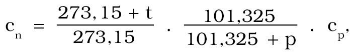
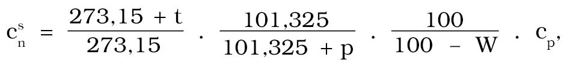
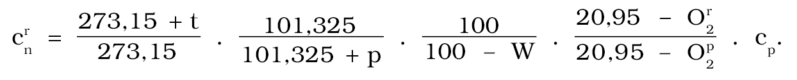

Príloha č. 5 k vyhláške č. 706/2002 Z. z.

- VELIČINY, JEDNOTKY A PREPOČTOVÉ VZŤAHY, KTORÝMI SÚ VYJADRENÉ EMISNÉ LIMITY

  - I. VELIČINY A JEDNOTKY EMISIÍ A EMISNÝCH LIMITOV

  - Na vyjadrenie emisií a emisných limitov sa používajú tieto veličiny a jednotky:

    - 1. Hmotnostná koncentrácia

    - Hmotnostná koncentrácia (ďalej len „koncentrácia“) je hmotnosť znečisťujúcej látky vztiahnutá na jednotku objemu odpadového plynu. Vyjadruje sa v jednotkách ng.m-3 , mg.m-3, prípadne g.m-3.

      - a) Podmienky určenia emisného limitu ako hmotnostnej koncentrácie pre nové zdroje

        - Hmotnostná koncentrácia, pokiaľ to nie je uvedené inak, sa vyjadruje ako koncentrácia v suchom plyne po prepočítaní na štandardné stavové podmienky (tlak 101,325 kPa, teplota 0 oC) a určený referenčný obsah kyslíka.

        - Odchylne od ustanovenia predchádzajúceho odseku pri výrobe vápenatého a horečnatého hydrátu, výrobe uhoľných brikiet, výrobe perlitov, výrobe a rafinácii cukru, sušení zelených krmív, sušení dreva, výrobe cementu mokrým spôsobom a pri špeciálnych zariadeniach, ako sú varáky a odparky, sa počítajú koncentrácie vo vlhkom plyne (t. j. taká vlhkosť plynu, ktorá vyplýva z technologického procesu).

        - Pre znečisťujúce látky, pre ktoré nie je určený referenčný obsah kyslíka pri emisných limitoch pre vybrané znečisťujúce látky pri vybraných technológiách a zariadeniach (príloha č. 4), je koncentrácia vztiahnutá na zloženie a množstvo odpadového plynu, ktoré vyplýva z podstaty technologického procesu. Množstvo vzduchu privádzané do zariadenia na riedenie spalín alebo odpadových plynov alebo na ich ochladzovanie sa pri zisťovaní koncentrácie odpočítava.

      - b) Podmienky určenia emisného limitu ako hmotnostnej koncentrácie pre jestvujúce zdroje

        - Hmotnostná koncentrácia, pokiaľ to nie je uvedené inak, sa udáva ako koncentrácia vo vlhkom plyne (t. j. taká vlhkosť, ktorá vyplýva z technologického procesu) po prepočítaní na štandardné stavové podmienky (tlak 101,325 kPa, teplota 0 oC) a referenčný obsah kyslíka.

        - Ak nie je určený referenčný obsah kyslíka, je koncentrácia vztiahnutá na zloženie a množstvo odpadového plynu, ktoré vyplýva z podstaty technologického procesu. Množstvo vzduchu privádzané do zariadenia na riedenie spalín alebo odpadových plynov alebo na ich ochladzovanie sa pri zisťovaní koncentrácie odpočítava.

    - 2. Hmotnostný tok

      - Hmotnostný tok je hmotnosť znečisťujúcej látky v odpadovom plyne vztiahnutá na jednotku času. Vyjadruje sa najmä v jednotkách kg.h-1, g.s-1, t.rok-1.

    - 3. Emisný faktor

      - Emisný faktor je pomer hmotnosti znečisťujúcej látky vypúšťanej zo zdroja alebo z jeho časti k jednotke hmotnosti alebo k inej jednotke množstva výrobku, polotovaru, suroviny, alebo výkonu výrobnej technológie znečisťujúcej ovzdušie. Je údajom charakterizujúcim pomerné množstvo emisií (merná výrobná emisia) vystupujúcich z daného technologického procesu (vrátane zariadenia na obmedzenie emisií) do ovzdušia. Vyjadruje sa najmä v jednotkách kg.t-1, kg.GJ-1.

    - 4. Emisný stupeň

      - Emisný stupeň je pomer hmotnosti znečisťujúcej látky vypúšťanej zo zdroja, jeho časti alebo zo zariadenia na obmedzovanie emisií k hmotnosti tejto látky privedenej do procesu. Vyjadruje sa v percentách.

    - 5. Stupeň odsírenia

      - Stupeň odsírenia je pomer množstva síry, ktorá sa za určitú časovú jednotku zo zariadenia nevypustí do ovzdušia k množstvu síry, ktorá sa za tú istú časovú jednotku privedie do zariadenia v palive. Vyjadruje sa v percentách.

    - 6. Tmavosť dymu

      - Tmavosť dymu je optická vlastnosť dymu, vyvolaná pohltením svetla. Pri spaľovaní tuhých palív sa vyjadruje v stupňoch podľa Ringelmanna (0 až 5) alebo opacitou v percentách (pri použití optických prístrojov). Opacita vyjadrená v percentách sa na stupne Ringelmanna prepočíta delením číslom 20. Ak sa pri spaľovaní kvapalných palív kontroluje obsah sadzí meraním tmavosti škvrny na filtri z odsatej vzorky podľa Bacharacha, vyjadruje sa v stupňoch (0 až 9).

  - II. PLYNNÉ ZNEČISŤUJÚCE LÁTKY A TUHÉ ZNEČISŤUJÚCE LÁTKY

    - Za plynné znečisťujúce látky v odpadovom plyne sa okrem plynov a pár považujú aj také jemne disperzné suspenzie kvapalín a tuhých látok, ktoré v daných podmienkach prechádzajú predsadeným odlučovacím zariadením (filter z kremičitej vlny, odlučovač kondenzátu a pod.) a pri analytických metódach vytvárajú merný signál.

    - Látky, ktoré sa v odlučovacích zariadeniach zachytili, sa vykazujú ako tuhé znečisťujúce látky.

  - III. PREPOČTOVÉ VZŤAHY

    - Ak sú koncentrácie zistené za iných než za štandardných stavových podmienok, použijú sa na prepočet na štandardné stavové podmienky alebo na referenčný obsah kyslíka tieto prepočtové vzťahy:

    - a) prepočet koncentrácií na štandardné stavové podmienky vlhkého plynu:

    - 

    - b) prepočet koncentrácií na štandardné stavové podmienky suchého plynu:

    - 

    - c) prepočet koncentrácií na štandardné stavové podmienky suchého plynu a referenčný obsah kyslíka v spalinách:

    - 

      - Význam symbolov v uvedených vzťahoch:

      - cn- koncentrácia po prepočte na štandardný stav vo vlhkom plyne,

      - csn- koncentrácia po prepočte na štandardný stav v suchom plyne,

      - crn - koncentrácia po prepočte na štandardný stav v suchom plyne a referenčné podmienky dané obsahom kyslíka ,

      - cp - koncentrácia zodpovedajúca prevádzkovým podmienkam (nameraná),

      - t - teplota odpadového plynu pri prevádzkových podmienkach (oC),

      - p - tlaková defirencia oproti štandardnému tlaku zodpovedajúca prevádzkovým podmienkam (kPa),

      - W - obsah vody v spalinách (obj. %),

      - Qr2 - referenčný obsah kyslíka v spalinách (obj. %),

      - Qp2 - obsah kyslíka v spalinách zodpovedajúci prevádzkovým podmienkam (nameraný) (obj. %).
