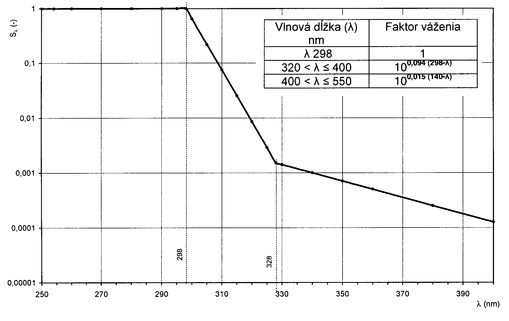

Príloha k vyhláške č. 708/ 2002 Z. z.

- LIMITY ULTRAFIALOVÉHO ŽIARENIA

- Limity ultrafialového žiarenia sa ustanovujú ako limity erytemálne účinnej intenzity ožiarenia (tabuľka č. 1), erytemálne účinnej prahovej dávky žiarenia podľa miestne rozšírených typov pokožky (tabuľka č. 2) a pomeru hodnôt intenzity ožiarenia v oblastiach UVB a UVA.

- Tabuľka č. 1

- Typ opaľovacieho zariadenia | Eer [W.m-2] |

- | 280 < λ ≤ 320 nm | 320 < λ ≤ 400 nm

- 1 | < 0,0005 | ≥ 0,15

- 2 | 0,0005 až 0,15 | ≥ 0,15

- 3 | < 0,05 | < 0,15

- 4 | < 0,015 | < 0,15

- Podiel krátkovlnného ÚV žiarenia (UVC, λ < 280 nm) emitovaného žiaričmi v opaľovacích zariadeniach musí byt nulový. | |

- Tabuľka č. 2

- Erytemálne účinná prahová dávka žiarenia podľa miestne rozšírených typov pokožky

- Typ pokožky | Erytemálne účinná prahová dávka žiarenia Her |

- | [J/m2] | [MED]

- II** | 250 | 1,0

- III*** | 350 | 1,4

- IV**** | 450 | 1,8

- Hodnoty Her nie sú uvedené pre typ pokožky I*, pre ľudí s týmto typom je opaľovanie v soláriu zo zdravotného hľadiska nevhodné. | |

- @NOUINDENT = * Keltský typ - nápadne svetlá pleť, pehy, hrdzavé vlasy, modré, zriedkavo hnedé oči, svetlé prsné bradavky: ťažké bolestivé spálenie, rýchlo sčervenie, zle sa opaľuje, šúpe sa, čas 1. opaľovania na slnku 5 - 10 min.

- ** Európsky typ so svetlou pleťou - trochu tmavšia pleť ako pri type I, blond až hnedé vlasy, modré, zelené, sivé oči, svetlé prsné bradavky: ťažké bolestivé spálenie, pleť sa len málo opáli, šúpe sa, čas 1. opaľovania na slnku 10 - 20 min.

- *** Európsky typ s tmavou pleťou - svetlá až svetlohnedá pleť, tmavoblond až hnedé vlasy, sivé, hnedé oči, tmavšie prsné bradavky: k spáleniu dochádza zriedka, je mierne, opálenie je priemerné, čas 1. opaľovania na slnku 20 - 30 min.

- **** Stredomorský typ - svetlohnedá pleť, tmavé pehy, tmavohnedé vlasy, tmavé oči, tmavé prsné bradavky: k spáleniu nedochádza, opálenie je rýchle a hlboké, čas 1. opaľovania na slnku 40 min.

- Pomer nameraných hodnôt intenzity ožiarenia v oblastiach UVB a UVA nesmie počas celej doby používania UV žiariča presiahnuť hodnotu 2,2:

- Eer, B / Eer, A ≤ 2,2

- UV žiariče nesmú vysielať žiarenie v nebezpečnej miere. Miera zdravotného rizika sa objektivizuje meraniami pomocou spektrorádiometra alebo vhodného širokospektrálneho rádiometra s krivkou citlivosti snímača čo najtesnejšie prispôsobenou krivke erytemálnej spektrálnej účinnosti podľa CIE (obr. č. 1).

- Spôsob merania erytemálne účinnej intenzity ožiarenia (Eer) UV žiaričom v spektrálnej oblasti UVB (od 280 nm do 320 nm) a v oblasti UVA (od 320 nm do 400 nm) je určený technickou normou.1)

- Najvyšší prípustný čas jedného opaľovania nesmie viesť k prekročeniu limitov minimálnej erytemálnej dávky (Her), ktoré sú uvedené v tabuľke č. 2 v závislosti od typu pokožky.

- Obrázok č. 1 Krivka spektrálnej erytemálnej účinnosti (akčná krivka CIE)

- 

- Opaľovacie zariadenie - elektrický spotrebič vybavený UV žiaričmi, používaný v soláriu na opaľovanie pokožky. Podľa vlnovej dĺžky a intenzity ožiarenia sa tieto spotrebiče delia na štyri typy (1 - 4):

- 1. s oblasťou biologického účinku UVA 320 - 400 nm s relatívne vysokou intenzitou ožiarenia, použitie v soláriách je možné len pod dohľadom zaškolenej obsluhy,

- 2. s oblasťou biologického účinku UVA + UVB 280 - 400 nm s relatívne vysokou intenzitou ožiarenia v rozsahu 320 - 400 nm,

- 3. s oblasťou biologického účinku UVA + UVB 280 - 400 nm s obmedzenou intenzitou ožiarenia.

- 4. s oblasťou biologického účinku UVB 280 - 320 nm, môže sa používať len na základe odporúčania lekára.

- Ultrafialový (UV) žiarič - zdroj vyžarujúci prevažne v UV oblasti, pričom prípadné viditeľné alebo infračervené žiarenie má len podružný význam.

- Zdroj žiarenia - umelým zdrojom UV žiarenia v opaľovacích zariadeniach sú obyčajne žiarivky so špeciálnym luminofórom alebo ortuťové výbojky s filtrami nežiaducich zložiek žiarenia.

- Erytemálne účinná intenzita ožiarenia - intenzita elektromagnetického žiarenia, ktoré sa dávkuje v súlade so stanovenou funkciou erytemálnej spektrálnej účinnosti.

- Fyzikálne veličiny - použité fyzikálne veličiny sú uvedené v tabuľke č. 3.

- Tabuľka č. 3

- Veličina | Definícia | Značka | Jednotka

- Žiarivý tok | výkon vysielaný, prenášaný alebo prijímaný žiarením | Φ | W

- Vlnová dĺžka | vzdialenosť v smere šírenia periodickej vlny medzi najbližšími dvoma bodmi a rovnakou fázou vlny | λ | nm

- Ožiarenost; intenzita ožiarenia; hustota žiarivého toku | podiel žiarivého toku dopadajúceho na plošný element v danom bode a veľkosti tejto plochy | E | W/m2

- Dávka ožiarenia | podiel žiarivej energie, ktorá dopadá na plošný element v danom bode a veľkosti tejto plochy | H | J/m2

- Pomerné spektrálne rozloženie žiarenia.; relatívna spektrálna účinnosť | pomerná hodnota, podiel spektrálnej účinnosti j-teho pásma k maximálnej účinnosti | Sλ | 1

- Minimálna erytemálna dávka | najmenšia dávka žiarenia, ktorá spôsobí práve viditeľné sčervenanie (erytém) pokožky, ostro rozoznateľné od neožiarenej pokožky. Dávka 1 MED zodpovedá erytemálne váženému ožiareniu 250 J/m2. | MED | J/m2
