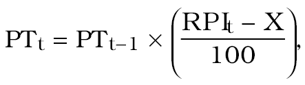
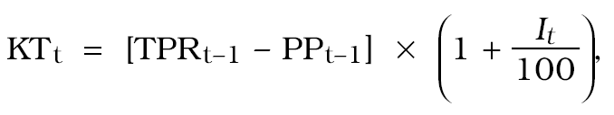
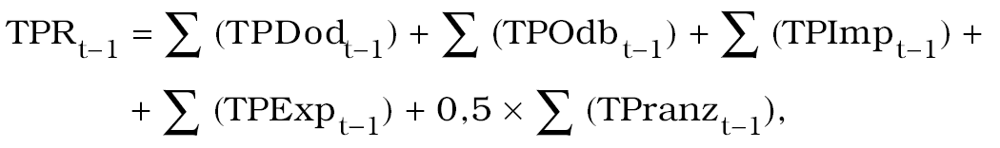
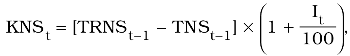
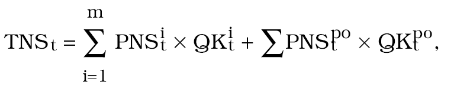

# Článok 3

(1) Tento článok upravuje spôsob regulácie cien za prenos elektriny.

(2) Pri návrhu cien na rok t bude regulovaný subjekt dbať na to, aby skutočne dosiahnutý výnos za prenos elektriny v roku t neprekročil maximálny povolený výnos PPt v Sk na rok t vypočítaný podľa vzorca:

,

pričom

PTt = maximálne povolený výnos za prístup k prenosovej sústave a riadenie prenosovej sústavy v Sk v roku t,

INVt = faktor investícií v Sk v roku t,

KTt = korekčný faktor v Sk v roku t na vyrovnanie nedostatku alebo prebytku príjmov v roku t-1,

ZTt = neočakávané zmeny nákladov regulovaného subjektu, ktoré úrad povolí zahrnúť do cien za prenos elektriny v Sk v roku t.

- a) Maximálne povolený výnos za prístup k prenosovej sústave a riadenie prenosovej sústavy PTt v Sk v roku t sa vypočíta podľa vzorca:

pričom:

PTt-1 = maximálne povolený výnos za prístup k prenosovej sústave a riadenie prenosovej sústavy v Sk v roku t-1,

RPIt = aritmetický priemer indexov spotrebiteľských cien, ktorým je položka „indexy spotrebiteľských cien oproti rovnakému obdobiu minulého roku, spotrebiteľské ceny úhrnom", publikovaný Štatistickým úradom Slovenskej republiky v období od októbra v roku t-2 až do septembra v roku t-1,

X = faktor cenovej regulácie.

- b) Hodnota faktora investícií INVt v Sk v roku t sa vypočíta podľa vzorca:

  - 1. INVt je rovné nule v prípade, ak

  - (0,8 x INVPLt-1) ? INVSKt-1,

  - 2. INVt = [INVSKt-1 - INVPLt-1] x (RoR + Depr) v prípade,

  - ak INVSKt-1 < (0,8 x INVPLt-1),

  - pričom

  - INVPLt-1 = celkový plánovaný objem investícií do prenosovej sústavy od začiatku regulačného obdobia do konca roku t-1 v Sk,

  - INVSKt-1 = celkový skutočný objem investícií do prenosovej sústavy uskutočnený regulovaným subjektom od začiatku regulačného obdobia do konca roku t-1 v Sk,

  - RoR = povolená miera návratnosti vzťahujúca sa na regulované aktíva pre regulačné obdobie v percentách,

  - Depr = povolená odpisová miera pre nové investície pre regulačné obdobie v percentách.

- c) Korekčný faktor KTt v Sk v roku t sa vypočíta podľa vzorca:

pričom

TPRt-1 = celkové skutočné výnosy v Sk v roku t-1 z prenosu elektriny s výnimkou výnosov z poplatku za straty elektriny pri prenose elektriny,

PPt-1 = maximálne povolený výnos z prenosu elektriny v Sk v roku t-1,

hodnota It v prípade, ak

- a) >>0, je rovná úrokovej sadzbe: 12M BRIBOR (predaj), ktorú publikuje Národná banka Slovenska za obdobie január až september v roku t-1 + 5 % a ktorá sa vypočíta ako priemer mesačných priemerov,

- b) [TPRt-1- PPt-1] < 0, je rovná úrokovej sadzbe: 12M BRIBOR (predaj), ktorú publikuje Národná banka Slovenska za obdobie január až september v roku t-1 a ktorá sa vypočíta ako priemer mesačných priemerov,

pričom

pričom

TPDodt-1 = celkový skutočný výnos v Sk v roku t-1 z prenosu elektriny od dodávateľov elektriny do prenosovej sústavy umiestnených na území Slovenskej republiky,

TPOdbt-1 = celkový skutočný výnos v Sk v roku t-1 z prenosu elektriny od odberateľov elektriny z prenosovej sústavy umiestnených na území Slovenskej republiky,

TPImpt-1 = celkový skutočný výnos v Sk v roku t-1 z prenosu elektriny pri dovoze elektriny s použitím prenosovej sústavy,

TPExpt-1 = celkový skutočný výnos v Sk v roku t-1 z prenosu elektriny pri vývoze elektriny s použitím prenosovej sústavy,

TPTranzt-1 = celkový skutočný výnos v Sk v roku t-1 z tranzitu elektriny cez prenosovú sústavu.

- d) Neočakávané zmeny nákladov ZTt v Sk v roku t sa vypočítajú podľa vzorca:

,

pričom:

PNT = celkový objem nákladov v Sk vyvolaných skutočnosťami, na ktoré regulovaný subjekt nemá vplyv a ktoré úrad povolí zahrnúť do cien za prenos elektriny v roku t na základe návrhu regulovaného subjektu na zmenu cien.

(3) Regulovaný subjekt zároveň účtuje užívateľom prenosovej sústavy poplatky za straty elektriny pri prenose elektriny. Výnos z týchto poplatkov sa nezahŕňa do výnosu za prenos elektriny podľa odseku 2. Výšku poplatku za straty elektriny pri prenose elektriny určí úrad na základe návrhu cien, ktorý predkladá regulovaný subjekt.

(4) Regulovaný subjekt zároveň účtuje držiteľom licencie na rozvod elektriny a prevádzkujúcim distribučnú sústavu, ako aj koncovým odberateľom priamo pripojeným na prenosovú sústavu platby za náklady systému, pričom maximálny výnos z týchto platieb TNSt v Sk v roku t sa vypočíta podľa vzorca:

,

pričom

VNSt = plánované náklady systému povolené úradom pre držiteľov licencie na výrobu elektriny a účtované držiteľovi licencie na rozvod a prevádzkujúcemu prenosovú sústavu v Sk v roku t,

KNSt = korekčný faktor v Sk v roku t, ktorý sa vypočíta podľa vzorca:

pričom

TRNSt-1 = celkový skutočný výnos z platieb za náklady systému uhradených regulovanému subjektu držiteľmi licencie na rozvod elektriny a prevádzkujúcimi distribučnú sústavu, ako aj koncovými odberateľmi napojenými na prenosovú sústavu v Sk v roku t-1,

TNSt-1 = maximálny povolený výnos z platieb za náklady systému v Sk v roku t-1,

hodnota It v prípade, ak:

- 1. >>0, je rovná úrokovej sadzbe: 12M BRIBOR (predaj), ktorú publikuje Národná banka Slovenska za obdobie január až september v roku t-1 + 5 % a ktorá sa vypočíta ako priemer mesačných priemerov,

- 2. [TRNSt-1- TNSt-1] < 0, je rovná úrokovej sadzbe: 12M BRIBOR (predaj), ktorú publikuje Národná banka Slovenska za obdobie január až september v roku t-1 a ktorá sa vypočíta ako priemer mesačných priemerov.

(5) Regulovaný subjekt pri určovaní platieb za náklady systému v Sk v roku t bude zároveň dbať, aby maximálny výnos z týchto platieb TNSt v Sk v roku t neprekročil hodnotu, ktorá sa vypočíta podľa vzorca:

pričom

= úradom určený poplatok za náklady systému pre koncových odberateľov napojených na distribučnú sústavu i-teho držiteľa licencie na rozvod elektriny v Sk na jednotku elektriny v roku t,

= celkový plánovaný objem elektriny odobraný koncovými odberateľmi z distribučnej sústavy i-teho držiteľa licencie na rozvod elektriny v jednotkách elektriny v roku t,

m = počet držiteľov licencie na rozvod elektriny a prevádzkujúcich distribučnú sústavu,

= úradom určený poplatok za náklady systému pre koncových odberateľov, ktorí sú priamo pripojení na prenosovú sústavu, v Sk na jednotku elektriny v roku t,

= celkový objem elektriny odobranej koncovými odberateľmi, ktorí sú priamo pripojení na prenosovú sústavu, z prenosovej sústavy v jednotkách elektriny v roku t.
