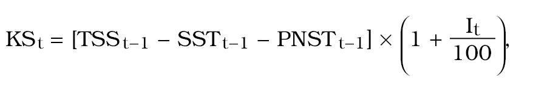
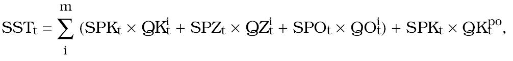

# Článok 4

(1) Tento článok upravuje spôsob regulácie cien za poskytovanie systémových služieb regulovaným subjektom pre užívateľov prenosovej sústavy.

(2) Regulovaný subjekt zároveň účtuje držiteľom licencie na rozvod elektriny a prevádzkujúcim distribučnú sústavu, ako aj koncovým odberateľom priamo pripojeným na prenosovú sústavu platby za systémové služby, pričom maximálny výnos SSTt z týchto platieb v Sk v roku t sa vypočíta podľa vzorca:

,

pričom

PPSt = plánované povolené náklady na zabezpečenie podporných služieb od držiteľov licencie na výrobu elektriny v Sk v roku t,

KSt = korekčný faktor v Sk v roku t, ktorý sa vypočíta podľa vzorca

pričom

TSSt-1 = celkový skutočný výnos v Sk v roku t-1 z platieb za systémové služby vybraný od držiteľov licencie na rozvod v Sk na jednotku elektriny a prevádzkujúcich distribučnú sústavu a od koncových odberateľov priamo pripojených na prenosovú sústavu,

SSTt-1 = maximálny povolený výnos z platieb za systémové služby v Sk v roku t-1,

PNSTt-1 = celkový výnos z penále, pokút a iných poplatkov, ktoré regulovaný subjekt obdržal od držiteľov licencie na výrobu elektriny za neposkytnutie podporných služieb v rozsahu stanovenom v zmluvách o poskytovaní podporných služieb a v Kódexe prenosovej sústavy, v Sk v roku t-1,

It = úroková sadzba: 12M BRIBOR (predaj), ktorú publikuje Národná banka Slovenska za obdobie január až september v roku t-1 a ktorá sa vypočíta ako priemer mesačných priemerov.

(3) Regulovaný subjekt pri určovaní platieb za systémové služby v Sk v roku t bude zároveň dbať, aby maximálny výnos z týchto platieb SSTt v Sk v roku t neprekročil hodnotu, ktorá sa vypočíta podľa vzorca:

pričom

SPKt = úradom určený systémový poplatok pre koncových odberateľov v roku t v Sk na jednotku elektriny,

= celkový plánovaný objem elektriny odobraný koncovými odberateľmi z distribučnej sústavy i-teho držiteľa licencie na rozvod elektriny a prevádzkujúceho distribučnú sústavu v roku t s výnimkou elektriny odobranej koncovými odberateľmi v rámci ostrovnej prevádzky preukázateľne oddelenej od elektrizačnej sústavy Slovenskej republiky,

SPZt = úradom určený systémový poplatok pre držiteľov licencie na výrobu elektriny v roku t v Sk na jednotku elektriny,

= celkový plánovaný objem elektriny vyrobený držiteľmi licencie na výrobu elektriny, ktorí sú napojení na distribučnú sústavu i-teho držiteľa licencie na rozvod elektriny vo vlastnom zariadení a dodaný priamo odberateľom bez použitia prenosovej alebo distribučnej sústavy alebo spotrebovaný týmito výrobcami bez použitia prenosovej alebo distribučnej sústavy s výnimkou elektriny, ktorú títo výrobcovia spotrebujú priamo pri výrobe elektriny alebo tepla alebo pri čerpaní prečerpávacích vodných elektrární, v jednotkách elektriny v roku t,

SPOt = úradom určený systémový poplatok pre držiteľov licencie na rozvod elektriny v roku t v Sk na jednotku elektriny,

= celkový plánovaný objem elektriny odobraný i-tym držiteľom licencie na rozvod elektriny a prevádzkujúcim distribučnú sústavu z elektrizačnej sústavy Slovenskej republiky v prípade plného alebo čiastočného napojenia pôvodnej ostrovnej prevádzky preukázateľne oddelenej od elektrizačnej sústavy Slovenskej republiky nad rámec diagramu schváleného v dennej príprave prevádzky elektrizačnej sústavy Slovenskej republiky, v jednotkách elektriny v roku t,

m = počet držiteľov licencie na rozvod elektriny a prevádzkujúcich distribučnú sústavu,

= celkový plánovaný objem elektriny odobraný koncovými odberateľmi, ktorí sú priamo pripojení na prenosovú sústavu, z prenosovej sústavy v jednotkách elektriny v roku t.
