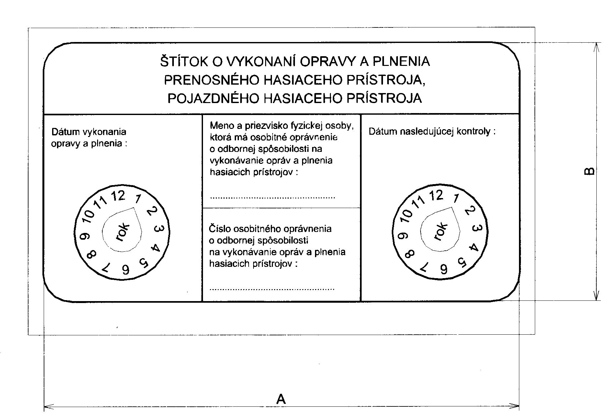

Príloha č. 8 k vyhláške č. 719/2002 Z. z.

- ŠTÍTOK O VYKONANÍ OPRAVY A PLNENIA PRENOSNÉHO HASIACEHO PRÍSTROJA, POJAZDNÉHO HASIACEHO PRÍSTROJA

- 

- Rozmer A - najmenej 100 mm

- Rozmer B - najmenej 55 mm

- V hlavičke štítku sa alternatívne uvedie druh hasiaceho prístroja podľa § 2 ods. 1, na ktorom bola vykonaná oprava a plnenie, alebo sa uvedú obidva druhy hasiacich prístrojov a v takom prípade sa nezmazateľne vyznačí ten druh hasiaceho prístroja, na ktorom bola vykonaná oprava a plnenie.
