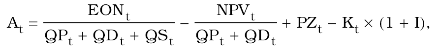
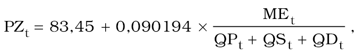
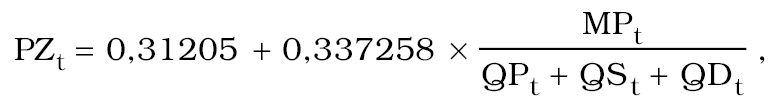
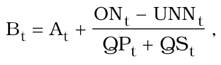
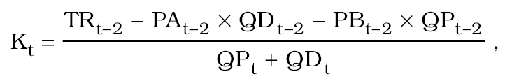
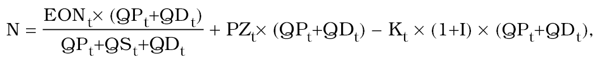

# Článok 3

(1) Regulovaný subjekt použije v roku t tarify držiteľa licencie na rozvod elektriny, na ktorého verejný rozvod elektriny5) je napojený, alebo tarify držiteľa licencie na rozvod zemného plynu, na ktorého verejný rozvod zemného plynu6) je napojený, s výnimkou prípadov uvedených v odsekoch 10 a 11. Túto skutočnosť oznámi úradu. Toto oznámenie sa považuje za návrh cien podľa článku 5.

(2) Ak výnosy regulovaného subjektu pri použití taríf podľa odseku 1 nepokrývajú jeho ekonomicky oprávnené náklady a primeraný zisk, ktoré vzniknú pri dodávke a distribúcii elektriny alebo rozvode zemného plynu v nevyhnutnej výške, môže požiadať úrad o určenie maximálnej ceny a taríf.

(3) Maximálna cena za distribúciu elektriny v Sk na jednotku množstva a maximálna cena za prepravu zemného plynu v Sk na jednotku množstva sa vypočíta podľa vzorca

- 

- kde

- EONt - plánované ekonomicky oprávnené náklady v Sk na dodávku elektriny alebo rozvod zemného plynu v roku t určené podľa článku 4; do EONt sa nezahrnú plánované obstarávacie náklady na zemný plyn alebo elektrinu v roku t vrátane nákladov spojených s vlastnou výrobou elektriny,

- NPVt - neoprávnený prebytok výnosov v Sk, ktorý predstavuje celkovú sumu neoprávnených výnosov, ktorá sa vypočíta ako rozdiel skutočných výnosov z regulovanej činnosti a celkových výnosov z regulovanej činnosti, ktoré bol regulovaný subjekt oprávnený dosiahnuť; takto určený neoprávnený prebytok výnosov sa použije na účely stanovenia maximálnej ceny na nasledujúci regulačný rok po roku, v ktorom úrad dodatočne zistí, že regulovaný subjekt fakturoval nesprávnu cenu alebo že úrad určil regulovanému subjektu maximálnu cenu alebo tarify na základe nesprávnych údajov, čím sa mu neoprávnene zvýšili výnosy,

- PZt - primeraný zisk v Sk na jednotku množstva elektriny alebo zemného plynu, ktorý sa vypočíta podľa odseku 4 alebo 5,

- Kt - korekčný faktor v Sk na jednotku množstva na vyrovnanie nedostatku alebo prebytku príjmov v roku t-2, ktorý sa vypočíta podľa odseku 7,

- I - úroková sadzba určená podľa odseku 8,

- QPt - plánované množstvo dodanej elektriny v jednotkách množstva znížené o plánované množstvo distribuovanej elektriny oprávneným odberateľom na základe zmluvy o distribúcii elektriny (ďalej len „distribuovaná elektrina") alebo plánované množstvo dodaného zemného plynu v jednotkách množstva znížené o plánované množstvo prepraveného zemného plynu oprávneným odberateľom na základe zmluvy o preprave zemného plynu (ďalej len „prepravený zemný plyn"),

- QDt - plánované množstvo distribuovanej elektriny alebo prepraveného zemného plynu v jednotkách množstva,

- QSt - plánované množstvo elektriny alebo zemného plynu pre vlastnú spotrebu v jednotkách množstva.

(4) Na účely výpočtu maximálnej ceny za distribúciu elektriny sa primeraný zisk v Sk na jednotku množstva vypočíta podľa vzorca

- 

- kde

- MEt - plánovaná účtovná zostatková cena investičného majetku v Sk používaného výhradne na dodávku a distribúciu elektriny k 31. decembru roku t-1.

- Maximálna výška primeraného zisku za distribúciu elektriny je 250,35 Sk na jednotku množstva.

(5) Na účely výpočtu maximálnej ceny za prepravu zemného plynu sa primeraný zisk v Sk na jednotku množstva vypočíta podľa vzorca

- 

- kde

- MPt - plánovaná účtovná zostatková cena investičného majetku v Sk používaného výhradne na rozvod zemného plynu k 31. decembru roku t-1.

- Maximálna výška primeraného zisku za prepravu zemného plynu je 0,936 Sk na jednotku množstva.

- 

- kde

- At - maximálna cena za distribúciu elektriny v Sk na jednotku množstva alebo maximálna cena za prepravu zemného plynu v Sk na jednotku množstva určená podľa odseku 3,

- ONt - celkové plánované obstarávacie náklady v Sk v roku t na elektrinu vrátane nákladov na vlastnú výrobu elektriny určených podľa článku 4 alebo celkové plánované obstarávacie náklady na zemný plyn v Sk v roku t vrátane nákladov na ťažbu zemného plynu určených podľa článku 4,

- UNNt - úradom nepovolené obstarávacie náklady v Sk na elektrinu vrátane vlastnej výroby elektriny alebo na zemný plyn, pri ktorých regulovaný subjekt nepreukáže úradu, že nákup elektriny a vlastnú výrobu elektriny alebo nákup zemného plynu realizoval za najnižšie možné ceny.

(7) Korekčný faktor v Sk na jednotku množstva v roku t sa vypočíta podľa vzorca

- 

- kde

- TRt-2 - celkové výnosy v Sk v roku t-2 za rozvod elektriny vrátane distribúcie elektriny alebo za rozvod zemného plynu vrátane prepravy zemného plynu,

- PAt-2 - prepočítaná maximálna cena v Sk na jednotku množstva distribuovanej elektriny alebo prepočítaná maximálna cena v Sk na jednotku množstva prepraveného zemného plynu podľa odseku 3 v roku t-2; regulovaný subjekt vypočíta hodnotu PAt-2 tak, že dosadí do vzorca podľa odseku 3 skutočné údaje za rok t-2,

- PBt-2 - prepočítaná maximálna cena v Sk na jednotku množstva dodanej elektriny alebo dodaného zemného plynu podľa odseku 6 v roku t-2; regulovaný subjekt vypočíta hodnotu PBt-2 tak, že dosadí do vzorca podľa odseku 6 skutočné údaje za rok t-2,

- QPt-2 - celkové množstvo elektriny v jednotkách množstva dodanej odberateľom znížené o celkové množstvo distribuovanej elektriny alebo celkové množstvo zemného plynu dodaného odberateľom v jednotkách množstva znížené o celkové množstvo prepraveného zemného plynu v roku t-2,

- QDt-2 - celkový objem distribuovanej elektriny alebo prepraveného zemného plynu v jednotkách množstva v roku t-2.

(8) Hodnota úrokovej sadzby I je dvojnásobok úrokovej sadzby 12M BRIBOR (predaj), ktorú publikuje Národná banka Slovenska ku dňu podania návrhu cien, zníženej o štyri percentá, ak je korekčný faktor Kt väčší ako nula. Ak je korekčný faktor Kt menší ako nula, hodnota úrokovej sadzby I je dvojnásobok úrokovej sadzby 12M BRIBOR (predaj), ktorú publikuje Národná banka Slovenska ku dňu podania návrhu cien, zvýšenej o štyri percentá.

(9) V prípade, ak je neoprávnený prebytok výnosov (NPVt) väčší ako N, kde

- 

- do výpočtu maximálnej ceny na rok t podľa odseku 3 sa zahrnie iba časť neoprávneného prebytku výnosov vo výške rovnej N. Časť neoprávneného prebytku výnosov vo výške prevyšujúcej hodnotu N sa zahrnie do výpočtu maximálnej ceny pre ďalšie regulačné roky. Každý regulačný rok je možné zahrnúť do výpočtu maximálnej ceny pre rok t neoprávnený prebytok výnosov (NPVt) vo výške N.

(10) Ak neoprávnený prebytok výnosov nebol v plnej výške zahrnutý do výpočtu maximálnej ceny na rok t podľa odseku 3, v roku t+1 regulovaný subjekt nepoužije tarify podľa odseku 1, ale požiada úrad o určenie maximálnej ceny podľa odsekov 3 a 6 a taríf podľa odsekov 12 a 13.

(11) Ak regulovaný subjekt v roku t-2 požiadal o určenie maximálnej ceny za distribúciu alebo dodávku elektriny podľa odseku 3 alebo 6 alebo o určenie maximálnej ceny za prepravu alebo rozvod zemného plynu podľa odseku 3 alebo 6 a hodnota Kt určená podľa odseku 7 je väčšia ako 5 % hodnoty At určenej podľa odseku 3, regulovaný subjekt v roku t nepoužije tarify podľa odseku 1, ale požiada úrad o určenie maximálnej ceny podľa odsekov 3 a 6 a taríf podľa odsekov 12 a 13.

(12) Regulovaný subjekt navrhuje tarify za distribúciu elektriny alebo tarify za prepravu zemného plynu tak, aby sa priemer taríf vážený plánovaným množstvom distribuovanej elektriny alebo prepraveného zemného plynu v jednotkách množstva v jednotlivých tarifách rovnal maximálnej cene podľa odseku 3. V návrhu taríf sa zohľadnia ekonomicky oprávnené náklady a primeraný zisk na distribúciu elektriny alebo prepravu zemného plynu. Regulovaný subjekt fakturuje oprávnenému odberateľovi tarify za distribúciu elektriny zvýšené o náklady spôsobené stratami elektriny vyvolanými distribúciou elektriny pre tohto odberateľa.

(13) Regulovaný subjekt navrhuje tarify za dodávku elektriny a tarify za rozvod zemného plynu tak, aby sa priemer taríf vážený plánovaným množstvom dodanej elektriny alebo dodaného zemného plynu v jednotkách množstva v jednotlivých tarifách rovnal maximálnej cene podľa odseku 6. V návrhu taríf sa zohľadnia ekonomicky oprávnené náklady a primeraný zisk na dodávku elektriny alebo rozvod zemného plynu.
