# Článok 3

(1) Tento článok upravuje spôsob regulácie cien za dodávku elektriny regulovaným subjektom pre regulovaných odberateľov.

(2) Regulovaný subjekt navrhuje ceny na rok t tak, aby skutočne dosiahnutý priemerný výnos za dodávku elektriny v roku t na jednotku elektriny neprekročil pre regulovaných odberateľov maximálne ceny na rok t vypočítané podľa odsekov 3 a 4.

(3) Maximálna cena za dodávku elektriny pre regulovaných odberateľov Pt v Sk na jednotku elektriny v roku t zohľadňuje ekonomicky oprávnené náklady a primeraný zisk a vypočíta sa podľa vzorca:

,

pričom

PEt = neovplyvniteľné náklady v Sk na jednotku elektriny dodanú pre regulovaných odberateľov v roku t,

PDt = ovplyvniteľné náklady v Sk na jednotku elektriny dodanú pre regulovaných odberateľov v roku t,

Lt = index strát elektriny v roku t,

Kt = korekčný faktor v Sk na jednotku elektriny v roku t na vyrovnanie nedostatku alebo prebytku príjmov v roku t - 1,

Zt = neočakávané zmeny nákladov regulovaného subjektu, ktoré úrad povolí zahrnúť do cien za dodávku elektriny pre regulovaných odbe- rateľov v roku t.

- a) Neovplyvniteľné náklady PEt v Sk na jednotku elektriny dodanú pre regulovaných odberateľov v roku t sa vypočítajú podľa vzorca:

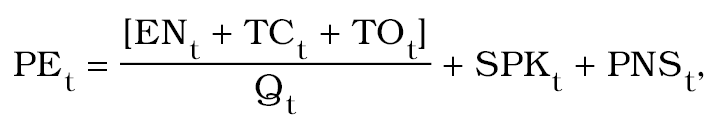

pričom:

ENt = plánovaná výška nákladov na nákup elektriny od dodávateľov na zabezpečenie dodávky elektriny pre regulovaných odberateľov v Sk v roku t,

TCt = plánovaná výška nákladov na prenos elektriny vrátane nákladov za prístup k prenosovej sústave a nákladov na straty elektriny pri prenose potrebnej na dodávku pre regulovaných odberateľov v Sk v roku t,

TOt = celkové ostatné plánované neovplyvniteľné náklady v Sk roku t, ktoré zahŕňajú najmä poplatky za vydanie licencií, náklady na poistenie majetku a dane z nehnuteľností,3)

Qt = celkový plánovaný objem dodávky elektriny pre regulovaných odberateľov v roku t v jednotkách elektriny,

SPKt = systémový poplatok pre koncových odberateľov v Sk na jednotku elektriny v roku t,

PNSt = poplatok za náklady systému pre koncových odberateľov v Sk na jednotku elektriny v roku t.

1.

Plánovaná výška nákladov na nákup elektriny ENt od dodávateľov na zabezpečenie dodávky elektriny pre regulovaných odberateľov v Sk v roku t sa vypočíta podľa vzorca:

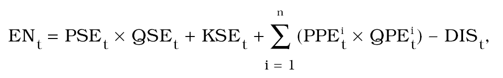

pričom

PSEt = maximálna cena v Sk na jednotku elektriny v roku t, za ktorú regulovaný subjekt nakúpi elektrinu od držiteľa licencie na výrobu elektriny, ktorého objem výroby elektriny na území Slovenskej republiky bol v roku t - 1 väčší ako 5 000 000 MWh (ďalej len „veľkovýrobca"), na účely dodávky elektriny pre regulovaných odberateľov,

QSEt = plánovaný objem elektriny nakúpenej od veľkovýrobcu v jednotkách elektriny v roku t na účely dodávky elektriny pre regulovaných odberateľov,

KSEt = korekčný faktor na náklady na nákup elektriny od veľkovýrobcu na účely dodávky elektriny pre regulovaných odberateľov v Sk v roku t,

= plánovaná cena v Sk na jednotku elektriny v roku t, za ktorú regulovaný subjekt nakúpi elektrinu od dodávateľov elektriny (okrem veľkovýrobcu) na účely dodávky elektriny pre regulovaných odberateľov včítane výkupu elektriny z obnoviteľných zdrojov a kombinovanej výroby elektriny a tepla v rámci i-tej zmluvy,

= plánovaný objem elektriny nakúpenej od dodávateľov elektriny (okrem veľkovýrobcu) vrátane elektriny vykúpenej z obnoviteľných zdrojov a kombinovanej výroby elektriny a tepla v jednotkách elektriny v roku t v rámci i-tej zmluvy na účely dodávky elektriny pre regulovaných odberateľov,

n = počet zmlúv na nákup elektriny od iných dodávateľov na účely dodávky elektriny pre regulovaných odberateľov,

= počet zmlúv na nákup elektriny od iných dodávateľov na účely dodávky elektriny pre regulovaných odberateľov,

DISt = úradom nepovolené náklady na nákup elektriny v Sk v roku t, pri ktorých regulovaný subjekt nepreukáže úradu, že nákup elektriny realizoval za najnižšie možné ceny,

2.

korekčný faktor na náklady na nákup elektriny od veľkovýrobcu na účely dodávky elektriny pre regulovaných odberateľov KSEt v Sk v roku t sa vypočíta podľa vzorca:

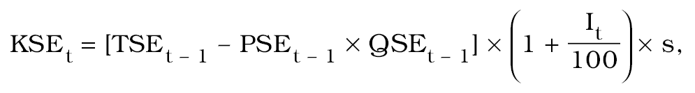

pričom

TSEt - 1 = celkové skutočné náklady regulovaného subjektu na nákup elektriny od veľkovýrobcu v roku t - 1 na účely dodávky elektriny pre regulovaných odberateľov v Sk,

PSEt - 1 = maximálna cena, za ktorú regulovaný subjekt nakúpil elektrinu od veľkovýrobcu na účely dodávky elektriny pre regulovaných odberateľov, v Sk na jednotku elektriny v roku t - 1,

QSEt - 1 = celkový objem elektriny nakúpenej od veľkovýrobcu na účely dodávky elektriny pre regulovaných odberateľov v jednot- kách elektriny v roku t - 1,

It = úroková sadzba: 12M BRIBOR (predaj), ktorú publikuje Národná banka Slovenska za obdobie január až september v roku t - 1 a ktorá sa vypočíta ako priemer mesačných priemerov,

s = koeficient delenia rozdielu medzi skutočnými a plánovanými nákladmi na nákup elektriny regulovaného subjektu medzi regulovaný subjekt a veľkovýrobcu.

- b) Ovplyvniteľné náklady PDt v Sk na jednotku elektriny dodanú pre regulovaných odberateľov v roku t sa vypočítajú podľa vzorca:

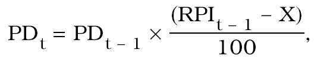

pričom:

PDt - 1 = ovplyvniteľné náklady v Sk na jednotku elektriny v roku t - 1, ktoré obsahujú prevádzkové náklady, odpisy a primeraný zisk,

RPIt - 1 = aritmetický priemer indexov spotrebiteľských cien, ktorým je položka „indexy spotrebiteľských cien oproti rovnakému obdobiu minulého roku, spotrebiteľské ceny úhrnom", publikovaný Štatistickým úradom Slovenskej republiky, v období od októbra v roku t - 2 až do septembra v roku t - 1,

X = faktor cenovej regulácie.

- c) Index strát elektriny Lt sa vypočíta podľa vzorca:

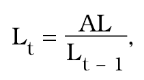

pričom:

AL = aritmetický priemer strát elektriny regulovaného subjektu za roky t - 3, t - 2 a t - 1 v percentách,

Lt - 1 = straty elektriny regulovaného subjektu v roku t - 1 vypočítané v percentách takto:

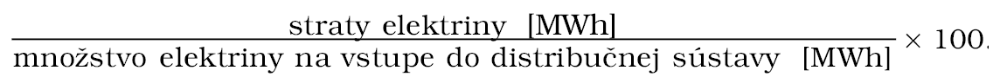

- d) Korekčný faktor Kt v Sk na jednotku elektriny v roku t sa vypočíta podľa vzorca:

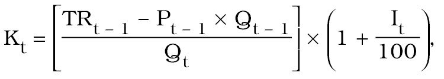

pričom

TRt - 1 = celkové výnosy z cien a taríf schválených úradom v Sk v roku t - 1 za dodávku elektriny pre regulovaných odberateľov s výnimkou výnosov za nedodržanie parametrov odberu elektriny, najmä nedodržanie neutrálneho účinníka, spätnej jalovej dodávky, prekročenie a nedočerpanie dohodnutého množstva elektriny,

Pt - 1 = maximálna cena v Sk na jednotku elektriny za dodávku elektriny pre regulovaných odberateľov v roku t - 1,

Qt - 1 = celkový očakávaný objem dodanej elektriny v jednotkách elektriny pre regulovaných odberateľov v roku t - 1,

hodnota It v prípade, ak:

1.

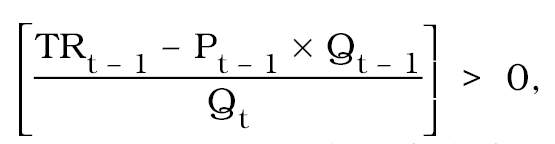 rovná sa úrokovej sadzbe: 12M BRIBOR (predaj), ktorú publikuje Národná banka Slovenska za obdobie január až september v roku t - 1 + 5 % a ktorá sa vypočíta ako priemer mesačných priemerov,

2.

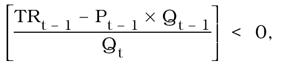 rovná sa úrokovej sadzbe: 12M BRIBOR (predaj), ktorú publikuje Národná banka Slovenska za obdobie január až september v roku t - 1 a ktorá sa vypočíta ako priemer mesačných priemerov.

- e) Neočakávané zmeny nákladov Zt v Sk na jednotku elektriny v roku t sa vypočítajú podľa vzorca:

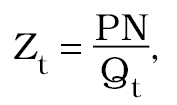

pričom:

PN = celkový objem nákladov v Sk, ktoré sú vyvolané skutočnosťami, na ktoré regulovaný subjekt nemá vplyv, ktoré úrad povolí zahrnúť do cien za dodávku elektriny pre regulovaných odberateľov v roku t na základe návrhu regulovaného subjektu na zmenu cien.

(4) Maximálna cena za dodávku elektriny pre kategóriu domácnosť4) PRt v Sk na jednotku elektriny v roku t sa vypočíta podľa vzorca:

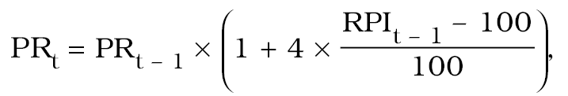

pričom:

PRt - 1 = maximálna cena za dodávku elektriny pre kategóriu domácnosť v Sk na jednotku elektriny v roku t - 1.

(5) Spôsob výpočtu maximálnej ceny za dodávku elektriny pre kategóriu domácnosť v Sk na jednotku elektriny uvedený v odseku 4 sa bude uplatňovať dovtedy, kým maximálna cena za dodávku elektriny pre kategóriu domácnosť nepokryje oprávnené náklady a primeraný zisk vynaložený regulovaným subjektom pri dodávke elektriny pre túto kategóriu.
