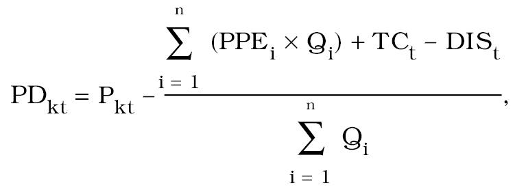

# Článok 4

(1) Tento článok upravuje spôsob regulácie cien za distribúciu elektriny regulovaným subjektom pre oprávnených odberateľov, ktorí majú s regulovaným subjektom uzatvorenú zmluvu o prenose alebo distribúcii elektriny.

(2) Cena, ktorú regulovaný subjekt účtuje za distribúciu elektriny pre oprávnených odberateľov podľa odseku 1, určí sa ako maximálna cena v Sk na jednotku elektriny pokrývajúca ovplyvniteľné náklady PDt regulovaného subjektu vynaložené na jednotlivých napäťových úrovniach.

(3) Ak cena za dodávku elektriny pre skupinu odberateľov, v ktorej sa nachádzajú alebo môžu nachádzať oprávnení odberatelia podľa odseku 1, obsahuje krížové dotácie povolené úradom, maximálna cena za distribúciu elektriny pre oprávnených odberateľov PDkt v tejto skupine sa určí ako cena za dodávku elektriny v Sk na jednotku elektriny po odpočítaní nákladov na nákup a prenos elektriny v Sk na jednotku elektriny, a to podľa vzorca:

pričom

Pkt = priemerná cena za dodávku elektriny pre regulovaných odberateľov v skupine k v roku t v Sk na jednotku elektriny.

(4) Úrad určí tarify za distribúciu elektriny pre oprávnených odberateľov podľa odseku 1 na základe návrhu cien, ktorý predloží regulovaný subjekt, spôsobom uvedeným v odsekoch 2 a 3 tak, aby priemer taríf vážený plánovaným množstvom distribuovanej elektriny oprávneným odberateľom v jednotkách množstva v jednotlivých tarifách neprekročil PDt podľa odseku 2.

(5) Regulovaný subjekt fakturuje oprávneným odberateľom tarify za distribúciu elektriny podľa odseku 4 zvýšené o náklady spôsobené stratami elektriny, ktoré vznikajú regulovanému subjektu pri distribúcii elektriny oprávneným odberateľom. Straty elektriny sa na tento účel určia ako násobok percenta strát elektriny, ktoré regulovaný subjekt dosiahol v roku t - 1 na jednotlivých napäťových úrovniach, a objemu elektriny, ktorý oprávnený odberateľ dohodol na distribúciu elektriny.

(6) Regulovaný subjekt fakturuje oprávneným odberateľom podľa odseku 1, ktorí sú zároveň koncoví odberatelia, aj poplatok za systémové náklady PNSt a systémový poplatok SPKt za každú jednotku elektriny, ktorú odoberú z distribučnej sústavy regulovaného subjektu v roku t.
