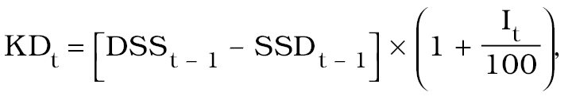

# Článok 5

(1) Tento článok upravuje spôsob regulácie cien za poskytovanie systémových služieb regulovaným subjektom pre užívateľov distribučnej sústavy.

(2) Maximálny povolený výnos, ktorý regulovaný subjekt dosiahne za poskytovanie systémových služieb SSDt v Sk v roku t, vypočíta sa podľa vzorca:

,

pričom

SPKt = systémový poplatok pre koncových odberateľov v roku t v Sk na jednotku elektriny,

QKt = celkový plánovaný objem elektriny v jednotkách elektriny, ktorý odoberú koncoví odberatelia z distribučnej sústavy regulovaného subjektu v roku t, s výnimkou plánovaného odberu elektriny koncovými odberateľmi v rámci ostrovnej prevádzky preukázateľne oddelenej od elektrizačnej sústavy Slovenskej republiky,

SPZt = systémový poplatok pre držiteľov licencie na výrobu elektriny v roku t v Sk na jednotku elektriny,

QZt = celkový plánovaný objem elektriny v jednotkách elektriny v roku t vyrobenej držiteľmi licencie na výrobu elektriny, ktorí sú napojení na distribučnú sústavu regulovaného subjektu, vo vlastnom zariadení a dodanej priamo odberateľom bez použitia prenosovej alebo distribučnej sústavy alebo spotrebovanej týmito výrobcami bez použitia prenosovej alebo distribučnej sústavy, s výnimkou elektriny, ktorú výrobcovia spotrebujú priamo pri výrobe elektriny alebo tepla alebo pri čerpaní prečerpávacích vodných elektrární,

SPOt = systémový poplatok pre regulovaný subjekt v roku t v Sk na jednotku elektriny,

QOt = celkový plánovaný objem elektriny v jed- notkách elektriny odobraný regulovaným subjektom z elektrizačnej sústavy Slovenskej republiky v prípade plného alebo čiastočného napojenia pôvodnej ostrovnej prevádzky preukázateľne oddelenej od elektrizačnej sústavy Slovenskej republiky nad rámec diagramu schváleného v dennej príprave prevádzky elektrizačnej sústavy Slovenskej republiky,

KDt = korekčný faktor v Sk v roku t, ktorý sa vypočíta podľa vzorca:

pričom

DSSt - 1 = celkový skutočný výnos v Sk v roku t - 1 z poskytovania systémových služieb,

SSDt - 1 = maximálny povolený výnos z poskytovania systémových služieb v Sk v roku t - 1,

It = úroková sadzba: 12M BRIBOR (predaj), ktorú publikuje Národná banka Slovenska za obdobie január až september v roku t - 1 a ktorá sa vypočíta ako priemer mesačných priemerov.

Celkový skutočný výnos v Sk v roku t - 1 z poskytovania systémových služieb DSSt - 1 sa vypočíta podľa vzorca:

pričom

SPKt - 1 = systémový poplatok pre koncových odberateľov v roku t - 1 v Sk na jednotku elektriny,

QKt - 1 = celkový objem elektriny v jednotkách elektriny odobraný koncovými odberateľmi z distribučnej sústavy regulovaného subjektu v roku t - 1 s výnimkou elektriny odobranej koncovými odberateľmi v rámci ostrovnej prevádzky preukázateľne oddelenej od elektrizačnej sústavy Slovenskej republiky,

SPZt - 1 = systémový poplatok pre držiteľov licencie na výrobu elektriny v roku t - 1 v Sk na jednotku elektriny,

QZt - 1 = celkový objem elektriny v jednotkách elektriny v roku t - 1 vyrobenej držiteľmi licencie na výrobu elektriny, ktorí sú napojení na distribučnú sústavu regulovaného subjektu, vo vlastnom zariadení a dodanej priamo odberateľom bez použitia prenosovej alebo distribučnej sústavy alebo spotrebovanej týmito výrobcami bez použitia prenosovej alebo distribučnej sústavy s výnimkou elektriny, ktorú držitelia licencie spotrebujú priamo pri výrobe elektriny alebo tepla alebo pri čerpaní prečerpávacích vodných elektrární,

SPOt - 1 = systémový poplatok pre regulovaný subjekt v roku t - 1 v Sk na jednotku elektriny,

QOt - 1 = celkový objem elektriny v jednotkách elektriny odobraný regulovaným subjektom z elektrizačnej sústavy Slovenskej republiky v prípade plného alebo čiastočného napojenia pôvodnej ostrovnej prevádzky preukázateľne oddelenej od elektrizačnej sústavy Slovenskej republiky nad rámec diagramu schváleného v dennej príprave prevádzky elektrizačnej sústavy Slovenskej republiky.
