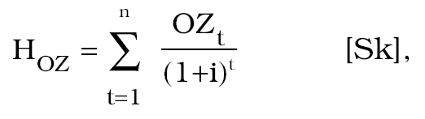
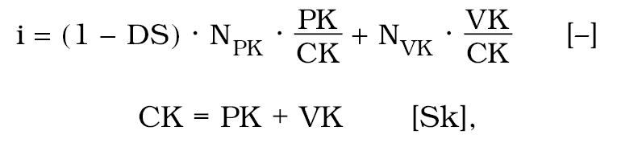
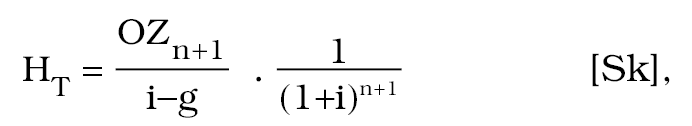
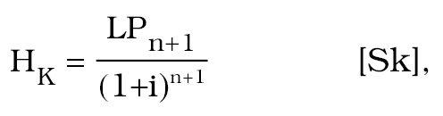
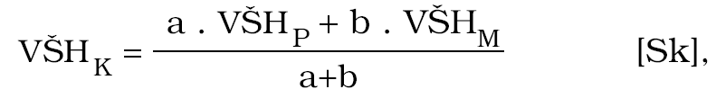

Príloha č. 1 k vyhláške č. 86/2002 Z. z.

- ZÁKLADNÉ POSTUPY STANOVENIA VŠEOBECNEJ HODNOTY PODNIKU A ČASTÍ PODNIKU

- 1. Majetková metóda stanovenia všeobecnej hodnoty podniku a častí podniku

  - Všeobecná hodnota podniku a častí podniku stanovená majetkovou metódou je všeobecná hodnota majetku znížená o všeobecnú hodnotu cudzích pasív k termínu ohodnotenia.

  - Majetková metóda stanovenia všeobecnej hodnoty podniku a častí podniku poskytuje časovo reálne a ľahko kontrolovateľné údaje o štruktúre majetku, objektivizuje údaje vykazované v účtovnej a inej evidencii.

  - Všeobecná hodnota podniku a častí podniku sa stanoví majetkovou metódou podľa zaužívaného vzťahu

  - VŠHM = A + B + C + D - CP [Sk], ktorý je na účely tejto vyhlášky upravený takto:

  - VŠHM = VŠHIM + VŠHOBM + VŠHOM - VŠHCP [Sk],

  - kde

  - VŠHM - všeobecná hodnota podniku a častí podniku stanovená majetkovou metódou [Sk],

  - VŠHIM- všeobecná hodnota investičného majetku [Sk],

  - VŠHOBM - všeobecná hodnota obežného majetku [Sk],

  - VŠHOM - všeobecná hodnota ostatného majetku [Sk],

  - VŠHCP- všeobecná hodnota cudzích pasív [Sk].

- 2. Podnikateľská metóda stanovenia všeobecnej hodnoty podniku a častí podniku

  - a) Všeobecná hodnota podniku a častí podniku stanovená podnikateľskou metódou pri časovo neobmedzenej životnosti podniku sa stanoví takto:

    - VŠHP = HOZ + HT[Sk],

    - kde

    - VŠHP- všeobecná hodnota podniku a častí podniku stanovená podnikateľskou metódou [Sk],

    - HOZ - všeobecná hodnota odčerpateľných zdrojov počas hodnoteného obdobia [Sk],

    - HT - trvalá hodnota [Sk].

    - Všeobecná hodnota odčerpateľných zdrojov počas hodnoteného obdobia sa stanoví takto:

    - 

    - kde

    - HOZ - všeobecná hodnota odčerpateľných zdrojov počas hodnoteného obdobia [Sk],

    - OZt- odčerpateľné zdroje počas hodnoteného obdobia [Sk],

    - i - diskontná sadzba v percentách, ktorá sa do výpočtu dosadzuje v desatinnom tvare [-],

    - n - dĺžka sledovaného obdobia [rok].

    - Diskontná sadzba sa stanoví takto:

    - 

    - kde

    - i - vypočítaná diskontná sadzba v percentách odrážajúca mieru rizika, priemernú nákladovosť kapitálu a štruktúru využívaného kapitálu, ktorá sa do výpočtu dosadzuje v desatinnom tvare [%/100],

    - DS - sadzba dane z príjmu v percentách, ktorá je stanovená v zmysle zákona o dani z príjmov pre ohodnocovaný podnik, do výpočtu sa dosadzuje v desatinnom tvare [%/100],

    - NPK- náklady spojené s využívaním požičaného kapitálu v percentách, t. j. úrok a iné náklady platené veriteľom, ktoré sa do výpočtu dosadzujú v desatinnom tvare [%/100],

    - PK - objem požičaného kapitálu v slovenských korunách; pozostáva zo zložiek cudzích pasív, ktorými na účel výpočtu diskontnej sadzby sú: dlhodobé bankové úvery, bežné bankové úvery, finančné výpomoci, emitované dlhopisy, zmenky, lízing, platené nájmy a iné záväzky,

    - NVK - náklady vlastného kapitálu v percentách, t. j. podiel na zisku očakávaný a získavaný vlastníkom za vklad svojho kapitálu do podniku, ktoré sa do výpočtu dosadzujú v desatinnom tvare [%/100],

    - VK - objem vlastného kapitálu v slovenských korunách pozostáva zo zložiek pasív, ktorými na účel výpočtu diskontnej sadzby je základné imanie.

    - CK - celkový kapitál (súčet vlastného kapitálu a požičaného kapitálu v slovenských korunách).

    - Trvalá hodnota sa stanoví takto:

    - 

    - kde

    - HT- trvalá hodnota [Sk],

    - OZn+1 - objem odčerpateľných zdrojov v roku nasledujúcom po sledovanom období [Sk],

    - i - diskontná sadzba v percentách, ktorá sa do výpočtu dosadzuje v desatinnom tvare [%/100],

    - g - trvale udržateľná miera rastu odčerpateľných zdrojov v percentách, ktorá sa do výpočtu dosadzuje v desatinnom tvare [%/100],

    - n - dĺžka sledovaného obdobia [rok].

    - Trvalá hodnota (HT) je všeobecná hodnota odčerpateľných zdrojov podniku a častí podniku v roku nasledujúcom po sledovanom období, zohľadňujúca predpoklady podniku vytvárať odčerpateľné zdroje počas časovo neobmedzeného obdobia, ktorá je prepočítaná na súčasnú hodnotu k dátumu ohodnotenia.

    - Trvale udržateľná miera rastu odčerpateľných zdrojov (g) vyjadruje percentuálnu medziročnú zmenu schopnosti podniku vytvárať odčerpateľné zdroje, ktorá závisí od stavu podniku ku dňu ohodnotenia a od jeho vývoja počas sledovaného obdobia v rámci jeho odvetvia v kontexte s jeho históriou.

  - b) Všeobecná hodnota podniku a častí podniku vymedzená podnikateľskou metódou pri časovo obmedzenej životnosti podniku sa stanoví takto:

    - VŠHP= HOZ + HK [Sk],

    - kde

    - VŠHP - všeobecná hodnota podniku a častí podniku stanovená podnikateľskou metódou pri časovo obmedzenej životnosti podniku [Sk],

    - HOZ - hodnota odčerpateľných zdrojov počas hodnoteného obdobia [Sk],

    - HK - konečná hodnota podniku v roku nasledujúcom po sledovanom období, ktorá sa stanoví takto:

    - 

    - kde

    - HK - konečná hodnota podniku a častí podniku v roku nasledujúcom po sledovanom období, ktorá je prepočítaná na súčasnú hodnotu k dátumu ohodnotenia [Sk],

    - LPn+1 - predpokladaný čistý výnos zo speňaženia majetku v roku nasledujúcom po sledovanom období (likvidačný prebytok) [Sk],

    - i - diskontná sadzba v percentách, ktorá sa do výpočtu dosadzuje v desatinnom tvare [%/100],

    - n - dĺžka sledovaného obdobia [rok].

- 3. Likvidačná metóda stanovenia všeobecnej hodnoty podniku a častí podniku

  - a) Všeobecná hodnota podniku stanovená pri skončení podnikateľskej činnosti likvidáciou predstavuje hodnotu majetku podniku stanovenú likvidačnou metódou k určitému dátumu, ktorá ostáva vlastníkovi po predaji majetku, po splatení všetkých záväzkov vrátane odmeny likvidátora a všetkých nákladov na likvidáciu. Stanoví sa likvidačnou metódou podľa zaužívaného vzťahu

    - VŠHL = A + B + C + D - CP - NL [Sk], ktorý je na účely tejto vyhlášky upravený takto:

    - VŠHL = VŠHIM + VŠHOBM + VŠHOM - VŠHCP - VŠHNL [Sk],

    - kde

    - VŠHL- všeobecná hodnota podniku stanovená likvidačnou metódou [Sk],

    - VŠHIM- všeobecná hodnota investičného majetku [Sk],

    - VŠHOBM - všeobecná hodnota obežného majetku [Sk],

    - VŠHOM- všeobecná hodnota ostatného majetku [Sk],

    - VŠHCP- všeobecná hodnota cudzích pasív [Sk],

    - VŠHNL - všeobecná hodnota nákladov súvisiacich s likvidáciou (napr. odmena likvidátora, odmeny za znalecké posudky, likvidácia škôd, vyraďovanie investičného majetku, nárok zamestnancov na odstupné a pod.) [Sk].

  - b) Všeobecná hodnota podniku pri skončení podnikateľskej činnosti konkurzom sa stanoví likvidačnou metódou takto:

    - VŠHLK= (VŠHIM + VŠHOBM + VŠHOM ) . kS + VŠHFM [Sk],

    - kde

    - VŠHLK - všeobecná hodnota podniku stanovená likvidačnou metódou [Sk],

    - VŠHIM - všeobecná hodnota investičného majetku [Sk],

    - VŠHOBM- všeobecná hodnota obežného majetku bez finančného majetku [Sk],

    - VŠHOM- všeobecná hodnota ostatného majetku [Sk],

    - VŠHFM- všeobecná hodnota finančného majetku [Sk],

    - kS - súhrnný koeficient speňažiteľnosti majetku ako celku zohľadňujúci mimoriadne špecifiká, ktoré sa nebrali do úvahy pri stanovení všeobecných hodnôt jednotlivých zložiek majetku a majú vplyv na výslednú všeobecnú hodnotu majetku ako celku. Výšku súhrnného koeficientu speňažiteľnosti a v ňom zahrnuté mimoriadne špecifiká znalecká organizácia preskúmateľne zdôvodní. Spravidla sa koeficient speňažiteľnosti rovná približne 1,0 [-]

- 4. Kombinovaná metóda stanovenia všeobecnej hodnoty podniku a častí podniku

  - 

  - kde

  - VŠHK - všeobecná hodnota podniku vypočítaná kombinovanou metódou [Sk],

  - VŠHP - všeobecná hodnota podniku stanovená podnikateľskou metódou [Sk],

  - VŠHM - všeobecná hodnota podniku stanovená majetkovou metódou [Sk],

  - a - váha korigujúca podnikateľskú hodnotu podniku [-],

  - b - váha korigujúca majetkovú hodnotu podniku [-].

  - V prípadoch, keď sa všeobecná hodnota stanovená podnikateľskou a majetkovou metódou približne rovnajú, alebo v prípadoch, keď je všeobecná hodnota stanovená podnikateľskou metódou vyššia, platí a = b = 1. V ostatných prípadoch platí: a > b.

- 5. Porovnávacia metóda stanovenia všeobecnej hodnoty podniku a častí podniku

  - Všeobecná hodnota podniku a častí podniku podľa transakčného prístupu sa stanoví porovnaním so vzorovými podnikmi rovnakého odvetvia a zamerania, porovnateľnej veľkosti a štruktúry, ktoré boli kúpené alebo predané v nedávnom čase. Hodnota podniku alebo jeho častí sa stanoví pomocou cenových násobkov vybraných ukazovateľov vzorových podnikov, ktoré sa použijú na ohodnocovaný podnik alebo časť podniku.

  - Všeobecná hodnota podniku alebo jeho častí podľa vzorového prístupu sa stanoví porovnaním so vzorovými podnikmi sumarizáciou finančných ukazovateľov po zohľadnení rizikových faktorov, kontrolných príplatkov, diskontov predajnosti.

  - Všeobecná hodnota podniku alebo jeho častí podľa burzového prístupu sa stanoví ako súčet budúcich dividend počas sledovaného obdobia a očakávanej majetkovej hodnoty na konci sledovaného obdobia.

  - Výber použitých metód stanovenia všeobecnej hodnoty podniku a jeho častí znalecká organizácia jednoznačne zdôvodní.
