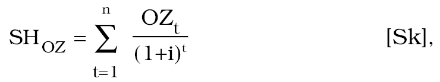
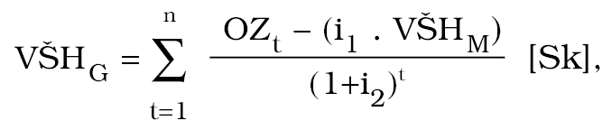
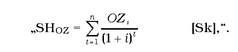

Príloha č. 2 k vyhláške č. 86/2002 Z. z.

- STANOVENIE VŠEOBECNEJ HODNOTY NEHMOTNÉHO INVESTIČNÉHO MAJETKU

- 1. Všeobecná hodnota zriaďovacích výdavkov

- Stanoví sa individuálnym posúdením vynaložených zriaďovacích výdavkov z hľadiska ich využitia pri činnosti podniku a prínosu pri realizovaní jeho aktivít.

- 2. Všeobecná hodnota softvéru

- Stanoví sa ako rozdiel medzi východiskovou hodnotou (účtovnou cenou alebo vynaloženými nákladmi) a amortizáciou. Pri stanovení všeobecnej hodnoty softvéru sa vezme do úvahy jeho využitie pri činnosti podniku a prínos pri realizovaní jeho aktivít.

- 3. Všeobecná hodnota nehmotných výsledkov výskumnej a obdobnej činnosti a všeobecná hodnota oceniteľných práv

- Stanoví sa

- a) metódou licenčnej analógie v prípade licencií, patentov, ochranných známok a iných obchodovateľných súčastí nehmotného investičného majetku alebo

- b) metódou kapitalizácie odčerpateľných zdrojov; základom je stanovenie dĺžky obdobia v rokoch, počas ktorého sa nehmotný investičný majetok bude využívať; výpočet objemu odčerpateľných zdrojov, ktoré sa vytvárajú využívaním ohodnocovaného nehmotného investičného majetku; stanovenie podielu, ktorý pripadá na ohodnocovaný nehmotný investičný majetok podniku z vytváraných odčerpateľných zdrojov,

- podľa vzťahu

- VŠHNIM = SHOZ. pNIM[Sk],

- kde

- VŠHNIM- všeobecná hodnota nehmotného investičného majetku podniku.

- 

- kde

- n - počet rokov používania nehmotného investičného majetku podniku [rok],

- SHOZ- súčasná hodnota budúcich odčerpateľných zdrojov ku dňu vypracovania znaleckého posudku [Sk],

- pNIM - percentuálny podiel, ktorým sa ohodnocovaný nehmotný investičný majetok podieľa na tvorbe odčerpateľných zdrojov, ktorý sa do výpočtu dosadzuje v desatinnom tvare [%/100],

- i - diskontná sadzba v percentách vypočítaná podľa prílohy č. 1 časti 2, ktorá sa do výpočtu dosadzuje v desatinnom tvare [%/100].

- 4. Iný nehmotný investičný majetok

- Člení sa na goodwill a know-how.

- Všeobecná hodnota goodwillu sa stanoví ako

- a) rozdiel medzi podnikateľskou a majetkovou hodnotou

- VŠHG = VŠHP - VŠHM [Sk],

- kde

- VŠHG - všeobecná hodnota goodwillu [Sk],

- VŠHP- všeobecná hodnota podniku stanovená podnikateľskou metódou [Sk],

- VŠHM- všeobecná hodnota podniku stanovená majetkovou metódou [Sk],

- alebo ako

- b) súčasná hodnota rozdielu medzi hodnotou odčerpateľných zdrojov a súčinom miery rentability investovaného kapitálu a všeobecnou hodnotou majetku podniku

- 

- kde

- OZt- objem odčerpateľných zdrojov v čase t [Sk],

- VŠHM- všeobecná hodnota podniku stanovená majetkovou metódou [Sk],

- n - počet rokov používania nehmotného investičného majetku podniku [rok],

- i1- rentabilita investovaného kapitálu v percentách, ktorá sa do výpočtu dosadzuje v desatinnom tvare [%/100],

- i2 - diskontná sadzba v percentách vypočítaná podľa prílohy č. 1 časti 2, ktorá sa do výpočtu dosadzuje v desatinnom tvare [%/100].

- Všeobecná hodnota know-how sa stanoví metódou kapitalizácie odčerpateľných zdrojov. Stanoví sa dĺžka obdobia v rokoch, počas ktorého sa know-how bude využívať, vypočíta sa objem odčerpateľných zdrojov, ktoré sa vytvárajú využívaním ohodnocovaného know-how, stanoví sa podiel, ktorý pripadá na ohodnocované know-how z vytváraných odčerpateľných zdrojov.

- VŠHNIM = SHOZ . pNIM [Sk],

- kde

- VŠHNIM - všeobecná hodnota know-how podniku,

- 

- kde

- n - počet rokov používania know-how podniku [rok],

- SHOZ- súčasná hodnota budúcich odčerpateľných zdrojov ku dňu vypracovania znaleckého posudku [Sk],

- pNIM - percentuálny podiel, ktorým sa ohodnocované know-how podieľa na tvorbe budúcich odčerpateľných zdrojov; do výpočtu sa dosadzuje v desatinnom tvare [%/100],

- i - diskontná sadzba v percentách vypočítaná podľa prílohy č. 1 časti 2, ktorá sa do výpočtu dosadzuje v desatinnom tvare [%/100].

- 5. Všeobecná hodnota nedokončených nehmotných investícií

- Stanoví sa s prihliadnutím na možnosti skončenia nehmotného investičného majetku, čas potrebný na skončenie a ich využiteľnosť v podniku. V prípade nevyužiteľnosti všeobecná hodnota, ktorá zodpovedá výnosu zo speňaženia. Základom na výpočet sú objektivizované vynaložené náklady.

- 6. Všeobecná hodnota poskytnutých preddavkov na nehmotný investičný majetok

- Stanovuje sa s prihliadnutím na schopnosť prijímateľa preddavku splniť zmluvný vzťah a s prihliadnutím na skutočnú využiteľnosť nehmotného investičného majetku v podniku.

- 7. Všeobecné pravidlá na postup znalca

- Znalec alebo znalecká organizácia zváži a zdôvodní výber vhodnej metódy, ktorá prihliada na všetky špecifiká nehmotného investičného majetku, pričom použije zaužívané znalecké postupy.
