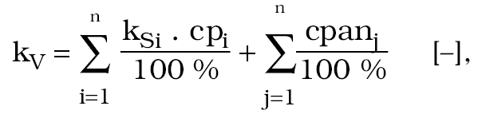
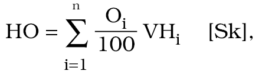
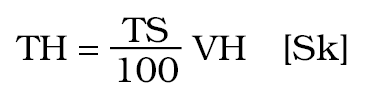
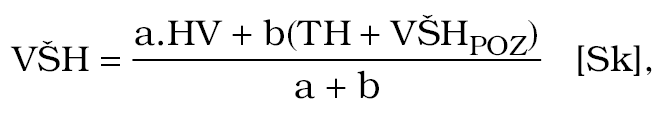
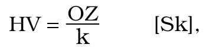
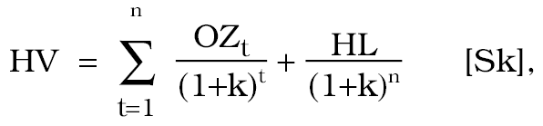
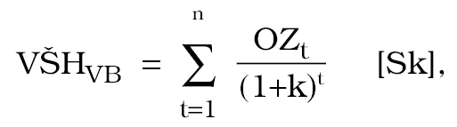

Príloha č. 3 k vyhláške č. 86/2002 Z. z.

- POSTUP STANOVENIA VŠEOBECNEJ HODNOTY NEHNUTEĽNOSTÍ A STAVIEB

- A. ZÁKLADNÉ POJMY A NÁZVOSLOVIE

- 1. Všeobecná hodnota (VŠH)

- Všeobecná hodnota je znalecký odhad ceny, ktorá by sa dosiahla pri predajoch rovnakých alebo porovnateľných nehnuteľností a stavieb v bežnom obchodnom styku k dátumu ohodnotenia.

- 2. Východisková hodnota (VH)

- Východisková hodnota je znalecký odhad hodnoty, za ktorú by bolo možné rovnakú novú stavbu nadobudnúť formou výstavby v čase ohodnotenia.

- 3. Technická hodnota (TH)

- Technická hodnota je znalecký odhad východiskovej hodnoty stavby znížená o hodnotu zodpovedajúcu výške opotrebovania.

- 4. Výnosová hodnota (HV)

- Výnosová hodnota je znalecký odhad súčasnej hodnoty budúcich disponibilných výnosov z využitia nehnuteľnosti formou prenájmu, diskontovaných rizikovou (diskontnou) sadzbou.

- 5. Stavby1)

- Stavba je stavebná konštrukcia postavená stavebnými prácami zo stavebných výrobkov, ktorá je pevne spojená so zemou alebo ktorej osadenie vyžaduje úpravu podkladu.

- Stavby sa podľa stavebnotechnického vyhotovenia a účelu členia na pozemné stavby a inžinierske stavby.

- B. ZÁKLADNÉ POSTUPY OHODNOCOVANIA NEHNUTEĽNOSTÍ A STAVIEB

- Všeobecná hodnota sa stanoví týmito metódami:

- a) porovnávacia metóda,

- b) kombinovaná metóda (použije sa iba vtedy, ak je predmet ohodnotenia schopný dosahovať výnos formou prenájmu),

- c) metóda polohovej diferenciácie.

- Výber vhodnej metódy vykoná znalec alebo znalecká organizácia. Výber musí v znaleckom posudku zdôvodniť. Podľa účelu znaleckého posudku možno použiť aj viac metód súčasne.

- C. TECHNICKÁ HODNOTA NEHNUTEĽNOSTÍ A STAVIEB

- C.1 Výpočet východiskovej hodnoty (VH)

- Výpočet sa vykoná na báze rozpočtových ukazovateľov. Rozpočtový ukazovateľ porovnateľného objektu musí byť preskúmateľný, tzn. vybraný ukazovateľ sa musí presne špecifikovať číslom objektu, zatriedenia do číselníka klasifikácie stavieb a jednotkovou hodnotou podľa verejne publikovaného katalógu, z ktorého bol vybraný.

- Jednotková hodnota sa preskúmateľným spôsobom upraví podľa jednotlivých charakteristík hodnoteného objektu (výška podlaží, plocha podlaží, vybavenosť objektu, konštrukčno-materiálová charakteristika a pod.) a prepočíta sa do cenovej úrovne k termínu, ku ktorému sa vykonáva ohodnotenie.

- Východisková hodnota sa stanoví podľa základného vzťahu

- VH = M . (RU . kCU. kV . kZP . kVP . kK . kM ) [Sk],

- kde

- M - počet merných jednotiek.

- Udáva počet merných jednotiek hodnoteného objektu vypočítaných podľa technickej normy, na ktorej základe bol zostavený vybraný rozpočtový ukazovateľ.

- RU - rozpočtový ukazovateľ

- Rozumie sa hodnota základných rozpočtových nákladov na mernú jednotku, ktorá zodpovedá vybranému porovnateľnému objektu z publikovaných katalógov rozpočtových ukazovateľov. Výber porovnateľného objektu sa vykoná podľa zatriedenia hodnoteného objektu do číselníka príslušnej klasifikácie stavebných objektov2), na ktorej základe bol vybraný katalóg zostavený.

- kCU- koeficient vyjadrujúci nárast cien

- Vyjadruje nárast cien stavebných prác medzi termínom ohodnotenia a obdobím, pre ktoré bol zostavený rozpočtový ukazovateľ porovnateľného objektu. Koeficient sa určí pomocou indexov nárastu cien stavebných prác a materiálov v stavebníctve vydávaných Štatistickým úradom Slovenskej republiky po jednotlivých štvrťrokoch.

- kV- koeficient vplyvu vybavenosti hodnoteného objektu

- Vyjadruje rozdiel ceny konštrukcií a vybavení porovnateľného a hodnoteného objektu.

- Vypočíta sa podľa vzťahu

- 

- kde

- kSi - koeficient štandardu i-tej konštrukcie alebo vybavenia zohľadňujúci štandardné, podštandardné alebo nadštandardné vybavenie. V prípade, ak sa v cenových podieloch porovnateľného objektu uvedených v katalógoch rozpočtových ukazovateľov nachádza konštrukcia alebo vybavenie, ktoré sa na hodnotenom objekte nevyskytuje, koeficient sa rovná nule,

- cpi - cenový podiel i-tej konštrukcie alebo vybavenia vybraného porovnateľného objektu uvedený v katalógoch rozpočtových ukazovateľov,

- cpanj- cenový podiel nadštandardnej j-tej konštrukcie alebo vybavenia, ktoré sa nevyskytuje v cenových podieloch porovnateľného objektu uvedených v katalógoch rozpočtových ukazovateľov a zistí sa z pomeru odhadnutých alebo preukázateľných obstarávacích nákladov na jej vybudovanie v čase a mieste ohodnotenia k východiskovej hodnote hodnoteného objektu.

- Vo výnimočných prípadoch možno koeficient stanoviť zdôvodneným odborným odhadom. V prípade zhodného výberu porovnateľného objektu oproti hodnotenému objektu sa koeficient rovná 1,0.

- kZP- koeficient vplyvu zastavanej plochy hodnotenej stavby

- Vyjadruje rozdiel ceny konštrukcií a vybavení závislých od zastavanej plochy v porovnaní s priemernou zastavanou plochou hodnotenej a porovnateľnej stavby. Na výpočet koeficientu sa použijú primerané vzťahy vzhľadom na použitý katalóg rozpočtových ukazovateľov. Priemerná zastavaná plocha sa vypočíta ako aritmetický priemer zastavaných plôch všetkých reprezentatívnych podlaží.

- kVP - koeficient vplyvu konštrukčnej výšky podlaží hodnotenej stavby

- Vyjadruje rozdiel ceny konštrukcií a vybavenia závislých od konštrukčnej výšky v porovnaní s priemernou konštrukčnou výškou hodnotenej a porovnateľnej stavby. Na výpočet koeficientu sa použijú primerané vzťahy vzhľadom na použitý katalóg rozpočtových ukazovateľov. Priemerná konštrukčná výška sa vypočíta ako vážený priemer konštrukčných výšok všetkých podlaží stavby alebo jej časti. Ako váha sa použije veľkosť zastavanej plochy príslušného podlažia.

- kK- koeficient konštrukčno-materiálovej charakteristiky

- Vyjadruje rozdiel ceny v závislosti od použitého materiálu nosnej konštrukcie stavby, ak to nebolo zohľadnené v kV. Pri výbere porovnateľného objektu s rovnakou konštrukčno-materiálovou charakteristikou hodnoteného objektu sa tento koeficient rovná 1,0.

- kM- koeficient vyjadrujúci územný vplyv

- Vyjadruje zvýšené, resp. znížené náklady na výstavbu v danom mieste z dôvodu dopravných vzdialeností, možnosti zariadenia staveniska a pod.

- Pri stavbách, ktoré majú vo zvislom alebo vodorovnom členení časť, ktorá sa typom konštrukcie alebo účelom výrazne líši podľa zatriedenia do klasifikácie stavieb (napr. dielne s kanceláriami na hornom podlaží, bytové domy s obchodmi na prvom nadzemnom podlaží, výrobné haly s administratívnymi alebo technickými prístavbami a pod.), východisková hodnota sa môže vypočítať ako súčet ohodnotení jednotlivých častí. Pri vodorovnom delení sa obstavaný priestor základov a strechy, t. j. spoločných častí stavby, rozdelí podľa pomerov obstavaného priestoru vrchnej stavby jednotlivých častí. Ak obstavaný priestor časti stavby tvorí nevýrazný podiel z celkového obstavaného priestoru stavby, ohodnotenie sa vykoná podľa prevažujúcej časti.

- Pri inžinierskych stavbách, bytoch a nebytových priestoroch sa koeficienty vplyvu zastavanej plochy a vplyvu výšky podlaží spravidla nepoužijú.

- Nedokončené a poškodené stavby

- Nedokončenými stavbami sa rozumejú rozostavané stavby, nadstavby a prístavby v čase od začatia výstavby do vydania užívacieho povolenia stavebným úradom alebo stavby, na ktorých sa vykonáva rekonštrukcia a modernizácia. Východisková hodnota nedokončenej stavby sa vypočíta ako východisková hodnota stavby dokončenej na základe projektovej dokumentácie overenej stavebným úradom (ak takáto projektová dokumentácia nie je alebo ak nie je v súlade so skutkovým stavom, tak podľa predpokladaného stavu stavby po jej dokončení) s tým, že sa odpočet východiskovej hodnoty nevyhotovených a nedokončených konštrukcií a vybavení vykoná podľa ich pomerného percentuálneho zastúpenia na celej stavbe.

- Obdobným spôsobom sa postupuje pri poškodených stavbách.

- C.2 Výpočet technického stavu (TS) a hodnoty vyjadrujúcej opotrebenie stavby (HO)

- Technický stav sa vypočíta podľa vzťahu

- TS = 100 - O [%],

- kde

- O - opotrebenie stavby [%].

- Opotrebenie stavby sa uvádza v percentách a zodpovedá znehodnoteniu technického stavu stavby v závislosti od veku, predpokladanej životnosti, spôsobu užívania stavby, údržby stavby a pod.

- Opotrebenie stavby sa vypočíta

- a) lineárnou metódou,

- b) analytickou metódou.

- Opotrebenie nadstavieb, prístavieb a samostatne ohodnocovaných častí stavby sa pri lineárnej metóde vypočíta samostatne za každý rok ich veku rovnakým spôsobom, ale ukončenie predpokladanej životnosti sa určí vždy pre celú stavbu k rovnakému roku.

- Celkové opotrebenie stavby sa pri lineárnej metóde môže vypočítať ako vážený priemer opotrebení jednotlivých častí stavby, kde váhou je merná jednotka použitá pri výpočte východiskovej hodnoty.

- Opotrebenie nedokončených stavieb určí znalec odborným odhadom.

- Pri výpočte opotrebenia sa používajú tieto pojmy:

- Vek stavby (V) - vypočíta sa ako rozdiel roku, ku ktorému sa ohodnotenie vykonáva, a roku, v ktorom nadobudlo právoplatnosť kolaudačné rozhodnutie. V prípadoch, keď došlo k užívaniu stavby skôr, vypočíta sa vek tak, že od roku, ku ktorému sa ohodnotenie vykonáva, sa odpočíta rok, v ktorom sa preukázateľne stavba začala užívať. Ak nemožno vek stavby takto zistiť, počíta sa podľa iného dokladu, a ak nie je ani taký doklad, určí sa zdôvodneným odborným odhadom.

- Životnosť stavby (Z) - rozumie sa celková predpokladaná životnosť stavby pri bežnej údržbe od jej vzniku až do úplného zániku. Udáva sa v rokoch. Životnosť stavby určuje znalec s prihliadnutím na jej konštrukčno-materiálové riešenie, technický stav, spôsob a intenzitu užívania a vykonávanú údržbu.

- Na určenie životnosti stavby možno použiť vzťah

- Z = V + T [rok],

- kde

- V - vek stavby [rok],

- T - znalcom určená zostatková životnosť stavby od roku, ku ktorému sa vykonáva ohodnotenie [rok].

- Hodnota vyjadrujúca opotrebenie (HO) sa vypočíta ako súčet hodnôt vyjadrujúcich opotrebenie jednotlivých častí stavby podľa vzťahu

- 

- kde

- Oi- opotrebenie i-tej časti stavby [%],

- VHi- východisková hodnota i-tej časti stavby [Sk],

- n - počet častí stavby [-].

- C.3 Výpočet technickej hodnoty (TH)

- Výpočet sa vykoná podľa vzťahu

- 

- alebo

- TH = VH - HO [Sk],

- kde

- TH - technická hodnota stavby [Sk],

- TS - technický stav stavby [%],

- VH - východisková hodnota stavby [Sk],

- HO - hodnota vyjadrujúca opotrebenie stavby [Sk].

- D. VÝPOČET VŠEOBECNEJ HODNOTY (VŠH)

- D.1 Porovnávacia metóda

- Pri výpočte sa používa transakčný prístup. Na porovnanie je potrebný súbor aspoň troch nehnuteľností, stavieb a pozemkov. Porovnanie treba vykonať na mernú jednotku (obstavaný priestor, zastavaná plocha, podlahová plocha, dĺžka, kus a pod.) s prihliadnutím na odlišnosti porovnávaných objektov a ohodnocovaného objektu.

- Hlavné faktory porovnávania:

- a) ekonomické (dátum prevodu, forma prevodu, spôsob platby a pod.),

- b) polohové (miesto, lokalita, atraktivita a pod.),

- c) konštrukčné a fyzické (štandard, nadštandard, podštandard, príslušenstvo a pod.).

- Podklady na porovnanie (doklad o prevode alebo prechode nehnuteľnosti, prípadne ponuky realitných kancelárií) musia byť identifikovateľné. Pri porovnávaní sa musia vylúčiť všetky vplyvy mimoriadnych okolností trhu (napr. príbuzenský vzťah medzi predávajúcim a kupujúcim, stav tiesne predávajúceho alebo kupujúceho a pod).

- D.2 Kombinovaná metóda

- Vypočíta sa podľa vzťahu

- 

- kde

- HV - výnosová hodnota stavieb a pozemkov [Sk],

- TH - technická hodnota stavieb [Sk],

- VŠHPOZ- všeobecná hodnota pozemkov [Sk],

- a - váha výnosovej hodnoty [-],

- b - váha technickej hodnoty [-].

- Za výnosovú hodnotu dosadzujeme hodnotu stavieb vrátane výnosu z pozemkov. Výnimku tvorí stav, keď je stavba postavená na cudzom pozemku. V takom prípade sa všeobecná hodnota pozemkov nezapočíta a vo výnosovej hodnote sa zohľadnia náklady na prenájom cudzieho pozemku.

- V prípadoch, keď sa výnosová hodnota stavieb a pozemkov približne rovná súčtu alebo je vyššia ako súčet technickej hodnoty stavieb a všeobecnej hodnoty pozemkov, platí: a = b = 1. V ostatných prípadoch platí: a > b.

- Výnosová hodnota (HV)

- Výnosová hodnota stavieb a pozemkov sa vypočíta kapitalizáciou budúcich odčerpateľných zdrojov počas časovo neobmedzeného obdobia alebo kapitalizáciou budúcich odčerpateľných zdrojov počas časovo obmedzeného obdobia s následným predajom. Spôsob výpočtu určí znalec.

- Kapitalizácia budúcich výnosov počas časovo neobmedzeného obdobia

- Výnosová hodnota sa vypočíta podľa základného vzťahu

- 

- kde

- OZ - odčerpateľný zdroj, ktorým sa rozumie disponibilný výnos so zohľadnením kapitalizovaného odpisu [Sk/rok],

- k - diskontná sadzba v percentách, ktorá sa do výpočtu dosadzuje v desatinnom tvare [%/100].

- Kapitalizácia budúcich výnosov počas časovo obmedzeného obdobia s následným predajom

- Výnosová hodnota sa vypočíta podľa základného vzťahu

- 

- kde

- OZt- odčerpateľný zdroj, ktorým sa rozumie disponibilný výnos v období t [Sk/rok],

- n - časové obdobie výnosovosti v rokoch uvažované pre výpočet,

- k - diskontná sadzba, ktorá sa do výpočtu dosadzuje v desatinnom tvare [%/100],

- HL - likvidačná hodnota stavieb a pozemkov [Sk].

- Likvidačná hodnota (HL) sa vypočíta podľa vzťahu

- HL = VŠH - DP [Sk],

- kde

- VŠH - všeobecná hodnota stavieb a pozemkov vypočítaná metódou polohovej diferenciácie v čase ohodnotenia [Sk],

- DP - daň z prevodu nehnuteľností podľa daňového zákona [Sk].

- Odčerpateľný zdroj v období t (OZ)

- Odčerpateľným zdrojom sa rozumie ročný disponibilný výnos z využívania nehnuteľnosti formou prenájmu.

- Vypočíta sa ako rozdiel hrubého výnosu a nákladov na využívanie nehnuteľnosti (prevádzkových, správnych nákladov, nákladov na údržbu a pod.) znížený o daň z príjmu.

- Hrubý výnos sa vypočíta za predpokladu 100 % prenajatia objektu ako súčin ročnej nájomnej sadzby a mernej jednotky (napr. m2 podlahovej plochy, podlažie, miestnosť, budova a pod.) znížený o odhad predpokladaných strát výnosu z nájomného.

- D.3 Metóda polohovej diferenciácie

- Metódou polohovej diferenciácie sa spravidla samostatne stanoví všeobecná hodnota pre

- a) stavby s výnimkou bytov a nebytových priestorov,

- b) byty a nebytové priestory,

- c) pozemky.

- Výsledná všeobecná hodnota sa vypočíta ako súčet všeobecných hodnôt jednotlivých zložiek majetku.

- D.3.1 Stavby s výnimkou bytov a nebytových priestorov

- Vypočíta sa podľa základného vzťahu

- VŠHS = TH . kPD [Sk],

- kde

- TH - technická hodnota stavby [Sk],

- kPD- koeficient polohovej diferenciácie vyjadrujúci vplyv polohy a ostatných faktorov vplývajúcich na všeobecnú hodnotu v mieste a čase [-].

- Koeficient predajnosti sa môže stanoviť pre skupinu stavieb alebo jednotlivo pre každú stavbu.

- Pri určení koeficientu vyjadrujúceho vplyv polohy sa váhovým priemerom zohľadnia spravidla tieto faktory:

- - trh s nehnuteľnosťami - kúpna sila obyvateľstva,

- - poloha nehnuteľnosti v danej obci - vzťah k centru obce,

- - súčasný technický stav nehnuteľnosti,

- - prevládajúca zástavba v okolí nehnuteľnosti,

- - príslušenstvo nehnuteľnosti,

- - typ nehnuteľnosti,

- - pracovné možnosti obyvateľstva,

- - skladba obyvateľstva v mieste stavby,

- - orientácia nehnuteľnosti k svetovým stranám,

- - konfigurácia terénu,

- - pripravenosť inžinierskych sietí v blízkosti stavby,

- - doprava v okolí nehnuteľnosti,

- - občianska vybavenosť,

- - prírodná lokalita v bezprostrednom okolí stavby,

- - kvalita životného prostredia v bezprostrednom okolí stavby,

- - možnosti zmeny v zástavbe - územný rozvoj,

- - možnosti ďalšieho rozšírenia,

- - dosahovanie výnosu z nehnuteľnosti,

- - názor znalca,

- - iné faktory.

- D.3.2 Byty a nebytové priestory

- Vypočíta sa podľa základného vzťahu

- VŠHB= TH . kPD [Sk],

- kde

- TH - technická hodnota bytu, nebytového priestoru [Sk],

- kPD - koeficient polohovej diferenciácie vyjadrujúci vplyv polohy a ostatných faktorov vplývajúcich na všeobecnú hodnotu v mieste a čase [-].

- Pri určení koeficientu vyjadrujúceho vplyv polohy sa váhovým priemerom zohľadnia spravidla tieto faktory:

- - trh s bytmi v danej lokalite - na sídlisku,

- - poloha bytového domu v danej obci - vzťah k centru obce,

- - súčasný technický stav bytu a bytového domu,

- - prevládajúca zástavba v bezprostrednom okolí bytového domu,

- - príslušenstvo bytového domu,

- - vybavenosť a príslušenstvo bytu,

- - pracovné možnosti obyvateľstva - miera nezamestnanosti,

- - skladba obyvateľstva v obytnom dome - na sídlisku,

- - orientácia obytných miestností k svetovým stranám,

- - umiestnenie bytu v bytovom dome,

- - počet bytov vo vchode - v bloku,

- - doprava v okolí bytového domu,

- - občianska vybavenosť v okolí bytového domu,

- - prírodná lokalita v bezprostrednom okolí bytového domu,

- - kvalita životného prostredia v bezprostrednom okolí bytového domu,

- - názor znalca,

- - iné faktory.

- D.3.3 Pozemky

- Všeobecná hodnota nepoľnohospodárskych a nelesných pozemkov uvedených v prílohe č. 1 k vyhláške3) časti C a poľnohospodárskej pôdy v zastavanom území obcí uvedených v prílohe č. 1 k vyhláške3) časti A.1, prvom bode (orná pôda), štvrtom (záhrady) a šiestom bode (trvalé trávne porasty) sa vypočíta podľa základného vzťahu

- VŠHPOZ= M . VŠHMJ [Sk],

- kde

- M - výmera pozemku v m2,

- VŠHMJ- jednotková všeobecná hodnota pozemku v Sk/m2.

- Jednotková všeobecná hodnota pozemku sa môže stanoviť aj pre skupinu pozemkov.

- Jednotková všeobecná hodnota pozemkov sa stanoví týmito metódami:

- a) metódou cenových máp,

- b) porovnávacou metódou,

- c) metódou polohovej diferenciácie podľa vzťahu

- VŠHMJ= VHMJ . kPD [Sk/m2],

- kde

- VHMJ - jednotková východisková hodnota pozemku, ktorá sa stanoví podľa tabuľky:

- Klasifikácia obce - názov alebo údaj podľa počtu obyvateľov | VHMJ Sk/m2

- a) Bratislava | 1 500,-

- b) Krajské mestá: Nitra, Prešov, Trenčín, Trnava, Žilina, Košice, Banská Bystrica a mestá: Piešťany, Vysoké Tatry, Trenčianske Teplice | 800,-

- c) Mestá: Poprad, Zvolen, Liptovský Mikuláš, Martin | 500,-

- d) Ostatné okresné mestá | 300,-

- e) Ostatné obce nad 15 000 obyvateľov | 200,-

- f) Ostatné obce od 5 000 do 15 000 obyvateľov | 150,-

- g) Ostatné obce od 2 000 do 5 000 obyvateľov | 100,-

- h) Ostatné obce do 2 000 obyvateľov | 50,-

- Obce a lokality v okolí miest so zvýšeným záujmom o kúpu nehnuteľností na bývanie alebo rekreáciu majú jednotkovú východiskovú hodnotu do 70 % z východiskovej hodnoty obce (mesta), z ktorej vyplýva zvýšený záujem.

- kPD je koeficient polohovej diferenciácie, vypočíta sa podľa vzťahu

- kPD = kS . kV . kD . kP . kI. kZ [-],

- kde

- kS - koeficient všeobecnej situácie (0,70-2,00), stanoví sa takto:

- Všeobecná situácia | ks

- 1. poľnohospodárske oblasti značne vzdialené od obcí, obce bez turistického ruchu | 0,70 - 0,80

- 2. stavebné územie obcí do 5 000 obyvateľov, okrajové priemyslové a poľnohospodárske časti obcí a miest do 10 000 obyvateľov | 0,80 - 0,90

- 3. obytné časti obcí a miest od 5 000 do 10 000 obyvateľov a časti rekreačných oblastí s cudzineckým ruchom, centrá obcí do 5 000 obyvateľov, obytné časti na predmestiach a priemyslové oblasti miest do 50 000 obyvateľov | 0,90 - 1,10

- 4. centrá miest od 10 000 do 50 000 obyvateľov, obytné časti väčších miest a ich rýchlo dostupné predmestia, prednostné oblasti vilových alebo rodinných domov v centre i mimo centra mesta, oblasti rekreačných domčekov v dôležitých centrách turistického ruchu, vyhľadávané priemyslové centrá miest nad 50 000 obyvateľov | 1,00 - 1,30

- 5. veľmi dobré obchodné časti v mestách od 50 000 do 100 000 obyvateľov, obytné centrá miest nad 100 000 obyvateľov, luxusné obytné oblasti s dobrým osvetlením a výhľadom, exkluzívne oblasti rodinných domov v dosahu miest nad 100 000 obyvateľov | 1,20 - 1,60

- 6. veľmi dobré obchodné oblasti v mestách od 50 000 do 100 000 obyvateľov a kúpeľných mestách, vedľajšie ulice v centre miest nad 100 000 obyvateľov, nákupné centrá vo veľkých obytných častiach mimo centra miest nad 100 000 obyvateľov s dobrými dopravnými možnosťami | 1,50 - 1,80

- 7. prednostné obchodné ulice a miesta v užšom centre miest nad 100 000 obyvateľov, najlepšie miesta pre obchod v mestách od 50 000 do 100 000 obyvateľov | 1,70 - 1,90

- 8. najlepšie miesta pre obchod v mestách nad 100 000 obyvateľov | 1,80 - 2,00

- kV - koeficient intenzity využitia (0,90-2,0), stanoví sa takto:

- Intenzita využitia | kv

- 1. veľmi malé využitie, 2-podlažné súkromné rekreačné domčeky, 2-3-podlažné stavby rodinných domov s podštandardným vybavením, nepodpivničené, nízke nebytové stavby nevyužívané alebo s malým využitím, poľnohospodárske stavby bez využitia | 0,90

- 2. rodinné domy s nižším štandardom vybavenia, obytné domy s podštandardným vybavením, 3-4-podlažné nebytové stavby na výrobu a služby s malým technickým vybavením, využívané poľnohospodárske stavby | 0,95

- 3. rodinné domy so štandardným vybavením, bežné obytné domy stredného využitia, 4-5-podlažné domy s 2-3 bytmi na jednom podlaží, prístupnými z jedného schodišťa, obytné domy s nebytovými priestormi, nebytové stavby na výrobu a služby s bežným technickým vybavením | 1,00

- 4. nadštandardné rodinné domy; obytné bloky s malými bytmi, bytmi v osobnom vlastníctve a so skladovými miestnosťami (3-5-podlažné), viacpodlažné nebytové stavby so štandardným technickým zariadením | 1,05 - 1,10

- 5. exkluzívne obytné stavby, obytné a obchodné domy (na prvom nadzemnom podlaží skladové miestnosti, reštaurácie, na ostatných podlažiach priestory na súkromnú prax, kancelárie, byty v osobnom vlastníctve), 5-7-podlažné, vysoké využitie pozemku | 1,10 - 1,15

- 6. obchodné domy, skladovacie miestnosti, kiná, reštaurácie, priestory na súkromnú prax lekárov a právnikov, kancelárie, viacpodlažné obchody (5-7 podlaží a 1-2 podzemné podlažia), veľmi vysoké využitie pozemku | 1,15 - 1,20

- 7. obchodné domy ako v položke 6 s nadštandardným vybavením (klimatizačné zariadenie, rýchlovýťahy, pohyblivé schody) s viac ako 7 nadzemnými podlažiami | 1,20 - 1,30

- 8. využitie ako v položke 7, ale exkluzívne miesta v centrách miest | 1,30 - 2,0

- kD - koeficient dopravných vzťahov (0,80-1,20), stanoví sa takto:

- Dopravné spojenie s obcou | kD

- 1. pozemky v odľahlých lokalitách so zlým dopravným spojením, cesty bez dokončovacích prác (nespevnené a pod.), cesta do obce alebo mesta v trvaní viac ako 30 min. | 0,80

- 2. pozemky na okraji miest a obce so železničnou zastávkou alebo autobusovou prímestskou dopravou, doprava do mesta ešte vyhovujúca | 0,85

- 3. pozemky na predmestiach miest, odkiaľ sa možno pešo dostať k prostriedku hromadnej dopravy alebo vlastným autom do centra do 15 min. | 0,90

- 4. pozemky v tesnej blízkosti prostriedku hromadnej dopravy s dobrou úpravou ciest, cesta vlastným autom do centra (10 min.), územie mesta a predmestia | 1,00

- 5. pozemky na obchodných uliciach mesta, v nákupných centrách väčších predmestí, intenzívny peší ruch, centrum hromadnej dopravy (autobus, trolejbus) | 1,05

- 6. pozemky na obchodných uliciach v centre miest nad 100 000 obyvateľov so širokými ulicami a parkoviskami, autobusy a trolejbusy s hustou premávkou | 1,05 - 1,20

- kP- koeficient obchodnej alebo priemyselnej polohy (0,90-2,00), vypočíta sa takto:

- Obchodná poloha alebo priemyselná poloha | | kP

- 1. | obchodná poloha | 1,50 - 2,00

- 2. | obchodná poloha a byty | 1,20 - 1,50

- 3. | obytná poloha | 1,00 - 1,20

- 4. | priemyselná poloha | 0,90 - 1,00

- 5. | vidiecka a poľnohospodárska poloha, obce do 5 000 obyvateľov | 0,90

- kI - koeficient druhu pozemku (0,70-1,50) závisí od druhu uvedeného v katastri nehnuteľností a jeho pripravenosti (vhodnosti) na realizovanie stavby, stanoví sa takto:

- Druh pozemku | Vybavenie pozemku | kI

- zastavaná plocha, nádvorie a záhrady pri stavbách | a) bez tech. infraštruktúry | 0,90

- | b) stredná vybavenosť | 1,00 - 1,20

- | c) dobrá vybavenosť | 1,20 - 1,30

- | d) veľmi dobrá vybavenosť | 1,30 - 1,50

- stavebné pozemky - stavebne pripravené | a) bez tech. infraštruktúry | 0,70 - 0,80

- | b) stredná vybavenosť | 0,80 - 1,00

- | c) dobrá vybavenosť | 1,00 - 1,10

- | d) veľmi dobrá vybavenosť | 1,10 - 1,30

- stavebné pozemky - stavebne nepripravené | bez ohľadu na vybavenosť | 0,70

- ostatné plochy uvedené v prílohe č. 1 k vyhláške3) časti C, treťom bode pod písmenami a) až h), príp. orná pôda v zastavanom území obce | a) bez tech. infraštruktúry | 0,70 - 0,80

- | b) stredná vybavenosť | 0,80 - 1,00

- | c) dobrá vybavenosť | 1,00 - 1,10

- | d) veľmi dobrá vybavenosť | 1,10 - 1,30

- kZ - koeficient povyšujúcich a redukujúcich faktorov (0,60-2,00), stanoví sa takto:

- Povyšujúce faktory a redukujúce faktory | kz

- Povyšujúce faktory: | 1,00-2,00

- - budovy určené výhľadovým plánom na iné využitie, než na aké slúžia v súčasnosti, |

- - rohové parcely na obchodné účely, |

- - pozemky so stavebnou uzáverou na chránených územiach, |

- - obchodné parcely v miestach so silným turistickým ruchom, ak to nebolo zohľadnené v koeficiente ks, |

- - pozemky s výrazne zvýšeným záujmom o kúpu, |

- - oblasti s výrazným zvýhodnením daňových poplatkov, |

- - iné faktory. |

- Redukujúce faktory: | 0,60-1,00

- - ak sa v najbližšom čase predpokladá nižší stupeň využitia ako doteraz, |

- - spad emisií a vplyv zápachu z priemyselnej výroby, uskladnenia surovín, odpadov, z výroby potravín, z poľnohospodárskej výroby a pod., |

- - rušivý hluk z cestnej, leteckej alebo železničnej dopravy v obytných oblastiach, |

- - ekologické zaťaženie pozemku, |

- - ak sa v blízkosti obytnej, administratívnej alebo hotelovej zóny nachádzajú rušivo pôsobiace priemyselné zariadenia, |

- - pri mimoriadnom zatienení obytných miest (les, skaly, severné úbočie a pod.), |

- - svahovitosť terénu, hladina podzemnej vody, únosnosť základovej pôdy, |

- - ochranné pásma, stavebná uzávera, chránená krajinná oblasť, |

- - stavba pod povrchom pozemku, |

- - vecné bremeno (napr. právo prechodu alebo prejazdu, ochranné pásmo a pod.), |

- - iné faktory. |

- Všeobecná hodnota poľnohospodárskej pôdy mimo zastavaného územia obce uvedenej v prílohe č. 1 k vyhláške3) časti A.1, prvom bode (orná pôda) a v šiestom bode (trvalé trávne porasty) sa vypočíta podľa základného vzťahu

- VŠHPOZ= M . VŠHMJ [Sk],

- kde

- M - výmera pozemku v m2,

- VŠHMJ- jednotková všeobecná hodnota pozemku v Sk/m2.

- Jednotková všeobecná hodnota pozemku sa môže stanoviť aj pre skupinu pozemkov s rovnakým kódom bonitovanej pôdno-ekologickej jednotky.

- Jednotková všeobecná hodnota pozemku sa stanoví porovnávacou metódou alebo metódou polohovej diferenciácie podľa základného vzťahu

- VŠHMJ= VHMJ. kPD [Sk/m2],

- kde

- VHMJ- jednotková východisková hodnota pozemku, ktorá sa stanoví podľa cenových predpisov4) v závislosti od kódu bonitovanej pôdno-ekologickej jednotky určenej príslušným okresným úradom [Sk/m2],

- kPD - koeficient polohovej diferenciácie, ktorý zohľadňuje špecifiká polohy, využiteľnosti, dosahovania výnosu, predajnosti a pod. [-].

- Všeobecná hodnota poľnohospodárskej pôdy vrátane porastov uvedenej v prílohe č. 1 k vyhláške3) časti A.1, druhom bode (chmeľnice), treťom bode (vinice), piatom bode (ovocné sady) a v časti B (lesné pozemky) sa vypočíta podľa základného vzťahu

- VŠHPOZP = VŠHPOZ+ VŠHP [Sk],

- kde

- VŠHPOZ - všeobecná hodnota pozemku, ktorá sa vypočíta podľa vzťahu

- VŠHPOZ = M . VŠHMJ [Sk],

- kde

- M - výmera pozemku v m2, prípadne v ha,

- VŠHMJ - jednotková všeobecná hodnota pozemku v Sk/m2, prípadne v Sk/ha.

- Jednotková všeobecná hodnota pozemku sa môže stanoviť aj pre skupinu pozemkov.

- Jednotková všeobecná hodnota pozemku sa stanoví porovnávacou metódou alebo metódou polohovej diferenciácie podľa základného vzťahu

- VŠHMJ= VHMJ . kPD [Sk/m2], [Sk/ha],

- kde

- VHMJ - jednotková východisková hodnota pozemku, ktorá sa stanoví podľa cenových predpisov4) [Sk/m2], [Sk/ha],

- kPD- koeficient polohovej diferenciácie, ktorý zohľadňuje špecifiká polohy, využiteľnosti, dosahovania výnosu, predajnosti a pod. [-].

- VŠHP je všeobecná hodnota porastu, ktorá sa vypočíta podľa vzťahu

- VŠHP = VHP. kPD [Sk],

- kde

- VHP - jednotková východisková hodnota porastu, ktorá sa stanoví podľa cenových predpisov4) [Sk/m2], [Sk/ha],

- kPD - koeficient polohovej diferenciácie, ktorý zohľadňuje špecifiká kvality, stupňa poškodenia, dosahovania výnosu, predajnosti a pod. [-].

- D.3.4. Stavby určené na odstránenie

- Všeobecná hodnota stavieb, ktoré príslušný stavebný úrad nariadil alebo povolil odstrániť, sa vypočíta ako rozdiel všeobecnej hodnoty použiteľného materiálu, ktorý možno získať odstránením stavby, a nákladov na odstránenie stavby s odprataním nevyužiteľného materiálu a jeho uložením na skládku.

- Všeobecná hodnota stavby určenej na odstránenie na účely tejto vyhlášky nemôže byť záporná.

- E. VÝPOČET VŠEOBECNEJ HODNOTY VECNÝCH BREMIEN

- E.1 Vecné bremeno

- Vecné bremená obmedzujú vlastníka stavby a pozemku v prospech iného. Práva zodpovedajúce vecným bremenám sú viazané na vlastníctvo budovy, haly, stavby a pozemku alebo patria osobe. Vecné bremená prevodom alebo prechodom stavieb a pozemkov prechádzajú na nadobúdateľa. Delia sa na vecné bremená s povinnosťou

- a) konať (napr. poskytnúť doživotné bývanie),

- b) zdržať sa (napr. nestavať plot nad určenú výšku),

- c) strpieť (napr. právo prechodu, prejazdu).

- Všeobecná hodnota jednotlivých vecných bremien viaznucich na nehnuteľnostiach sa stanoví iba na účely exekučného konania.5) V takých prípadoch sa všeobecná hodnota nehnuteľností a stavieb stanoví bez zohľadnenia existencie vecného bremena.

- V ostatných prípadoch sa existencia vecného bremena zohľadní pri výpočte všeobecnej hodnoty nehnuteľností a stavieb.

- E.2 Výpočet všeobecnej hodnoty vecného bremena (VŠHVB) na účely exekučného konania

- Výpočet všeobecnej hodnoty vecného bremena sa vykoná takto:

- a) Práva spojené s nehnuteľnosťou sa odhadnú tak, že sa zistí výhoda, ktorú tieto práva prinášajú oprávnenému (vlastníkovi) v období jedného roka, a hodnota tejto výhody sa násobí pri právach časovo neobmedzených dvadsiatimi, pri právach časovo obmedzených počtom rokov, počas ktorých má právo ešte trvať, najviac však dvadsiatimi.

- b) Závady viaznuce na nehnuteľnosti sa odhadnú podľa hospodárskej ujmy, ktorá vyplýva zo závady pre zaťaženého (vlastníka). Výpočet sa vykoná kapitalizáciou hospodárskej ujmy (rozdielu budúcich znížených odčerpateľných zdrojov oproti bežným odčerpateľným zdrojom) počas časovo obmedzeného obdobia. Pri závadách neobmedzeného trvania sa vezme za základ výpočtu obdobie dvadsiatich rokov, pri závadách presne obmedzeného trvania toto obdobie.

- Všeobecná hodnota vecného bremena sa vypočíta podľa základného vzťahu

- 

- kde

- OZt- trvalo odčerpateľný zdroj [Sk/rok], ktorý sa vypočíta ako rozdiel budúcich znížených odčerpateľných zdrojov oproti bežným odčerpateľným zdrojom (napr. hodnota zvýšenia alebo zníženia ročnej nájomnej sadzby vyplývajúca z vecného bremena a pod.),

- n - časové obdobie trvania vecného bremena pri neobmedzenom trvaní platí: n = 20 rokov [rok],

- k - diskontná sadzba, ktorá sa do výpočtu dosadzuje v desatinnom tvare [%/100].
