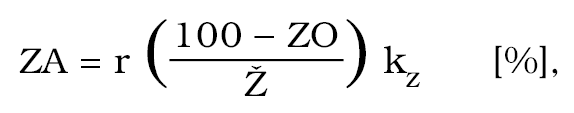
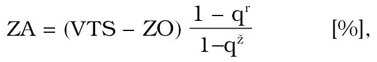
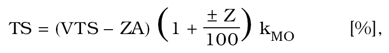
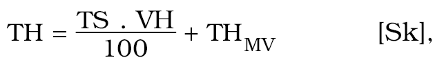

Príloha č. 4 k vyhláške č. 86/2002 Z. z.

- POSTUP STANOVENIA VŠEOBECNEJ HODNOTY STROJOV, STROJOVÝCH ZARIADENÍ, DRÁHOVÝCH VOZIDIEL, PLAVIDIEL A LIETADIEL

- Znalec zatriedi posudzovanú zložku majetku podniku do príslušnej kategórie uvedenej v osobitných predpisoch.1) Zložkou majetku podniku sa pre túto prílohu rozumie stroj, strojové zariadenie, dráhové vozidlo, plavidlo a lietadlo.

- A. ZÁKLADNÉ POJMY A NÁZVOSLOVIE

- 1. Stroje a strojové zariadenia

- Stroje a strojové zariadenia sú stroje, strojové zariadenia, prístroje, súbory strojov, napríklad výrobné linky, pružné výrobné systémy a pod., ktoré majú samostatné technicko-ekonomické určenie a výrobcom, dovozcom či predajcom stanovené plnenie prevádzkovo-technických funkcií. Podľa ďalej uvedeného postupu sa môže stanoviť hodnota strojov a strojových zariadení uvedených v osobitných predpisoch.1) Tieto predpisy zároveň určujú rozsah oprávnenia na výkon znaleckej činnosti v odbore strojárstvo.

- 2. Dráhové vozidlá

- Dráhové vozidlá sú dopravné prostriedky, ktorých pohyb je viazaný na pozemnú dráhu. Dráhové vozidlá podľa druhu dráhy rozdeľujeme na železničné, električkové vozidlá a metro, trolejbusové, lanové a špeciálne vozidlá. Železničné koľajové vozidlá rozdeľujeme na hnacie vozidlá závislej a nezávislej trakcie a na hnané vozidlá osobné, nákladné a špeciálne. Podľa ďalej uvedeného postupu sa môže stanovovať hodnota dráhových vozidiel uvedených v príslušných predpisoch.2) Tieto predpisy zároveň určujú rozsah oprávnenia na výkon znaleckej činnosti v odbore doprava železničná.

- 3. Lietadlá

- Lietadlá sú zariadenia schopné pohybu v atmosfére následkom iných reakcií, ako sú reakcie vzduchu so zemským povrchom, čiastočne alebo úplne riaditeľné, ktoré sú spôsobilé lietať, bezpečne uskutočniť vzlet a pristátie a niesť na palube osoby a inú užitočnú záťaž. Znalec môže ohodnocovať lietadlá ľahšie ako vzduch s pohonom alebo bez pohonu (balóny, vzducholode) a ťažšie ako vzduch s pohonom alebo bez pohonu (klzáky, draky, letúne, rotorové lietadlá a krídelníky). Podľa ďalej uvedeného postupu môže stanovovať hodnotu lietadiel len znalec z odboru doprava letecká.

- 4. Plavidlá

- Plavidlá sú plávajúce telesá. Znalec môže ohodnocovať plte (zväzky plávajúcich telies), lode, technické plavidlá (s pohonom a bez pohonu), plávajúce zariadenia a športové a rekreačné plavidlá. Podľa ďalej uvedeného postupu môže stanovovať hodnotu plavidiel len znalec z odboru doprava lodná.

- 5. Členenie na skupiny

- Skupinou zložky majetku podniku sa rozumie funkčne, konštrukčne a montážne jednotný celok. Zložka majetku podniku sa spravidla ohodnocuje ako celok. V prípade, že niektorá skupina zložky majetku podniku má podstatne iný technický stav (lepší alebo horší ako celok), resp. jednotlivé skupiny zložky majetku podniku majú výrazne odlišnú životnosť, hodnotí sa zložka majetku podniku rozčlenená na skupiny. Metodika ohodnocovania skupín je rovnaká ako metodika ohodnocovania celku. O tom, či zložku majetku podniku pri ohodnocovaní treba alebo netreba členiť na skupiny, rozhoduje znalec.

- 6. Pomerný diel skupiny (PDS) [%]

- Je to percentuálne vyjadrenie podielu príslušnej skupiny z novej zložky majetku podniku ako celku bez mimoriadnej výbavy.

- 7. Štandardná výbava

- Štandardnou výbavou zložky majetku podniku sa rozumie výbava zahrnutá obvykle v tzv. základnej cene zložky majetku.

- 8. Mimoriadna výbava (MV)

- Mimoriadna výbava zložky majetku podniku je vybavenosť zložky majetku podniku nad rámec štandardne dodávanej výbavy výrobcom daného typu zložky majetku podniku stanovenej výrobcom, resp. dovozcom, autorizovaným distribútorom alebo predajcom, ktorej vstupná cena nie je zahrnutá do vstupnej ceny zložky majetku podniku. Pri určovaní hodnoty mimoriadnej výbavy znalec vychádza z údajov a katalógov výrobcov, z údajov a katalógov autorizovaných predajcov, prípadne z iných katalógov a zdrojov.

- 9. Predpokladaná životnosť (Ž) [roky, h]

- Je to predpokladaná technická životnosť zložky majetku podniku v rokoch (hodinách) stanovená na základe technických parametrov zložky majetku a jej normálneho používania za predpokladu vykonávania údržby a opráv podľa pokynov výrobcu alebo predajcu zložky majetku podniku. Ak má ohodnocovaná zložka majetku podniku (skupina) uvedenú životnosť v mesiacoch alebo v pracovných hodinách, v prípade potreby sa prepočíta na životnosť v rokoch (jeden mesiac je 1/12 roka = 0,083 roka, pri jednozmennej prevádzke jeden pracovný deň má 8 pracovných hodín a jeden pracovný rok má 250 pracovných dní, pri trvalej prevádzke má pracovný deň 24 hodín, rok má 365 dní). Ak existuje osobitný predpis,1) znalec pre ohodnocovanú zložku majetku podniku stanoví životnosť v súlade s osobitným predpisom.

- 10. Doba prevádzky (r) [mesiace, roky]

- Doba prevádzky je vek zložky majetku podniku (skupiny) uvedený v mesiacoch alebo rokoch od dátumu jej prvého uvedenia do prevádzky, prípadne od jej uvedenia do prevádzky po vykonaní celkovej alebo generálnej opravy, rekonštrukcie alebo modernizácie po dátum ohodnotenia. Pri stanovovaní doby prevádzky zložky majetku podniku znalec postupuje v súlade s osobitnými predpismi.1) Ak mala zložka majetku podniku od dátumu zaradenia do prevádzky z rôznych dôvodov prerušenú prevádzku, musí to znalec do posudku uviesť a dokladovať. Ak ide o zložku majetku podniku (skupiny), pri ktorej nemožno zistiť presný dátum prvého uvedenia zložky majetku podniku do prevádzky, môže ju znalec stanoviť od dátumu výroby zložky majetku podniku alebo ak nemožno zistiť dátum výroby, tak odborným odhadom.

- 11. Koeficient zmennosti (KZ) [-]

- Koeficient zmennosti sa určuje podľa režimu práce len pre zložky majetku podniku: stroje a strojové zariadenia podľa osobitných predpisov.1)

- 12. Zostatkové percento prevádzkyschopnosti (ZO) [%]

- Je to zostatkové percento prevádzkyschopnosti zložky majetku podniku, ktoré zostáva po skončení predpokladanej životnosti zložky majetku podniku. Číselná hodnota ZO sa stanoví podľa osobitných predpisov.1)

- 13. Základná amortizácia za dobu prevádzky (ZA) [%]

- Je percentuálnou mierou fyzického opotrebovania zložky majetku podniku počas jej skutočnej prevádzky. Podklady na výpočet základnej amortizácie znalec stanoví v súlade s osobitnými predpismi.1)

- 14. Východiskový technický stav (VTS) [%]

- Je to technický stav novej zložky majetku podniku, prípadne zložky majetku podniku po celkovej alebo generálnej oprave, modernizácii alebo rekonštrukcii vo vzťahu k novej zložke majetku podniku. Vyjadruje sa v percentách. Ak sa na zložke majetku podniku (skupine) nevykonala celková alebo generálna oprava, rekonštrukcia alebo modernizácia, jej východiskový technický stav sa rovná 100 %. Ak na zložke majetku sa vykonala celková alebo generálna oprava, rekonštrukcia alebo modernizácia, jej východiskový technický stav sa stanoví podľa osobitných predpisov.1)

- 15. Zmena technického stavu (Z) [%]

- Zmena technického stavu vyjadruje zmenu technického stavu zložky majetku podniku (lepší alebo horší technický stav), ako je predpokladaný stav daný základnou amortizáciou zložky majetku podniku. Hodnota Z rovnajúca sa 0 % znamená, že skutočný technický stav zložky majetku podniku je totožný s predpokladaným stavom daným základnou amortizáciou zložky majetku podniku.

- Zrážkou (-Z) alebo prirážkou (+Z) sa zohľadňuje charakter prevádzky zložky majetku podniku, kvalita jej údržby, vyskytujúce sa chyby, poškodenia a pod. Zrážka alebo prirážka môže vyjadrovať aj kvalitu vykonaných opráv, poškodenie skupín, ktoré nie je spôsobené normálnym opotrebovaním, prípadne zvýšené opotrebenia na začiatku prevádzky zložky majetku podniku. Zrážka Z sa uplatňuje aj za prevádzku zložky majetku podniku po predpokladanej životnosti, resp. zmena technického stavu spôsobená inými objektívnymi príčinami.

- 16. Skutočný technický stav (TS) [%]

- Je to taký technický stav zložky majetku podniku, ktorý predstavuje jej reálny zostatkový technický stav k dátumu ohodnocovania.

- 17. Porovnateľná hodnota (PH) [Sk]

- V prípade, ak nemožno zistiť vstupnú cenu ohodnocovanej zložky majetku podniku, stanoví sa porovnateľná hodnota ohodnocovanej zložky majetku podniku ako obstarávacia cena novej zložky majetku podniku porovnateľnej výkonom a úžitkovosťou pre rok výroby (obstarania) ohodnocovanej zložky majetku podniku. Typ porovnateľnej zložky majetku podniku a jej presnú špecifikáciu spolu so spôsobom určenia jej ceny uvedie znalec v posudku. V prípade zložky majetku podniku s veľkou hodnotou obstarávacej ceny a v prípade, že sa porovnateľná zložka majetku podniku presne nezhoduje s ohodnocovanou zložkou majetku podniku, môže znalec porovnateľnú hodnotu stanoviť aj na základe porovnania obstarávacích cien viacerých zložiek majetku podniku. Porovnateľnú hodnotu možno stanoviť aj pomocou rozpočtovej ceny na mernú jednotku alebo iných hodnoverných metód.

- Porovnateľná hodnota sa vzťahuje aj na zložku majetku podniku zhotovenú vlastnou činnosťou, prípadne aj na zložku majetku podniku, na ktorú majiteľ podniku nemá cenovú kalkuláciu.

- 18. Východisková hodnota (VH) [Sk]

- Východisková hodnota zložky majetku podniku sa používa na výpočet technickej hodnoty zložky majetku podniku TH a všeobecnej hodnoty zložky majetku podniku VŠH.

- 19. Technická hodnota zložky majetku podniku (TH) [Sk]

- Je to zvyšok technickej životnosti zložky majetku podniku vyjadrený v slovenských korunách k dátumu jej ohodnocovania.

- 20. Technická hodnota mimoriadnej výbavy (THMV) [Sk]

- Je to hodnota zvyšujúca technickú hodnotu zložky majetku podniku o hodnotu jeho mimoriadnej výbavy k dátumu jej ohodnocovania.

- 21. Koeficient predajnosti zložky majetku podniku (kP) [-]

- Predstavuje vo všeobecnosti pomer medzi spriemerovanými skutočne dosahovanými predajnými cenami a technickou hodnotou TH určitej, resp. porovnateľnej zložky majetku podniku v danom čase a mieste jej ohodnocovania. Pri stanovovaní koeficientu predajnosti znalec postupuje podľa osobitného predpisu platného k rozhodnému dátumu a postup náležite zdôvodní.

- 22. Všeobecná hodnota (VŠH) [Sk]

- Všeobecná hodnota zložky majetku podniku je hodnota zložky majetku podniku v danom mieste a čase, pri ktorej stanovení sú okrem vplyvu opotrebovania zahrnuté aj vplyvy trhu (predajnosť typu zložky majetku podniku). Vyjadruje hodnotu zložky majetku podniku pri jej predaji obvyklým spôsobom na voľnom trhu k rozhodnému dátumu. Znalec v znaleckom posudku vždy uvedie, či vypočítaná všeobecná hodnota zložky majetku je vrátane dane z pridanej hodnoty, alebo bez dane z pridanej hodnoty.

- B. POSTUP PRI VÝPOČTE HODNOTY

- Všeobecná hodnota sa vypočíta týmto postupom:

- 1. Východisková hodnota (VH)

- Znalec východiskovú hodnotu stanoví buď ako obstarávaciu cenu zložky majetku pre dátum ohodnocovania zložky, alebo ako objektivizovanú cenu z pôvodnej obstarávacej ceny zložky majetku, pričom znalec zdôvodní postup tejto objektivizácie.

- 2. Základná amortizácia (ZA)

- 2.1. Vzťahy pre výpočet základnej amortizácie pre stroje, dráhové vozidlá a plavidlá:

- a) pre r ≤ Ž:

- 

- b) pre r > Ž:

- ZA = VTS - ZO [%],

- kde

- r - počet odpracovaných rokov [roky],

- Ž - predpokladaná životnosť stroja, dráhového vozidla, plavidla [roky],

- ZO - zostatkové percento prevádzkyschopného stroja, dráhového vozidla, plavidla po skončení predpokladanej životnosti Ž [%],

- kz - koeficient zmennosti stroja [-],

- VTS - východiskový technický stav stroja, dráhového vozidla, plavidla [%].

- 2.2. Vzťahy pre výpočet ZA pre lietadlá:

- a) pre r ≤ Ž:

- 

- b) pre r > Ž:

- ZA = VTS - ZO [%],

- kde

- VTS - východiskový technický stav lietadla [%],

- ZO - zostatkové percento prevádzkyschopnosti lietadla po skončení predpokladanej životnosti [%],

- q - podiel odpisov základnej amortizácie dva po sebe nasledujúce roky zohľadňujúci morálne opotrebenie lietadla (platí: 0 < q < 1),

- Ž - predpokladaná doba životnosti [roky],

- r - počet odpracovaných rokov [roky].

- 3. Výpočet technického stavu (TS)

- Technický stav sa vypočíta podľa vzťahu

- 

- kde

- VTS - východiskový technický stav stroja, strojového zariadenia, dráhového vozidla, plavidla, lietadla [%],

- ZA - základná amortizácia stroja, strojového zariadenia, dráhového vozidla, plavidla, lietadla [%],

- Z - zmena technického stavu stroja, strojového zariadenia, dráhového vozidla, plavidla, lietadla [%],

- kMO - koeficient morálneho opotrebenia stroja, strojového zariadenia, dráhového vozidla, plavidla, lietadla [-].

- 4. Výpočet technickej hodnoty stroja, strojového zariadenia, dráhového vozidla, plavidla, lietadla (TH)

- Technická hodnota sa vypočíta podľa vzťahu

- 

- kde

- VH - východisková hodnota [Sk],

- TS - technický stav [%],

- THMV- technická hodnota mimoriadnej výbavy [Sk].

- 5. Výpočet všeobecnej hodnoty (VŠH)

- Všeobecná hodnota stroja, strojového zariadenia, dráhového vozidla, plavidla a lietadla sa vypočíta podľa vzťahu

- VŠH = TH . kP[Sk],

- kde

- TH - technická hodnota stroja, strojového zariadenia, dráhového vozidla, plavidla, lietadla [Sk],

- kP- koeficient predajnosti [-].

- Koeficient predajnosti predstavuje vo všeobecnosti pomer medzi spriemerovanými skutočne dosiahnutými cenami a technickými hodnotami určitého, resp. porovnateľného typu stroja, strojového zariadenia, dráhového vozidla, plavidla alebo lietadla.

- Koeficient predajnosti stanoví znalec takto:

- kP = kPT. kPS. kPD . kPL . kPI [-],

- kde

- kPT - koeficient neúplnosti alebo neplatnosti dokumentácie potrebnej na prevádzku,

- kPS- koeficient zohľadňujúci dostupnosť náhradných dielov a servisných služieb na opravy a údržbu,

- kPD - koeficient dopytu po ohodnocovanom stroji, strojovom zariadení, dráhovom vozidle, plavidle alebo lietadle na trhu,

- kPL - koeficient sa použije pri stanovení všeobecnej hodnoty linky alebo technologického celku pozostávajúceho z viacerých strojov alebo aj jednotlivého stroja a zohľadňuje zníženie všeobecnej hodnoty technologického celku alebo stroja v dôsledku zásahu do celku, napríklad nutnosťou jeho demontáže alebo vyčlenením niektorého stroja z technologického celku, vyčlenením skupiny strojov a pod.; pri stanovení koeficientu predajnosti dráhových vozidiel, plavidiel a lietadiel sa tento koeficient rovná 1,0,

- kPI - koeficient ostatných vplyvov, napríklad stroj v záručnej lehote, počet predchádzajúcich užívateľov (neznámy spôsob údržby a exploatácie, nevhodná lokalizácia, vysoké náklady na demontáž, stroj po havárii, nevhodné klimatické podmienky a pod.).
