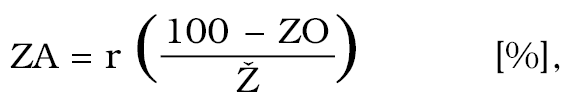
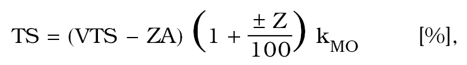
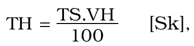

Príloha č. 5 k vyhláške č. 86/2002 Z. z.

- POSTUP STANOVENIA VŠEOBECNEJ HODNOTY ELEKTROTECHNICKÝCH ZARIADENÍ

- Znalec zatriedi posudzovanú zložku majetku podniku do príslušnej kategórie uvedenej v osobitných predpisoch.1)

- A. ZÁKLADNÉ POJMY A NÁZVOSLOVIE

- 1. Elektrotechnické zariadenia

- Elektrotechnické zariadenia sú zariadenia na výrobu, rozvod, premenu a prenos elektrickej energie; zariadenia, ktoré využívajú elektrickú energiu na prenos, spracovanie, záznam a reprodukciu informácií; zariadenia, ktoré využívajú elektrickú energiu na meracie a riadiace účely; zariadenia, ktoré využívajú elektrickú energiu na iné účely, a vyhradené elektrické zariadenia uvedené v osobitných predpisoch.1) Tieto zariadenia majú samostatné technicko-ekonomické podmienky prevádzky.

- Podľa ďalej uvedeného postupu sa môže stanoviť hodnota elektrotechnických zariadení uvedených v osobitných predpisoch.2) Tieto predpisy zároveň určujú rozsah oprávnenia na výkon znaleckej činnosti v odboroch elektrotechnika.

- 2. Predpokladaná životnosť (Ž) [roky]

- Je to predpokladaná technická životnosť elektrotechnického zariadenia v rokoch stanovená na základe jeho technických parametrov a jeho normálneho používania za predpokladu vykonávania údržby a opráv podľa pokynov výrobcu alebo predajcu. Ak má ohodnocované elektrotechnické zariadenie uvedenú životnosť v mesiacoch, v prípade potreby sa prepočíta na životnosť v rokoch (jeden mesiac je 1/12 roka = 0,083 roka). Ak existuje osobitný predpis,2) znalec pre ohodnocované elektrotechnické zariadenie stanoví životnosť v súlade s osobitným predpisom.

- 3. Doba prevádzky (r) [mesiace, roky]

- Doba prevádzky je vek elektrotechnického zariadenia uvedený v mesiacoch alebo rokoch od dátumu jeho prvého uvedenia do prevádzky, prípadne od jeho uvedenia do prevádzky po vykonaní celkovej alebo generálnej opravy, rekonštrukcie alebo modernizácie po dátum ohodnotenia. Pri stanovovaní doby prevádzky elektrotechnického zariadenia znalec postupuje v súlade s osobitnými predpismi.2) Ak malo elektrotechnické zariadenie od dátumu zaradenia do prevádzky z rôznych dôvodov prerušenú prevádzku, musí to znalec do posudku uviesť a dokladovať. Ak ide o elektrotechnické zariadenie, pri ktorom nemožno zistiť presný dátum prvého uvedenia do prevádzky, môže ju znalec stanoviť od dátumu výroby elektrotechnického zariadenia, alebo ak nemožno zistiť dátum výroby, tak odborným odhadom.

- 4. Zostatkové percento prevádzkyschopnosti (ZO) [%]

- Je to zostatkové percento prevádzkyschopnosti elektrotechnického zariadenia, ktoré zostáva po skončení predpokladanej životnosti. Číselná hodnota zostatkového percenta prevádzkyschopnosti sa stanoví podľa osobitných predpisov.2)

- 5. Základná amortizácia za dobu prevádzky (ZA) [%]

- Je percentuálnou mierou fyzického opotrebovania elektrotechnického zariadenia počas jeho skutočnej prevádzky. Podklady na výpočet základnej amortizácie počas prevádzky znalec stanoví v súlade s osobitnými predpismi.2)

- 6. Východiskový technický stav (VTS) [%]

- Je to technický stav nového elektrotechnického zariadenia, prípadne elektrotechnického zariadenia po celkovej alebo generálnej oprave, modernizácii alebo rekonštrukcii vo vzťahu k novému elektrotechnickému zariadeniu. Vyjadruje sa v percentách. Ak na elektrotechnickom zariadení nebola vykonaná celková alebo generálna oprava, rekonštrukcia alebo modernizácia, tak sa jeho východiskový technický stav rovná 100 %. Ak na elektrotechnickom zariadení bola vykonaná celková alebo generálna oprava, rekonštrukcia alebo modernizácia, jeho východiskový technický stav sa stanoví podľa osobitných predpisov.2)

- 7. Zmena technického stavu (Z) [%]

- Zmena technického stavu vyjadruje zmenu technického stavu elektrotechnického zariadenia (lepší alebo horší technický stav), ako je predpokladaný stav daný základnou amortizáciou elektrotechnického zariadenia. Hodnota zmeny technického stavu rovnajúca sa 0 % znamená, že skutočný technický stav elektrotechnického zariadenia je totožný s predpokladaným stavom daným amortizáciou elektrotechnického zariadenia.

- Zrážkou (-Z) alebo prirážkou (+Z) sa zohľadňuje charakter prevádzky elektrotechnického zariadenia, kvalita jeho údržby, vyskytujúce sa chyby, poškodenia a podobne. Zrážka alebo prirážka môže vyjadrovať aj kvalitu vykonaných opráv, poškodenie skupín, ktoré nie je spôsobené normálnym opotrebovaním elektrotechnického zariadenia. Zrážka (-Z) sa uplatňuje aj za prevádzku elektrotechnického zariadenia po predpokladanej životnosti, resp. zmenu technického stavu spôsobenú inými objektívnymi príčinami.

- 8. Technický stav (TS) [%]

- Je to taký technický stav elektrotechnického zariadenia, ktorý predstavuje jeho reálny technický stav k dátumu ohodnocovania.

- 9. Porovnateľná hodnota (PH) [Sk]

- V prípade, ak nie je možné zistiť vstupnú cenu ohodnocovaného elektrotechnického zariadenia, stanoví sa porovnateľná hodnota ohodnocovaného elektrotechnického zariadenia ako obstarávacia cena nového elektrotechnického zariadenia porovnateľného úžitkovými vlastnosťami v roku výroby (obstarania) ohodnocovaného elektrotechnického zariadenia. Typ porovnateľného elektrotechnického zariadenia a jeho presnú špecifikáciu spolu so spôsobom určenia jeho ceny uvedie znalec v posudku.

- Porovnateľná hodnota sa vzťahuje aj na elektrotechnické zariadenie zhotovené vlastnou činnosťou, prípadne aj na elektrotechnické zariadenie, na ktoré majiteľ nemá cenovú kalkuláciu.

- 10. Východisková hodnota (VH) [Sk]

- Východisková hodnota zložky majetku podniku sa používa na výpočet technickej hodnoty zložky majetku podniku TH a všeobecnej hodnoty zložky majetku podniku VŠH.

- 11. Technická hodnota (TH) [Sk]

- Je to zvyšok technickej životnosti zložky majetku podniku vyjadrený v slovenských korunách k dátumu jej ohodnocovania.

- 12. Koeficient predajnosti (kP) [-]

- Koeficient predajnosti predstavuje vo všeobecnosti pomer medzi spriemerovanými, skutočne dosahovanými predajnými cenami a technickou hodnotou určitého, resp. porovnateľného elektrotechnického zariadenia v danom čase a mieste jeho ohodnocovania. Pri stanovovaní koeficientu predajnosti znalec postupuje podľa osobitného predpisu platného k rozhodnému dátumu a postup náležite zdôvodní.

- 13. Všeobecná hodnota (VŠH) [Sk]

- Všeobecná hodnota elektrotechnického zariadenia je jeho hodnota v danom mieste a čase, pri ktorej stanovení sú okrem vplyvu opotrebovania zahrnuté aj vplyvy trhu (predajnosť typu elektrotechnického zariadenia). Vyjadruje hodnotu elektrotechnického zariadenia pri jeho predaji obvyklým spôsobom na voľnom trhu k rozhodnému dátumu. Znalec v znaleckom posudku vždy uvedie, či vypočítaná všeobecná hodnota zložky majetku je vrátane dane z pridanej hodnoty alebo bez dane z pridanej hodnoty.

- B. POSTUP PRI VÝPOČTE HODNOTY

- Všeobecná hodnota sa vypočíta týmto postupom:

- 1. Východisková hodnota (VH)

- Znalec východiskovú hodnotu elektrotechnického zariadenia VH stanoví ako obstarávaciu cenu elektrotechnického zariadenia k dátumu ohodnocovania elektrotechnického zariadenia alebo ako objektivizovanú cenu z pôvodnej obstarávacej ceny elektrotechnického zariadenia, pričom znalec zdôvodní postup tejto objektivizácie.

- 2. Základná amortizácia [ZA]

- a) pre r ≤ Ž

- 

- b) pre r > Ž

- ZA = VTS - ZO [%],

- kde

- r - počet odpracovaných rokov [roky],

- Ž - predpokladaná životnosť elektrotechnického zariadenia [roky],

- ZO - zostatkové percento prevádzkyschopnosti elektrotechnického zariadenia po skončení predpokladanej životnosti [%],

- VTS - východiskový technický stav elektrotechnického zariadenia [%].

- 3. Výpočet technického stavu (TS)

- Technický stav sa vypočíta podľa vzťahu

- 

- kde

- VTS - východiskový technický stav elektrotechnického zariadenia [%],

- ZA - základná amortizácia elektrotechnického zariadenia [%],

- Z - zmena technického stavu elektrotechnického zariadenia [%],

- kMO - koeficient morálneho opotrebenia [-].

- 4. Výpočet technickej hodnoty elektrotechnického zariadenia (TH)

- Technická hodnota sa vypočíta podľa vzťahu

- 

- kde

- VH - východisková hodnota elektrotechnického zariadenia [Sk],

- TS - technický stav elektrotechnického zariadenia [%].

- 5. Výpočet všeobecnej hodnoty (VŠH)

- Všeobecná hodnota elektrotechnického zariadenia sa vypočíta podľa vzťahu

- VŠH = TH . kP[Sk],

- kde

- TH - technická hodnota elektrotechnického zariadenia [Sk],

- kp - koeficient predajnosti [-].

- Koeficient predajnosti sa vypočíta podľa vzťahu

- kP = kPT. kPS . kPD . kPL . kPI [-],

- kde

- kPT- koeficient zohľadňujúci neúplnosť alebo neplatnosť dokumentácie potrebnej na prevádzku elektrotechnického zariadenia a pod.,

- kPS- koeficient zohľadňujúci dostupnosť náhradných dielcov a servisných služieb na opravy a údržbu elektrotechnického zariadenia,

- kPD - koeficient dopytu po ohodnocovanom elektrotechnickom zariadení na trhu,

- kPL - koeficient sa použije pri stanovení všeobecnej hodnoty linky alebo technologického celku pozostávajúceho z viacerých elektrotechnických zariadení alebo aj jednotlivého elektrotechnického zariadenia a zohľadňuje zníženie všeobecnej hodnoty technologického celku alebo elektrotechnického zariadenia v dôsledku zásahu do celku, napríklad nutnosťou jeho demontáže alebo vyčlenením niektorého elektrotechnického zariadenia z technologického celku,

- kPI- koeficient ostatných vplyvov, napríklad elektrotechnické zariadenie v záručnej lehote, počet predchádzajúcich užívateľov (neznámy spôsob údržby a exploatácie elektrotechnického zariadenia, elektrotechnické zariadenie po havárii a pod.).
