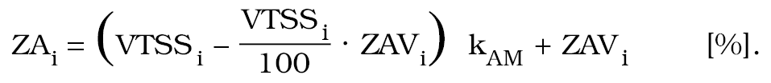
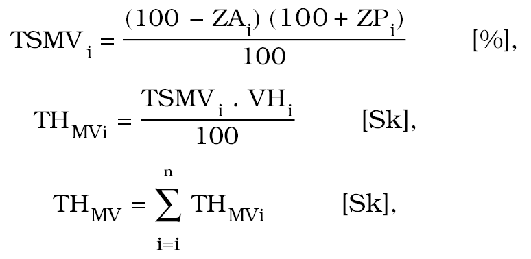
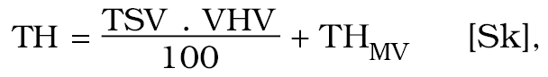

Príloha č. 6 k vyhláške č. 86/2002 Z. z.

- POSTUP PRI VÝPOČTE VŠEOBECNEJ HODNOTY CESTNÝCH VOZIDIEL

- A. ZÁKLADNÉ POJMY A NÁZVOSLOVIE

- 1. Cestné vozidlo

- Cestné vozidlo (ďalej len „vozidlo“) je motorové vozidlo, nemotorové vozidlo, prípojné vozidlo, zvláštne motorové alebo nemotorové vozidlo (pojazdný stroj) a ostatné vozidlá. Podľa § 2 vyhlášky Ministerstva dopravy, pôšt a telekomunikácií Slovenskej republiky č. 116/1997 Z. z.1) (ďalej len „vyhláška“) sú to vozidlá zaradené do kategórií L, M, N, O, R, S a T. Na účely tejto vyhlášky zaradí znalec vozidlo do kategórie podľa osobitného predpisu.2)

- 2. Základné časti vozidla - technická skupina

- Technickou skupinou (ďalej len „skupina“) sa na účely stanovenia hodnoty vozidla rozumie funkčne, konštrukčne a montážne jednotný celok. Rozdelenie vozidla na skupiny pre potreby ohodnocovania závisí od jeho technickej koncepcie.

- 3. Mimoriadna výbava vozidla

- Mimoriadna výbava vozidla je vybavenosť vozidla nad rámec štandardne dodávanej výbavy výrobcom daného typu vozidla. Štandardnou výbavou vozidla sa rozumie výbava zahrnutá obvykle v tzv. základnej cene vozidla.

- Pri určovaní mimoriadnej výbavy znalec vychádza z údajov a katalógov výrobcov, z údajov a katalógov autorizovaných predajcov, prípadne z iných katalógov a zdrojov.

- 4. Doba prevádzky (T) [mesiace]

- Doba prevádzky je vek vozidla (skupiny) uvedený v mesiacoch od dátumu jeho (jej) prvého uvedenia do prevádzky, prípadne od uvedenia do prevádzky po vykonaní celkovej alebo generálnej opravy po dátum ohodnotenia. Ak vozidlo nebolo uvedené do prevádzky v tom istom roku, ako je jeho rok výroby (okrem vozidiel modelového radu o rok vyššieho, ako je ich rok výroby), uvažuje sa doba prevádzky od 1. januára roku nasledujúceho po roku výroby.

- Ak ide o vozidlá (skupiny), pri ktorých nemožno zistiť presný dátum prvého uvedenia do prevádzky, tento znalcom stanovený dátum je 1. júl v roku výroby vozidla (skupiny). Obdobne znalec postupuje pri stanovení doby prevádzky dielov mimoriadnej výbavy, prípadne jednotlivých súčiastok.

- 5. Predpokladaný ročný jazdný výkon (PKV) [km/rok]

- Predpokladaný ročný jazdný výkon vyjadruje priebeh predpokladaného ročného jazdného výkonu určených kategórií vozidiel za ich predpokladanú dobu prevádzky. Znalec stanoví predpokladaný ročný jazdný výkon na základe zaradenia vozidla do príslušnej kategórie.2)

- 6. Predpokladaný počet najazdených kilometrov (PRKM) [km]

- Predpokladaný počet najazdených kilometrov vyjadruje predpokladaný počet najazdených kilometrov určených kategórií vozidiel za ich skutočnú dobu prevádzky. Je daný dvanástinou súčinu predpokladaného ročného jazdného výkonu (PKV) s dobou prevádzky vozidla (T).

- 7. Počet skutočne najazdených kilometrov (PSKM) [km]

- Počet skutočne najazdených kilometrov určuje počet skutočne najazdených kilometrov vozidla od jeho prvého uvedenia do prevádzky, prípadne od uvedenia do prevádzky po vykonaní generálnej opravy po dátum ohodnotenia.

- Pri určovaní počtu skutočne najazdených kilometrov skupiny sa uvažuje jazdný výkon od jej prvého uvedenia do prevádzky alebo od jej uvedenia do prevádzky po vykonaní celkovej opravy.

- 8. Rozdiel v počte najazdených kilometrov (RKM) [km]

- Je to rozdiel medzi počtom skutočne najazdených kilometrov (PSKM) a predpokladaným počtom najazdených kilometrov (PRKM).

- 9. Koeficient najazdených kilometrov (kKM) [%]

- Koeficient najazdených kilometrov vyjadruje amortizáciu vozidla vzhľadom na predpokladaný počet najazdených kilometrov.

- 10. Koeficient amortizácie za skutočne najazdené kilometre (kAM) [%]

- Koeficient amortizácie za skutočne najazdené kilometre vyjadruje vplyv skutočne najazdených kilometrov na celkovú základnú amortizáciu vozidla. Rovná sa desaťtisícine súčinu rozdielu medzi počtami najazdených kilometrov (RKM) s koeficientom najazdených kilometrov (kKM).

- 11. Základná amortizácia za dobu prevádzky vozidla (skupiny) (ZAV) [%]

- Je to amortizácia, ktorá vyjadruje predpokladaný pokles technickej hodnoty vozidla (skupiny) za dobu jeho (jej) prevádzky. Určuje sa pomocou amortizačných stupníc určených pre jednotlivé kategórie vozidiel.

- 12. Celková základná amortizácia vozidla (ZA) [%]

- Celková základná amortizácia vozidla vyjadruje opotrebenie, ktoré sa rovná priemernému opotrebeniu porovnateľného (etalónového) vozidla rovnakého veku, rovnakej doby prevádzky a rovnakého počtu najazdených kilometrov pri priemernej primeranej údržbe. Keďže každá kategória vozidiel zahŕňa pomerne veľký a rozmanitý súbor typov vozidiel, pri stanovení priebehu celkových základných amortizácií sa musí pri každej kategórii vozidiel zohľadniť priemerná amortizácia.

- Celková základná amortizácia vozidla pri kategóriách vozidiel s predpísaným predpokladaným počtom najazdených kilometrov (PRKM) je súčtom základnej amortizácie za dobu prevádzky vozidla (ZAV) a vzťahu určujúceho zvýšenie, prípadne zníženie celkovej základnej amortizácie za počet skutočne najazdených kilometrov.

- 13. Východisková hodnota vozidla (VHV) [Sk]

- Východisková hodnota vozidla sa používa na výpočet technickej hodnoty vozidla (THV) vyjadrenej v slovenských korunách, všeobecnej hodnoty vozidla (VŠH) a na výpočet reprodukčnej obstarávacej hodnoty vozidla (ROH).

- 14. Východiskový technický stav skupiny (VTSS) [%]

- Je to technický stav skupiny vyjadrený v percentách v čase jej uvedenia do prevádzky, ktorý udáva jej technický stav v porovnaní s novou skupinou.

- Skupina sa začína amortizovať od prvého uvedenia do prevádzky. Ak na skupine nebola vykonaná celková oprava, tak sa východiskový technický stav rovná 100 %.

- Hodnoty východiskových technických stavov jednotlivých skupín po vykonaní celkovej opravy je potrebné určiť v zmysle preskúmateľnej, resp. platnej metodiky.

- 15. Zrážka, prirážka za technický stav (ZP) [± %]

- Zrážka, prirážka za technický stav vyjadruje lepší alebo horší technický stav skupiny, dielu mimoriadnej výbavy, príp. vozidla ako celku, než je predpokladaný stav daný základnou amortizáciou skupiny, dielu mimoriadnej výbavy, príp. vozidla.

- 16. Technický stav skupiny (TSS) [%]

- Je to zvyšok technickej životnosti skupiny v porovnaní s novou skupinou vyjadrený v percentách.

- 17. Pomerný diel skupiny (PDS) [%]

- Je to percentuálne vyjadrenie podielu príslušnej skupiny na novom vozidle ako celku bez mimoriadnej výbavy.

- 18. Pomerný technický stav skupiny (PTSS) [%]

- Je to pomerný diel, ktorý predstavuje konkrétny technický stav skupiny z technického stavu vozidla.

- 19. Technický stav vozidla (TSV) [%]

- Je to zvyšok technickej životnosti vozidla vyjadrený v percentách. Určuje ho súčet pomerných technických stavov (PTSS) jednotlivých skupín vozidla.

- 20. Technická hodnota vozidla (TH) [Sk]

- Je to zvyšok technickej životnosti vozidla vyjadrený v Sk.

- 21. Technická hodnota mimoriadnej výbavy (THMV) [Sk]

- Je to hodnota zvyšujúca technickú hodnotu vozidla o hodnotu jeho mimoriadnej výbavy.

- 22. Koeficient predajnosti vozidla (kP) [-]

- Koeficient predajnosti vozidla vyjadruje predajnosť hodnoteného vozidla k rozhodnému dátumu.

- 23. Všeobecná hodnota vozidla (VŠH) [Sk]

- Všeobecná hodnota vozidla je hodnota vozidla v danom mieste a čase, pri ktorej stanovení sú okrem vplyvu opotrebenia zahrnuté aj vplyvy trhu (predajnosť typu vozidla). Vyjadruje hodnotu vozidla pri jeho predaji obvyklým spôsobom na voľnom trhu k rozhodnému dátumu. Znalec v znaleckom posudku vždy uvedie, či vypočítaná všeobecná hodnota vozidla je vrátane dane z pridanej hodnoty, alebo bez dane z pridanej hodnoty.

- 24. Reprodukčná obstarávacia hodnota vozidla (ROH) [Sk]

- Reprodukčná obstarávacia hodnota vozidla (ROH) je hodnota vozidla v slovenských korunách, ktorú treba uhradiť pri obstaraní porovnateľného vozidla obvyklým spôsobom na voľnom trhu v rozhodnej dobe vrátane primeraných a obvyklých nákladov na jeho zaobstaranie.

- B. POSTUP PRI VÝPOČTE VŠEOBECNEJ HODNOTY CESTNÝCH VOZIDIEL

- 1. Určenie východiskovej hodnoty vozidla (VHV)

- Východiskovú hodnotu vozidla znalec určí podľa predpísaného postupu, pričom vždy uvedie, či ide o hodnotu s daňou z pridanej hodnoty, alebo bez dane z pridanej hodnoty.

- Metodiku určenia, resp. výpočtu východiskových hodnôt vozidiel predpisujú metodické pokyny.

- 2. Zatriedenie vozidla do kategórie

- Cestné vozidlá sa na účely určenia hodnoty rozdeľujú do kategórií podľa metodiky, ktorú určuje osobitný predpis platný k rozhodnému dátumu.

- 3. Výpočet základnej amortizácie vozidla (skupiny) [%]

- 

- Prípadne ak východiskový technický stav vozidla je 100 %, základná amortizácia sa vypočíta podľa zjednodušeného vzťahu

- ZA = (100 - ZAV).kAM + ZAV [%],

- kde

- ZA - základná amortizácia vozidla (skupiny) [%],

- VTSSi- východisková technická hodnota skupiny [Sk],

- ZAV - základná amortizácia za dobu prevádzky vozidla (skupiny) [%],

- kAM - koeficient amortizácie za skutočne najazdené kilometre, ktorý sa do výpočtu dosadzuje v desatinnom tvare [%/100].

- Pri vozidlách, pre ktoré platný znalecký štandard2) alebo metodický pokyn nepredpisuje výpočet koeficientu amortizácie za skutočne najazdedé kilometre, platí ZA = ZAV.

- 4. Určenie a výpočet technického stavu skupín (TSS) a technického stavu vozidla (TSV)

- Na výpočet technického stavu vozidla (TSV) slúži tabuľka výpočtu technickej hodnoty vozidla, ktorú predpisuje platný osobitný predpis k rozhodnému dátumu.

- 5. Určenie technickej hodnoty mimoriadnej výbavy (THMV)

- Mimoriadna výbava sa na účely výpočtu hodnoty vozidiel (HMV) rozdeľuje do dvoch základných skupín:

- a) mimoriadna výbava nenahrádzajúca pôvodné diely (skupiny) štandardne vybaveného vozidla, ale rozširujúca jeho technické, úžitkové, prípadne estetické vlastnosti,

- b) mimoriadna výbava nahrádzajúca pôvodné diely, prípadne skupiny štandardne vybaveného vozidla.

- Technická hodnota mimoriadnej výbavy sa vypočíta podľa týchto vzťahov:

- 

- kde

- TSMV - technický stav mimoriadnej výbavy [%],

- ZA - základná amortizácia mimoriadnej výbavy [%],

- VH - východisková hodnota mimoriadnej výbavy [Sk],

- THMV- technická hodnota mimoriadnej výbavy [Sk].

- 6. Výpočet technickej hodnoty (TH)

- Technická hodnota vyjadruje zvyšok technickej životnosti vozidla vyjadrený v slovenských korunách a nie sú v nej zahrnuté vplyvy zohľadňujúce trhové a ekonomické podmienky.

- Pri výpočte technickej hodnoty postupuje znalec podľa tohto vzťahu:

- 

- kde

- TSV - technický stav vozidla [%],

- VHV - východisková hodnota vozidla [Sk],

- THMV - technická hodnota mimoriadnej výbavy [Sk].

- 7. Určenie koeficientu predajnosti (kP)

- Pri výpočte koeficientu predajnosti znalec postupuje podľa osobitného predpisu platného k rozhodnému dátumu a postupy náležite zdôvodní.

- 8. Výpočet všeobecnej hodnoty vozidla (VŠH)

- Všeobecná hodnota vozidla je hodnota v slovenských korunách, ktorej výpočet zahŕňa okrem vplyvov opotrebenia aj vplyvy trhu (predajnosť typu vozidla).

- Vypočíta sa ako súčin technickej hodnoty vozidla (TH) s koeficientom predajnosti kP.

- VŠH = TH . kP [Sk],

- kde

- TH - technická hodnota [Sk],

- kP- koeficient predajnosti [-].

- 9. Výpočet reprodukčnej obstarávacej hodnoty vozidla (ROH)

- V prípade potreby vypočíta znalec aj reprodukčnú obstarávaciu hodnotu vozidla (ROH).

- Pri jej výpočte znalec vychádza z aktuálneho vývoja na trhu, aktuálnych ekonomických podmienok a právnych noriem.

- ROH = VŠH + ZN [Sk],

- kde

- VŠH - všeobecná hodnota vozidla [Sk],

- NZ - náklady na zaobstaranie, ktoré predstavujú bežné priemerné náklady potrebné na zaobstaranie podobného typu porovnateľného vozidla v danom regióne a v rozhodnom čase (napríklad obvyklá obchodná marža predajcu, náklady na prihlásenie vozidla do evidencie a pod.) [Sk].
