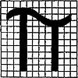

Príloha č. 6 k nariadeniu vlády č. 176/2003 Z. z.

- ZNAČKA ZHODY

  - Značka zhody π musí mať túto grafickú podobu:

- 

  - Ak sa značka zmenšuje alebo zväčšuje, musí sa rešpektovať mierka rozmerov na uvedenom obrázku.

  - Jednotlivé zložky značky musia mať rovnakú výšku, ktorá nesmie byť menšia ako 5 mm.

  - Tieto minimálne rozmery sa nemusia dodržať v prípade označovania zariadení s malými rozmermi.
