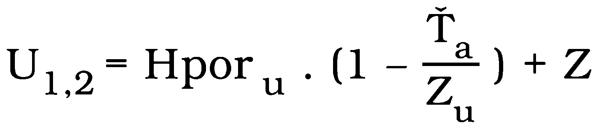
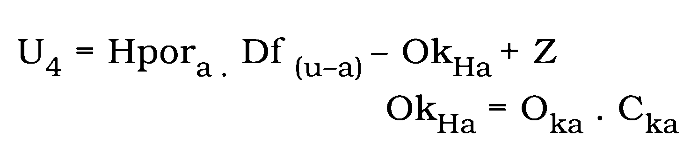

Príloha č. 2 k nariadeniu vlády č. 184/2003 Z. z.

- SPÔSOB VÝPOČTU NÁHRADY ZA OBMEDZENIE BEŽNÉHO OBHOSPODAROVANIA NA LESNOM POZEMKU

  - A. Náhrada za stratu výnosu z dreva - použije sa v územiach so zákazom ťažby dreva

    - U1,1 = Hporu . Df(u-a) + Z

    - Diskontácia Df(u-a) sa vykoná iba v prípade náhrady obmedzenia bežného obhospodarovania na lesných pozemkoch pred dosiahnutím veku rubnej doby bežného spôsobu obhospodarovania. V porastoch vo veku rubnej doby sa Df(u-a) = 1. V porastoch starších, ako je rubný vek, sa diskontácia uplatní iba v prípade, keď sa vychádza z hodnoty porastu v skutočnom veku (a).

    - 

  - B. Náhrada za zníženie výnosu z dreva

    - U2,1 = Hpora . (% Ťa,u - % Ťob) + Z

    - U2,2 = (PPpHa - PPzHa) . to + Z - použije sa v prípadoch zníženia výnosu z dreva v dôsledku účelovej zmeny zastúpenia drevín alebo zmeny (predĺženia) rubnej doby.

  - C. Náhrada za zvýšenie nákladov na bežné obhospodarovanie pozemku

    - U3 = (Ncp - Ncb) . Ťa (m3) + (Ncp - Ncb) . P (ha) + Z

    - Pri výpočte výšky náhrady za obmedzenia bežného obhospodarovania zo zvýšenia nákladov na pestovnú činnosť sa zohľadňujú iba náklady skutočne realizovaných výkonov pestovnej činnosti. Výška zvýšených nákladov pestovnej činnosti oproti nákladom pri bežnom obhospodarovaní sa odvodí spravidla zo skutočných prevádzkových pomerov subjektov obhospodarujúcich les, respektíve v prípade neexistovania takýchto podkladov pomocou priemerného koeficienta 1,6.

  - D. Náhrada v prípade mimoriadnych okolností prírodných a antropogénnych kalamít

    - 

    - Význam premenných (symbolov) vo vzorcoch

    - Un,m - vzorce výpočtu náhrady, n - druh obmedzenia bežného obhospodarovania, m - poradie vzorcov na výpočet daného druhu obmedzenia bežného obhospodarovania

    - to - doba obmedzenia obhospodarovania v rokoch

    - Hpor a,u - cena porastu v skutočnom veku (a) alebo vo veku rubnej doby (u) podľa vyhlášky Ministerstva financií Slovenskej republiky č. 465/1991 Zb. o cenách stavieb, pozemkov, trvalých porastov, úhradách za zriadenie práva osobného užívania pozemkov a náhradách za dočasné užívanie pozemkov v znení neskorších predpisov

    - Zu - zásoba dreva na pni v rubnej dobe (u)

    - %Ťa,u - ťažbové percento skutočne vykonaných predrubných a rubných ťažieb vo veku (a) alebo vo veku (u)

    - %Ťob - ťažbové percento obmedzených predrubných a rubných ťažieb

    - Ťa - skutočná ťažba predrubná a rubná v m3 vo veku (u)

    - PPpHa - priemerný prírastok hodnotový dreva na pni v Sk . m-3 alebo Sk . ha-1 v rubnej dobe potenciálneho zastúpenia drevín

    - PPzHa - priemerný prírastok ceny dreva na pni v Sk . m-3 alebo Sk . ha-1 v rubnej dobe zmeneného cieľového zastúpenia drevín alebo v zmenenej rubnej dobe

    - Ncp- celkové náklady požadovaného spôsobu obhospodarovania, a to v Sk . m-3 ťažby dreva alebo v Sk . ha-1 lesa v pestovnej činnosti

    - Ncb - celkové náklady bežného spôsobu obhospodarovania, a to v Sk.m-3 ťažby dreva alebo v Sk . ha-1 lesa v pestovnej činnosti

    - P(ha) - plocha lesa v ha (na štyri desatinné miesta)

    - OkHa - hodnota vyťaženej a realizovanej kalamitnej produkcie dreva v cenách dreva na pni

    - Oka - objem spracovaného a predaného kalamitného dreva v m3

    - Cka - priemerná trhová cena m3 kalamitného dreva na pni

    - Df(u-a) - diskontačný faktor, ktorým sa upravuje očakávaná hodnota vo veku (u) na skutočnú hodnotu vo veku (a) pri úrokovej miere p = 3 %

    - Z - náklady na vyhotovenie znaleckého posudku (v Sk)

    - V ťažbovej činnosti sa obmedzenie bežného obhospodarovania týka výkonov ťažby a sústreďovania dreva. Výška nákladov požadovaného obhospodarovania sa stanoví v konkrétnych podmienkach užívateľa lesov, respektíve v prípade nemožnosti ich získania použitím koeficientov v uvedenej tabuľke:

  - Ťažba dreva | | | | Sústreďovanie dreva | | |

  - Hospodársky spôsob | | | | | | |

  - Holorubný | | Podrastový | | Holorubný | | Podrastový |

  - Technológia | | | | | | |

  - T | L | T | L | T | L | T | L

  - 1 | 2 | 3 | 4 | 5 | 6 | 7 | 8

  - Koeficienty | | | | | | |

  - 1 | 1,2 | 1,4 | 1,6 | 1 | 1,3 | 1,5 | 1,6

  - stl. 1 x koef. 1 | stl. 1 x koef. 1,2 | stl. 1 x koef. 1,4 | stl. 3 x koef. 1,6 | stl. 5 x koef. 1 | stl. 5 x koef. 1,3 | stl. 1 x koef. 1,5 | stl. 7 x koef. 1,6

    - T - Traktorový terén

    - L - Lanovkový terén
