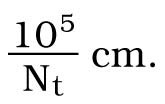
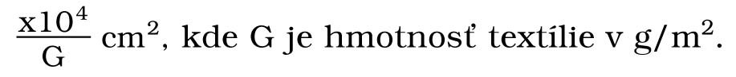

Príloha č. 2 k nariadeniu vlády č. 23/2003 Z. z.

- PRÍPRAVA LABORATÓRNYCH A SKÚŠOBNÝCH VZORIEK NA URČENIE OBSAHU VLÁKEN TEXTILNÝCH VÝROBKOV

  - 1. OBLASŤ POUŽITIA

    - Táto príloha ustanovuje postupy získavania laboratórnych vzoriek vhodnej veľkosti na predbežné spracovanie na účely kvantitatívnej analýzy (t. j. hmotnosť nepresahujúca 100 g zo vzoriek partií) a postupy odberu skúšobných vzoriek z laboratórnych vzoriek, ktoré boli predbežne spracované na účely odstránenia nevláknových látok.1)

  - 2. DEFINÍCIE

    - 2.1. Partia - množstvo materiálu, ktoré sa posudzuje na základe jednej série skúšobných výsledkov. Môže zahŕňať napríklad všetok materiál v jednej dodávke tkaniny, všetku tkaninu tkanú z jedného osnového návoja, zásielku priadze, balík alebo niekoľko balíkov surového vlákna.

    - 2.2. Vzorka partie - časť partie odobraná ako reprezentačná vzorka celku, ktorá je k dispozícii pre laboratórium. Veľkosť a povaha vzorky partie musia byť dostatočné vzhľadom na nerovnomernosť partie a zároveň musia umožňovať ľahkú manipuláciu v laboratóriu.2)

  - 3. PODSTATA

    - Laboratórna vzorka sa odoberie tak, aby reprezentovala vzorku partie. Veľkosť a objem laboratórnej vzorky musia byť dostatočné vzhľadom na nerovnomernosť vzorky partie.3)

    - Skúšobné vzorky sa odoberú z laboratórnej vzorky tak, aby každá z nich reprezentovala laboratórnu skúšobnú vzorku.

  - 4. ODBER VZORIEK VOĽNÝCH VLÁKEN

    - 4.1. Neorientované vlákna - laboratórna vzorka sa získa náhodným výberom chumáčikov zo vzorky partie. Celá laboratórna vzorka sa dokonale premieša pomocou laboratórneho mykacieho stroja.4) Rúno alebo zmes obsahujúca voľné vlákna a vlákna prilipnuté k zariadeniu použitému na zmiešavanie sa podrobí predbežnému spracovaniu. Potom sa z rúna alebo zo zmesi, z voľných vláken a z vláken prilipnutých k zariadeniu odoberú skúšobné vzorky zodpovedajúcej hmotnosti. Ak rúno z mykacieho stroja zostane po predbežnom spracovaní neporušené, skúšobné vzorky sa odoberú postupom opísaným v bode 4.2. Ak je rúno z mykacieho stroja predbežným spracovaním narušené, jednotlivé skúšobné vzorky sa pripravia náhodným odberom najmenej 16 malých chumáčikov zodpovedajúcej a približne rovnakej veľkosti, ktoré sa zlúčia.

    - 4.2. Orientované vlákna (česance, rúna, pramene, predpriadze) - z náhodne vybraných častí vzorky partie sa vystrihne najmenej 10 vzoriek tak, aby zahŕňali celý prierez, každá s hmotnosťou približne 1 g. Takto vytvorená laboratórna vzorka sa podrobí laboratórnemu spracovaniu. Jednotlivé odstrihnuté časti sa spoja tak, že sa položia vedľa seba a skúšobná vzorka sa odoberie z celého prierezu tak, že sa odoberie časť z každej z desiatich odstrihnutých častí.

  - 5. ODBER VZORIEK PRIADZE

    - 5.1. Priadza na cievkach alebo v pradenách - vzorky sa odoberú zo všetkých cievok vzorky partie. Odvinú sa vhodné rovnaké dĺžky z každej cievky buď navinutím do pradien s rovnakým počtom ovinov na navíjadle,5) alebo inými prostriedkami. Jednotlivé priadze sa uložia vedľa seba buď ako jedno pradeno, alebo ako káblik a vytvorí sa laboratórna vzorka s rovnakými dĺžkami priadze z každej cievky v pradene alebo v kábliku.

      - Laboratórna vzorka sa podrobí predbežnému spracovaniu.

      - Z laboratórnej vzorky sa odoberú skúšobné vzorky vystrihnutím zväzku nití rovnakej dĺžky z pradena alebo z káblika, pričom treba dbať na to, aby zväzok obsahoval všetky nite vo vzorke. Ak dĺžková hmotnosť priadze v texoch je t a počet cievok vo vzorke partie je N, potom na získanie skúšobnej vzorky s hmotnosťou 10 g dĺžka priadze, ktorú treba odvinúť z každej cievky, je

    - 

      - Ak je hodnota Nt vysoká, t. j. viac ako 2 000, navinie sa ťažšie pradeno a rozreže sa naprieč na dvoch miestach, aby sa vytvoril káblik vhodnej hmotnosti. Konce vzoriek vo forme káblika musia byť pred predbežným spracovaním pevne spojené a skúšobné vzorky sa odoberú z miesta vzdialeného od tohto spojenia.

    - 5.2. Priadza v osnove - laboratórna vzorka sa odoberie odstrihnutím časti z konca osnovy s dĺžkou najmenej 20 cm, zahŕňajúceho všetky priadze v osnove s výnimkou okrajových priadzí, ktoré sa vyradia. Zväzok priadzí sa na jednom konci zviaže. Ak je vzorka na predbežné spracovanie ako celok príliš veľká, rozdelí sa do dvoch alebo viacerých častí, ktoré sa spracujú jednotlivo. Každá časť sa pred predbežným spracovaním zviaže priadzou na jednom konci a po predbežnom spracovaní sa časti opäť spoja. Skúšobná vzorka sa odoberie odstrihnutím vhodnej dĺžky priadze z laboratórnej vzorky z nezviazaného konca zahŕňajúceho všetky priadze v osnove. Pre osnovu s počtom nití N s dĺžkovou hmotnosťou v texoch t dĺžka skúšobnej vzorky s hmotnosťou 1 g je

    - 

  - 6. ODBER VZORIEK PLOŠNÝCH TEXTÍLIÍ

    - 6.1. Zo vzorky partie reprezentovanej jedným odstrižkom plošnej textílie sa odstrihne po uhlopriečke pásik od jedného rohu k druhému a odstránia sa okrajové nite. Tento pásik je laboratórna vzorka. Na získanie laboratórnej vzorky s hmotnosťou x gramov plocha pásika musí byť

    - 

      - Laboratórna vzorka sa podrobí predbežnému spracovaniu a potom sa priečne rozstrihne na štyri rovnaké časti, ktoré sa položia na seba.

      - Skúšobné vzorky sa odoberú z každej časti navrstveného materiálu prerezaním všetkých vrstiev tak, aby každá vzorka obsahovala rovnakú dĺžku každej vrstvy.

      - Ak má tkanina tkaný vzor, odoberie sa laboratórna vzorka v smere osnovy s rozmerom, ktorý sa rovná najmenej osnovnému raportu vzoru. Ak je po splnení tejto podmienky laboratórna vzorka príliš veľká, aby sa dala spracovať ako celok, rozreže sa na rovnaké časti, tie sa samostatne predbežne spracujú a pred odberom skúšobnej vzorky sa položia na seba, pričom sa dbá na to, aby sa zodpovedajúce časti vzoru neprekrývali.

    - 6.2. Zo vzorky partie pozostávajúcej z niekoľkých odstrižkov sa každý odstrižok spracuje podľa bodu 6.1. a každý výsledok sa uvedie osobitne.

  - 7. ODBER VZORIEK KONFEKČNÝCH A HOTOVÝCH KUSOVÝCH VÝROBKOV

    - Laboratórnou vzorkou partie je zvyčajne konfekčný výrobok, hotový kusový výrobok alebo jeho reprezentatívna časť.

    - Pri odbere vzoriek treba brať do úvahy aj tie časti výrobkov, ktoré nemajú rovnaký obsah vláken podľa § 3 a 4 vyhlášky Ministerstva hospodárstva Slovenskej republiky č. 18/1999 Z. z., ktorou sa ustanovujú podrobnosti o označovaní zloženia a spôsobe zaobchádzania s textilnými výrobkami.

    - Odoberie sa laboratórna skúšobná vzorka reprezentujúca časť konfekčného výrobku alebo hotového kusového výrobku, ktorého zloženie musí byť uvedené na etikete. Ak má výrobok niekoľko etikiet, odoberú sa reprezentatívne laboratórne vzorky z každej časti zodpovedajúcej príslušnej etikete.

    - Ak je výrobok vyrobený z častí, ktoré majú rôzne zloženie, treba odobrať laboratórne vzorky z každej časti výrobku a určiť relatívne podiely jednotlivých častí vo vzťahu k celému príslušnému výrobku.

    - Potom sa vypočíta percento, pričom sa berú do úvahy podiely častí, z ktorých boli odobrané vzorky.

    - Laboratórne skúšobné vzorky sa podrobia predbežnému spracovaniu.

    - Potom sa odoberú skúšobné vzorky reprezentujúce predbežne spracované laboratórne skúšobné vzorky.
