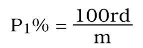
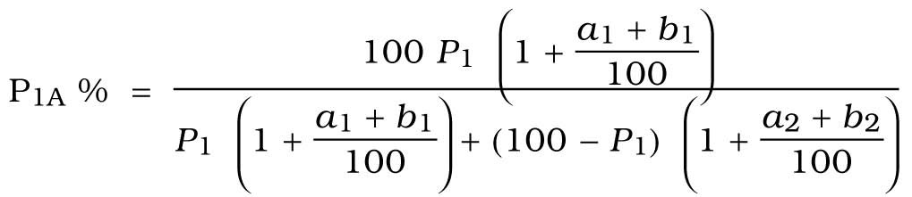
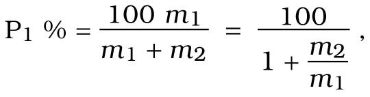
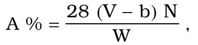
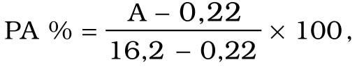

Príloha č. 3 k nariadeniu vlády č. 23/2003 Z. z.

- METÓDY NA KVANTITATÍVNU ANALÝZU URČITÝCH DVOJZLOŽKOVÝCH VLÁKNOVÝCH ZMESÍ

  - VŠEOBECNÉ USTANOVENIA

  - Metódy na kvantitatívnu analýzu vláknových zmesí sú založené na dvoch hlavných procesoch, na ručnej separácii a chemickej separácii vláken.

  - Metóda ručnej separácie sa použije vždy, keď je to možné, keďže vo všeobecnosti poskytuje oveľa presnejšie výsledky ako chemická metóda. Možno ju použiť na všetky textílie, ktorých vlákna nevytvárajú dobre premiešanú zmes, ako napríklad v prípade priadzí zložených z niekoľkých prvkov, z ktorých každý je vytvorený len jedným typom vlákna alebo látok, v ktorých vlákno osnovy je odlišného druhu než vlákno útoku (tkaniny), alebo pletených látok, ktoré sa dajú rozpliesť, vytvorených priadzami rôznych typov.

  - Metódy chemickej kvantitatívnej analýzy sú vo všeobecnosti založené na selektívnom rozpúšťaní jednotlivých komponentov. Po odstránení komponentu sa odváži nerozpustný zvyšok a podiel rozpustného komponentu sa vypočíta zo straty na hmotnosti. Prvá časť prílohy uvádza informácie spoločné pre analýzy podľa tejto metódy u všetkých vláknových zmesí, ktorými sa zaoberá príloha, bez ohľadu na ich zloženie. Preto sa použije v spojení s nasledujúcimi časťami prílohy, ktoré obsahujú podrobné postupy použiteľné na konkrétne vláknové zmesi. Príležitostne je analýza založená na inom princípe ako selektívne rozpúšťanie; v takýchto prípadoch sú úplné podrobnosti uvedené v príslušnej časti.

  - Zmesi vláken počas spracovania a v menšom rozsahu ukončené textílie môžu obsahovať nevláknové látky, ako sú tuky, vosky alebo aplikácie, alebo vodorozpustné látky, buď vyskytujúce sa prirodzene, alebo pridané na uľahčenie spracovania. Nevláknové látky sa musia odstrániť pred analýzou. Na to sa taktiež používa uvedená metóda na odstraňovanie olejov, tukov, voskov a vo vode rozpustných látok.

  - Okrem toho textílie môžu obsahovať živice alebo inú hmotu pridávanú na dosiahnutie špeciálnych vlastností. Takáto látka vrátane farbív môže vo výnimočných prípadoch rušiť účinok činidla na rozpustnú zložku alebo môže byť čiastočne, alebo úplne odstránená pomocou činidla. Tento typ pridanej látky môže spôsobiť chyby a treba to odstrániť predtým, než sa vzorka analyzuje. Ak nie je možné odstrániť takúto pridanú látku, metódy na kvantitatívnu chemickú analýzu, ktoré sú uvedené v tejto prílohe, nie sú použiteľné.

  - Farbivá vo farbených látkach sa považujú za integrálnu súčasť vlákna a neodstraňujú sa.

  - Analýzy sa vykonávajú na základe suchej hmotnosti, ak je uvedený postup na stanovenie suchej hmotnosti.

  - Výsledok sa získava aplikovaním na suchú hmotnosť každého vlákna, odsúhlasených prídavkov, uvedených v metódach 1 až 15.

  - Pred vykonaním akejkoľvek analýzy sa všetky vlákna prítomné v zmesi identifikujú. V niektorých metódach nerozpustný komponent zmesi môže byť čiastočne rozpustený v činidle použitom na rozpúšťanie rozpustného komponentu. Kde je to možné, tam boli zvolené činidlá, ktoré majú malý alebo žiadny účinok na nerozpustné vlákna. Ak je známe, že sa počas analýzy vyskytuje strata na hmotnosti, výsledok sa koriguje, korekčné faktory na tento účel sú uvedené. Tieto faktory boli stanovené v niekoľkých laboratóriách spracúvaním s príslušným činidlom, ako sú špecifikované v metóde analýzy vláken očistených predbežnou úpravou. Tieto korekčné faktory platia len pre nedegradované vlákna a môžu byť potrebné rozličné korekčné faktory, ak vlákna boli degradované pred spracovaním alebo počas spracovania. Uvedené postupy platia pre jednotlivé stanovenia. Vykonávajú sa najmenej dve stanovenia na výberových skúšobných vzorkách pre analýzu, tak v prípade ručnej separácie, ako aj v prípade chemickej separácie. Na potvrdenie, ak to nie je technicky nemožné, sa odporúčajú použiť alternatívne postupy, v ktorých sa rozpúšťa najprv zložka, ktorá bola zvyškom v štandardnej metóde.

  - I. VŠEOBECNÉ INFORMÁCIE O METÓDACH NA KVANTITATÍVNU CHEMICKÚ ANALÝZU TEXTILNÝCH VLÁKNOVÝCH ZMESÍ

    - Informácie spoločné pre uvedené metódy na kvantitatívnu chemickú analýzu vláknových zmesí.

    - I.1. Rozsah a oblasť aplikovania

      - Oblasť aplikovania pre každú metódu špecifikuje, pre ktoré vlákna je metóda použiteľná.

    - I.2. Podstata

      - Po identifikovaní komponentov zmesi sa nevláknový materiál odstráni vhodnou predbežnou úpravou, a potom jeden z komponentov, obyčajne selektívnym rozpúšťaním.1) Nerozpustný zvyšok sa odváži a podiel rozpustného komponentu sa vypočíta zo straty na hmotnosti. Ale kde to predstavuje technické ťažkosti, uprednostňuje sa rozpúšťať vlákno prítomné vo väčšom podiele, čím sa získa vlákno prítomné v menšom podiele ako zvyšok.

    - I.3. Prístroje, pomôcky a chemikálie (činidlá)

      - I.3.1. Prístroje

        - I.3.1.1. Sklené fritové filtre a dostatočne veľké odvažovačky, aby sa do nich zmestili takéto tégliky alebo nejaké iné vybavenie, dávajúce identické výsledky

        - I.3.1.2. Banka pre vákuovú destiláciu (výveva)

        - I.3.1.3. Exsikátor so silikagélom s indikátorom vlhkosti

        - I.3.1.4. Sušiareň s nútenou cirkuláciou vzduchu na sušenie vzoriek pri 150 oC ± 3o

        - I.3.1.5. Analytické váhy s presnosťou 0,0002 g

        - I.3.1.6. Soxhletov extraktor alebo iné vybavenie dávajúce identické výsledky

      - I.3.2. Chemikálie - činidlá

        - I.3.2.1. Petroléter, redestilovaný, rozmedzie varu 40 až 60 oC

        - I.3.2.2. Ostatné činidlá sú špecifikované v príslušných častiach každej metódy. Všetky použité činidlá majú byť chemicky čisté

        - I.3.2.3. Destilovaná alebo deionizovaná voda

    - I.4. Kondicionovanie a skúšobná atmosféra

      - Pretože sa stanovujú suché hmotnosti, treba kondicionovať vzorku na analýzu alebo vykonávať analýzy v kondicionovanej atmosfére.

    - I.5. Laboratórna skúšobná vzorka

      - Zobrať laboratórnu skúšobnú vzorku, ktorá je reprezentačná pre laboratórnu objemovú vzorku a dostatočná na poskytnutie všetkých vzoriek na analýzu, ktoré sú požadované, každú s hmotnosťou najmenej 1 g.

    - I.6. Predbežná úprava laboratórnej skúšobnej vzorky2)

      - Tam, kde je prítomná látka, ktorá sa nemá zohľadniť pri percentuálnych výpočtoch, odstráni sa vhodnou metódou, ktorá neovplyvní niektorú zo zložiek vlákna. Je to niektorá z týchto látok: mastné látky, spojivá, plnidlá, šlichtovacie a preparačné prostriedky, impregnačné materiály, pomocné prostriedky na farbenie a tlač a ďalšie textilné pomocné prípravky.

      - Na tento účel sa nevláknová látka, ktorá sa dá extrahovať petroléterom a vodou, odstráni spracovaním skúšobnej vzorky vysušenej na vzduchu v Soxhletovom extraktore pomocou petroléteru počas jednej hodiny, pri minimálnej rýchlosti 6 cyklov za hodinu. Petroléter sa nechá vypariť zo vzorky, ktorá sa potom extrahuje priamym spracovaním, pozostávajúcim z namáčania vzorky na analýzu do vody pri izbovej teplote počas jednej hodiny a potom namáčaním vo vode pri 65 ± 5 oC počas ďalšej hodiny, pričom sa tekutina z času na čas premieša. Použiť pomer tekutiny ku vzorke na analýzu 100 : 1. Odstrániť prebytok vody zo vzorky stláčaním, saním alebo odstredením a potom vzorku vysušiť na vzduchu.

      - Tam, kde nevláknovú látku nemožno extrahovať pomocou petroléteru a vody, sa odstráni nahradením vhodnej metódy už opísanej za inú vhodnú metódu, ktorá podstatne nezmení niektorú zo zložiek vlákna. Pre niektoré nebielené prírodné rastlinné vlákna (napríklad juta, kokos) treba však poznamenať, že normálna predbežná úprava pomocou petroléteru a vody neodstraňuje všetky prírodné nevláknové látky; tak či tak dodatočná predbežná úprava sa nepoužíva, ak vzorka neobsahuje apretúry, ktoré nie sú rozpustné ani v petrolétere, ani vo vode.

      - Protokol o analýze obsahuje všetky podrobnosti o použitých metódach predbežnej úpravy.

    - I.7. Skúšobný postup

      - I.7.1. Všeobecné inštrukcie

        - I.7.1.1. Sušenie

        - Vykonávať všetky sušiace operácie počas nie menej ako štyroch hodín a nie viac ako 16 hodín, pri 105 ± 3 oC vo vetranej sušiarni, s dverami sušiarne pevne zatvorenými. Ak je čas sušenia menej ako 14 hodín, vzorka sa musí odvážiť, aby sa skontrolovalo, či jej hmotnosť je už konštantná. Hmotnosť sa považuje za konštantnú, ak po ďalšom čase sušenia 60 minút je zmena menej ako 0,05 %.

        - Vyhnúť sa manipulácii s téglikmi a odvažovačkami, vzorkami alebo zvyškami pomocou holých rúk počas sušiacej, chladiacej a vážiacej operácie.

        - Vzorky vysúšať v odvažovačke so zátkou vedľa nej. Po vysušení zazátkovať odvažovačku pred jej vybratím zo sušiarne a preniesť ju rýchlo do vysušovača.

        - Sklený fritový filter sušiť v odvažovačke s jej krytom vedľa nej v sušiarni. Po vysušení zatvoriť odvažovačku a preniesť ju rýchlo do vysušovača.

        - Kde sa použije iné vybavenie ako sklený fritový filter, sušiace operácie v sušiarni sa vykonávajú takým spôsobom, ktorý umožňuje, aby sa hmotnosť vláken mohla určiť bez strát.

        - I.7.1.2. Ochladzovanie

        - Vykonávať všetky chladiace operácie vo vysušovači, ten umiestniť vedľa váhy, pokým sa nedosiahne úplné ochladenie odvažovačiek, a v každom prípade počas nie menej ako dvoch hodín.

        - I.7.1.3. Váženie

        - Po ochladení ukončiť váženie odvažovačky do dvoch minút po jej vybratí z vysušovača. Vážiť s presnosťou 0,0002 g.

      - I.7.2. Postup

        - Zobrať z predbežne upravenej laboratórnej skúšobnej vzorky skúšobnú vzorku na analýzu, s hmotnosťou najmenej 1 g. Nastrihať priadzu alebo látku do dĺžok približne 10 mm, čo najviac rozčlenene. Vysušiť priadzu v odvažovačke, ochladiť v sušičke a odvážiť ju. Presunúť vzorku na analýzu do sklenej nádoby špecifikovanej v príslušnej časti relevantnej metódy, opätovne odvážiť bezprostredne odvažovačku a diferenciou dosiahnuť suchú hmotnosť vzorky na analýzu. Ukončiť test tak, ako je špecifikované v príslušnej časti použiteľnej metódy. Zvyšok preveriť mikroskopicky, aby sa skontrolovalo, či spracovanie fakticky úplne odstránilo rozpustné vlákno.

    - I.8. Výpočet a vyjadrenie výsledkov

      - Hmotnosť nerozpustného komponentu vyjadriť ako percento celkovej hmotnosti vlákna v zmesi. Percento rozpustného komponentu sa dostane diferenciou. Výsledky vypočítať na základe čistej suchej hmotnosti, upravenej a) odsúhlasenými prídavkami a b) opravnými faktormi, pričom treba vziať do úvahy straty hmotnosti počas predbežnej úpravy a analýzy. Výpočty sa robia aplikovaním vzorca uvedeného v bode 1.8.2.

      - I.8.1. Výpočet percenta nerozpustného komponentu na báze čistej suchej hmotnosti, zanedbávajúc stratu hmotnosti vlákna počas predbežnej úpravy

      - 

        - kde

        - P1 je percento čistého, suchého, nerozpustného komponentu,

        - m je suchá hmotnosť vzorky na analýzu po predbežnej úprave,

        - r je suchá hmotnosť zvyšku,

        - d je opravný faktor na stratu hmotnosti nerozpustného komponentu v činidle počas analýzy.

        - Vhodné hodnoty „d“ sú uvedené v príslušnej časti každej metódy.

        - Takéto hodnoty „d“ sú, prirodzene, normálnymi hodnotami použiteľnými na chemicky nedegradované vlákna.

      - I.8.2. Výpočet percenta nerozpustného komponentu na báze čistej suchej hmotnosti s úpravou konvenčnými faktormi, a kde je to primerané, opravnými faktormi na stratu hmotnosti počas predbežnej úpravy

      - 

        - kde

        - P1A je percento nerozpustného komponentu upravené odsúhlasenými prídavkami a na stratu hmotnosti počas predbežnej úpravy,

        - P1 je percento čistého, suchého, nerozpustného komponentu, ako je vypočítané zo vzorca uvedeného v bode 1.8.1.,

        - a1 je odsúhlasený prídavok pre nerozpustný komponent (pozri prílohu II k smernici o textilných názvoch),

        - a2 je odsúhlasený prídavok pre rozpustný komponent (pozri prílohu II k smernici o textilných názvoch),

        - b1 je percentuálna strata nerozpustného komponentu spôsobená predbežnou úpravou,

        - b2je percentuálna strata rozpustného komponentu spôsobená predbežnou úpravou.

        - Percento druhého komponentu (P2A %) sa rovná 100 - P1A %.

        - Tam, kde bola použitá špeciálna predbežná úprava, hodnoty b1a b2 sa určia, ak je to možné, podrobením každej čistej vláknovej zložky predbežnej úprave aplikovanej v analýze. Čisté vlákna sú tie, ktoré sú bez všetkých nevláknových materiálov, s výnimkou keď sú normálne obsiahnuté (buď prirodzene, alebo pre výrobný proces) v stave (nebielenom, bielenom), v ktorom sa nachádzajú v materiáli, ktorý sa má analyzovať.

        - Kde nie sú k dispozícii žiadne čisté vlákna výberovej zložky použité vo výrobe materiálu, ktorý sa má analyzovať, treba použiť priemerné hodnoty b1, b2, ako sú získané z testov vykonávaných na čistých vláknach, podobných tým v zmesi, ktorá sa preveruje.

        - Ak sa aplikuje normálna predbežná úprava extrakciou petroléterom a vodou, korekčné faktory b1 a b2 netreba zohľadniť okrem nebielenej bavlny, nebieleného ľanu a nebielenej konopy, kde sa strata v dôsledku predbežnej úpravy konvenčne berie ako 4 % a v prípade polypropylénu, kde sa berie ako 1 %.

        - V prípade ostatných vláken sú straty v dôsledku predbežnej úpravy konvenčne vo výpočtoch zanedbávané.

  - II. METÓDA KVANTITATÍVNEJ ANALÝZY RUČNOU SEPARÁCIOU

    - II.1. Oblasť aplikovania

      - Táto metóda je použiteľná na textilné vlákna všetkých typov za predpokladu, že netvoria dobre premiešanú zmes a že ich možno separovať ručne.

    - II.2. Princíp

      - Po identifikovaní zložiek textilu sa nevláknový materiál odstráni vhodnou predbežnou úpravou a potom sa vlákna separujú ručne, vysušia a odvážia, aby sa vypočítal podiel každého vlákna v zmesi.

    - II.3. Vybavenie

      - II.3.1. Odvažovačka alebo akékoľvek iné vybavenie dávajúce identické výsledky

      - II.3.2. Exsikátor so silikagélom s indikátorom vlhkosti

      - II.3.3. Vetraná sušiareň na sušenie vzoriek na analýzu pri 105 ± 3 oC

      - II.3.4. Analytické váhy, presnosť 0,0002 g

      - II.3.5. Soxhletov extraktor alebo iné vybavenie dávajúce identické výsledky

      - II.3.6. Preparačná ihla

      - II.3.7. Zákrutomer alebo podobný prístroj

    - II.4. Činidlá

      - II.4.1. Petroléter, redestilovaný, rozsah varu 40 až 60 oC

      - II.4.2. Destilovaná alebo deionizovaná voda

    - II.5. Klimatizácia a skúšobná atmosféra, pozri bod 1.4.

    - II.6. Laboratórna skúšobná vzorka, pozri bod 1.5.

    - II.7. Predbežná úprava laboratórnej skúšobnej vzorky, pozri bod 1.6.

    - II.8. Postup

      - II.8.1. Analýza priadze

        - Selektovať z predbežne upravenej laboratórnej skúšobnej vzorky vzorku na analýzu s hmotnosťou nie menšou ako 1 g. Pri veľmi jemnej priadzi sa analýza môže robiť na minimálnej dĺžke 30 m bez ohľadu na jej hmotnosť.

        - Postrihať priadzu na kusy vhodnej dĺžky a separovať typy vláken pomocou ihly, a ak je to potrebné, skúšačky zákrutu. Takto získané typy vláken sa umiestnia do vopred odvážených odvažovačiek a vysušujú sa pri 105 ± 3 oC, kým sa nedosiahne konštantná hmotnosť, ako je to opísané v bodoch 1.7.1. a 1.7.2.

      - II.8.2. Analýza látky (plošnej textílie)

        - Selektovať z vopred upravenej laboratórnej skúšobnej vzorky, dobre zbavenej všetkých okrajov, vzorku na analýzu s hmotnosťou nie menšou ako 1 g, s okrajmi starostlivo pristrihnutými, aby sa zamedzilo ostrapkaniu a paralelne s útkom alebo osnovou priadzí, alebo v prípade pletených textílií, stĺpikov a riadkov. Separovať rozličné typy vláken, zhromaždiť ich vo vopred zvážených odvažovačkách a postupovať, ako je to opísané v bode II.8.1.

    - II.9. Výpočet a vyjadrenie výsledkov

      - Hmotnosť každej vláknovej zložky vyjadriť ako percento celkovej hmotnosti vláken v zmesi. Výsledky počítať na báze čistej suchej hmotnosti, upravenej (a) odsúhlasenými prídavkami a (b) opravnými faktormi, pričom je potrebné vziať do úvahy straty hmoty počas predbežnej úpravy.

      - II.9.1. Výpočet percentuálnych hmotností čistého suchého vlákna, zanedbávajúc stratu hmotnosti vlákna počas predbežnej úpravy:

      - 

        - kde

        - P1 je percento prvej čistej suchej zložky,

        - m1 je čistá suchá hmotnosť prvej zložky,

        - m2 je čistá suchá hmotnosť druhej zložky.

      - II.9.2. Na výpočet percenta každej zložky s úpravou odsúhlasenými prídavkami a tam, kde je to primerané, opravnými faktormi na stratu hmoty počas predbežnej úpravy, pozri bod 1.8.2.

    - III.1. Presnosť metód

      - Presnosť indikovaná v jednotlivých metódach súvisí s reprodukovateľnosťou.

      - Reprodukovateľnosť sa vzťahuje na spoľahlivosť, t. j. tesnosť zhody medzi experimentálnymi hodnotami získanými obsluhou v rôznych laboratóriách alebo v rôznych časoch s použitím tej istej metódy, a na získanie individuálnych výsledkov na vzorkách na analýzu z identickej konzistentnej zmesi. Reprodukovateľnosť je vyjadrená intervalom spoľahlivosti výsledkov pre hladinu významnosti 95 %.

      - Tým sa myslí, že rozdiel medzi dvoma výsledkami v sérii analýz vykonaných v rôznych laboratóriách sa pri normálnom a správnom aplikovaní metódy na identickej a konzistentnej zmesi prekročí len v piatich prípadoch zo sto.

    - III.2. Skúšobná správa

      - III.2.1. Uviesť, či bola analýza vykonaná v súlade s touto metódou.

      - II.2.2. Uviesť podrobnosti o akejkoľvek špeciálnej predbežnej úprave, pozri bod 1.6.

      - III.2.3. Uviesť individuálne výsledky a aritmetický stred, všetko s presnosťou 0,1.

  - 2. ŠPECIÁLNE METÓDY - SÚHRNNÁ TABUĽKA

  - Metóda číslo | Oblasť aplikovania | | Činidlo

  - 1. | acetát | určité iné vlákna | acetón

  - 2. | určité proteínové vlákna | určité iné vlákna | chlórnan

  - 3. | viskóza, meďnaté vlákno alebo určité typy modalu | bavlna | kyselina mravčia a chlorid zinočnatý

  - 4. | polyamid alebo nylon | určité iné vlákna | kyselina mravčia, 80 % m/m

  - 5. | acetát | triacetát | benzylalkohol

  - 6. | triacetát alebo polylaktid | určité iné vlákna | dichlórmetán

  - 7. | určité celulózové vlákna | polyester alebo elastomultiester | kyselina sírová, 75 % m/m

  - 8. | akrylové vlákna, určité modakrylové vlákna alebo určité chloridové vlákna | určité iné vlákna | dimetylformamid

  - 9. | určité chloridové vlákna | určité iné vlákna | sírouhlík/acetón, 55,5/44,5 v/v

  - 10. | acetát | určité chloridové vlákna | ľadová kyselina octová

  - 11. | hodváb | vlna alebo srsť | kyselina sírová, 75 % m/m

  - 12. | juta | určité živočíšne vlákna | metóda na základe stanovenia obsahu dusíka

  - 13. | polypropylén | určité iné vlákna | xylén

  - 14. | určité iné vlákna | chloridové vlákna (homopolyméry vinylchloridu) | metóda s použitím koncentrovanej kyseliny sírovej

  - 15. | chloridové vlákna, určité modakrylové vlákna, určité elastanové vlákna, acetátové vlákna a triacetátové vlákna | určité iné vlákna | cyklohexanón

    - METÓDA č. 1 ACETÁT A URČITÉ INÉ VLÁKNA

      - (acetónová metóda)

      - 1. OBLASŤ APLIKOVANIA

    - Túto metódu možno použiť po odstránení nevláknovej hmoty pri dvojzložkových zmesiach:

    - 1.1.

    - acetátu (19),

    - 1.2.

    - vlnou (1), zvieracou srsťou (2 a 3), hodvábom (4), bavlnou (5), ľanom (7), pravým konope (8), jutou (9), abakovým vláknom (10), alfou (11), kokosovým vláknom (12), vláknom broom (13), ramiovým vláknom (14), sisalovým vláknom (15), meďnatým vláknom (21), modalom (22), proteínovým vláknom (23), viskózou (25), akrylovým vláknom (26), polyamidom alebo nylonom (30), polyesterom (34) a elastomultiesterom (45).

    - Uvedenú metódu nemožno za žiadnych okolností použiť pri acetátových vláknach, ktoré boli deacetylované na povrchu.

      - 2. PRINCÍP

        - Acetát sa rozpustí zo známej suchej hmotnosti zmesi pomocou acetónu. Zvyšok sa zhromaždí, premyje, vysuší a odváži; jeho hmotnosť, ak je potrebné, korigovaná, vyjadrí sa ako percento suchej hmotnosti zmesi. Percento suchého acetátu sa zistí rozdielom.

      - 3. VYBAVENIE A ČINIDLÁ (dodatočné k tým, ktoré sú špecifikované vo všeobecných inštrukciách)

        - 3.1. Vybavenie

          - Kužeľová banka so zábrusom s objemom minimálne 200 ml.

        - 3.2. Činidlo

          - Acetón.

      - 4. SKÚŠOBNÝ POSTUP

        - Dodržiavať všeobecné inštrukcie a postupovať takto:

        - k vzorke obsiahnutej v kužeľovej banke so zábrusom a s objemom najmenej 200 ml pridať 100 ml acetónu na gram vzorky, potriasť bankou, nechať stáť 30 minút pri izbovej teplote, z času na čas premiešať a potom dekantovať kvapalinu cez odvážený filtrovací téglik.

        - Opakovať spracovanie ešte dvakrát (čím sa dosiahnu dovedna tri extrakcie), ale len počas 15 minút tak, aby celkovo spracovanie v acetóne trvalo 1 hodinu. Zvyšok preniesť do skleného fritového filtra. Zvyšok opláchnuť v sklenom fritovom filtri acetónom a odsať tekutinu. Opäť naplniť filter acetónom a nechať ho stiecť samovoľne.

        - Napokon odvodniť téglik saním, vysušiť filter a zvyšok ochladiť a odvážiť.

      - 5. VÝPOČET A VYJADRENIE VÝSLEDKOV

        - Výsledky vypočítať, ako je opísané vo všeobecných inštrukciách. Hodnota d = 1,00.

      - 6. PRESNOSŤ

        - Interval spoľahlivosti získaných výsledkov pomocou tejto metódy nie je väčší ako ± 1 pre hladinu významnosti 95 %.

    - METÓDA č. 2 URČITÉ PROTEÍNOVÉ VLÁKNA A URČITÉ INÉ VLÁKNA

      - (metóda s použitím chlórnanu)

      - 1. OBLASŤ APLIKOVANIA

      - Túto metódu možno použiť po odstránení nevláknovej hmoty pri dvojzložkových zmesiach:

        - 1.1. určitých proteínových vláken, konkrétne: vlny (1), zvieracích chlpov (2 a 3), hodvábu (4), proteínu (23),

        - 1.2. bavlnou (5), meďnatým vláknom (21), viskózou (25), akrylovým vláknom (26), chloridovými vláknami (27), polyamidom alebo nylonom (30), polyesterom (34), polypropylénom (36), elastanom (42), skleným vláknom (43) a elastomultiesterom (45).

        - Ak sú prítomné odlišné proteínové vlákna, metóda dáva súhrn ich čiastok, ale nie ich jednotlivé množstvá.

      - 2. PRINCÍP

        - Proteínové vlákno sa rozpúšťa zo známej suchej hmotnosti zmesi roztokom chlórnanu. Zvyšok sa sústredí, premyje, vysuší a odváži; jeho hmotnosť, ak je potrebné, korigovaná, vyjadrí sa ako percento suchej hmotnosti zmesi. Percento suchého proteínového vlákna sa zisťuje rozdielom.

        - Na prípravu chlórnanového roztoku možno použiť buď chlórnan lítny, alebo chlórnan sodný.

        - Chlórnan lítny sa odporúča v prípadoch zahŕňajúcich malý počet analýz alebo na analýzy vykonávané v primerane dlhých intervaloch, a to preto, lebo percento chlórnanu v pevnom chlórnane lítnom - na rozdiel od chlórnanu sodného - je prakticky konštantné. Ak je percento chlórnanu známe, obsah chlórnanu netreba kontrolovať jodometricky pri každej analýze, keďže možno použiť konštantnú váženú časť chlórnanu lítneho.

      - 3. VYBAVENIE A ČINIDLÁ (iné ako tie, ktoré sú špecifikované vo všeobecných inštrukciách)

        - 3.1. Vybavenie

          - (i) Kužeľová banka so zábrusom, 250 ml.

          - (ii) Termostat nastavený na 20 (± 2) oC.

        - 3.2. Činidlá

          - (i) Chlórnanové činidlo

            - (a) Roztok chlórnanu lítneho

              - Ten pozostáva z čerstvo pripraveného roztoku obsahujúceho 35 (± 2) g/l aktívneho chlóru (približne 1 M), do ktorého sa pridá 5 (± 0,5) g/l predtým rozpusteného hydroxidu sodného. Na prípravu rozpustiť 100 g chlórnanu lítneho, obsahujúceho 35 % aktívneho chlóru (alebo 115 g obsahujúcich 30 % aktívneho chlóru) približne v 700 ml destilovanej vody, pridať 5 g hydroxidu sodného, rozpusteného približne v 200 ml destilovanej vody a doplniť destilovanou vodou. Roztok, ktorý bol čerstvo pripravený, netreba kontrolovať jodometricky.

            - (b) Roztok chlórnanu sodného

              - Ten pozostáva z čerstvo pripraveného roztoku obsahujúceho 35 (± 2) g/l aktívneho chlóru (približne 1 M), do ktorého sa pridá 5 (± 0,5) g/l predtým rozpusteného hydroxidu sodného.

              - Pred každou analýzou treba skontrolovať obsah aktívneho chlóru v roztoku jodometricky.

          - (ii) Kyselina octová, zriedený roztok

            - Rozriediť 50 ml ľadovej kyseliny octovej na 1 liter vodou.

      - 4. SKÚŠOBNÝ POSTUP

        - Dodržiavať postup opísaný vo všeobecných inštrukciách a pokračovať takto: zmiešať približne 1 g vzorky približne so 100 ml roztoku chlórnanu (lítneho alebo sodného) v 250 ml v banke a dôkladne ňou potriasť, aby sa navlhčila vzorka.

        - Potom nahrievať banku 40 minút v termostate pri 20 oC a stále triasť alebo v pravidelných intervaloch. Keďže rozpúšťanie vlny pokračuje exotermne, reakčné teplo pri tejto metóde sa musí distribuovať a odstraňovať. Inak môžu vzniknúť značné chyby začínajúcim sa rozpúšťaním nerozpustných vláken.

        - Po 40 minútach odfiltrovať obsah banky cez vážený sklenený filtrovací téglik a preniesť zvyšok vláken do skleného fritového filtra opláchnutím banky malým množstvom chlórnanového činidla. Odvodniť téglik saním a premyť zvyšok postupne vodou, zriedenou kyselinou octovou a napokon vodou, odvodniť téglik saním po každom pridávaní. Nepoužívať odsávanie, kým každá premývacia kvapalina nestečie samovoľne.

        - Napokon vyprázdniť téglik odsávaním, vysušiť téglik so zvyškom, ochladiť a odvážiť.

      - 5. VÝPOČET A VYJADRENIE VÝSLEDKOV

        - Výsledky vypočítať, ako je to opísané vo všeobecných inštrukciách. Hodnota d = 1,00 okrem bavlny, viskózy a modalu, pri ktorých d = 1,01, a nebielenej bavlny, pri ktorej d = 1,03.

      - 6. PRESNOSŤ

        - Na homogénnych zmesiach textilných materiálov interval spoľahlivosti získaných výsledkov pomocou tejto metódy nie je väčší ako ± 1 pre hladinu významnosti 95 %.

    - METÓDA č. 3 VISKÓZA, MEĎNATÉ VLÁKNO ALEBO URČITÉ TYPY MODALU A BAVLNY

      - (metóda, pri ktorej sa používa kyselina mravčia a chlorid zinočnatý)

      - 1. OBLASŤ APLIKOVANIA

      - Túto metódu možno použiť po odstránení nevláknovej látky pri dvojzložkových zmesiach:

        - 1. viskózy (25) alebo meďnatého vlákna (21) vrátane určitých typov modalového vlákna (22),

        - 2. s bavlnou (5).

        - Ak sa ukáže, že modalové vlákno je prítomné, treba uskutočniť predbežný test s cieľom zistiť, či je rozpustné v činidle. Túto metódu nemožno použiť pri zmesiach, pri ktorých bavlna utrpela nadmernú chemickú degradáciu, ani vtedy, keď viskóza alebo meďnaté vlákno nie sú úplne rozpustné, čo zapríčiňuje prítomnosť určitých farbív alebo apretúr, ktoré nemožno úplne odstrániť.

      - 2. PRINCÍP

        - Viskózové, meďnaté alebo modalové vlákno sa rozpúšťa zo známej suchej hmotnosti zmesi s činidlom pozostávajúcim z kyseliny mravčej a chloridu zinočnatého. Zvyšok sa zhromaždí, premyje, vysuší a odváži; jeho korigovaná hmotnosť sa vyjadrí ako percento suchej hmotnosti zmesi. Percento suchej hmotnosti viskózy, meďnatého alebo modalového vlákna sa zistí rozdielom.

      - 3. VYBAVENIE A ČINIDLÁ (iné ako tie, ktoré sú špecifikované vo všeobecných inštrukciách)

      - 3.1. Vybavenie

        - (i) Kužeľová banka so zábrusom s objemom najmenej 200 ml.

        - (ii) Vybavenie na udržiavanie baniek pri 40 (± 2) oC.

      - 3.2. Činidlá

        - (i) Roztok obsahujúci 20 g roztaveného bezvodého chloridu zinočnatého a 68 g bezvodej kyseliny mravčej, doplnené na 100 g vodou (konkrétne 20 hmotnostných častí roztaveného bezvodého chloridu zinočnatého a 80 hmotnostných častí 85 % m/m kyseliny mravčej).

          - Poznámka

          - V tomto ohľade upriamiť pozornosť na bod 1.3.2.2., ktorý stanovuje, že všetky použité činidlá majú byť chemicky čisté; okrem toho je dôležité použiť len roztavený bezvodý chlorid zinočnatý.

        - (ii) Roztok hydroxidu amónneho: rozriediť 20 ml koncentrovaného roztoku amoniaku (špecifická hmotnosť 0,880 g/ml) do 1 litra vodou.

      - 4. SKÚŠOBNÝ POSTUP

        - Dodržiavať postup opísaný vo všeobecných inštrukciách a pokračovať takto: umiestniť vzorku bezprostredne do banky predhriatej na 40 oC. Pridať 100 ml roztoku kyseliny mravčej a chloridu zinočnatého predhriatych na 40 oC na 1 g vzorky. Uzavrieť zátkou a silne potriasť bankou. Udržiavať banku a jej obsah pri konštantnej teplote 40 oC dva a pol hodiny, potriasajúc bankou v hodinových intervaloch. Prefiltrovať obsah banky cez odvážený sklený fritový filter a pomocou činidla preniesť do téglika akékoľvek vlákna, ktoré zostali v banke. Prepláchnuť 20 ml činidla.

        - Opláchnuť téglik a zvyšok dokonale vodou pri 40 oC. Opláchnuť vláknový zvyšok približne v 100 ml chladného amónneho roztoku [3.2.(ii)], zabezpečiac, aby tento zvyšok zostal plne ponorený do roztoku 10 minút;1) potom dokonale opláchnuť chladnou vodou.

        - Nepoužívať odsávanie, kým každá premývacia kvapalina nestečie samovoľne. Napokon odstrániť zvyšujúcu kvapalinu saním, vysušiť téglik a zvyšok ochladiť a odvážiť.

      - 5. VÝPOČET A VYJADRENIE VÝSLEDKOV

        - Výsledky vypočítať, ako je opísané vo všeobecných inštrukciách. Pre bavlnu hodnota d = 1,02.

      - 6. PRESNOSŤ

        - Na homogénnej zmesi textilných materiálov interval spoľahlivosti výsledkov získaných touto metódou nie je väčší ako ± 2 pre hladinu významnosti 95 %.

    - METÓDA č. 4 POLYAMID ALEBO NYLON A URČITÉ INÉ VLÁKNA

      - (metóda používajúca 80 % m/m kyselinu mravčiu)

      - 1. OBLASŤ APLIKOVANIA

      - Túto metódu možno použiť po odstránení nevláknovej látky na dvojzložkové zmesi:

        - 1.1. polyamidu alebo nylonu (30)

        - 1.2. vlnou (1), zvieracou srsťou (2 a 3), bavlnou (5), meďnatým vláknom (21), modalom (22), viskózou (25), akrylovým vláknom (26), chloridovým vláknom (27), polyesterom (34), polypropylénom (36), skleným vláknom (43) a elastomultiesterom (45).

        - Ako bolo uvedené, táto metóda je taktiež použiteľná na zmesi s vlnou, no v prípade, ak je obsah vlny nad 25 %, mala by sa použiť metóda č. 2 (rozpúšťanie vlny v roztoku alkalického chlórnanu sodného).

      - 2. PRINCÍP

        - Polyamidové vlákno sa rozpúšťa zo známej suchej hmotnosti zmesi pomocou kyseliny mravčej. Zvyšok sa zhromaždí, premyje, vysuší a odváži; jeho korigovaná hmotnosť sa vyjadrí ako percento suchej hmotnosti zmesi. Percento suchého polyamidu alebo nylonu sa zistí rozdielom.

      - 3. VYBAVENIE A ČINIDLÁ (iné ako tie, ktoré sú špecifikované vo všeobecných inštrukciách)

        - 3.1. Vybavenie

          - Kuželová banka so zábrusom s objemom najmenej 200 ml.

        - 3.2. Činidlá

          - (i) Kyselina mravčia (80 % m/m, relatívna hustota pri 20 oC: 1,186). Rozriediť 880 ml 90 % m/m kyseliny mravčej (relatívna hustota pri 20 oC: 1,204) na 1 liter vodou. Alternatívne rozriediť 780 ml 98 - 100 % m/m kyseliny mravčej (relatívna hustota pri 20 oC: 1,220) na 1 liter vodou.

            - Koncentrácia nie je kritická v rámci rozsahu 77 - 83 % m/m kyseliny mravčej.

          - (ii) Amoniak, zriedený roztok: rozriediť 80 ml koncentrovaného roztoku amoniaku (relatívna hustota pri 20 oC: 0,880) na 1 liter vodou.

      - 4. SKÚŠOBNÝ POSTUP

      - Dodržiavať všeobecné inštrukcie a postupovať takto:

        - K vzorke obsiahnutej v kužeľovej banke so zábrusom s objemom najmenej 200 ml pridať 100 ml kyseliny mravčej na 1 g vzorky. Zazátkovať, potriasť bankou, aby sa zvlhčila vzorka. Banku nechať stáť 15 minút pri izbovej teplote, pravidelne ju potriasajúc. Prefiltrovať obsah banky cez odvážený sklený fritový filter a preniesť akékoľvek zvyšné vlákna do téglika opláchnutím banky malým množstvom činidla - kyseliny mravčej. Odvodniť téglik saním a premyť zvyšok na filtri postupne činidlom - kyselinou mravčou, horúcou vodou, zriedeným roztokom amoniaku a napokon studenou vodou, odvodniť lievik saním po každom pridaní. Sanie neaplikovať, kým každá premývacia kvapalina nestečie samovoľne. Napokon téglik odvodniť saním, vysušiť ho, zvyšok ochladiť a odvážiť.

      - 5. VÝPOČET A VYJADRENIE VÝSLEDKOV

        - Výsledky vypočítať, ako je opísané vo všeobecných inštrukciách. Hodnota d = 1,00.

      - 6. PRESNOSŤ

        - Na homogénnej zmesi textilných materiálov interval spoľahlivosti výsledkov získaných touto metódou nie je väčší ako ± 1 pre hladinu významnosti 95 %.

    - METÓDA č. 5 ACETÁT A TRIACETÁT

      - (metóda používajúca benzylalkohol)

      - 1. OBLASŤ APLIKOVANIA

        - Túto metódu možno použiť po odstránení nevláknovej látky na dvojzložkové zmesi:

        - 1.1. acetátu (19)

        - 1.2. s triacetátom (24).

      - 2. PRINCÍP

        - Acetátové vlákno sa rozpustí zo známej suchej hmotnosti zmesi benzylalkoholom pri 52 ± 2 oC. Zvyšok sa zhromaždí, premyje, vysuší a odváži; jeho hmotnosť sa vyjadrí ako percento suchej hmotnosti zmesi. Percento suchého acetátu sa zistí rozdielom.

      - 3. VYBAVENIE A ČINIDLÁ (iné ako tie, ktoré sú špecifikované vo všeobecných inštrukciách)

        - 3.1. Vybavenie

          - (i) Kužeľová banka so zábrusom so sklenou zátkou s objemom najmenej 200 ml.

          - (ii) Mechanická trepačka.

          - (iii) Termostat alebo iné vybavenie na udržiavanie banky pri teplote 52 ± 2 oC.

        - 3.2. Činidlá

          - (i) Benzylalkohol.

          - (ii) Etanol.

      - 4. SKÚŠOBNÝ POSTUP

      - Dodržiavať všeobecné inštrukcie a postupovať takto:

        - Ku vzorke obsiahnutej v kužeľovej banke pridať 100 ml benzylalkoholu na 1 g vzorky. Zazátkovať, pripevniť banku na trepačku tak, aby bola ponorená vo vodnom kúpeli, udržiavať pri 52 ± 2 oC a triasť 20 minút pri tejto teplote. (Namiesto použitia mechanickej trepačky možno banku silno potriasať rukou.)

        - Dekantovať kvapalinu cez odvážený sklený fritový filter. Pridať ďalšiu dávku benzylalkoholu do banky a potriasať ako predtým pri 52 ± 2 oC počas 20 minút. Dekantovať kvapalinu cez téglik.

        - Opakovať cyklus operácií trikrát.

        - Napokon preliať kvapalinu a zvyšok do téglika; opláchnuť akékoľvek zvyšné vlákna z banky do téglika pomocou dodatočného množstva benzylalkoholu pri 52 ± 2 oC. Téglik dokonale odvodniť. Preniesť vlákna do banky, prepláchnuť etanolom a po potrasení ručne dekantovať cez sklený fritový filter. Túto preplachovaciu operáciu opakovať dvakrát alebo trikrát. Preniesť zvyšok do téglika a dokonale odvodniť. Vysušiť téglik a zvyšok ochladiť a odvážiť.

      - 5. VÝPOČET A VYJADRENIE VÝSLEDKOV

        - Výsledky vypočítať, ako je opísané vo všeobecných inštrukciách. Hodnota d = 1,00.

      - 6. PRESNOSŤ

        - Na homogénnej zmesi textilných materiálov interval spoľahlivosti výsledkov získaných touto metódou nie je väčší ako ± 1 pre hladinu významnosti 95 %.

    - METÓDA č. 6 TRIACETÁTOVÉ A URČITÉ INÉ VLÁKNA

      - (metóda používajúca dichlórmetán)

      - 1. OBLASŤ APLIKOVANIA

        - Túto metódu možno použiť po odstránení nevláknovej látky na dvojzložkové zmesi

        - 1. triacetátu (24) alebo polylaktidu (33a)

        - s

        - 2. vlnou (1), zvieracou srsťou (2 a 3), hodvábom (4), bavlnou (5), meďnatým vláknom (21), modalom (22), viskózou (25), akrylovým vláknom (26), polyamidom alebo nylonom (30), polyesterom (34), skleným vláknom (43) a elastomultiesterom (45).

        - Poznámka

        - Triacetátové vlákna, ktoré dostali apretúru vedúcu k čiastočnej hydrolýze, nie sú v činidle úplne rozpustné. V takých prípadoch metóda nie je použiteľná.

      - 2. PRINCÍP

        - Triacetátové alebo polylaktidové vlákna sa získavajú zo známej suchej hmotnosti zmesi prostredníctvom rozpúšťania dichlórmetánom. Zvyšok sa zhromažďuje, premýva, suší a váži; jeho hmotnosť, ktorá sa v prípade potreby upravuje, sa vyjadrí ako percentuálny podiel zo suchej hmotnosti zmesi. Percentuálny podiel suchého triacetátu sa zisťuje na základe vyjadrenia rozdielu.

      - 3. VYBAVENIE A ČINIDLÁ (iné ako tie, ktoré sú špecifikované vo všeobecných inštrukciách)

        - 3.1. Vybavenie

          - Kužeľová banka so sklenou zátkou s objemom najmenej 200 ml.

        - 3.2. Činidlo

          - Dichlórmetán.

      - 4. SKÚŠOBNÝ POSTUP

      - Dodržiavať všeobecné inštrukcie a postupovať takto:

        - Ku vzorke obsiahnutej v 200 ml kužeľovej banke so sklenou zátkou pridať 100 ml dichlórmetánu na 1 g vzorky. Zazátkovať, potriasť bankou každých 10 minút, aby sa zvlhčila vzorka, nechať stáť 30 minút pri izbovej teplote a potriasať bankou v pravidelných intervaloch. Dekantovať kvapalinu cez odvážený sklený fritový filter. Pridať 60 ml dichlórmetánu do banky obsahujúcej zvyšok, ručne potriasť a prefiltrovať obsah banky cez sklený fritový filter. Preniesť zvyšné vlákna do téglika opláchnutím banky malým množstvom dichlórmetánu. Odvodniť téglik saním, aby sa odstránil prebytok kvapaliny, téglik znovu naplniť dichlórmetánom a nechať stiecť samovoľne.

        - Napokon aplikovať odsávanie na eliminovanie prebytku kvapaliny, potom pridať k zvyšku horúcu vodu, aby sa eliminovalo všetko rozpúšťadlo, použiť odsávanie, téglik vysušiť a zvyšok ochladiť a odvážiť.

      - 5. VÝPOČET A VYJADRENIE VÝSLEDKOV

        - Výsledky vypočítať, ako je opísané vo všeobecných inštrukciách. Hodnota d = 1,00 s výnimkou polyesteru a elastomultiesteru, pri ktorých hodnota d = 1,01.

      - 6. PRESNOSŤ

        - Na homogénnej zmesi textilných materiálov interval spoľahlivosti výsledkov získaných touto metódou nie je väčší ako ± 1 pre hladinu významnosti 95 %.

    - METÓDA č. 7 URČITÉ CELULÓZOVÉ VLÁKNA A POLYESTER

      - (metóda používajúca 75 % m/m kyselinu sírovú)

      - 1. OBLASŤ APLIKOVANIA

      - Túto metódu možno použiť po odstránení nevláknovej látky na dvojzložkové zmesi:

        - 1.1. bavlny (5), ľanu (7), konope (8), ramie - čínskej trávy (14), meďnatého vlákna (21), modalového vlákna (22), viskózy (25)

        - 1.2. polyesterom (34) a elastomultiesterom (45).

      - 2. PRINCÍP

        - Celulózové vlákno sa rozpúšťa zo známej suchej hmotnosti zmesi pomocou 75 % m/m kyseliny sírovej. Zvyšok sa zhromaždí, premyje, vysuší a odváži; jeho hmotnosť sa vyjadrí ako percento suchej hmotnosti zmesi. Podiel suchého celulózového vlákna sa zistí diferenciou.

      - 3. VYBAVENIE A ČINIDLÁ (iné ako tie, ktoré sú špecifikované vo všeobecných inštrukciách)

        - 3.1. Vybavenie

          - (i) Kužeľová banka so zábrusom so sklenou zátkou s objemom najmenej 500 ml.

          - (ii) Termostat alebo iné vybavenie na udržiavanie banky pri 50 ± 5 oC.

        - 3.2. Činidlá

          - (i) Kyselina sírová 75 ± 2 % m/m.

            - Pripraviť opatrným pridaním za stáleho chladenia 700 ml kyseliny sírovej (relatívna hustota pri 20 oC: 1,84) do 350 ml destilovanej vody. Po ochladení roztoku na izbovú teplotu rozriediť na 1 liter vodou.

          - (ii) Amoniak, zriedený roztok.

            - Rozriediť 80 ml roztoku amoniaku (relatívna hustota pri 20 oC: 0,88) na 1 liter vodou.

      - 4. SKÚŠOBNÝ POSTUP

      - Dodržiavať všeobecné inštrukcie a postupovať takto:

        - Ku vzorke obsiahnutej v kužeľovej banke, zazátkovanej, s objemom najmenej 500 ml pridať 200 ml 75 % kyseliny sírovej na 1 g vzorky. Zazátkovať, dôkladne potriasť bankou, aby sa zvlhčila vzorka. Udržiavať banku pri 50 ± 5 oC počas 1 hodiny, potriasajúc v pravidelných intervaloch približne 10 minút.

        - Prefiltrovať obsah banky cez odvážený sklený fritový filter pomocou odsávania. Preniesť akékoľvek zvyšné vlákna opláchnutím banky malým množstvom 75 % kyseliny sírovej. Odvodniť téglik saním a opláchnuť zvyšok na filtri jedenkrát naplnením téglika čerstvou dávkou kyseliny sírovej. Nepoužiť odsávanie, pokým kyselina nestečie samovoľne.

        - Opláchnuť zvyšok postupne niekoľkokrát chladnou vodou, dvakrát zriedeným roztokom amoniaku a potom dokonale studenou vodou, odvodniť téglik odsávaním po každom pridaní. Nepoužiť odsávanie, pokým každá preplachová kvapalina nestečie samovoľne.

        - Napokon odvodniť zvyšnú kvapalinu z téglika odsávaním, téglik vysušiť a zvyšok ochladiť a odvážiť.

      - 5. VÝPOČET A VYJADRENIE VÝSLEDKOV

        - Výsledky vypočítať, ako je opísané vo všeobecných inštrukciách. Hodnota d = 1,00.

      - 6. PRESNOSŤ

        - Na homogénnej zmesi textilných materiálov interval spoľahlivosti výsledkov získaných touto metódou nie je väčší ako ± 1 pre hladinu významnosti 95 %.

    - METÓDA č. 8 AKRYLY, URČITÉ MODAKRYLY ALEBO URČITÉ CHLORIDOVÉ VLÁKNA A URČITÉ INÉ VLÁKNA

      - (metóda používajúca dimetylformamid)

      - 1. OBLASŤ APLIKOVANIA

      - Túto metódu možno použiť po odstránení nevláknovej látky na dvojzložkové zmesi:

        - 1.1. akrylov (26), určitých modakrylov (29) alebo určitých chloridových vláken (27)1)

        - 1.2. vlnou (1), zvieracou srsťou (2 a 3), hodvábom (4), bavlnou (5), meďnatým vláknom (21), modalom (22), viskózou (25), polyamidom alebo nylonom (30), polyesterom (34) a elastomultiesterom (45).

        - Je rovnako použiteľná na akryly a určité modakryly spracovávané s kovovokomplexnými farbivami, ale nie tie, ktoré sú farbené chrómovými farbami.

      - 2. PRINCÍP

        - Akrylové, modakrylové alebo chloridové vlákno sa rozpúšťa zo známej suchej hmotnosti zmesi pomocou dimetylformamidu zohriateho vo vriacom vodnom kúpeli. Zvyšok sa zhromaždí, vysuší a odváži; jeho hmotnosť, ak je to potrebné, korigovaná, vyjadrí sa ako percento suchej hmotnosti zmesi. Percento suchého akrylového, modakrylového alebo chloridového vlákna sa zistí rozdielom.

      - 3. VYBAVENIE A ČINIDLÁ (iné ako tie, ktoré sú špecifikované vo všeobecných inštrukciách)

        - 3.1. Vybavenie

          - (i) Kužeľová banka so zábrusom so sklenou zátkou s objemom najmenej 500 ml.

          - (ii) Vodný kúpeľ pri bode varu.

        - 3.2. Činidlá

          - Dimetylformamid (bod varu 153 ± 1 oC) neobsahujúci viac ako 0,1 % vody.

          - Toto činidlo je toxické, preto sa odporúča použiť digestor.

      - 4. SKÚŠOBNÝ POSTUP

        - Dodržiavať všeobecné inštrukcie a postupovať takto:

        - K vzorke obsiahnutej v kužeľovej banke so sklenou zátkou s objemom najmenej 200 ml pridať na 1 g vzorky 80 ml dimetylformamidu zohriateho vo vriacom vodnom kúpeli, vložiť zátku, potriasť bankou, aby sa zvlhčila vzorka a zohrievať vo vriacom vodnom kúpeli jednu hodinu. Potriasť bankou päťkrát jemne rukou po uvedený čas.

        - Dekantovať kvapalinu cez odvážený sklený fritový filter, ponechávajúc vlákna v banke. Pridať ďalších 60 ml dimetylformamidu do banky a zohrievať ďalších 30 minút, potriasť bankou dvakrát jemne rukou po uvedený čas.

        - Prefiltrovať obsah banky cez sklený fritový filter pomocou odsávania.

        - Preniesť akékoľvek zvyškové vlákno do téglika opláchnutím banky dimetylformamidom. Odvodniť téglik odsávaním. Premyť zvyšok približne s 1 litrom horúcej vody pri 70 - 80 oC, pričom zakaždým naplniť téglik. Po každom pridaní vody nakrátko aplikovať odsávanie, ale až potom, keď voda stečie samovoľne. Ak prepieracia kvapalina tečie cez téglik príliš pomaly, môže sa aplikovať mierne odsávanie.

        - Napokon vysušiť téglik so zvyškom, vychladiť ho a odvážiť.

      - 5. VÝPOČET A VYJADRENIE VÝSLEDKOV

        - Výsledky vypočítať, ako je opísané vo všeobecných inštrukciách. Hodnota d = 1,00 s výnimkou týchto prípadov:

      - pre vlnu pre bavlnu pre meďnaté vlákno pre modal pre polyester pre elastomultiester | d = 1,01 d = 1,01 d = 1,01 d = 1,01 d = 1,01 d = 1,01

      - 6. PRESNOSŤ

        - Na homogénnej zmesi textilných materiálov interval spoľahlivosti výsledkov získaných touto metódou nie je väčší ako ± 1 pre hladinu významnosti 95 %.

    - METÓDA č. 9 URČITÉ CHLORIDOVÉ VLÁKNA A URČITÉ INÉ VLÁKNA

      - (metóda používajúca zmes 55,5/44,5 sulfidu uhličitého a acetónu)

      - 1. OBLASŤ APLIKOVANIA

      - Túto metódu možno použiť po odstránení nevláknovej látky na dvojzložkové zmesi:

        - 1.1. určitých chloridových vláken (27), menovite určitých polyvinylchloridových vláken, či už sú následne chlórované alebo nie1)

        - 1.2. vlnou (1), zvieracou srsťou (2 a 3), hodvábom (4), bavlnou (5), meďnatým vláknom (21), modalom (22), viskózou (25), akrylovým vláknom (26), polyamidom alebo nylonom (30), polyesterom (34), skleným vláknom (43) a elastomultiesterom (45).

        - Ak je obsah vlny alebo hodvábu v zmesi viac ako 25 %, použije sa metóda č. 2. Ak je obsah polyamidu alebo nylonu v zmesi viac ako 25 %, použije sa metóda č. 4.

      - 2. PRINCÍP

        - Chloridové vlákno sa rozpúšťa zo známej suchej hmotnosti zmesi s azeotropickou zmesou sulfidu uhličitého a acetónu. Zvyšok sa zhromaždí, premyje, vysuší a odváži; jeho hmotnosť, ak je to potrebné, korigovaná, vyjadrí sa ako percento suchej hmotnosti zmesi. Percento suchého polyvinylchloridového vlákna sa zistí diferenciou.

      - 3. VYBAVENIE A ČINIDLÁ (iné ako tie, ktoré sú špecifikované vo všeobecných inštrukciách)

        - 3.1. Vybavenie

          - (i) Kužeľová banka so zábrusom so sklenou zátkou s objemom najmenej 200 ml.

          - (ii) Mechanická trepačka.

        - 3.2. Činidlá

          - (i) Azeotropická zmes sírouhlíka a acetónu (55,5 % objemových sírouhlíka k 44,5 % acetónu). Keďže toto činidlo je toxické, odporúča sa použiť digestor.

          - (ii) Etanol (92 % objemových) alebo metanol.

      - 4. SKÚŠOBNÝ POSTUP

      - Dodržiavať všeobecné inštrukcie a postupovať takto:

        - K vzorke obsiahnutej v kužeľovej banke so sklenou zátkou s objemom najmenej 200 ml pridať 100 ml azeotropickej zmesi na 1 g vzorky. Banku bezpečne utesniť a pretrepávať bankou na mechanickej trepačke alebo dôkladne potriasť rukou 20 minút pri izbovej teplote. Dekantovať kvapalinu nad usadeninou cez odvážený sklený fritový filter.

        - Spracovanie opakovať so 100 ml čerstvého činidla. Pokračovať s týmto cyklom operácií, pokým žiadna usadenina polyméru nezostane na hodinovom sklíčku, keď sa vyparí kvapka extrakčnej kvapaliny. Preniesť zvyšok na sklený fritový filter s použitím väčšieho množstva činidla, aplikovať odsávanie na odstránenie kvapaliny a téglik s obsahom zvyšku prepláchnuť 20 ml alkoholu a potom trikrát vodou. Nechať preplachovú kvapalinu stiecť samovoľne pred drenážou pomocou odsávania. Vysušiť téglik a zvyšok ochladiť a odvážiť.

        - Poznámka

        - S určitými zmesami majúcimi vysoký obsah chloridového vlákna môže nastať značné zrazenie vzorky počas postupu sušenia, čoho výsledkom je oneskorené rozpúšťanie chloridového vlákna rozpúšťadlom. Toto však neovplyvňuje konečné rozpustenie chloridového vlákna v rozpúšťadle.

      - 5. VÝPOČET A VYJADRENIE VÝSLEDKOV

        - Výsledky vypočítať, ako je opísané vo všeobecných inštrukciách. Hodnota d = 1,00.

      - 6. PRESNOSŤ

        - Na homogénnej zmesi textilných materiálov interval spoľahlivosti výsledkov získaných touto metódou nie je väčší ako ± 1 pre hladinu významnosti 95 %.

    - METÓDA č. 10 ACETÁTOVÉ A URČITÉ CHLORIDOVÉ VLÁKNA

      - (metóda používajúca ľadovú kyselinu octovú)

      - 1. OBLASŤ APLIKOVANIA

      - Túto metódu možno použiť po odstránení nevláknovej látky na dvojzložkové zmesi:

        - 1.1. acetátu (19)

        - 1.2. s určitými chloridovými vláknami (27), menovite polyvinylchloridovými vláknami, či už sú následne chlórované alebo nie.

      - 2. PRINCÍP

        - Acetátové vlákno sa rozpúšťa zo známej suchej hmotnosti zmesi ľadovou kyselinou octovou. Zvyšok sa zhromaždí, premyje, vysuší a odváži; jeho hmotnosť, ak je to potrebné, korigovaná, vyjadrí sa ako percento suchej hmotnosti zmesi. Percento suchého acetátu vlákna sa zistí diferenciou.

      - 3. VYBAVENIE A ČINIDLÁ (iné ako tie, ktoré sú špecifikované vo všeobecných inštrukciách)

        - 3.1. Vybavenie

          - (i) Kužeľová banka so zábrusom so sklenou zátkou s objemom najmenej 200 ml.

          - (ii) Mechanická trepačka.

        - 3.2. Činidlá

          - Ľadová kyselina octová (viac ako 99 %). S týmto činidlom by sa malo manipulovať opatrne, keďže je vysoko žieravé.

      - 4. SKÚŠOBNÝ POSTUP

      - Dodržiavať všeobecné inštrukcie a postupovať takto:

        - K vzorke obsiahnutej v kužeľovej banke so sklenou zátkou s objemom najmenej 200 ml pridať 100 ml ľadovej kyseliny octovej na 1 g vzorky. Banku bezpečne utesniť a pretrepávať na mechanickej trepačke alebo dôkladne potriasť rukou počas 20 minút pri izbovej teplote.

        - Dekantovať kvapalinu nad usadeninou cez odvážený sklený fritový filter. Toto spracovanie opakovať dvakrát, zakaždým s použitím 100 ml čerstvého činidla, čím sa dosiahnu celkove tri extrakcie. Preniesť zvyšok na sklený fritový filter, odvodniť odsávaním, aby sa odstránila kvapalina a téglik s obsahom zvyšku prepláchnuť 50 ml ľadovej kyseliny octovej a potom trikrát vodou. Po každom oplachovaní nechať kvapalinu stiecť samovoľne a potom použiť odsávanie. Vysušiť téglik a zvyšok ochladiť a odvážiť.

      - 5. VÝPOČET A VYJADRENIE VÝSLEDKOV

        - Výsledky vypočítať, ako je opísané vo všeobecných inštrukciách. Hodnota d = 1,00.

      - 6. PRESNOSŤ

        - Na homogénnej zmesi textilných materiálov interval spoľahlivosti výsledkov získaných touto metódou nie je väčší ako ± 1 pre hladinu významnosti 95 %.

    - METÓDA č. 11 HODVÁB A VLNA ALEBO CHLPY

      - (metóda používajúca 75 % m/m kyselinu sírovú)

      - 1. OBLASŤ APLIKOVANIA

      - Túto metódu možno použiť po odstránení nevláknovej látky na dvojzložkové zmesi:

        - 1.1. hodvábu (4)

        - 1.2. s vlnou (1) alebo so zvieracími chlpami (2 a 3).

      - 2. PRINCÍP

        - Hodvábne vlákno sa rozpúšťa zo známej suchej hmotnosti zmesi so 75 % m/m kyselinou sírovou.1)

        - Zvyšok sa zhromaždí, premyje, vysuší a odváži; jeho hmotnosť, ak je to potrebné, korigovaná, vyjadrí sa ako percento suchej hmotnosti zmesi. Percento suchého hodvábu sa zistí diferenciou.

      - 3. VYBAVENIE A ČINIDLÁ (iné ako tie, ktoré sú špecifikované vo všeobecných inštrukciách)

        - 3.1. Vybavenie

          - Kužeľová banka so zábrusom so sklenou zátkou s objemom najmenej 200 ml.

        - 3.2. Činidlá

          - (i) Kyselina sírová (75 ± 2 % m/m).

            - Pripraviť opatrným pridaním počas chladenia 700 ml kyseliny sírovej (hustota pri 20 oC : 1,84) do 350 ml destilovanej vody.

            - Po ochladení na izbovú teplotu zriediť roztok na 1 liter vodou.

          - (ii) Kyselina sírová, zriedený roztok: pridajte 100 ml kyseliny sírovej (hustota pri 20 oC : 1,84) pomaly do 1 900 ml destilovanej vody.

          - (iii) Amoniak, zriedený roztok: zriediť 200 ml koncentrovaného amoniaku (hustota pri 20 oC : 0,880) do 1 000 ml vodou.

      - 4. SKÚŠOBNÝ POSTUP

      - Dodržiavať všeobecné inštrukcie a postupovať takto:

        - K vzorke obsiahnutej v kužeľovej banke so sklenou zátkou s objemom najmenej 200 ml pridať 100 ml 75 % m/m kyseliny sírovej na 1 g vzorky a vložiť zátku. Dôkladne potriasť a nechať stáť 30 minút pri izbovej teplote. Znovu potriasť a nechať stáť 30 minút. Napokon potriasť a prefiltrovať obsah banky cez odvážený sklený fritový filter. Zmyť akékoľvek zvyšné vlákna z banky pomocou 75 % kyseliny sírovej - činidla. Premyť zvyšok na filtri postupne 50 ml roztoku kyseliny sírovej, 50 ml vody a 50 ml roztoku amoniaku. Zakaždým nechať vlákna, aby zostali v kontakte s kvapalinou približne 10 minút pred použitím odsávania. Napokon prepláchnuť vodou, ponechajúc vlákna v kontakte s vodou približne 30 minút. Odvodniť téglik odsávaním. Vysušiť téglik a zvyšok ochladiť a odvážiť.

      - 5. VÝPOČET A VYJADRENIE VÝSLEDKOV

        - Výsledky vypočítať, ako je opísané vo všeobecných inštrukciách. Pre vlnu hodnota d = 0,985.1)

      - 6. PRESNOSŤ

        - Na homogénnej zmesi textilných materiálov interval spoľahlivosti výsledkov získaných touto metódou nie je väčší ako ± 1 pre hladinu významnosti 95 %.

    - METÓDA č. 12 JUTA A URČITÉ ŽIVOČÍŠNE VLÁKNA

      - (metóda stanovením obsahu dusíka)

      - 1. OBLASŤ APLIKOVANIA

      - Túto metódu možno použiť po odstránení nevláknovej látky na dvojzložkové zmesi:

        - 1.1. juty (9)

        - 1.2. s určitými živočíšnymi vláknami.

          - Živočíšna vláknová zložka môže pozostávať výlučne z chlpov (2 a 3) alebo vlny (1), alebo z oboch. Táto metóda nie je použiteľná na textilné zmesi obsahujúce nevláknovú látku (farbivá, apretúry atď.) s dusíkovou bázou.

      - 2. PRINCÍP

        - Stanoví sa obsah dusíka v zmesi a z tohto obsahu a zo známeho alebo z predpokladaného obsahu dusíka oboch zložiek sa vypočíta podiel obsahu dusíka v oboch zložkách.

      - 3. VYBAVENIE A ČINIDLÁ (iné ako tie, ktoré sú špecifikované vo všeobecných inštrukciách)

        - 3.1. Vybavenie

          - (i) Kjeldahlova mineralizačná banka, objem 200 - 300 ml.

          - (ii) Kjeldahlov destilačný prístroj so vstrekovaním pary.

          - (iii) Titračný prístroj umožňujúci presnosť 0,05 ml.

        - 3.2. Činidlá

          - (i) Toluén.

          - (ii) Metanol.

          - (iii) Kyselina sírová, relatívna hustota pri 20 oC : 1,84.1)

          - (iv) Síran draselný.1)

          - (v) Oxid seléničitý.1)

          - (vi) Roztok hydroxidu sodného (400 g/liter). Rozpustiť 400 g hydroxidu sodného v 400 - 500 ml vody a zriediť na 1 liter vodou.

          - (vii) Zmiešaný indikátor. Rozpustiť 0,1 g metylčervene v 95 ml etanolu a 5 ml vody a zmiešať s 0,5 g brómkrezolovej zelene rozpustenej v 475 ml etanolu a 25 ml vody.

          - (viii) Roztok kyseliny boritej. Rozpustiť 20 g kyseliny boritej v 1 litri vody.

          - (ix) Kyselina sírová 0,02 N (štandardný volumetrický roztok).

      - 4. PREDBEŽNÁ ÚPRAVA SKÚŠOBNEJ VZORKY

      - Nasledujúca predbežná úprava nahrádza predbežnú úpravu opísanú vo všeobecných inštrukciách:

        - Extrahovať suchú, na vzduchu vysušenú vzorku v Soxhletovom prístroji so zmesou jeden objem toluénu a tri objemy metanolu počas 4 hodín pri minimálnej rýchlosti 5 cyklov za hodinu. Ponechať, aby sa rozpúšťadlo vyparilo zo vzorky na vzduchu a odstrániť posledné stopy v sušiarni pri 105 ± 3 oC. Potom extrahovať vzorku vo vode (50 ml na 1 g vzorky) varením s refluxom počas 30 minút. Odfiltrovať, vrátiť vzorku do banky a opakovať extrakciu s identickým objemom vody. Prefiltrovať, odstrániť nadbytok vody zo vzorky stláčaním, odsávaním alebo odstredením a potom nechať vzorku na vzduchu vysušiť.

        - Poznámka

        - Treba mať na mysli toxické účinky toluénu a metanolu a pri ich používaní treba urobiť bezpečnostné opatrenia.

      - 5. SKÚŠOBNÝ POSTUP

        - 5.1. Všeobecné inštrukcie

          - Dodržiavať postup opísaný vo všeobecných inštrukciách, ak ide o selekciu, sušenie a váženie telieska.

          - Podrobný postup

          - Presunúť vzorku do Kjeldahlovej mineralizačnej banky. K vzorke vážiacej najmenej 1 g, danej do mineralizačnej banky, pridať v nasledujúcom poradí 2,5 g síranu draselného, 0,1 - 0,2 g oxidu seléničitého a 10 ml kyseliny sírovej (relatívna hustota 1,84). Banku nahriať spočiatku mierne, kým celé vlákna nebudú rozložené, a potom ohrievať oveľa energickejšie, kým sa roztok nevyjasní a nebude takmer bezfarebný. Ohrievať ho počas ďalších 15 minút. Nechať banku ochladiť, rozriediť obsah opatrne 10 - 20 ml vody, ochladiť, preniesť obsah kvantitatívne do 200 ml kalibrovanej banky a doplniť objem vodou na vytvorenie mineralizačného roztoku.

          - Dať približne 20 ml roztoku kyseliny boritej do 100 ml kužeľovej banky a umiestniť banku pod chladič Kjeldahlovho destilačného prístroja tak, aby výtoková trubička bola ponorená práve pod povrch roztoku kyseliny boritej. Premiestniť presne 10 ml mineralizačného roztoku do destilačnej banky, pridať nie menej ako 5 ml roztoku hydroxidu sodného do lievika, zľahka zdvihnúť zátku a nechať roztok hydroxidu sodného natekať pomaly do banky. Ak mineralizačný roztok a roztok hydroxidu sodného zostanú ako dve oddelené vrstvy, zmiešať ich miernym miešaním. Ohrievať jemne destilačnú banku a dať ju do pary z generátora. Zhromaždiť približne 20 ml destilátu, spustiť kužeľovú banku tak, aby špička výtokovej trubičky chladiča bola približne 20 mm pod povrchom kvapaliny a destilovať ešte jednu minútu. Opláchnuť špičku výtlačnej rúrky vodou a zachytiť opláchnutú kvapalinu do kužeľovej banky. Vybrať kužeľovú banku a nahradiť ju ďalšou kužeľovou bankou obsahujúcou zhruba 10 ml roztoku kyseliny boritej a odobrať približne 10 ml destilátu.

          - Titrovať oba destiláty oddelene s 0,02 N kyselinou sírovou, použiť zmiešaný indikátor. Zaznamenať celkový titer pre oba destiláty. Ak titer pre druhý destilát je viac ako 2 ml, opakovať test a začať destiláciu znovu s použitím čerstvého podielu mineralizačného roztoku.

          - Uskutočniť slepé stanovenie, t. j. lúhovanie a destiláciu len s použitím činidiel.

      - 6. VÝPOČET A VYJADRENIE VÝSLEDKOV

        - 6.1. Vypočítať percento obsahu dusíka v suchej vzorke takto:

        - 

          - kde:

          - A % je množstvo dusíka v čistej suchej vzorke v percentách,

          - W je celkový objem štandardnej kyseliny sírovej použitej v stanovení v ml,

          - b je celkový objem štandardnej kyseliny sírovej použitej v slepom pokuse v ml,

          - N je normalita štandardnej kyseliny sírovej,

          - W je suchá hmotnosť vzorky v gramoch.

        - 6.2. S použitím hodnôt 0,22 % pre obsah dusíka juty a 16,2 % pre obsah dusíka živočíšneho vlákna, pričom obe percentá sú vyjadrené na suchú hmotnosť vlákna, vypočítať zloženie zmesi takto:

        - 

          - kde:

          - PA % je množstvo živočíšneho vlákna v čistej suchej vzorke v percentách.

      - 7. PRESNOSŤ

        - Na homogénnej zmesi textilných materiálov interval spoľahlivosti výsledkov získaných touto metódou nie je väčší ako ± 1 pre hladinu významnosti 95 %.

    - METÓDA č. 13 POLYPROPYLÉNOVÉ VLÁKNA A URČITÉ INÉ VLÁKNA

      - (xylénová metóda)

      - 1. OBLASŤ APLIKOVANIA

        - 1.1. propylénových vlákien (36)

        - s

        - 1.2. vlnou (1), zvieracou srsťou (2 a 3), hodvábom (4), bavlnou (5), acetátovým vláknom (19), meďnatým vláknom (21), modalom (22), triacetátovým vláknom (24), viskózou (25), akrylovým vláknom (26), polyamidom alebo nylonom (30), polyesterom (34), skleným vláknom (43) a elastomultiesterom (45).

      - 2. PRINCÍP

        - Polypropylénové vlákno sa rozpúšťa zo známej suchej hmotnosti zmesi vriacim xylénom. Zvyšok sa zhromaždí, premyje, vysuší a odváži; jeho hmotnosť, ak treba korigovaná, sa vyjadrí ako percento suchej hmotnosti zmesi. Percento polypropylénu sa zistí diferenciou.

      - 3. VYBAVENIE A ČINIDLO (iné ako tie, ktoré sú špecifikované vo všeobecných inštrukciách)

        - 3.1. Vybavenie

          - (i) Kužeľová banka so zábrusom so sklenou zátkou s objemom najmenej 200 ml.

          - (ii) Spätný chladič (vhodný pre kvapaliny s vysokým bodom varu) vhodný pre kužeľovú banku.

        - 3.2. Činidlo

          - Xylén destilujúci medzi 137 až 142 oC.

          - Poznámka:

          - Toto činidlo je vysoko horľavé a má toxické pary. Pri jeho používaní sa musia vykonať vhodné bezpečnostné opatrenia.

      - 4. SKÚŠOBNÝ POSTUP

      - Dodržiavať všeobecné inštrukcie a postupovať takto:

        - Ku vzorke obsiahnutej v kužeľovej banke [(3.1 (i)] pridať 100 ml xylénu (3.2) na gram vzorky. Pripojiť chladič [3.1 (ii)], priviesť obsah do varu a udržiavať na bode varu počas troch minút. Okamžite dekantovať horúcu kvapalinu cez odvážený sklený fritový filter (pozri poznámku 1). Toto spracovanie opakovať ešte dvakrát, zakaždým s použitím čerstvej 50 ml dávky rozpúšťadla.

        - Premyť zvyšok, ktorý zostane v banke, postupne s 30 ml vriaceho xylénu (dvakrát), potom so 75 ml petroléteru ( I.3.2.1 vo všeobecných inštrukciách) (dvakrát). Po druhom premývaní petroléterom prefiltrovať obsah banky cez téglik, preniesť akékoľvek zvyšné vlákna do téglika pomocou malého množstva petroléteru a nechať rozpúšťadlo vypariť. Vysušiť téglik a zvyšok, ochladiť a odvážiť ich.

        - Poznámky:

        - 1. Sklený fritový filter, cez ktorý sa má dekantovať xylén, musí byť vopred predhriaty.

        - 2. Po spracovaní s vriacim xylénom zabezpečiť, aby banka obsahujúca zvyšok bola dostatočne ochladená predtým, ako sa pridá petroléter.

        - 3. Aby sa redukovalo nebezpečenstvo požiaru a toxicity pre obsluhu, možno použiť extrakčný prístroj s použitím primeraných postupov dávajúcich identické výsledky.

      - 5. VÝPOČET A VYJADRENIE VÝSLEDKOV

        - Výsledky vypočítať, ako je opísané vo všeobecných inštrukciách. Hodnota d = 1,00.

      - 6. PRESNOSŤ

        - Na homogénnej zmesi textilných materiálov interval spoľahlivosti výsledkov získaných touto metódou nie je väčší ako ± 1 pre hladinu významnosti 95 %.

    - METÓDA č. 14 CHLORIDOVÉ VLÁKNA (HOMOPOLYMÉRY VINYLCHLORIDU) A URČITÉ INÉ VLÁKNA

      - (metóda s koncentrovanou kyselinou sírovou)

      - 1. OBLASŤ APLIKOVANIA

      - Túto metódu možno použiť po odstránení nevláknovej látky na dvojzložkové zmesi:

        - 1.1. chloridových vláken (27) založených na homopolyméroch vinylchloridu, či už následne chlórovaných alebo nie

        - 1.2. bavlnou (5), acetátovým vláknom (19), meďnatým vláknom (21), modalom (22), triacetátovým vláknom (24), viskózou (25), určitými akrylátovými vláknami (26), určitými modakrylátovými vláknami (29), polyamidom alebo nylonom (30), polyesterom (34) a elastomultiesterom (45).

        - Príslušné modakryly sú tie, ktoré dávajú číry roztok, keď sú ponorené do koncentrovanej kyseliny sírovej (relatívna hustota 1,84 pri 20 oC).

        - Túto metódu možno použiť namiesto metód č. 8 a 9.

      - 2. PRINCÍP

        - Zložka iná ako chloridové vlákno (t. j. vlákna uvedené v bode 1.2.) sa rozpúšťa zo známej suchej hmotnosti zmesi koncentrovanou kyselinou sírovou (relatívna hustota 1,84 pri 20 oC). Zvyšok pozostávajúci z chloridového vlákna sa zhromaždí, premyje, vysuší a odváži; jeho hmotnosť, ak ju treba korigovať, vyjadrí sa ako percento suchej hmotnosti zmesi. Percento druhej zložky sa zistí diferenciou.

      - 3. VYBAVENIE A ČINIDLÁ (iné ako tie, ktoré sú špecifikované vo všeobecných inštrukciách)

        - 3.1. Vybavenie

          - (i) Kužeľová banka so zábrusom so sklenou zátkou s objemom najmenej 200 ml.

          - (ii) Sklená tyčinka s plochým koncom.

        - 3.2. Činidlá

          - (i) Kyselina sírová koncentrovaná (relatívna hustota 1,84 pri 20 oC).

          - (ii) Kyselina sírová, približne 50 % m/m vodný roztok. Pripraviť opatrným pridaním za chladenia 400 ml kyseliny sírovej (relatívna hustota 1,84 pri 20 oC) do 500 destilovanej alebo deionizovanej vody. Po ochladení na izbovú teplotu rozriediť roztok na 1 liter vodou.

          - (iii) Amoniak, zriedený roztok. 60 ml koncentrovaného roztoku amoniaku (relatívna hustota 0,880 pri 20 oC ) sa doplní na jeden liter destilovanou vodou.

      - 4. SKÚŠOBNÝ POSTUP

      - Dodržiavať postup opísaný vo všeobecných inštrukciách a postupovať takto:

        - Ku vzorke obsiahnutej v kužeľovej banke [3.1 (i)] pridať 100 ml kyseliny sírovej [3.2 (i)] na gram vzorky.

        - Obsah banky nechať stáť pri izbovej teplote počas 10 minút a v priebehu tohto času príležitostne miešať skúšobnú vzorku pomocou sklenej tyčinky. Ak sa spracováva tkaná alebo pletená textília, zakliniť ju medzi stenu banky a sklenú tyčinku a vyvinúť ľahký tlak, aby sa separoval materiál rozpustený kyselinou sírovou.

        - Dekantovať kvapalinu cez odvážený sklený fritový filter. Pridať do banky čerstvú dávku 100 ml kyseliny sírovej [3.2 (i)] a opakovať tú istú operáciu. Preniesť obsah banky do skleného fritového filtra, preniesť tam vláknitý zvyšok pomocou sklenej tyčinky. Ak treba, pridať trochu koncentrovanej kyseliny sírovej [3.2 (i)] do banky, aby sa odstránili akékoľvek vlákna prilepené na stenu. Odvodniť sklený fritový filter odsávaním; odstrániť filtrát vyprázdnením alebo výmenou filtračnej banky, opláchnuť zvyšok v tégliku postupne 50 %-ným roztokom kyseliny sírovej [3.2(ii)], destilovanou alebo deionizovanou vodou podľa všeobecných inštrukcií, roztokom amoniaku [3.2 (iii)] a napokon dôkladne opláchnuť destilovanou alebo deionizovanou vodou, odvodniť téglik odsávaním po každom pridaní. (Nepoužívať odsávanie počas premývacej operácie, ale len po tom, čo kvapalina stečie samovoľne).

        - Téglik a zvyšok vysušiť, ochladiť a odvážiť.

      - 5. VÝPOČET A VYJADRENIE VÝSLEDKOV

        - Výsledky vypočítať, ako je opísané vo všeobecných inštrukciách. Hodnota d = 1,00.

      - 6. PRESNOSŤ

        - Na homogénnej zmesi textilných materiálov interval spoľahlivosti výsledkov získaných touto metódou nie je väčší ako ± 1 pre hladinu významnosti 95 %.

    - METÓDA č. 15 CHLORIDOVÉ VLÁKNA, URČITÉ MODAKRYLY, URČITÉ ELASTANY, ACETÁTY, TRIACETÁTY A URČITÉ INÉ VLÁKNA

      - (metóda používajúca cyklohexanón)

      - 1. OBLASŤ APLIKOVANIA

      - Túto metódu možno použiť po odstránení nevláknovej látky na dvojzložkové zmesi:

        - 1.1. acetátu (19), triacetátu (24), chloridových vláken (27), určitých modakrylov (29), určitých elastanov (39)

        - 1.2. s vlnou (1), živočíšnymi chlpmi (2 a 3), hodvábom (4), bavlnou (5), meďnatým vláknom (21), modalom (22), viskózou (25), polyamidom alebo nylonom (30), akrylom (26) a skleným vláknom (40).

        - Tam, kde sú prítomné modakryly alebo elastany, musí sa najprv uskutočniť predbežný test na stanovenie, či je vlákno úplne rozpustné v činidle.

        - Možno tiež analyzovať zmesi obsahujúce chloridové vlákna s použitím metódy č. 9 alebo 14.

      - 2. PRINCÍP

        - Acetátové a triacetátové vlákna, chloridové vlákna, určité modakryly a určité elastany sa rozpúšťajú zo známej suchej hmotnosti s cyklohexanónom pri teplote blízkej bodu varu. Zvyšok a zhromaždí, prepláchne, vysuší a odváži; jeho hmotnosť, ak treba korigovaná, sa vyjadrí ako percento suchej hmotnosti zmesi. Percento chloridového vlákna, modakrylu, elastanu, acetátu a triacetátu sa zistí z rozdielu hodnôt.

      - 3. VYBAVENIE A ČINIDLÁ (iné ako tie, ktoré sú špecifikované vo všeobecných inštrukciách)

        - 3.1. Vybavenie

          - (i) Vybavenie na horúcu extrakciu, vhodné na použitie v skúšobnom postupe v časti 4.

          - (ii) Sklený fritový filter na zachytenie vzorky.

          - (iii) Pórovitá priehradka (stupeň pórovitosti 1).

          - (iv) Spätný chladič, ktorý môže byť adaptovaný na destilačnú banku.

          - (v) Ohrevné zariadenie.

        - 3.2. Činidlá

          - (i) Cyklohexanón, bod varu 156 oC.

          - (ii) Etylakohol, 50 % objemových.

          - Poznámka: Cyklohexanón je horľavý a toxický. Pri jeho používaní sa musia vykonať vhodné bezpečnostné opatrenia.

      - 4. SKÚŠOBNÝ POSTUP

      - Dodržiavať postup opísaný vo všeobecných inštrukciách a postupovať takto:

        - Vliať do destilačnej banky 100 ml cyklohexanónu na gram materiálu, vložiť extrakčný kontajner, v ktorom je sklený fritový filter obsahujúci vzorku a pórovitú priehradku mierne naklonenú, ktorá bola umiestnená predtým. Vložiť spätný chladič. Uviesť do varu a pokračovať s extrakciu počas 60 minút pri minimálnej rýchlosti 12 cyklov za hodinu. Po extrakcii a ochladení vybrať extrakčný kontajner, vytiahnuť sklený fritový filter a vybrať pórovitú priehradku. Opláchnuť obsah skleného fritového filtra 3- alebo 4-krát 50 % etylalkoholom ohriatym na približne 60 oC a následne jedným litrom vody pri 60 oC.

        - Nepoužívať odsávanie počas preplachovacích operácií alebo medzi nimi. Nechať stiecť kvapalinu samovoľne a potom použiť odsávanie. Napokon vysušiť téglik so zvyškom, ochladiť a odvážiť.

      - 5. VÝPOČET A VYJADRENIE VÝSLEDKOV

        - Výsledky vypočítať, ako je opísané vo všeobecných inštrukciách. Hodnota d = 1,00 okrem:

        - hodvábu d = 1,01,

        - akrylu d = 0,98.

      - 6. PRESNOSŤ

        - Na homogénnej zmesi textilných materiálov interval spoľahlivosti výsledkov získaných touto metódou nie je väčší ako ± 1 pre hladinu významnosti 95 %.
