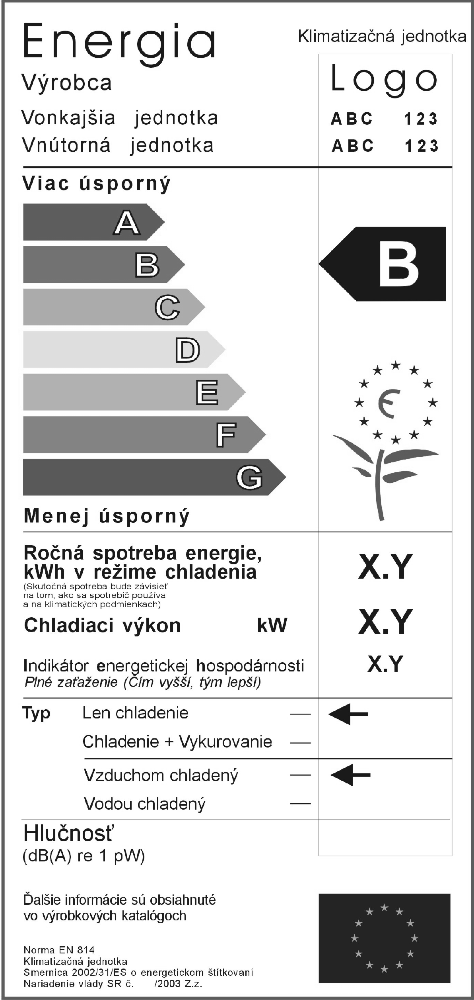
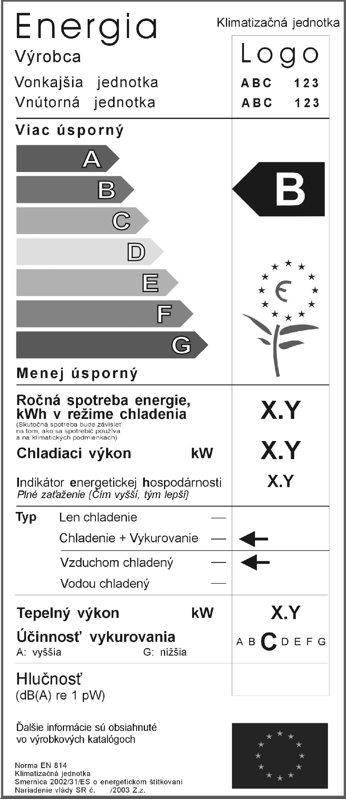
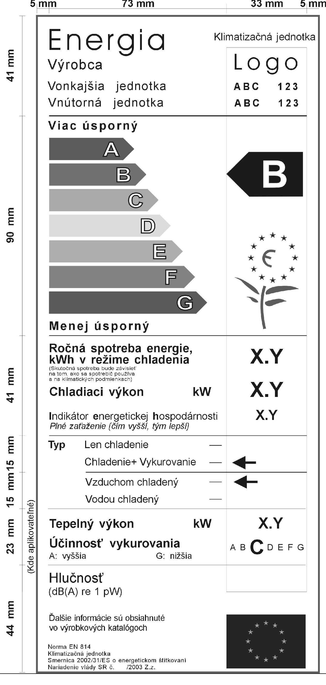

Príloha č. 2 k nariadeniu vlády č. 231/2003 Z. z.

- ENERGETICKÝ ŠTÍTOK

  - Štítok pre spotrebiče iba na chladenie - štítok č. 1

- 

  - Štítok pre spotrebiče iba na chladenie/vykurovanie - štítok č. 2

- 

- ÚDAJE NA ENERGETICKOM ŠTÍTKU

  - I. Meno alebo obchodná značka výrobcu alebo dovozcu.

  - II. Identifikačná značka modelu pre „delené a viacnásobne delené zariadenia“; uplatňuje sa identifikačná značka modelu vnútorných a vonkajších prvkov kombinácie, na ktorú sa vzťahujú čísla uvedené ďalej.

  - III. Trieda energetickej hospodárnosti modelu alebo kombinácie podľa prílohy č. 5. Trieda je uvedená vo výške príslušnej šípky. Šírka šípky obsahujúcej písmeno indikátora nebude menšia a zároveň väčšia ako dvojnásobok šírky šípok jednotlivých tried.

  - IV. Ekologická značka EÚ (Európsky kvet),1) ak bola klimatizačnej jednotke udelená. Toto uvedenie ekologickej značky EÚ nemá žiadny vplyv na plnenie požiadaviek na jej udelenie.

  - V. Indikatívna ročná spotreba energie vypočítaná s celkovým príkonom podľa harmonizovaných slovenských technických noriem2),3) podľa § 3 ods. 4, násobená priemerným použitím 500 hodín ročne v režime chladenia pri plnom zaťažení podľa skúšobného postupu podľa harmonizovaných slovenských technických noriem2),3) (podmienky T1 „stredná“).

  - VI. Chladiaci výkon klimatizačnej jednotky v kW v režime chladenia pri plnom zaťažení podľa skúšobného postupu podľa harmonizovaných slovenských technických noriem2),3) (podmienky T1 „stredný“).

  - VII. EER (indikátor energetickej hospodárnosti) spotrebiča v režime chladenia pri plnom zaťažení podľa skúšobného postupu podľa harmonizovaných slovenských technických noriem2),3) (podmienky T1 „stredný“).

  - VIII. Typ spotrebiča: len chladenie, chladenie/vykurovanie. Šípka sa umiestni v rovnakej rovine ako príslušná veľkosť.

  - IX. Režim chladenia: vzduchom chladený, vodou chladený. Šípka sa umiestni v rovnakej rovine ako príslušná veľkosť.

  - X. Iba pre klimatizačné jednotky s možnosťou vykurovania (štítok č. 2); tepelný výkon definovaný ako vykurovací výkon spotrebiča v kW v režime vykurovania pri plnom zaťažení podľa skúšobného postupu podľa harmonizovaných slovenských technických noriem2),3) (podmienky T1 + 7C).

  - XI. Iba pre klimatizačné jednotky s možnosťou vykurovania (štítok č. 2); trieda energetickej hospodárnosti v režime vykurovania podľa prílohy č. 5 vyjadrená na stupnici od A (vyššia) po G (nižšia), určená podľa skúšobného postupu podľa harmonizovaných slovenských technických noriem2),3) (podmienky T1 + 7C). Ak je možnosť vykurovania klimatizačnou jednotkou zabezpečená odporovým prvkom, potom koeficient výkonu COP má hodnotu 1.

  - XII. Hlučnosť klimatizačnej jednotky ustanovuje osobitný predpis.4)

  - 

    - Použité farby

    - CMYK - tyrkysová, fialová, žltá, čierna.

    - Príklad použitia farieb:

    - 07X0: 0 % tyrkysová, 70 % fialová, 100 % žltá, 0 % čierna.

    - Šípky:

    - A: X0X0,

    - B: 70X0,

    - C: 30X0,

    - D: 00X0,

    - E: 03X0,

    - F: 07X0,

    - G: 0XX0.

    - Farba rámčeka X070.

    - Farba podkladu šípky indikátora triedy energetickej hospodárnosti je čierna.

    - Celý text je čierny. Podklad je biely.
